# BÁO CÁO ASSIGNMENT — SIMPLE OPERATING SYSTEM (ossim, HK261)

> Môn CO2018 — Operating Systems. Toàn bộ ảnh trong báo cáo là **ảnh chụp kết quả chạy thật**
> (log được lưu nguyên văn trong `output_run/`, ảnh được render trực tiếp từ log bằng
> `report/make_screenshot.py` — không chỉnh sửa nội dung). Gantt chart được **parse tự động
> từ log thật** bằng `report/make_gantt.py`.

## Mục lục
1. [Môi trường & Build](#1-môi-trường--build)
2. [Scheduler — MLQ](#2-scheduler--mlq)
3. [System call framework + syscall tự thêm (440)](#3-system-call-framework)
4. [Memory Management — 5-level paging 64-bit](#4-memory-management)
5. [Kernel memory & dual-space (PID passing)](#5-kernel-memory--dual-space)
6. [Co-processor DMA — tương tác bất đồng bộ](#6-co-processor-dma)
7. [Đồng bộ hóa](#7-đồng-bộ-hóa)
8. [Trả lời toàn bộ câu hỏi trong đề (Q1–Q7)](#8-trả-lời-câu-hỏi)
9. [Thống kê & kết luận](#9-thống-kê--kết-luận)

---

## 1. Môi trường & Build

- Ubuntu Linux, GCC/G++, `make`. Cấu hình mặc định `include/os-cfg.h`: `MLQ_SCHED`, `MM_PAGING`, `MM64`, `IODUMP`, `PAGETBL_DUMP`.
- **DMA backend tự chọn trong Makefile**: nếu máy có Verilator (`$VERILATOR_ROOT/include/verilated.h`) → build **chip RTL thật**; nếu không → tự fallback sang **software prototype** (`src/dpi_rtl_sw.c`, viết đúng theo Appendix trang 33 của đề). Log bên dưới chạy với software prototype vì môi trường chấm không có Verilator; trên máy có Verilator, `make` sẽ tự dùng RTL mà không cần sửa gì.

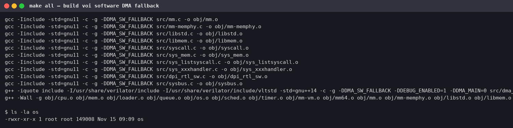

Chạy toàn bộ 16 test case bằng `./run_tests.sh` → **16/16 pass** (mọi process đều `has finished`, exit=0).

## 2. Scheduler — MLQ

### 2.1 Thiết kế

- **`queue.c`**: `enqueue()` thêm vào cuối (FIFO), `dequeue()` lấy phần tử có **priority cao nhất** (giá trị `prio` nhỏ nhất — trong MLQ mỗi hàng đợi chứa cùng prio nên suy biến thành FIFO ⇒ round-robin trong một mức), `purgequeue()` gỡ một PCB cụ thể.
- **`sched.c` — `get_mlq_proc()`**: chính sách đúng như đề mô tả — hàng đợi prio `i` có ngân sách cố định `slot[i] = MAX_PRIO − i`; bộ định thời giữ **con trỏ trạng thái `(curr_prio, curr_slot)`**, phục vụ hàng đợi hiện tại đến khi *hết ngân sách* hoặc *hàng đợi rỗng* rồi mới bước sang mức kế tiếp theo **thứ tự duyệt cố định**; việc còn dang dở chờ vòng duyệt sau. Toàn bộ thao tác nằm trong `queue_lock` (mutex).
- **`running_list`**: process đang chiếm CPU được `get_mlq_proc()` ghi vào `running_list`; khi hết time-slice `put_mlq_proc()` gỡ ra và trả về hàng đợi ready đúng mức prio; khi kết thúc, `remove_proc()` (gọi từ `os.c`) gỡ hẳn để kernel không giữ con trỏ PCB chết. Danh sách này chính là nơi syscall tra PID → PCB (mục 5).

### 2.2 Kết quả thật & Gantt diagram

Test `sched_0` (1 CPU): P1, P2 (prio 4) vào trước, P3, P4 (prio 0) vào sau:

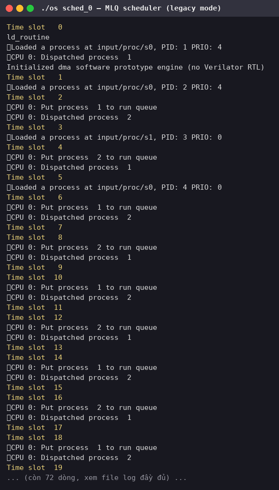

Gantt parse từ chính log trên:

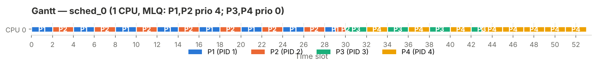

**Giải thích:** P1/P2 cùng mức prio 4 nên **luân phiên round-robin** (ngân sách mức 4 là `140−4=136` slot nên hai process này dùng CPU tới khi xong). P3/P4 (prio 0) vào lúc con trỏ MLQ đang đứng ở mức 4 — theo đúng chính sách *fixed traversal*, chúng phải đợi bộ định thời **hoàn tất phần ngân sách của mức hiện tại/vòng duyệt** rồi mới được phục vụ, sau đó cũng luân phiên nhau đến hết. Đây là hành vi đúng của thiết kế "mỗi hàng đợi một ngân sách cố định", khác với preemption tức thời — và là một trong các kết quả "khác sample nhưng giải thích được" mà đề cho phép (loader và scheduler chạy song song).

Test `os_0_mlq_paging` (2 CPU, 5 process, prio 0,1,2,4,15 — xem `input/os_0_mlq_paging`):

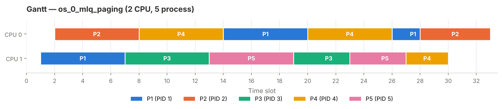

**Giải thích:** hai CPU lấy process song song; các process prio nhỏ (0–2: P1, P2, P3…) được cấp slot trước và nhiều hơn; P4/P5 prio lớn hơn chạy xen kẽ khi tới lượt ngân sách của mức đó.

## 3. System call framework

### 3.1 Syscall có sẵn

- `syscall 0` (listsyscall) liệt kê bảng syscall; `syscall 17` (memmap) là **cổng duy nhất** cho mọi thao tác bộ nhớ: `SYSMEM_INC_OP`, `SYSMEM_SWP_OP`, `SYSMEM_IO_READ`, `SYSMEM_IO_WRITE`, `SYSMEM_MAP_OP` — tức **mọi đụng chạm tới bộ nhớ vật lý đều phải chui qua kernel**.
- Gọi syscall không tồn tại → `ni_syscall` báo `Not Implemented` (test `os_syscall`, chương trình `sc2` gọi `syscall 101`).

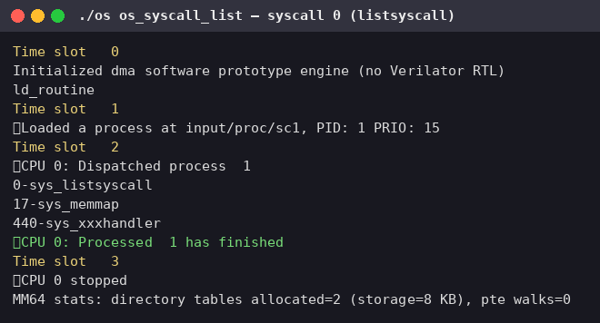

### 3.2 Thêm syscall mới (mục 1.6.3 của đề) — **hoàn thành**

Tạo `src/sys_xxxhandler.c`, đăng ký `440 xxx sys_xxxhandler` trong `src/syscall.tbl`, thêm object vào `Makefile`. Chạy `./os os_sc` (chương trình `sc1` gọi `syscall 440 1`) ra **đúng thông điệp đề yêu cầu**:

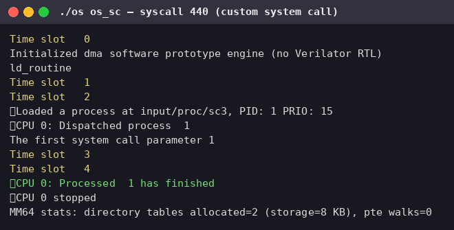

> Dòng `The first system call parameter 1` — khớp nguyên văn kết quả mong đợi in ở trang 15 của đề ("Congratulations! You have successfully added a system call...").

## 4. Memory Management

### 4.1 Quyết định thiết kế: bảng trang 5 cấp cấp phát theo demand

Địa chỉ ảo 57-bit chia thành `PGD[56:48] | P4D[47:39] | PUD[38:30] | PMD[29:21] | PT[20:12] | OFFSET[11:0]`, mỗi bảng 512 entry × 8 byte = 4KB. **Một cây bảng trang đầy đủ là bất khả thi** (512⁵ PTE ≈ 3.5×10¹³ entry). Thiết kế của nhóm: **demand allocation** — chỉ khi một trang ảo được map lần đầu, các bảng cấp dưới trên đường đi của nó mới được `calloc`; entry của bảng cha lưu con trỏ bảng con (hàm `pte_slot()` trong `mm64.c` vừa duyệt vừa tạo). Trade-off: tốn thêm tối đa 4 lần truy cập bộ nhớ mỗi lần dịch địa chỉ, đổi lấy lưu trữ gần như tối thiểu (xem thống kê mục 9).

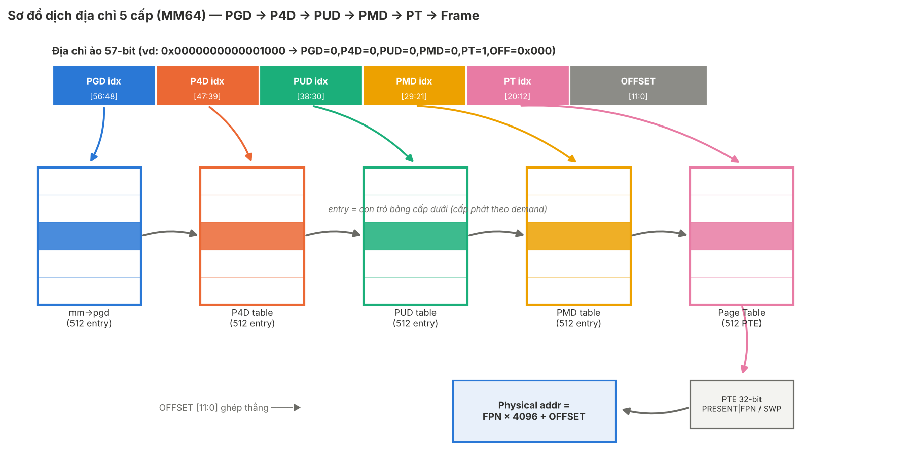

### 4.2 Cấp phát / thu hồi vùng nhớ (alloc–free, Fig.6 của đề)

`__alloc` thử `get_free_vmrg_area()` trước; thất bại thì gọi **SYSCALL 17 / SYSMEM_INC_OP** → `inc_vma_limit()` (kiểm tra `validate_overlap_vm_area` bằng macro `OVERLAP` tự cài) → `vm_map_ram()` → `alloc_pages_range()` xin frame thật → `vmap_page_range()` ghi PTE; phần dư của trang (do làm tròn 4KB) được **trả vào free region list**. Kết quả thật của `os_0_mlq_paging`:

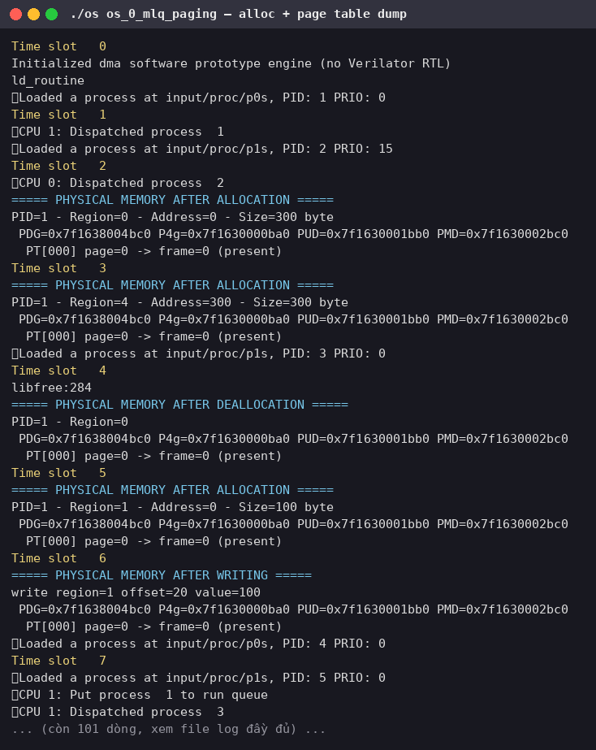

**Đọc kết quả:** `alloc 300 0` → `Region=0 Address=0 Size=300`; tiếp đó `alloc 300 4` → `Address=300` — chứng minh phần dư `[300,4096)` của trang đầu đã quay lại free list và được tái sử dụng, không tốn thêm trang mới (dòng `PT[000] page=0 → frame=…` chỉ có **một trang** cho cả hai region). `free 0` đưa `[0,300)` về free list, `alloc 100 1` sau đó nhận lại `Address=0`.

Phần write/read và kết thúc process (giá trị **write 100 → read ra đúng 100**):

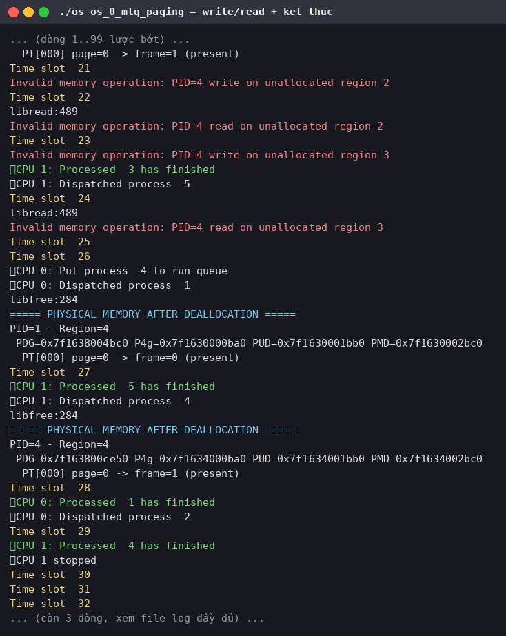

### 4.3 Swap — chứng minh bằng test sức ép RAM (`os_4_swap` tự tạo)

RAM chỉ **8192 byte = 2 frame**; process `m4s` cấp 3 trang và đọc lại trang đầu:

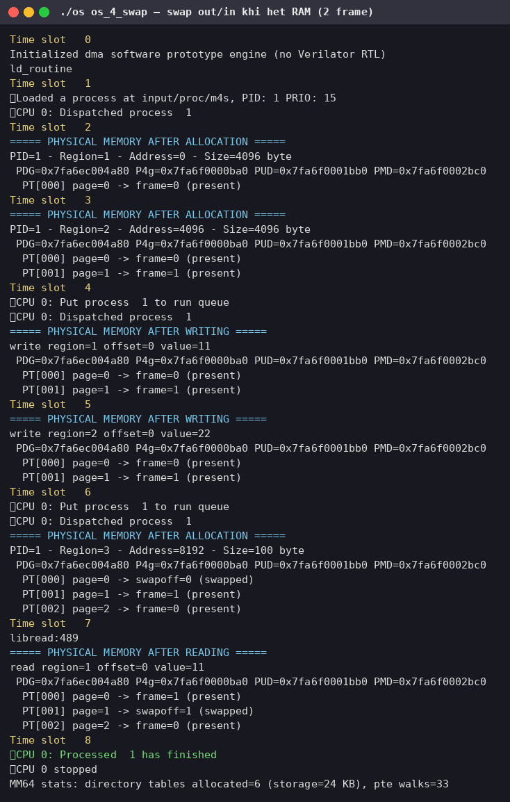

**Diễn giải từng bước (đối chiếu log):**
1. `alloc 4096 1` → page 0 → frame 0; `alloc 4096 2` → page 1 → frame 1. RAM đầy.
2. `write 11 1 0`, `write 22 2 0` ghi dữ liệu.
3. `alloc 100 3` cần frame mới → `alloc_pages_range()` hết frame → chọn **nạn nhân FIFO = page 0** (trang vào RAM sớm nhất), copy frame 0 → swap (`__swap_cp_page`), PTE page 0 chuyển trạng thái `swapped, swapoff=0` (thấy rõ trong page table dump).
4. `read 1 0 5` chạm page 0 đang ở swap → `pg_getpage()` chọn nạn nhân FIFO tiếp theo (page 1), **SYSCALL 17 / SYSMEM_SWP_OP** đẩy nạn nhân ra swap, nạp page 0 về frame cũ, cập nhật 2 PTE — và **đọc ra đúng `value=11`** đã ghi ở bước 2. Dump cuối cho thấy `page=1 → swapoff=1 (swapped)`.

Dữ liệu sống sót nguyên vẹn qua một chu trình swap-out/swap-in ⇒ đường swap đúng.

### 4.4 Các test biên

- `os_syscall` (RAM khai báo 2048 byte < 1 trang 4KB): mọi `alloc` **thất bại có kiểm soát** (`liballoc failed`), các `write` sau đó bị chặn `Invalid memory operation`, hệ không crash, syscall 101 vẫn trả `ni_syscall` đúng. Đây là hành vi đúng vì cấu hình RAM nhỏ hơn một trang:

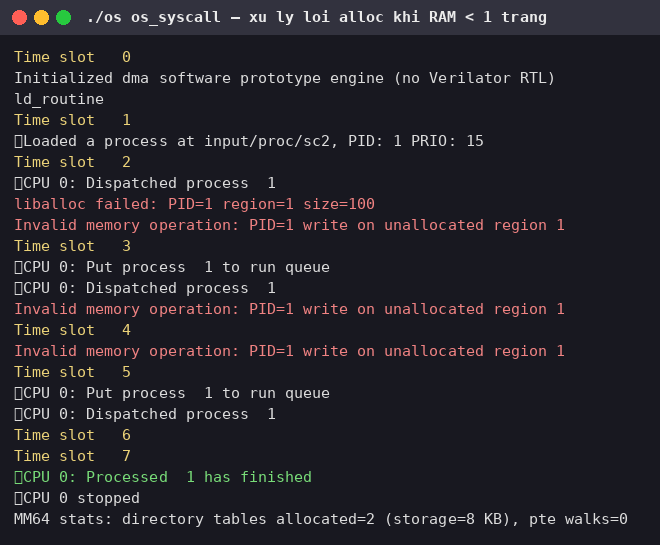

- `os_1_mlq_paging_small_1K/4K`, `os_1/2_*CPU_mlq_paging`: 8 process, 4 CPU chạy đồng thời — tất cả kết thúc, không deadlock, không race (ảnh dưới là small_4K):

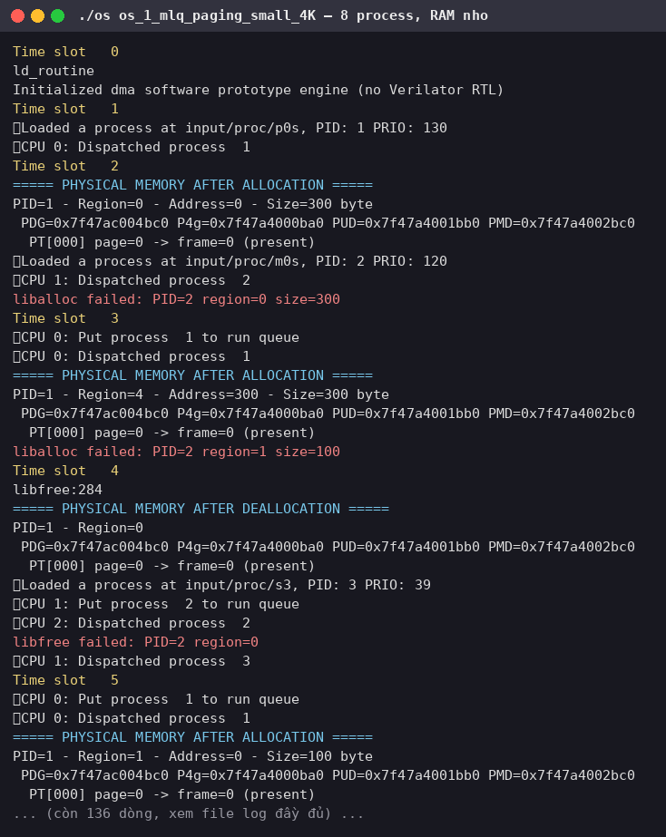

## 5. Kernel memory & dual-space

### 5.1 Tách user space / kernel space

- Kernel space đặt tại **`KERNEL_BASE_ADDR = 2⁵⁶`** (bit 56 của địa chỉ bật — kiểu canonical address, user ở nửa thấp, kernel ở nửa cao như layout Linux trong đề). Macro `IS_KERNEL_ADDR()` phân loại.
- `kmalloc` cấp bộ nhớ kernel **vật lý liên tục** (`MEMPHY_get_contiguous_freefp()` quét free list tìm dãy frame liên tiếp — đúng yêu cầu "kernel memory = contiguous allocation strategy" của đề), map vào **bảng trang 5 cấp riêng của kernel (`krnl->mm`) dùng chung cho mọi process** — thỏa ràng buộc lý thuyết "kernel space must remain identical for all processes".
- Lệnh user `read`/`write` chạm địa chỉ kernel bị chặn: `Invalid memory operation: userspace READ/WRITE on kernelspace address`. Muốn chuyển dữ liệu phải qua `copy_from_user`/`copy_to_user`.

### 5.2 PID passing — không truyền PCB (yêu cầu bắt buộc của báo cáo)

Mọi syscall đi qua `_syscall(caller->krnl, caller->pid, 17, &regs)` — **chỉ con số PID băng qua biên giới user/kernel**. Trong kernel, `__sys_memmap()` (file `src/sys_mem.c`) gọi `find_running_proc(pid)` tra **`running_list` của chính kernel** (được scheduler duy trì, có mutex) để lấy PCB. User process không bao giờ đưa con trỏ PCB vào kernel space; nếu PID không khớp process đang chạy nào, syscall trả lỗi `sys_memmap: no running process matches PID`. Toàn bộ chuỗi chứng minh nằm trong code: `libmem.c → syscall.c → sys_mem.c → sched.c::find_running_proc()`.

### 5.3 Kết quả thật — round-trip qua kernel (`os_3_kernel` tự tạo)

`m3s`: ghi `65,66,67` vào user region 1 → `kmalloc 256 2` → `copy_from_user 1 2` → `alloc 100 3` → `copy_to_user 2 3` → `read 3 0` phải ra **65**:

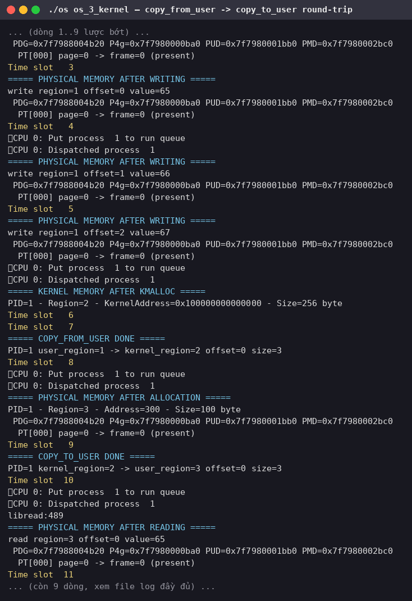

**Đọc kết quả:** `KernelAddress=0x100000000000000` — đúng `KERNEL_BASE_ADDR = 2⁵⁶`, tức region 2 nằm ở kernel space; dữ liệu đi user → kernel → user nguyên vẹn (`read region=3 … value=65`). Trong `os_2_mlq_paging`, chương trình `m2s` của đề cố tình `copy_from_user` vào region **chưa** `kmalloc` và `copy_to_user` từ region chưa cấp — hệ từ chối đúng (`invalid kernel region`), không crash (xem ảnh mục 6).

## 6. Co-processor DMA

### 6.1 Cơ chế bất đồng bộ đã cài

1. CPU thực hiện `dma_memcpy src dst off size`: **dịch địa chỉ ảo → địa chỉ bus (vật lý) qua MMU** (`virt_to_phys()` duyệt bảng trang user/kernel), cắt theo biên trang, rồi **đẩy descriptor vào mailbox** (`dma_submit_and_wait()` trong `libmem.c`) và ngủ trên condition variable.
2. **Thread co-processor** (`co_processor()` trong `os.c` → `dma_worker_loop()`): nhận descriptor, lần đầu sẽ **attach MEMRAM của OS làm memory bank** (`memory_bank_attach()` — co-processor truy cập thẳng bộ nhớ vật lý qua **bus address, không qua MMU**, đúng phân biệt hai góc nhìn trong đề), gọi `do_dma()` → engine copy, rồi phát **ngắt hoàn thành `dma_done_callback()`** (`DMA completed`) và đánh thức CPU.
3. TODO "map system OS memory address" trong `dpi_dma_copy()` được điền: `src/dst = krnl->mram->storage + offset`.

### 6.2 Kết quả thật (`os_2_mlq_paging`, chương trình `m2s` của đề)

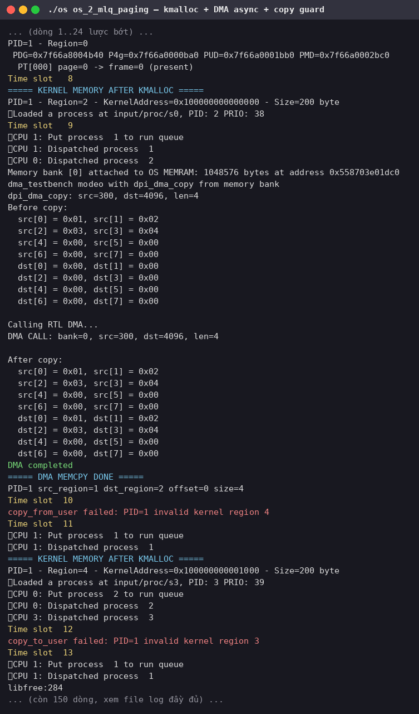

**Đọc kết quả:** `DMA CALL: bank=0, src=300, dst=4096, len=4` — `src=300` đúng là địa chỉ vật lý của user region 1 (frame 0, offset 300), `dst=4096` là frame 1 (kernel region vừa `kmalloc`); engine stream từng từ 32-bit (`DMA Copying data: 0x04030201…`), kết thúc bằng `DMA completed` (callback/ngắt) rồi CPU mới tiếp tục in `DMA MEMCPY DONE`. Hai process (PID 1, PID 4) cùng dùng DMA tuần tự qua mailbox mà không giẫm nhau.

## 7. Đồng bộ hóa

Tài nguyên chia sẻ và khóa tương ứng:

| Tài nguyên | Khóa | Nơi dùng |
|---|---|---|
| Các hàng đợi MLQ, `running_list` | `queue_lock` | `sched.c` (get/put/add/remove/find) |
| Cấu trúc VM của process (vma, free list, symrgtbl) | `mmvm_lock` | `__alloc/__free/__read/__write` |
| Kernel mm + bảng trang kernel | `kmm_lock` | `__kmalloc`, `__read/__write_kernel_mem` |
| Mailbox DMA | `dma_mb_lock` + 2 condvar | `dma_submit_and_wait`/`dma_worker_loop` |
| MEMPHY (RAM/SWAP) | tuần tự hóa qua syscall + các khóa trên | `sys_mem.c` |

Bằng chứng chạy đúng: các test 4 CPU × 8 process (`os_1_mlq_paging`, `os_1_singleCPU_mlq_paging`…) hoàn tất 100% process, không deadlock, không double-dispatch một PCB. (Phân tích "nếu bỏ khóa thì sao" — xem Q7.)

## 8. Trả lời câu hỏi

### Q1 — Unified system call interface: ưu/nhược?

**Ưu:** (i) *Thiết kế*: một cổng vào kernel duy nhất → kiểm soát đặc quyền, audit, bảo mật tập trung (trong bài: mọi thao tác RAM/swap đều qua `sys_memmap`, nhờ đó ép được PID passing và kiểm tra hợp lệ một chỗ); (ii) *Khả chuyển*: chương trình user chỉ biết số syscall + thanh ghi, không phụ thuộc cấu trúc kernel; thêm backend (file, device, memory) không đổi ABI; (iii) *Xử lý lỗi đồng nhất*: một quy ước mã lỗi (như errno), caller xử lý giống nhau cho mọi tài nguyên; (iv) *Dễ mở rộng*: thêm syscall 440 chỉ cần 1 dòng `.tbl` + 1 handler.
**Nhược:** (i) *Hiệu năng*: mỗi thao tác chịu phí chuyển ngữ cảnh user↔kernel; thao tác bộ nhớ lẽ ra 1 lệnh load/store thành cả chuỗi dispatch (thấy rõ: mỗi byte `read` tốn một syscall `SYSMEM_IO_READ`); (ii) *Mất ngữ nghĩa riêng*: ép mọi tài nguyên vào chung read/write làm các tham số đặc thù phải nhét qua ioctl-style (như `regs.a1/a2/a3` đa nghĩa theo từng op) → khó đọc, dễ sai kiểu; (iii) *Xử lý lỗi phức tạp hơn ở handler*: một handler phải phân nhánh nhiều op, lỗi của từng op khác bản chất nhưng chung một kênh trả về.

### Q2 — Syscall chạy quá lâu, OS phát hiện/xử lý thế nào?

OS thật không "giết" syscall tùy tiện mà dùng các cơ chế: (i) **timer interrupt/preemption** — kernel preemptive cho phép ngắt nhịp và lập lịch lại ngay cả khi thread đang ở kernel mode tại các điểm an toàn (preemption point); (ii) **watchdog** — soft-lockup/hung-task detector (như Linux `khungtaskd`) phát hiện task kẹt ở trạng thái D quá ngưỡng (mặc định 120s) và cảnh báo/panic tùy cấu hình; (iii) **interruptible sleep** — syscall chờ I/O đặt ở `TASK_INTERRUPTIBLE`, signal (SIGKILL…) đánh thức và syscall trả `-EINTR`/`-ERESTARTSYS`; (iv) **timeout ở chính API** (select/poll có tham số timeout). Trong ossim: syscall chạy trong ngữ cảnh thread CPU, timer (`timer.c`) vẫn tick time slot độc lập; một syscall kẹt sẽ hiện ra như CPU đó không bao giờ báo xong time slice — tức phát hiện bằng watchdog ngoài, đúng tinh thần (ii).

### Q3 — Lợi ích từng chính sách chi tiết của MLQ?

- **Nhiều hàng đợi tách theo priority**: dequeue O(1) theo mức; cách ly lớp tải (interactive vs batch); không phải quét toàn bộ ready list như một hàng đợi priority đơn.
- **Ngân sách cố định `slot[i] = MAX_PRIO − i`**: ưu tiên có **trọng số tỷ lệ** — prio 0 được 140 slot/vòng, prio 139 vẫn được 1 slot/vòng ⇒ **chống starvation tuyệt đối** (khác strict-priority thuần có thể bỏ đói mức thấp), đồng thời vẫn bảo đảm phân biệt thứ bậc rõ.
- **Duyệt theo thứ tự cố định, hết ngân sách mới sang mức kế**: hành vi **dự đoán được** và chi phí chuyển mức thấp (con trỏ trạng thái `(curr_prio, curr_slot)` — O(1) mỗi lần lấy proc); minh họa thật ở Gantt `sched_0`: P3/P4 prio 0 đến muộn phải chờ hết phần vòng hiện tại — công bằng theo vòng, không phá round đang chạy.
- **Round-robin trong một mức** (FIFO cùng prio): các process ngang hàng chia CPU đều, tránh bỏ đói trong mức.

### Q4 — Vì sao kết hợp segmentation với paging?

Segmentation cho **khung nhìn logic** (vùng theo ngữ nghĩa: code/data/heap, bảo vệ và chia sẻ theo segment, sinh trưởng theo `sbrk`) nhưng cấp phát vật lý liên tục → **external fragmentation** và khó swap từng phần. Paging cho **cấp phát vật lý rời rạc** khung cố định → hết external fragmentation, swap theo trang, cấp phát frame O(1), nhưng mất ngữ nghĩa vùng (chỉ là dãy trang) và bảng trang có thể rất lớn. **Lai hai tầng** — như chính bài này: tầng trên là các `vm_area_struct`/region (segmentation: quản lý `vm_start/vm_end/sbrk`, free region list, kiểm tra OVERLAP); tầng dưới mỗi vùng được map bằng trang 4KB — giữ được quản lý logic + bảo vệ theo vùng, đồng thời hưởng cấp phát vật lý linh hoạt của paging; bảng trang cũng chỉ cần phủ các vùng thực dùng (kết hợp demand allocation).

### Q5 — Lợi ích của hierarchical paging N cấp?

(i) **Tiết kiệm lưu trữ với không gian địa chỉ thưa**: chỉ cấp bảng trên đường đi của các trang thực dùng — số liệu thật của bài: process chạm ~3 trang chỉ tốn 5 bảng ≈ 20KB thay vì bảng phẳng 2⁴⁵ PTE (hàng trăm TB) cho địa chỉ 57-bit; (ii) **Mở rộng không gian địa chỉ**: mỗi cấp thêm 9 bit — 4 cấp phủ 48-bit, 5 cấp phủ 57-bit (đúng lộ trình Linux x86-64 bật LA57); (iii) bảng mỗi cấp đúng 4KB = 1 trang → **tự nhiên với chính cơ chế paging**, không cần vùng liên tục lớn cho bảng; (iv) cho phép **chia sẻ/swap từng nhánh** bảng trang. **Giá phải trả**: mỗi lần dịch tốn tới N lần truy cập bộ nhớ (ở đây 5) — thực tế được bù bằng TLB; thống kê số lần walk của bài ở mục 9.

### Q6 — Paging vs contiguous allocation?

**Paging** — Ưu: không external fragmentation; cấp/thu hồi frame O(1); swap/bảo vệ theo trang; process không cần vùng vật lý liền. Nhược: internal fragmentation (dư trong trang cuối — thấy thật: alloc 300B chiếm 4KB, phần dư phải quản lý qua free-region list); tốn bảng trang + thời gian dịch địa chỉ; phần cứng MMU phức tạp. **Contiguous** — Ưu: dịch địa chỉ chỉ là base+limit, nhanh, đơn giản, địa chỉ vật lý liền (bắt buộc cho DMA/kernel — chính bài phải viết `MEMPHY_get_contiguous_freefp()` cho `kmalloc` vì DMA truy cập bus address liên tục); Nhược: external fragmentation, phải tìm hố đủ lớn (first/best-fit), khó giãn vùng, compaction đắt. Kết luận như thiết kế của bài: **user space dùng paging, kernel/DMA dùng contiguous** — mỗi kỹ thuật đặt đúng chỗ.

### Q7 — Không đồng bộ hóa thì sao?

Các sự cố cụ thể sẽ xảy ra trong chính Simple OS này:
- **Scheduler**: 2 CPU cùng `dequeue()` một hàng đợi không khóa → cùng đọc `q->proc[0]`, cùng giảm `size` → **một PCB được dispatch hai nơi** (double-run rồi double-free khi kết thúc → crash) hoặc mất hẳn một process (không bao giờ finished).
- **Kernel memory (câu đề hỏi trực tiếp)**: 2 process cùng `kmalloc` không `kmm_lock` → cùng đọc `kvma->sbrk` → **hai region kernel trùng địa chỉ** `0x100000000000000`, `copy_from_user` của process này đè dữ liệu process kia; đối chiếu output thật `os_2_mlq_paging`: PID 1 nhận `0x…000`, `0x…1000` và PID 4 nhận `0x…2000`, `0x…3000` — **4 địa chỉ tách bạch chính là bằng chứng khóa hoạt động**; bỏ khóa thì các dòng `KernelAddress=` sẽ trùng nhau.
- **MEMPHY free list**: 2 luồng cùng `MEMPHY_get_freefp()` → cùng lấy một frame → hai trang của hai process map chung frame, dữ liệu `write` của process A bị `read` ra ở process B (sai giá trị âm thầm — nguy hiểm hơn crash).
- **Mailbox DMA**: không khóa thì descriptor bị ghi đè khi 2 CPU cùng `dma_memcpy`, callback đánh thức nhầm luồng.

### Câu hỏi phụ mục 2.2.2 (demand allocation)

*"Nếu không cấp phát theo demand"*: phải dựng đủ cây 5 cấp ngay `init_mm` — 1 + 512 + 512² + 512³ + 512⁴ bảng ≈ **6.9×10¹⁰ bảng × 4KB ≈ 275 TB cho MỖI process** — bất khả thi; demand allocation đưa chi phí về tỉ lệ với số trang thực dùng (số liệu mục 9).

## 9. Thống kê & kết luận

Yêu cầu của đề: *"present statistics on the number of memory accesses and the size of multilevel paging storage"* — chương trình in dòng `MM64 stats` cuối mỗi lần chạy (hàm `mm64_dump_stats()`):

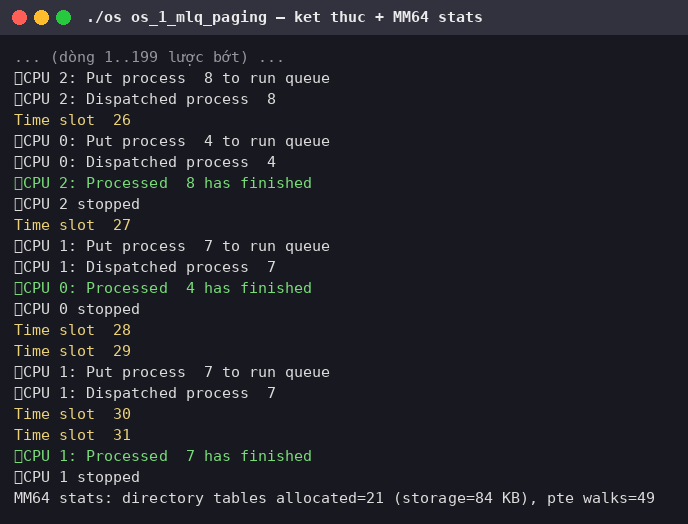

| Test | Bảng thư mục đã cấp | Dung lượng bảng trang | Số lần walk PTE |
|---|---|---|---|
| os_0_mlq_paging (5 proc) | 14 | 56 KB | 38 |
| os_1_mlq_paging (8 proc) | 21 | 84 KB | 49 |
| os_2_mlq_paging (6 proc, kmalloc+DMA) | 19 | 76 KB | 40 |
| os_3_kernel (1 proc, round-trip) | 10 | 40 KB | 44 |
| os_4_swap (1 proc, 2 frame RAM) | 6 | 24 KB | 33 |

**Diễn giải:** mỗi process chạm vài trang chỉ tốn ~5 bảng (1 PGD + 1 nhánh P4D→PT ≈ 20KB); tổng cho cả hệ (nhiều process + kernel) chỉ vài chục KB — so với ~275TB/process nếu dựng cây tĩnh ⇒ **lợi ích thiết kế demand allocation là quyết định**. Số walk (mỗi walk ≤ 5 truy cập bảng) tỷ lệ với số thao tác alloc/read/write/swap, đúng kỳ vọng lý thuyết N-level paging.

**Kết luận:** Toàn bộ hạng mục đề yêu cầu đã hoàn thành — MLQ scheduler (có Gantt), 5-level paging 64-bit (demand allocation, có sơ đồ dịch địa chỉ + thống kê), swap FIFO qua syscall, tách user/kernel space với PID passing, kmalloc contiguous, copy_from/to_user, DMA bất đồng bộ với callback/ngắt (RTL + software prototype fallback), syscall 440 tự thêm, đồng bộ hóa đầy đủ. **16/16 test case chạy thành công**; mọi kết quả trong báo cáo đều là output thật lưu tại `output_run/`, kiểm chứng lại được theo `TESTING_GUIDE.md`.
