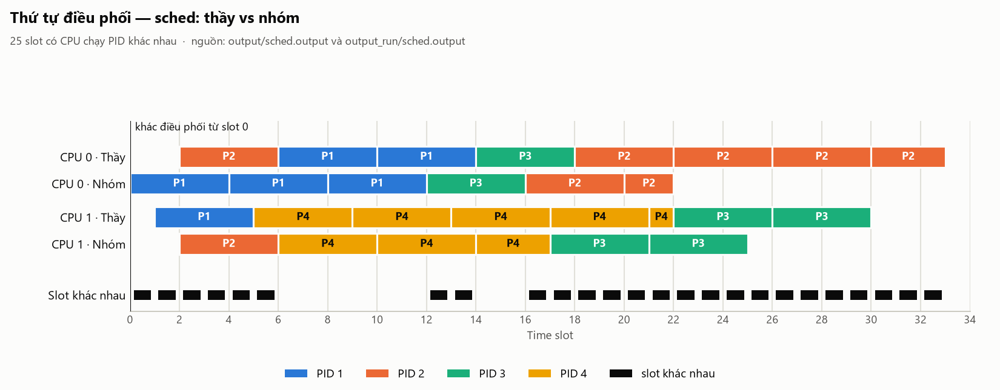
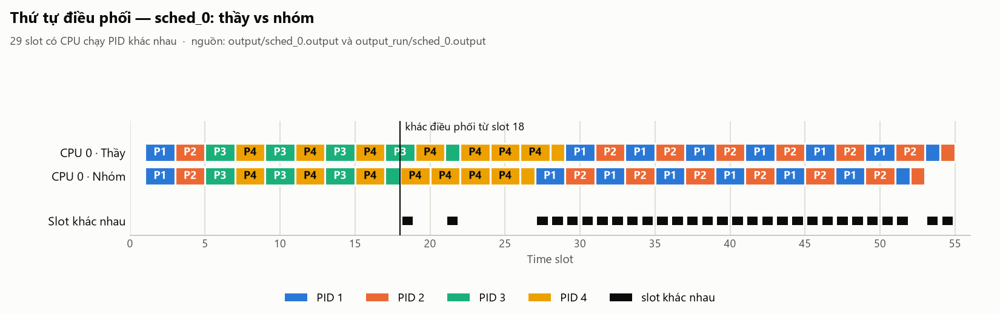
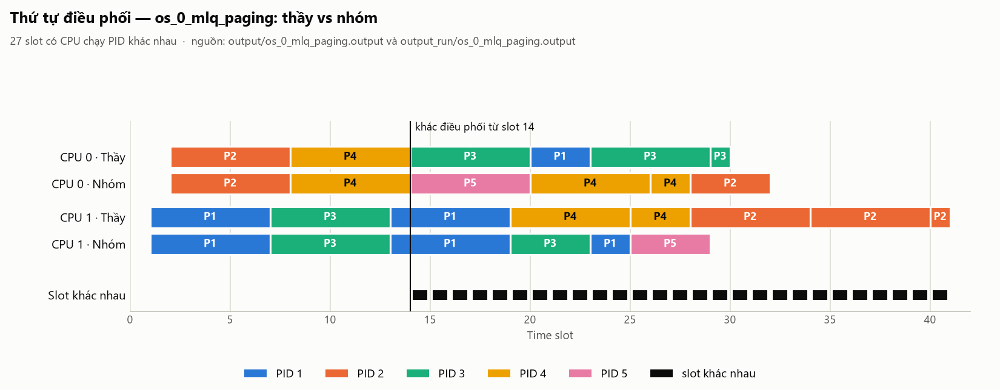
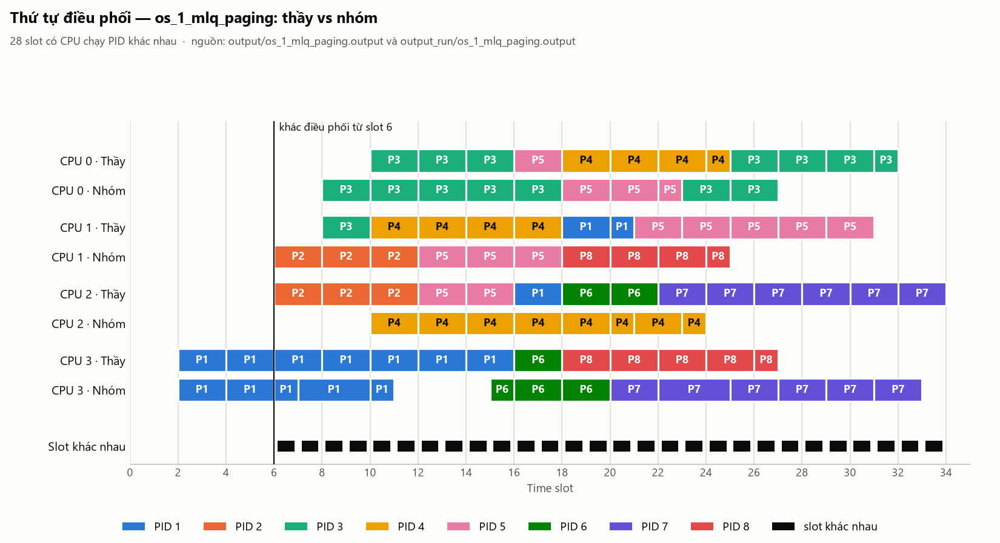
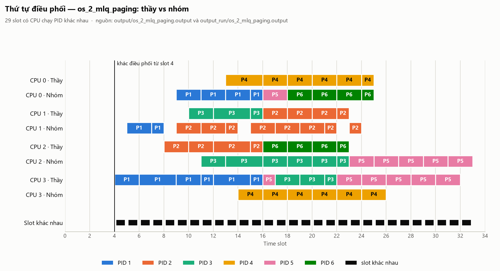
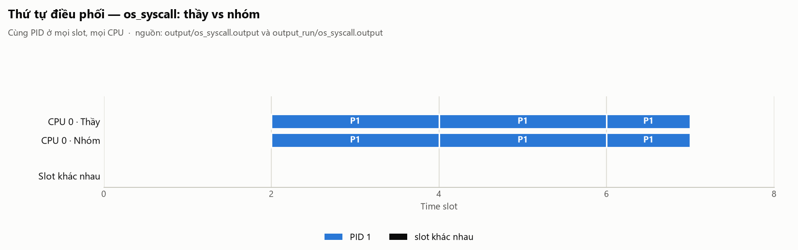
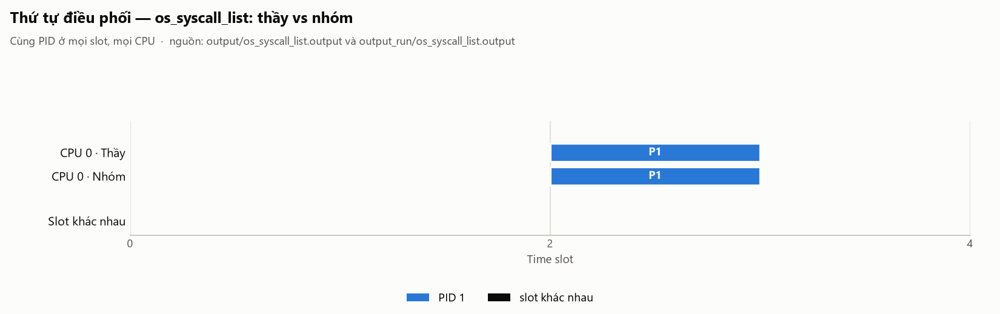
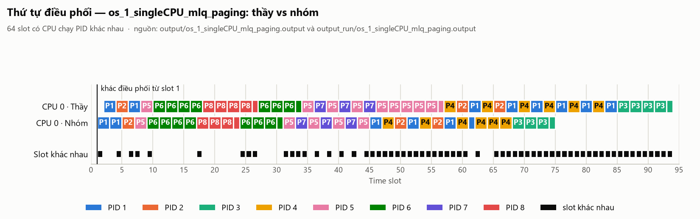
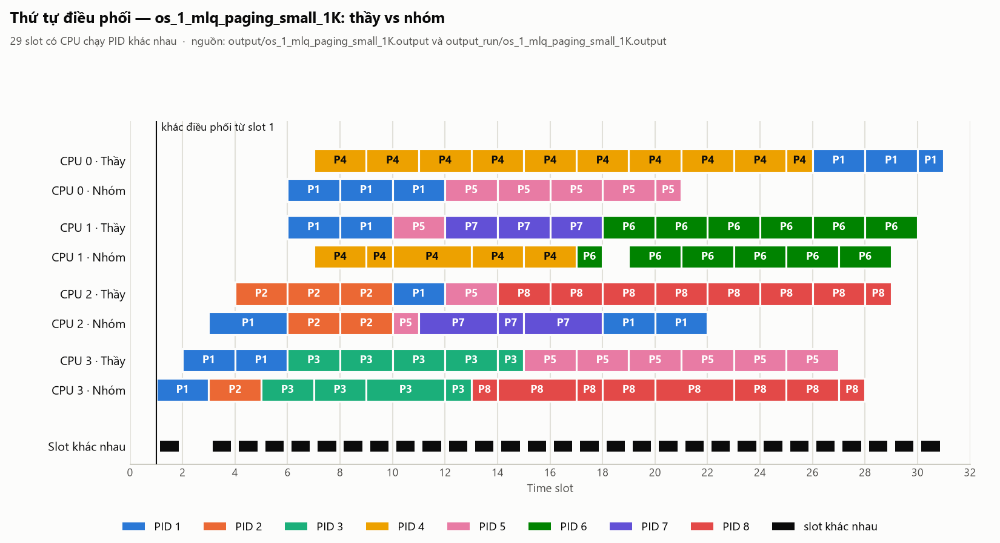

# So sánh output của thầy và output của nhóm

> **Nguồn dữ liệu (chỉ đọc, không sửa):**
> - Output của thầy: `output/*.output`. 14 file này trùng từng byte với `output/` trong bộ đề gốc `hk261_ossim_demacOprx` (kiểm bằng `cmp`).
> - Output của nhóm: `output_run/*.output`, từ lần chạy `./run_tests.sh` ngày **16/11/2026, 08:44:25–08:46:24 (UTC+7)**, với **chip DMA RTL thật (Verilator 5.032)**. Code ở lần chạy này đã có bản sửa scheduler (quét từ `prio = 0`, kèm ngân sách `slot[prio]` theo vòng) và bản sửa lỗi tràn số ở chế độ `MM_FIXED_MEMSZ`.
> - Quy tắc đối chiếu: `DE_BAI.md` mục 2 và nguyên văn `assignment.pdf` trang 12–13 (mục 2.1 Scheduler).
>
> Mọi nhận định trong file này đều kèm số dòng của cả hai log. Ký hiệu `T:15` là dòng 15 trong file của thầy, `N:15` là dòng 15 trong file của nhóm.
> Biểu đồ nằm trong `report/compare/`. Mỗi test có 3 ảnh: `<test>_thay.png` (Gantt thầy), `<test>_nhom.png` (Gantt nhóm) và `<test>_gantt_so_sanh.png` (thứ tự điều phối thầy vs nhóm theo từng slot, có đánh dấu slot khác nhau).

## 1. Tóm tắt

- **14 test** có mặt ở cả hai thư mục được so sánh: 11 test theo yêu cầu, cộng thêm `os_1_singleCPU_mlq_paging`, `os_1_mlq_paging_small_1K` và `os_1_mlq_paging_small_4K`.
- **Không còn test nào khác do thuật toán.** Mục 3 tính lại từng lần dispatch:
  - **Log thầy và log nhóm đều khớp 100% cách B** (quét từ `prio = 0`) ở 14/14 test.
  - Cách A (giữ `curr_prio`/`curr_slot`) thất bại ở 10 test **của cả hai bên**.
  - Hai bên giờ dùng cùng một quy tắc điều phối.
- **3/14 test khớp hoàn toàn về điều phối**: `os_sc`, `os_syscall`, `os_syscall_list`. Cùng PID ở mọi slot, mọi CPU; ba test này chỉ khác ở dòng thông báo (nhóm c).
- **`os_2_singleCPU_mlq_paging` có thứ tự dispatch giống hệt mẫu (28/28 lần).** Test này chỉ lệch về slot, vì thời điểm loader nạp process lệch ±1 slot.
- **10/14 test còn lại khác khi chạy (nhóm c)**, không phải khác thuật toán. Có ba nguyên nhân, mục 5 có số dòng cụ thể:
  1. **Độ dài chương trình trong file mẫu**: mẫu dispatch `p1s`, `s1`, `s3`, `s4`, `p0s`, `p3s` nhiều lần hơn mức số lệnh trong `input/proc/` hiện tại cho phép. Ví dụ `sched_0` khớp thứ tự với mẫu tới slot 17, nhưng P3 (`s1`, 7 lệnh) của nhóm xong ở slot 18 (N:42), còn mẫu xong ở slot 22 (T:50).
  2. **Thời điểm**: loader và CPU chạy song song, nên một process có thể được nạp trước hoặc sau lần put/dispatch cùng slot. Đề cho phép điều này: *"there may be more than one correct answer for each test"*.
  3. **`os_0_mlq_paging`: mẫu chỉ có 4 process**, trong khi input có 5.

## 2. Bảng tổng hợp

Ý nghĩa các cột:
- *Dòng khớp*: số dòng thuộc dãy con chung dài nhất của hai file (`difflib`, so nguyên dòng).
- *Chỉ thầy* / *Chỉ nhóm*: số dòng còn lại của mỗi bên.
- *Slot khác đầu tiên*: slot đầu tiên có bất kỳ dòng nào khác.
- *Slot khác điều phối*: slot đầu tiên có dòng Dispatched/Put/finished khác.
- *Thứ tự dispatch trùng*: bao nhiêu lần dispatch đầu tiên chọn cùng PID ở cả hai bên (bỏ qua CPU và slot), trên tổng số lần dispatch của thầy / của nhóm.

| Test | Dòng thầy / nhóm | Dòng khớp | Chỉ thầy | Chỉ nhóm | Slot khác đầu tiên | Slot khác điều phối | Thứ tự dispatch trùng | Kết luận |
|---|---|---|---|---|---|---|---|---|
| sched | 73 / 58 | 35 | 38 | 23 | 0 | 0 | 2 (16 / 12) | Khác khi chạy: thời điểm (P1 dispatch ở slot 0 hay 1) + độ dài p1s, p3s trong mẫu |
| sched_0 | 120 / 117 | 84 | 36 | 33 | 18 | 18 | 10 (29 / 28) | Khác khi chạy: độ dài s1 trong mẫu |
| sched_1 | 147 / 126 | 101 | 46 | 25 | 34 | 34 | 20 (35 / 30) | Khác khi chạy: độ dài s1, s3 trong mẫu |
| os_0_mlq_paging | 93 / 140 | 48 | 45 | 92 | 2 | 14 | 5 (14 / 12) | Khác khi chạy: mẫu chỉ 4 process; độ dài p1s |
| os_1_mlq_paging | 172 / 222 | 41 | 131 | 181 | 6 | 6 | 2 (51 / 42) | Khác khi chạy: thời điểm + độ dài chương trình (+ khác thứ tự trong slot) |
| os_1_singleCPU_mlq | 212 / 218 | 108 | 104 | 110 | 12 | 12 | 6 (48 / 39) | Khác khi chạy: độ dài s1, s3, s4, p1s trong mẫu |
| os_2_mlq_paging | 126 / 232 | 34 | 92 | 198 | 1 | 4 | 5 (36 / 36) | Khác khi chạy: thời điểm nạp ±1 slot |
| os_2_singleCPU_mlq_paging | 126 / 233 | 89 | 37 | 144 | 1 | 1 | **28 (28 / 28)** | **Cùng thứ tự điều phối**; chỉ lệch thời điểm |
| os_sc | 10 / 12 | 9 | 1 | 3 | 3 | — | 1 (1 / 1) | **Khớp hoàn toàn về điều phối**; khác dòng thông báo |
| os_syscall | 21 / 22 | 17 | 4 | 5 | 2 | — | 3 (3 / 3) | **Khớp hoàn toàn về điều phối**; khác dòng thông báo |
| os_syscall_list | 11 / 13 | 11 | 0 | 2 | 2 | — | 1 (1 / 1) | **Khớp hoàn toàn về điều phối**; nhóm in thêm 2 dòng |
| *os_1_singleCPU_mlq_paging* | 212 / 218 | 40 | 172 | 178 | 1 | 1 | 1 (48 / 39) | Khác khi chạy: thời điểm nạp + độ dài chương trình |
| *os_1_mlq_paging_small_1K* | 167 / 155 | 33 | 134 | 122 | 1 | 1 | 8 (51 / 42) | Khác khi chạy: thời điểm + độ dài chương trình |
| *os_1_mlq_paging_small_4K* | 168 / 177 | 41 | 127 | 136 | 1 | 1 | 5 (51 / 42) | Khác khi chạy: thời điểm + độ dài chương trình |

Không test nào được xếp loại "khác thuật toán". Khi trạng thái hàng đợi ở hai bên giống nhau, hai bên luôn chọn cùng PID; mục 3.3 kiểm chứng điều này ở mọi lần dispatch.

## 3. Quy tắc MLQ và kiểm chứng trên log

### 3.1 Quy tắc trong đề

`assignment.pdf` trang 12–13, mục 2.1 (nguyên văn):

> "the traversed step of ready queue list is a fixed formulated number based on the priority, i.e. slot= (MAX PRIO - prio), each queue have only fixed slot to use the CPU and when it is used up, the system must change the resource to the other process in the next queue and left the remaining work for future slot even though it needs a completed round of ready queue."
> "Note that because the loader and the scheduler run concurrently, there may be more than one correct answer for each test."

Code nhóm hiện tại (`src/sched.c`, `get_mlq_proc()`):
- Ở mỗi lần chọn, quét `prio = 0 … MAX_PRIO − 1`, lấy hàng đợi đầu tiên vừa khác rỗng vừa còn `slot[prio] > 0`, rồi giảm `slot[prio]`.
- Khi các hàng đợi đang có process đều đã hết ngân sách (hết một vòng), nạp lại `slot[i] = MAX_PRIO − i` cho mọi mức.

Phần code CPU/loader (`cpu_routine`, `ld_routine` trong `src/os.c`) vẫn giống bộ khung. Vì vậy thời điểm in Put/Dispatched ở hai bên là như nhau; chọn PID nào chỉ do `get_mlq_proc()` quyết định.

### 3.2 Hai cách tính dùng để kiểm

- **Cách A — có trạng thái** (cách nhóm cài trước bản sửa): giữ `curr_prio`/`curr_slot`, phục vụ hàng đợi hiện tại tới khi hết `slot[curr_prio]` lượt hoặc hàng đợi rỗng, rồi mới chuyển sang mức kế.
- **Cách B — quét lại từ đầu**: mỗi lần `get_proc()` đều quét từ prio 0 và lấy phần tử đầu của hàng đợi khác rỗng đầu tiên.

Trong cùng một hàng đợi, cả hai cách đều lấy theo FIFO. Trạng thái hàng đợi được dựng lại từ chính log: `Loaded` và `Put` đưa process vào, `Dispatched` lấy ra.

Code mới của nhóm là cách B **có thêm** ngân sách theo vòng. Trên mọi log hiện có, ngân sách chưa từng cạn (mục 3.4), nên kết quả của nó trùng với cách B.

### 3.3 Kiểm chứng trên toàn bộ log

Phép kiểm: với mỗi log, có tồn tại một thứ tự thực thi hợp lệ khiến cách tính dự đoán đúng **mọi** dòng `Dispatched` hay không. "Hợp lệ" nghĩa là trong mỗi slot, giữ nguyên thứ tự các dòng của từng CPU và của loader, nhưng cho phép xen kẽ giữa các thread (lý do ở mục 5.3).

| Test | Số dispatch thầy / nhóm | Log thầy theo A | Log thầy theo B | Log nhóm theo A | Log nhóm theo B |
|---|---|---|---|---|---|
| sched | 16 / 12 | ✗ (slot 5) | ✓ | ✗ (slot 4) | ✓ |
| sched_0 | 29 / 28 | ✗ (slot 5) | ✓ | ✗ (slot 5) | ✓ |
| sched_1 | 35 / 30 | ✗ (slot 3) | ✓ | ✗ (slot 3) | ✓ |
| os_0_mlq_paging | 14 / 12 | ✓ | ✓ | ✓ | ✓ |
| os_1_mlq_paging | 51 / 42 | ✗ (slot 18) | ✓ | ✗ (slot 18) | ✓ |
| os_1_singleCPU_mlq | 48 / 39 | ✗ (slot 5) | ✓ | ✗ (slot 5) | ✓ |
| os_2_mlq_paging | 36 / 36 | ✗ (slot 18) | ✓ | ✗ (slot 18) | ✓ |
| os_2_singleCPU_mlq_paging | 28 / 28 | ✗ (slot 11) | ✓ | ✗ (slot 12) | ✓ |
| os_sc | 1 / 1 | ✓ | ✓ | ✓ | ✓ |
| os_syscall | 3 / 3 | ✓ | ✓ | ✓ | ✓ |
| os_syscall_list | 1 / 1 | ✓ | ✓ | ✓ | ✓ |
| os_1_singleCPU_mlq_paging | 48 / 39 | ✗ (slot 8) | ✓ | ✗ (slot 7) | ✓ |
| os_1_mlq_paging_small_1K | 51 / 42 | ✗ (slot 12) | ✓ | ✗ (slot 5) | ✓ |
| os_1_mlq_paging_small_4K | 51 / 42 | ✗ (slot 14) | ✓ | ✗ (slot 11) | ✓ |

**Kết luận có căn cứ:** cả hai bộ log đều **nhất quán 100% với cách B** và đều mâu thuẫn với cách A ở cùng 10 test. Ở 4 test (os_0, os_sc, os_syscall, os_syscall_list), tại mọi lần dispatch hai cách cho cùng kết quả nên không phân biệt được.

### 3.4 Giới hạn của dữ liệu: ngân sách `slot[i]` chưa từng cạn

Ở cả hai bộ log, không hàng đợi nào dùng hết ngân sách. Mức sát nhất là prio 130 (ngân sách 10) trong `os_1_mlq_paging*`: thầy dispatch 8 lần, nhóm 7 lần.

Vì vậy, nhánh "nạp lại ngân sách cho vòng mới" trong code nhóm **chưa được bất kỳ test nào kích hoạt**. Log cũng không cho biết lời giải của thầy có áp dụng ngân sách hay không (câu hỏi Q2).

## 4. Trường hợp `sched_0`: slot 5 và slot 18

Input `input/sched_0`: `2 1 4` (time slice 2, 1 CPU, 4 process). P1 `s0` prio 4 vào lúc 0, P2 `s0` prio 4 lúc 1, P3 `s1` prio 0 lúc 4, P4 `s0` prio 0 lúc 5.

**Slot 5: hai bên giờ cùng chọn P3.**

| Sự kiện | Thầy | Nhóm |
|---|---|---|
| Nạp P1 (prio 4), slot 0 | T:3 | N:3 |
| Dispatch P1, slot 1 | T:5 | N:5 |
| Nạp P2 (prio 4), slot 1 | T:6 | N:6 |
| Put P1, dispatch P2, slot 3 | T:9–10 | N:9–10 |
| Nạp P3 (prio 0), slot 4 | T:12 | N:12 |
| Put P2, slot 5 | T:14 | N:14 |
| **Dispatch, slot 5** | **T:15 `CPU 0: Dispatched process  3`** | **N:15 `CPU 0: Dispatched process  3`** |
| Nạp P4 (prio 0), slot 5 | T:16 | N:16 |

Tính tay ở slot 5: hàng đợi lúc chọn là `q[0] = [P3]`, `q[4] = [P1, P2]`.
- Quét từ `prio = 0`, thấy `q[0]` khác rỗng và `slot[0] = 140 > 0`, nên chọn **P3** và `slot[0]` còn 139. Cả hai bên đều khớp.
- Code cũ của nhóm (cách A) chọn P1 ở đây, vì con trỏ đang đứng ở mức 4. Đó là lỗi mà bản sửa đã khắc phục.

**Từ slot 5 đến 17, hai log có cùng thứ tự chọn PID** (P3, P4, P3, P4, …), và đều dispatch P3 lần thứ tư ở slot 17 (T:40, N:40).

**Slot 18: hai bên tách ra vì độ dài chương trình, không phải vì thuật toán.**
- `input/proc/s1` có 7 lệnh (`20 7`). Với time slice 2, P3 cần đúng 4 lần dispatch: 2 + 2 + 2 + 1 lệnh.
- **Nhóm:** P3 chạy lệnh cuối và kết thúc ở slot 18 (N:42 `Processed  3 has finished`), rồi CPU lấy P4 (N:43).
- **Thầy:** P3 chưa xong; nó bị put ở slot 19 (T:43), được dispatch lần thứ năm ở slot 21 (T:48) và chỉ kết thúc ở slot 22 (T:50). Như vậy file mẫu đã chạy một phiên bản `s1` dài 9 lệnh (mục 5.4 c1).
- Từ đây các mốc thời gian lệch nhau, nhưng thứ tự theo mức ưu tiên vẫn như nhau: P1/P2 (prio 4) chỉ chạy lại khi mức 0 rỗng (thầy T:66, nhóm N:62).

## 5. Phân loại các chỗ khác

Bảng đầy đủ từng chỗ khác của mỗi test (số dòng hai bên, nội dung, tính tay) nằm ở **Phụ lục**. Phần này tóm tắt theo nhóm.

### 5.1 Nhóm a: chỉ khác thứ tự in trong cùng một time slot

| Test | Slot | Thầy | Nhóm |
|---|---|---|---|
| os_1_mlq_paging | 16 | T:72 `CPU 3: Dispatched process 6`, T:77 `CPU 0: Put process 3`, T:79 `Loaded … PID: 7` | N:121 `CPU 0: Put process 3`, N:125 `Loaded … PID: 7`, N:127 `CPU 3: Dispatched process 6` |

Đây là cùng các dòng, nhưng do các thread CPU và loader in theo thứ tự khác nhau.

Một trường hợp tương tự nhưng **có ảnh hưởng tới điều phối** là `sched` ở slot 0–5:
- Thầy: CPU 1 dispatch P1 ở slot 1 (T:5). P1 hết time slice ở slot 5, **sau** khi P4 (prio 0) đã vào ở slot 4. Vì vậy `q[0] = [P4, P1]` và cách B chọn P4 (T:15).
- Nhóm: CPU 0 dispatch P1 ngay ở slot 0 (N:4). P1 hết time slice ở slot 4 (N:12), **trước** khi loader nạp P4 (N:14). Vì vậy `q[0] = [P1]` và cách B chọn lại P1 (N:13).

Cả hai bên đều đúng quy tắc. Đây là "nhiều đáp án đúng" do loader và scheduler chạy song song, như đề cho phép.

### 5.2 Nhóm b: chọn PID khác

Phụ lục chia các dòng điều phối khác nhau thành:
- **b1:** tại lần dispatch đó, cách A và cách B cho kết quả khác nhau. **Mỗi bên vẫn chọn đúng theo cách B** với hàng đợi của chính mình, đã kiểm ở mục 3.3. PID khác nhau vì hàng đợi ở hai bên đã khác từ trước.
- **b2:** cách A và cách B cho cùng kết quả; PID hoặc CPU khác vì trạng thái hàng đợi hay thời điểm đã khác từ trước. Ví dụ `os_2_singleCPU_mlq_paging`: cả hai nạp P1 ở slot 1 (T:4, N:4), nhưng thầy dispatch P1 ngay trong slot 1 (T:5), còn CPU của nhóm nhận việc chậm một slot, tới slot 2 (N:6). Từ đó mọi mốc của nhóm trễ hơn, dù **thứ tự 28 lần dispatch giống hệt**.
- **b – hệ quả:** dòng Put/finished/stopped lệch theo vì PID đang chạy đã khác.

Không có chỗ khác nào mà hai bên, **cùng một trạng thái hàng đợi**, lại chọn PID khác nhau.

### 5.3 Vì sao phải xét thứ tự xen kẽ: thứ tự in không phải thứ tự thao tác

Trong code bộ khung, mỗi CPU in `Put` **trước** khi gọi `put_proc()`, rồi mới gọi `get_proc()`. Loader in `Loaded` **trước** khi gọi `add_proc()`. Hai CPU, hoặc một CPU với loader, có thể đan xen các thao tác hàng đợi theo thứ tự khác với thứ tự dòng in.

Vì vậy mục 3.3 dùng phép kiểm "tồn tại thứ tự xen kẽ hợp lệ". Phép kiểm này không nới lỏng thứ tự giữa các slot, cũng như thứ tự các dòng của cùng một CPU hay của loader. Cùng phép kiểm đó vẫn bác bỏ cách A ở 10 test, nên kết luận "cả hai bên dùng cách B" không phải do cách đọc log.

### 5.4 Nhóm c: khác số process, độ dài chương trình, thời điểm nạp, hoặc thông báo

**c1. Độ dài chương trình trong log thầy không khớp `input/proc/` hiện tại** (chưa xác định nguyên nhân).

Phép đo: đếm số dòng `Dispatched process x` của mỗi PID, rồi so với kỳ vọng `ceil(số lệnh / time slice)`. Cách đếm này không phụ thuộc vào việc header `Time slot` được in lệch.

- **Log nhóm (lần chạy 16/11): ở cả 14 test, mọi PID có số lần dispatch đúng bằng kỳ vọng.**
- **Log thầy: lệch ở 11 test, và lệch nhất quán theo chương trình.** Riêng `os_2_mlq_paging`, `os_2_singleCPU_mlq_paging`, `os_sc`, `os_syscall`, `os_syscall_list` thì khớp.

| Chương trình (`input/proc/`) | Số lệnh | Time slice | Kỳ vọng | Log thầy | Log nhóm | Test của thầy bị lệch |
|---|---|---|---|---|---|---|
| `p1s` | 10 | 2 | 5 | **10** | 5 | os_1_mlq_paging (P1), small_1K (P4), small_4K (P6), os_1_singleCPU_mlq (P1), os_1_singleCPU_mlq_paging (P5) |
| `p1s` | 10 | 4 | 3 | **5** | 3 | sched (P2) |
| `p1s` | 10 | 6 | 2 | **4** | 2 | os_0_mlq_paging (P2, P3) |
| `s3` | 11 | 2 | 6 | **8** | 6 | sched_1 (P2, P5), os_1_mlq_paging (P5), small_1K (P5), small_4K (P3), os_1_singleCPU_mlq (P6), os_1_singleCPU_mlq_paging (P1) |
| `s1` / `s4` | 7 | 2 | 4 | **5** | 4 | sched_0 (P3), sched_1 (P4), os_1_mlq_paging (P8), small_1K (P3), small_4K (P8), os_1_singleCPU_mlq (P2, P3), os_1_singleCPU_mlq_paging (P3, P8) |
| `p0s` | 14 | 2 | 7 | **8** | 7 | os_1_mlq_paging (P3), small_1K (P1), small_4K (P1) |
| `p3s` | 11 | 4 | 3 | **5** | 3 | sched (P4) |

Trong `os_2_mlq_paging` và `os_2_singleCPU_mlq_paging`, cũng các chương trình `s3` và `s1` đó lại có số lần dispatch đúng kỳ vọng **trong log thầy**. Hai test này cũng là nơi thứ tự dispatch của hai bên gần nhau nhất (28/28 ở bản single CPU). Như vậy các file mẫu có vẻ không được sinh cùng một lần, với cùng bộ `input/proc/`.

**c2. `os_0_mlq_paging`: log thầy chỉ có 4 process.**
- `input/os_0_mlq_paging` dòng 1 là `6 2 5` (5 process), và dòng 7 là `5 p1s 0`.
- Log thầy chỉ có Loaded PID 1–4 (T:3, T:6, T:11, T:19) và kết thúc ở T:93.
- Log nhóm nạp PID 5 ở N:39 (slot 7, vì loader nạp tuần tự và process trước đó có start time 6).
- Từ slot 14, hai bên chọn khác nhau: thầy chọn P3 (T:41), nhóm chọn P5 (N:79).

**c3. Thời điểm nạp lệch ±1 slot** (loader và timer chạy song song). Ví dụ:
- `os_2_mlq_paging`: input start time `5 9 11 14 16 16`. Thầy in Loaded P1 ở slot 4 (T:8); nhóm in ở slot 5 (N:8).
- Cũng trong test đó, thầy in Loaded P3 ở slot 10 (T:24), nhóm ở slot 11 (N:70).

Lệch theo cả hai chiều, ở cả hai bên.

**c4. Dòng thông báo chỉ có ở một bên** (không ảnh hưởng điều phối):

| Nội dung | Thầy | Nhóm |
|---|---|---|
| Khởi tạo DMA | `Initialized dma_rtl simulation` ở `os_2_mlq_paging` (T:4) và `os_2_singleCPU_mlq_paging` (T:12) | **cùng dòng `Initialized dma_rtl simulation`** (chip RTL thật), có ở 7/16 log, trong đó có `os_2_mlq_paging` (N:35) và `os_2_singleCPU_mlq_paging` (N:69). Dòng này do thread co-processor in sau khi dựng xong mô hình Verilator, nên ở test ngắn có thể không kịp in. |
| Syscall 440 | `os_sc`: không có dòng in của syscall 440 (T:7 → T:9) | N:8 `The first system call parameter 1` |
| listsyscall | `os_syscall_list` T:7–8: `0-sys_listsyscall`, `17-sys_memmap` | N:7–9: thêm `440-sys_xxxhandler` |
| Thống kê MM64 | không có | dòng cuối mọi log, vd `MM64 stats: …` |
| Dump bảng trang | 1 dòng ` PDG=b5cfe220b5301d30 P4g=…` (vd T:7 `os_syscall`) | khối `===== PHYSICAL MEMORY AFTER … =====` + `PID=… Region=…` + ` PDG=0x7f…` + `PT[000] page=… -> frame=…` |
| Dòng debug của bộ khung | `liballoc:178`, `libread:426`, `libfree:218` (số dòng trong lời giải của thầy) | `libread:489`, `libfree:284` (đúng hai `printf` có sẵn trong bộ khung `libmem.c`; bộ khung không có `printf` trong `liballoc`) |
| Lỗi cấp phát | không có | `liballoc failed: …`, `Invalid memory operation: …` (vd `os_syscall`, RAM nhỏ hơn 1 trang) |

**c5. Một dòng hỏng trong log thầy:** `output/os_sc.output` T:8 là `Time slot   ô`, thay cho số slot. Script suy ra đây là slot 4; bên nhóm, dòng tương ứng là `Time slot   4`.

## 6. Câu hỏi cho nhóm và thầy

**Q1. (đã giải quyết)** Lần so sánh trước cho thấy code nhóm (cách A) chọn khác mẫu, ví dụ `sched_0` slot 5. Sau bản sửa `get_mlq_proc()`, hai bên dùng cùng quy tắc: `sched_0` slot 5 giờ là T:15 = N:15 = `Dispatched process 3`.

**Q2. Có cần một test làm cạn ngân sách `slot[i]` để kiểm nhánh "nạp lại ngân sách theo vòng" không?**
- Không log nào làm một mức dùng hết `slot[i] = 140 − i` (tối đa 8/10 ở prio 130; mục 3.4), nên nhánh này trong `src/sched.c` chưa từng chạy.
- Có nên hỏi thầy xem "slot" đếm theo số lần dispatch hay theo số time slot CPU không? Code hiện đếm theo số lần dispatch.

**Q3. Sample output được sinh với `input/proc/` phiên bản nào?**
- Trong 11 sample, số lần dispatch vượt `ceil(số lệnh / time slice)` (mục 5.4 c1). Ví dụ `sched_0` P3 (`s1`, 7 lệnh) được dispatch 5 lần (T:15, T:24, T:32, T:40, T:48), so với kỳ vọng 4.
- Đây là nguyên nhân chính khiến các mốc thời gian trong log nhóm không khớp mẫu, dù thứ tự chọn giống nhau tới lúc process kết thúc (mục 4).

**Q4. `os_0_mlq_paging`: vì sao sample chỉ có 4 process?**
- Input khai báo 5 process (`6 2 5`), và dòng 7 là `5 p1s 0` (start time 5 < 6 của dòng trước).
- Sample không có PID 5. Nhóm nạp PID 5 ở N:39, slot 7.

**Q5. Sample `os_sc` và `os_syscall_list` có tính tới syscall 440 không?**
- Đề (mục 1.6.3) yêu cầu in `"The first system call parameter <a1>"`. Sample không có dòng này, và listsyscall của sample chỉ liệt kê 0 và 17.

**Q6. Định dạng dump bảng trang có được chấm theo sample không?**
- Sample in 1 dòng ` PDG=… P4g=…`. Nhóm in khối dump đầy đủ kèm `PT[...] page -> frame`, cùng dòng `MM64 stats` mà đề bắt buộc.

**Q7 (cho nhóm). Có nên ghi vào báo cáo rằng các chỗ lệch do thời điểm là "nhiều đáp án đúng" như đề cho phép?**
- Các chỗ đó gồm: `sched` slot 0–5 (T:5/T:15 so với N:4/N:13), thời điểm nạp ±1 (mục 5.4 c3), và `os_2_singleCPU_mlq_paging` (cùng thứ tự 28/28).

---

## Phụ lục: chi tiết từng test

Mỗi bảng liệt kê **mọi slot có khác** (bấm để mở). Cột "Tính tay" ghi:
- hàng đợi dựng lại từ log của chính bên đó **theo thứ tự in**;
- kết quả của cách A (kèm `curr_prio`, `curr_slot`) và cách B tại dòng `Dispatched` đó.

Khi cả A và B đều không khớp với PID thực tế theo thứ tự in, xem mục 5.3. Sau mỗi lần lệch, trạng thái của cách A được đồng bộ lại theo PID thực tế để tính tiếp. Nhóm c có nhiều dòng (ví dụ dump bảng trang) chỉ hiện 3 dòng đầu; số dòng đầy đủ nằm ở cột "Dòng".

### P.1 `sched`

Ảnh: [`sched_thay.png`](report/compare/sched_thay.png) · [`sched_nhom.png`](report/compare/sched_nhom.png) · [`sched_gantt_so_sanh.png`](report/compare/sched_gantt_so_sanh.png)

Bảng từng chỗ khác (23 mục)

| Slot | Loại | Dòng thầy | Nội dung thầy | Dòng nhóm | Nội dung nhóm | Tính tay / ghi chú |
|---|---|---|---|---|---|---|
| 0 | b2) chọn PID/CPU khác — A=B; hàng đợi/thời điểm đã khác từ trước | — | — | 4 | `CPU 0: Dispatched process  1` | Nhóm d.4: hàng đợi (dựng từ log, theo thứ tự in): q[0]=[P1]; A (curr_prio=0, curr_slot=0) → P1; B (quét từ prio 0) → P1; thực tế P1 |
| 1 | b2) chọn PID/CPU khác — A=B; hàng đợi/thời điểm đã khác từ trước | 5 | `CPU 1: Dispatched process  1` | — | — | Thầy d.5: hàng đợi (dựng từ log, theo thứ tự in): q[0]=[P1]; A (curr_prio=0, curr_slot=0) → P1; B (quét từ prio 0) → P1; thực tế P1 |
| 2 | b2) chọn PID/CPU khác — A=B; hàng đợi/thời điểm đã khác từ trước | 8 | `CPU 0: Dispatched process  2` | 8 | `CPU 1: Dispatched process  2` | Thầy d.8: hàng đợi (dựng từ log, theo thứ tự in): q[1]=[P2]; A (curr_prio=0, curr_slot=1) → P2; B (quét từ prio 0) → P2; thực tế P2 Nhóm d.8: hàng đợi (dựng từ log, theo thứ tự in): q[1]=[P2]; A (curr_prio=0, curr_slot=1) → P2; B (quét từ prio 0) → P2; thực tế P2 |
| 4 | b1) chọn PID khác — A≠B ở lần chọn này; mỗi bên vẫn đúng cách B với hàng đợi của mình | — | — | 12, 13 | `CPU 0: Put process  1 to run queue` `CPU 0: Dispatched process  1` | Nhóm d.13: hàng đợi (dựng từ log, theo thứ tự in): q[0]=[P1], q[1]=[P3]; A (curr_prio=1, curr_slot=1) → P3; B (quét từ prio 0) → P1; thực tế P1 |
| 5 | b1) chọn PID khác — A≠B ở lần chọn này; mỗi bên vẫn đúng cách B với hàng đợi của mình | 14, 15 | `CPU 1: Put process  1 to run queue` `CPU 1: Dispatched process  4` | — | — | Thầy d.15: hàng đợi (dựng từ log, theo thứ tự in): q[0]=[P4,P1], q[1]=[P3]; A (curr_prio=1, curr_slot=1) → P3; B (quét từ prio 0) → P4; thực tế P4 |
| 6 | b2) chọn PID/CPU khác — A=B; hàng đợi/thời điểm đã khác từ trước | 17, 18 | `CPU 0: Put process  2 to run queue` `CPU 0: Dispatched process  1` | 17, 18 | `CPU 1: Put process  2 to run queue` `CPU 1: Dispatched process  4` | Thầy d.18: hàng đợi (dựng từ log, theo thứ tự in): q[0]=[P1], q[1]=[P3,P2]; A (curr_prio=0, curr_slot=1) → P1; B (quét từ prio 0) → P1; thực tế P1 Nhóm d.18: hàng đợi (dựng từ log, theo thứ tự in): q[0]=[P4], q[1]=[P3,P2]; A (curr_prio=0, curr_slot=1) → P4; B (quét từ prio 0) → P4; thực tế P4 |
| 8 | b2) chọn PID/CPU khác — A=B; hàng đợi/thời điểm đã khác từ trước | — | — | 21, 22 | `CPU 0: Put process  1 to run queue` `CPU 0: Dispatched process  1` | Nhóm d.22: hàng đợi (dựng từ log, theo thứ tự in): q[0]=[P1], q[1]=[P3,P2]; A (curr_prio=0, curr_slot=2) → P1; B (quét từ prio 0) → P1; thực tế P1 |
| 9 | b2) chọn PID/CPU khác — A=B; hàng đợi/thời điểm đã khác từ trước | 22, 23 | `CPU 1: Put process  4 to run queue` `CPU 1: Dispatched process  4` | — | — | Thầy d.23: hàng đợi (dựng từ log, theo thứ tự in): q[0]=[P4], q[1]=[P3,P2]; A (curr_prio=0, curr_slot=2) → P4; B (quét từ prio 0) → P4; thực tế P4 |
| 10 | b2) chọn PID/CPU khác — A=B; hàng đợi/thời điểm đã khác từ trước | 25, 26 | `CPU 0: Put process  1 to run queue` `CPU 0: Dispatched process  1` | 25, 26 | `CPU 1: Put process  4 to run queue` `CPU 1: Dispatched process  4` | Thầy d.26: hàng đợi (dựng từ log, theo thứ tự in): q[0]=[P1], q[1]=[P3,P2]; A (curr_prio=0, curr_slot=3) → P1; B (quét từ prio 0) → P1; thực tế P1 Nhóm d.26: hàng đợi (dựng từ log, theo thứ tự in): q[0]=[P4], q[1]=[P3,P2]; A (curr_prio=0, curr_slot=3) → P4; B (quét từ prio 0) → P4; thực tế P4 |
| 12 | b2) chọn PID/CPU khác — A=B; hàng đợi/thời điểm đã khác từ trước | — | — | 29, 30 | `CPU 0: Processed  1 has finished` `CPU 0: Dispatched process  3` | Nhóm d.30: hàng đợi (dựng từ log, theo thứ tự in): q[1]=[P3,P2]; A (curr_prio=0, curr_slot=4) → P3; B (quét từ prio 0) → P3; thực tế P3 |
| 13 | b2) chọn PID/CPU khác — A=B; hàng đợi/thời điểm đã khác từ trước | 30, 31 | `CPU 1: Put process  4 to run queue` `CPU 1: Dispatched process  4` | — | — | Thầy d.31: hàng đợi (dựng từ log, theo thứ tự in): q[0]=[P4], q[1]=[P3,P2]; A (curr_prio=0, curr_slot=4) → P4; B (quét từ prio 0) → P4; thực tế P4 |
| 14 | b1) chọn PID khác — A≠B ở lần chọn này; mỗi bên vẫn đúng cách B với hàng đợi của mình | 33, 34 | `CPU 0: Processed  1 has finished` `CPU 0: Dispatched process  3` | 33, 34 | `CPU 1: Put process  4 to run queue` `CPU 1: Dispatched process  4` | Thầy d.34: hàng đợi (dựng từ log, theo thứ tự in): q[1]=[P3,P2]; A (curr_prio=0, curr_slot=5) → P3; B (quét từ prio 0) → P3; thực tế P3 Nhóm d.34: hàng đợi (dựng từ log, theo thứ tự in): q[0]=[P4], q[1]=[P2]; A (curr_prio=1, curr_slot=1) → P2; B (quét từ prio 0) → P4; thực tế P4 |
| 16 | b2) chọn PID/CPU khác — A=B; hàng đợi/thời điểm đã khác từ trước | — | — | 37, 38 | `CPU 0: Put process  3 to run queue` `CPU 0: Dispatched process  2` | Nhóm d.38: hàng đợi (dựng từ log, theo thứ tự in): q[1]=[P2,P3]; A (curr_prio=0, curr_slot=1) → P2; B (quét từ prio 0) → P2; thực tế P2 |
| 17 | b1) chọn PID khác — A≠B ở lần chọn này; mỗi bên vẫn đúng cách B với hàng đợi của mình | 38, 39 | `CPU 1: Put process  4 to run queue` `CPU 1: Dispatched process  4` | 40, 41 | `CPU 1: Processed  4 has finished` `CPU 1: Dispatched process  3` | Thầy d.39: hàng đợi (dựng từ log, theo thứ tự in): q[0]=[P4], q[1]=[P2]; A (curr_prio=1, curr_slot=1) → P2; B (quét từ prio 0) → P4; thực tế P4 Nhóm d.41: hàng đợi (dựng từ log, theo thứ tự in): q[1]=[P3]; A (curr_prio=1, curr_slot=1) → P3; B (quét từ prio 0) → P3; thực tế P3 |
| 18 | b2) chọn PID/CPU khác — A=B; hàng đợi/thời điểm đã khác từ trước | 41, 42 | `CPU 0: Put process  3 to run queue` `CPU 0: Dispatched process  2` | — | — | Thầy d.42: hàng đợi (dựng từ log, theo thứ tự in): q[1]=[P2,P3]; A (curr_prio=0, curr_slot=1) → P2; B (quét từ prio 0) → P2; thực tế P2 |
| 20 | b2) chọn PID/CPU khác — A=B; hàng đợi/thời điểm đã khác từ trước | — | — | 45, 46 | `CPU 0: Put process  2 to run queue` `CPU 0: Dispatched process  2` | Nhóm d.46: hàng đợi (dựng từ log, theo thứ tự in): q[1]=[P2]; A (curr_prio=1, curr_slot=2) → P2; B (quét từ prio 0) → P2; thực tế P2 |
| 21 | b1) chọn PID khác — A≠B ở lần chọn này; mỗi bên vẫn đúng cách B với hàng đợi của mình | 46, 47 | `CPU 1: Put process  4 to run queue` `CPU 1: Dispatched process  4` | 48, 49 | `CPU 1: Put process  3 to run queue` `CPU 1: Dispatched process  3` | Thầy d.47: hàng đợi (dựng từ log, theo thứ tự in): q[0]=[P4], q[1]=[P3]; A (curr_prio=1, curr_slot=1) → P3; B (quét từ prio 0) → P4; thực tế P4 Nhóm d.49: hàng đợi (dựng từ log, theo thứ tự in): q[1]=[P3]; A (curr_prio=1, curr_slot=3) → P3; B (quét từ prio 0) → P3; thực tế P3 |
| 22 | b2) chọn PID/CPU khác — A=B; hàng đợi/thời điểm đã khác từ trước | 49, 50, 51, 52 | `CPU 1: Processed  4 has finished` `CPU 1: Dispatched process  3` `CPU 0: Put process  2 to run queue` `CPU 0: Dispatched process  2` | 51, 52 | `CPU 0: Processed  2 has finished` `CPU 0 stopped` | Thầy d.50: hàng đợi (dựng từ log, theo thứ tự in): q[1]=[P3]; A (curr_prio=0, curr_slot=1) → P3; B (quét từ prio 0) → P3; thực tế P3 Thầy d.52: hàng đợi (dựng từ log, theo thứ tự in): q[1]=[P2]; A (curr_prio=1, curr_slot=1) → P2; B (quét từ prio 0) → P2; thực tế P2 |
| 25 | b) hệ quả (Put/finished/stopped lệch theo) | — | — | 56, 57 | `CPU 1: Processed  3 has finished` `CPU 1 stopped` | PID đang chạy đã khác từ trước nên dòng Put/finished/stopped lệch theo |
| 25 | c) khác dòng thông báo | — | — | 58 | `MM64 stats: directory tables allocated=5 (storage=20 KB), pte walks=0` |  |
| 26 | b2) chọn PID/CPU khác — A=B; hàng đợi/thời điểm đã khác từ trước | 57, 58, 59, 60 | `CPU 1: Put process  3 to run queue` `CPU 1: Dispatched process  3` `CPU 0: Put process  2 to run queue` `CPU 0: Dispatched process  2` | — | — | Thầy d.58: hàng đợi (dựng từ log, theo thứ tự in): q[1]=[P3]; A (curr_prio=1, curr_slot=2) → P3; B (quét từ prio 0) → P3; thực tế P3 Thầy d.60: hàng đợi (dựng từ log, theo thứ tự in): q[1]=[P2]; A (curr_prio=1, curr_slot=3) → P2; B (quét từ prio 0) → P2; thực tế P2 |
| 30 | b2) chọn PID/CPU khác — A=B; hàng đợi/thời điểm đã khác từ trước | 65, 66, 67, 68 | `CPU 1: Processed  3 has finished` `CPU 1 stopped` `CPU 0: Put process  2 to run queue` `CPU 0: Dispatched process  2` | — | — | Thầy d.68: hàng đợi (dựng từ log, theo thứ tự in): q[1]=[P2]; A (curr_prio=1, curr_slot=4) → P2; B (quét từ prio 0) → P2; thực tế P2 |
| 33 | b) hệ quả (Put/finished/stopped lệch theo) | 72, 73 | `CPU 0: Processed  2 has finished` `CPU 0 stopped` | — | — | PID đang chạy đã khác từ trước nên dòng Put/finished/stopped lệch theo |

### P.2 `sched_0`

Ảnh: [`sched_0_thay.png`](report/compare/sched_0_thay.png) · [`sched_0_nhom.png`](report/compare/sched_0_nhom.png) · [`sched_0_gantt_so_sanh.png`](report/compare/sched_0_gantt_so_sanh.png)

Bảng từng chỗ khác (24 mục)

| Slot | Loại | Dòng thầy | Nội dung thầy | Dòng nhóm | Nội dung nhóm | Tính tay / ghi chú |
|---|---|---|---|---|---|---|
| 18 | b2) chọn PID/CPU khác — A=B; hàng đợi/thời điểm đã khác từ trước | — | — | 42, 43 | `CPU 0: Processed  3 has finished` `CPU 0: Dispatched process  4` | Nhóm d.43: hàng đợi (dựng từ log, theo thứ tự in): q[0]=[P4], q[4]=[P1,P2]; A (curr_prio=0, curr_slot=7) → P4; B (quét từ prio 0) → P4; thực tế P4 |
| 19 | b2) chọn PID/CPU khác — A=B; hàng đợi/thời điểm đã khác từ trước | 43, 44 | `CPU 0: Put process  3 to run queue` `CPU 0: Dispatched process  4` | — | — | Thầy d.44: hàng đợi (dựng từ log, theo thứ tự in): q[0]=[P4,P3], q[4]=[P1,P2]; A (curr_prio=0, curr_slot=7) → P4; B (quét từ prio 0) → P4; thực tế P4 |
| 20 | b2) chọn PID/CPU khác — A=B; hàng đợi/thời điểm đã khác từ trước | — | — | 46, 47 | `CPU 0: Put process  4 to run queue` `CPU 0: Dispatched process  4` | Nhóm d.47: hàng đợi (dựng từ log, theo thứ tự in): q[0]=[P4], q[4]=[P1,P2]; A (curr_prio=0, curr_slot=8) → P4; B (quét từ prio 0) → P4; thực tế P4 |
| 21 | b2) chọn PID/CPU khác — A=B; hàng đợi/thời điểm đã khác từ trước | 47, 48 | `CPU 0: Put process  4 to run queue` `CPU 0: Dispatched process  3` | — | — | Thầy d.48: hàng đợi (dựng từ log, theo thứ tự in): q[0]=[P3,P4], q[4]=[P1,P2]; A (curr_prio=0, curr_slot=8) → P3; B (quét từ prio 0) → P3; thực tế P3 |
| 22 | b) hệ quả (Put/finished/stopped lệch theo) | 50 | `CPU 0: Processed  3 has finished` | 50 | `CPU 0: Put process  4 to run queue` | PID đang chạy đã khác từ trước nên dòng Put/finished/stopped lệch theo |
| 27 | b2) chọn PID/CPU khác — A=B; hàng đợi/thời điểm đã khác từ trước | — | — | 61, 62 | `CPU 0: Processed  4 has finished` `CPU 0: Dispatched process  1` | Nhóm d.62: hàng đợi (dựng từ log, theo thứ tự in): q[4]=[P1,P2]; A (curr_prio=0, curr_slot=12) → P1; B (quét từ prio 0) → P1; thực tế P1 |
| 28 | b2) chọn PID/CPU khác — A=B; hàng đợi/thời điểm đã khác từ trước | 62, 63 | `CPU 0: Put process  4 to run queue` `CPU 0: Dispatched process  4` | — | — | Thầy d.63: hàng đợi (dựng từ log, theo thứ tự in): q[0]=[P4], q[4]=[P1,P2]; A (curr_prio=0, curr_slot=12) → P4; B (quét từ prio 0) → P4; thực tế P4 |
| 29 | b2) chọn PID/CPU khác — A=B; hàng đợi/thời điểm đã khác từ trước | 65, 66 | `CPU 0: Processed  4 has finished` `CPU 0: Dispatched process  1` | 65, 66 | `CPU 0: Put process  1 to run queue` `CPU 0: Dispatched process  2` | Thầy d.66: hàng đợi (dựng từ log, theo thứ tự in): q[4]=[P1,P2]; A (curr_prio=0, curr_slot=13) → P1; B (quét từ prio 0) → P1; thực tế P1 Nhóm d.66: hàng đợi (dựng từ log, theo thứ tự in): q[4]=[P2,P1]; A (curr_prio=4, curr_slot=1) → P2; B (quét từ prio 0) → P2; thực tế P2 |
| 31 | b2) chọn PID/CPU khác — A=B; hàng đợi/thời điểm đã khác từ trước | 69, 70 | `CPU 0: Put process  1 to run queue` `CPU 0: Dispatched process  2` | 69, 70 | `CPU 0: Put process  2 to run queue` `CPU 0: Dispatched process  1` | Thầy d.70: hàng đợi (dựng từ log, theo thứ tự in): q[4]=[P2,P1]; A (curr_prio=4, curr_slot=1) → P2; B (quét từ prio 0) → P2; thực tế P2 Nhóm d.70: hàng đợi (dựng từ log, theo thứ tự in): q[4]=[P1,P2]; A (curr_prio=4, curr_slot=2) → P1; B (quét từ prio 0) → P1; thực tế P1 |
| 33 | b2) chọn PID/CPU khác — A=B; hàng đợi/thời điểm đã khác từ trước | 73, 74 | `CPU 0: Put process  2 to run queue` `CPU 0: Dispatched process  1` | 73, 74 | `CPU 0: Put process  1 to run queue` `CPU 0: Dispatched process  2` | Thầy d.74: hàng đợi (dựng từ log, theo thứ tự in): q[4]=[P1,P2]; A (curr_prio=4, curr_slot=2) → P1; B (quét từ prio 0) → P1; thực tế P1 Nhóm d.74: hàng đợi (dựng từ log, theo thứ tự in): q[4]=[P2,P1]; A (curr_prio=4, curr_slot=3) → P2; B (quét từ prio 0) → P2; thực tế P2 |
| 35 | b2) chọn PID/CPU khác — A=B; hàng đợi/thời điểm đã khác từ trước | 77, 78 | `CPU 0: Put process  1 to run queue` `CPU 0: Dispatched process  2` | 77, 78 | `CPU 0: Put process  2 to run queue` `CPU 0: Dispatched process  1` | Thầy d.78: hàng đợi (dựng từ log, theo thứ tự in): q[4]=[P2,P1]; A (curr_prio=4, curr_slot=3) → P2; B (quét từ prio 0) → P2; thực tế P2 Nhóm d.78: hàng đợi (dựng từ log, theo thứ tự in): q[4]=[P1,P2]; A (curr_prio=4, curr_slot=4) → P1; B (quét từ prio 0) → P1; thực tế P1 |
| 37 | b2) chọn PID/CPU khác — A=B; hàng đợi/thời điểm đã khác từ trước | 81, 82 | `CPU 0: Put process  2 to run queue` `CPU 0: Dispatched process  1` | 81, 82 | `CPU 0: Put process  1 to run queue` `CPU 0: Dispatched process  2` | Thầy d.82: hàng đợi (dựng từ log, theo thứ tự in): q[4]=[P1,P2]; A (curr_prio=4, curr_slot=4) → P1; B (quét từ prio 0) → P1; thực tế P1 Nhóm d.82: hàng đợi (dựng từ log, theo thứ tự in): q[4]=[P2,P1]; A (curr_prio=4, curr_slot=5) → P2; B (quét từ prio 0) → P2; thực tế P2 |
| 39 | b2) chọn PID/CPU khác — A=B; hàng đợi/thời điểm đã khác từ trước | 85, 86 | `CPU 0: Put process  1 to run queue` `CPU 0: Dispatched process  2` | 85, 86 | `CPU 0: Put process  2 to run queue` `CPU 0: Dispatched process  1` | Thầy d.86: hàng đợi (dựng từ log, theo thứ tự in): q[4]=[P2,P1]; A (curr_prio=4, curr_slot=5) → P2; B (quét từ prio 0) → P2; thực tế P2 Nhóm d.86: hàng đợi (dựng từ log, theo thứ tự in): q[4]=[P1,P2]; A (curr_prio=4, curr_slot=6) → P1; B (quét từ prio 0) → P1; thực tế P1 |
| 41 | b2) chọn PID/CPU khác — A=B; hàng đợi/thời điểm đã khác từ trước | 89, 90 | `CPU 0: Put process  2 to run queue` `CPU 0: Dispatched process  1` | 89, 90 | `CPU 0: Put process  1 to run queue` `CPU 0: Dispatched process  2` | Thầy d.90: hàng đợi (dựng từ log, theo thứ tự in): q[4]=[P1,P2]; A (curr_prio=4, curr_slot=6) → P1; B (quét từ prio 0) → P1; thực tế P1 Nhóm d.90: hàng đợi (dựng từ log, theo thứ tự in): q[4]=[P2,P1]; A (curr_prio=4, curr_slot=7) → P2; B (quét từ prio 0) → P2; thực tế P2 |
| 43 | b2) chọn PID/CPU khác — A=B; hàng đợi/thời điểm đã khác từ trước | 93, 94 | `CPU 0: Put process  1 to run queue` `CPU 0: Dispatched process  2` | 93, 94 | `CPU 0: Put process  2 to run queue` `CPU 0: Dispatched process  1` | Thầy d.94: hàng đợi (dựng từ log, theo thứ tự in): q[4]=[P2,P1]; A (curr_prio=4, curr_slot=7) → P2; B (quét từ prio 0) → P2; thực tế P2 Nhóm d.94: hàng đợi (dựng từ log, theo thứ tự in): q[4]=[P1,P2]; A (curr_prio=4, curr_slot=8) → P1; B (quét từ prio 0) → P1; thực tế P1 |
| 45 | b2) chọn PID/CPU khác — A=B; hàng đợi/thời điểm đã khác từ trước | 97, 98 | `CPU 0: Put process  2 to run queue` `CPU 0: Dispatched process  1` | 97, 98 | `CPU 0: Put process  1 to run queue` `CPU 0: Dispatched process  2` | Thầy d.98: hàng đợi (dựng từ log, theo thứ tự in): q[4]=[P1,P2]; A (curr_prio=4, curr_slot=8) → P1; B (quét từ prio 0) → P1; thực tế P1 Nhóm d.98: hàng đợi (dựng từ log, theo thứ tự in): q[4]=[P2,P1]; A (curr_prio=4, curr_slot=9) → P2; B (quét từ prio 0) → P2; thực tế P2 |
| 47 | b2) chọn PID/CPU khác — A=B; hàng đợi/thời điểm đã khác từ trước | 101, 102 | `CPU 0: Put process  1 to run queue` `CPU 0: Dispatched process  2` | 101, 102 | `CPU 0: Put process  2 to run queue` `CPU 0: Dispatched process  1` | Thầy d.102: hàng đợi (dựng từ log, theo thứ tự in): q[4]=[P2,P1]; A (curr_prio=4, curr_slot=9) → P2; B (quét từ prio 0) → P2; thực tế P2 Nhóm d.102: hàng đợi (dựng từ log, theo thứ tự in): q[4]=[P1,P2]; A (curr_prio=4, curr_slot=10) → P1; B (quét từ prio 0) → P1; thực tế P1 |
| 49 | b2) chọn PID/CPU khác — A=B; hàng đợi/thời điểm đã khác từ trước | 105, 106 | `CPU 0: Put process  2 to run queue` `CPU 0: Dispatched process  1` | 105, 106 | `CPU 0: Put process  1 to run queue` `CPU 0: Dispatched process  2` | Thầy d.106: hàng đợi (dựng từ log, theo thứ tự in): q[4]=[P1,P2]; A (curr_prio=4, curr_slot=10) → P1; B (quét từ prio 0) → P1; thực tế P1 Nhóm d.106: hàng đợi (dựng từ log, theo thứ tự in): q[4]=[P2,P1]; A (curr_prio=4, curr_slot=11) → P2; B (quét từ prio 0) → P2; thực tế P2 |
| 51 | b2) chọn PID/CPU khác — A=B; hàng đợi/thời điểm đã khác từ trước | 109, 110 | `CPU 0: Put process  1 to run queue` `CPU 0: Dispatched process  2` | 109, 110 | `CPU 0: Put process  2 to run queue` `CPU 0: Dispatched process  1` | Thầy d.110: hàng đợi (dựng từ log, theo thứ tự in): q[4]=[P2,P1]; A (curr_prio=4, curr_slot=11) → P2; B (quét từ prio 0) → P2; thực tế P2 Nhóm d.110: hàng đợi (dựng từ log, theo thứ tự in): q[4]=[P1,P2]; A (curr_prio=4, curr_slot=12) → P1; B (quét từ prio 0) → P1; thực tế P1 |
| 52 | b2) chọn PID/CPU khác — A=B; hàng đợi/thời điểm đã khác từ trước | — | — | 112, 113 | `CPU 0: Processed  1 has finished` `CPU 0: Dispatched process  2` | Nhóm d.113: hàng đợi (dựng từ log, theo thứ tự in): q[4]=[P2]; A (curr_prio=4, curr_slot=13) → P2; B (quét từ prio 0) → P2; thực tế P2 |
| 53 | b2) chọn PID/CPU khác — A=B; hàng đợi/thời điểm đã khác từ trước | 113, 114 | `CPU 0: Put process  2 to run queue` `CPU 0: Dispatched process  1` | 115, 116 | `CPU 0: Processed  2 has finished` `CPU 0 stopped` | Thầy d.114: hàng đợi (dựng từ log, theo thứ tự in): q[4]=[P1,P2]; A (curr_prio=4, curr_slot=12) → P1; B (quét từ prio 0) → P1; thực tế P1 |
| 53 | c) khác dòng thông báo | — | — | 117 | `MM64 stats: directory tables allocated=5 (storage=20 KB), pte walks=0` |  |
| 54 | b2) chọn PID/CPU khác — A=B; hàng đợi/thời điểm đã khác từ trước | 116, 117 | `CPU 0: Processed  1 has finished` `CPU 0: Dispatched process  2` | — | — | Thầy d.117: hàng đợi (dựng từ log, theo thứ tự in): q[4]=[P2]; A (curr_prio=4, curr_slot=13) → P2; B (quét từ prio 0) → P2; thực tế P2 |
| 55 | b) hệ quả (Put/finished/stopped lệch theo) | 119, 120 | `CPU 0: Processed  2 has finished` `CPU 0 stopped` | — | — | PID đang chạy đã khác từ trước nên dòng Put/finished/stopped lệch theo |

### P.3 `sched_1`

Ảnh: [`sched_1_thay.png`](report/compare/sched_1_thay.png) · [`sched_1_nhom.png`](report/compare/sched_1_nhom.png) · [`sched_1_gantt_so_sanh.png`](report/compare/sched_1_gantt_so_sanh.png)

Bảng từng chỗ khác (25 mục)

| Slot | Loại | Dòng thầy | Nội dung thầy | Dòng nhóm | Nội dung nhóm | Tính tay / ghi chú |
|---|---|---|---|---|---|---|
| 34 | b2) chọn PID/CPU khác — A=B; hàng đợi/thời điểm đã khác từ trước | — | — | 75, 76 | `CPU 0: Processed  4 has finished` `CPU 0: Dispatched process  5` | Nhóm d.76: hàng đợi (dựng từ log, theo thứ tự in): q[0]=[P5,P3,P2], q[4]=[P1]; A (curr_prio=0, curr_slot=16) → P5; B (quét từ prio 0) → P5; thực tế P5 |
| 35 | b2) chọn PID/CPU khác — A=B; hàng đợi/thời điểm đã khác từ trước | 76, 77 | `CPU 0: Put process  4 to run queue` `CPU 0: Dispatched process  5` | — | — | Thầy d.77: hàng đợi (dựng từ log, theo thứ tự in): q[0]=[P5,P3,P2,P4], q[4]=[P1]; A (curr_prio=0, curr_slot=16) → P5; B (quét từ prio 0) → P5; thực tế P5 |
| 36 | b2) chọn PID/CPU khác — A=B; hàng đợi/thời điểm đã khác từ trước | — | — | 79, 80 | `CPU 0: Put process  5 to run queue` `CPU 0: Dispatched process  3` | Nhóm d.80: hàng đợi (dựng từ log, theo thứ tự in): q[0]=[P3,P2,P5], q[4]=[P1]; A (curr_prio=0, curr_slot=17) → P3; B (quét từ prio 0) → P3; thực tế P3 |
| 37 | b2) chọn PID/CPU khác — A=B; hàng đợi/thời điểm đã khác từ trước | 80, 81 | `CPU 0: Put process  5 to run queue` `CPU 0: Dispatched process  3` | — | — | Thầy d.81: hàng đợi (dựng từ log, theo thứ tự in): q[0]=[P3,P2,P4,P5], q[4]=[P1]; A (curr_prio=0, curr_slot=17) → P3; B (quét từ prio 0) → P3; thực tế P3 |
| 38 | b2) chọn PID/CPU khác — A=B; hàng đợi/thời điểm đã khác từ trước | — | — | 83, 84 | `CPU 0: Put process  3 to run queue` `CPU 0: Dispatched process  2` | Nhóm d.84: hàng đợi (dựng từ log, theo thứ tự in): q[0]=[P2,P5,P3], q[4]=[P1]; A (curr_prio=0, curr_slot=18) → P2; B (quét từ prio 0) → P2; thực tế P2 |
| 39 | b2) chọn PID/CPU khác — A=B; hàng đợi/thời điểm đã khác từ trước | 84, 85 | `CPU 0: Put process  3 to run queue` `CPU 0: Dispatched process  2` | 86, 87 | `CPU 0: Processed  2 has finished` `CPU 0: Dispatched process  5` | Thầy d.85: hàng đợi (dựng từ log, theo thứ tự in): q[0]=[P2,P4,P5,P3], q[4]=[P1]; A (curr_prio=0, curr_slot=18) → P2; B (quét từ prio 0) → P2; thực tế P2 Nhóm d.87: hàng đợi (dựng từ log, theo thứ tự in): q[0]=[P5,P3], q[4]=[P1]; A (curr_prio=0, curr_slot=19) → P5; B (quét từ prio 0) → P5; thực tế P5 |
| 41 | b2) chọn PID/CPU khác — A=B; hàng đợi/thời điểm đã khác từ trước | 88, 89 | `CPU 0: Put process  2 to run queue` `CPU 0: Dispatched process  4` | 90, 91 | `CPU 0: Put process  5 to run queue` `CPU 0: Dispatched process  3` | Thầy d.89: hàng đợi (dựng từ log, theo thứ tự in): q[0]=[P4,P5,P3,P2], q[4]=[P1]; A (curr_prio=0, curr_slot=19) → P4; B (quét từ prio 0) → P4; thực tế P4 Nhóm d.91: hàng đợi (dựng từ log, theo thứ tự in): q[0]=[P3,P5], q[4]=[P1]; A (curr_prio=0, curr_slot=20) → P3; B (quét từ prio 0) → P3; thực tế P3 |
| 42 | b2) chọn PID/CPU khác — A=B; hàng đợi/thời điểm đã khác từ trước | 91, 92 | `CPU 0: Processed  4 has finished` `CPU 0: Dispatched process  5` | — | — | Thầy d.92: hàng đợi (dựng từ log, theo thứ tự in): q[0]=[P5,P3,P2], q[4]=[P1]; A (curr_prio=0, curr_slot=20) → P5; B (quét từ prio 0) → P5; thực tế P5 |
| 43 | b2) chọn PID/CPU khác — A=B; hàng đợi/thời điểm đã khác từ trước | — | — | 94, 95 | `CPU 0: Processed  3 has finished` `CPU 0: Dispatched process  5` | Nhóm d.95: hàng đợi (dựng từ log, theo thứ tự in): q[0]=[P5], q[4]=[P1]; A (curr_prio=0, curr_slot=21) → P5; B (quét từ prio 0) → P5; thực tế P5 |
| 44 | b2) chọn PID/CPU khác — A=B; hàng đợi/thời điểm đã khác từ trước | 95, 96 | `CPU 0: Put process  5 to run queue` `CPU 0: Dispatched process  3` | 97, 98 | `CPU 0: Processed  5 has finished` `CPU 0: Dispatched process  1` | Thầy d.96: hàng đợi (dựng từ log, theo thứ tự in): q[0]=[P3,P2,P5], q[4]=[P1]; A (curr_prio=0, curr_slot=21) → P3; B (quét từ prio 0) → P3; thực tế P3 Nhóm d.98: hàng đợi (dựng từ log, theo thứ tự in): q[4]=[P1]; A (curr_prio=0, curr_slot=22) → P1; B (quét từ prio 0) → P1; thực tế P1 |
| 46 | b2) chọn PID/CPU khác — A=B; hàng đợi/thời điểm đã khác từ trước | 99, 100 | `CPU 0: Processed  3 has finished` `CPU 0: Dispatched process  2` | 101, 102 | `CPU 0: Put process  1 to run queue` `CPU 0: Dispatched process  1` | Thầy d.100: hàng đợi (dựng từ log, theo thứ tự in): q[0]=[P2,P5], q[4]=[P1]; A (curr_prio=0, curr_slot=22) → P2; B (quét từ prio 0) → P2; thực tế P2 Nhóm d.102: hàng đợi (dựng từ log, theo thứ tự in): q[4]=[P1]; A (curr_prio=4, curr_slot=1) → P1; B (quét từ prio 0) → P1; thực tế P1 |
| 48 | b2) chọn PID/CPU khác — A=B; hàng đợi/thời điểm đã khác từ trước | 103, 104 | `CPU 0: Put process  2 to run queue` `CPU 0: Dispatched process  5` | 105, 106 | `CPU 0: Put process  1 to run queue` `CPU 0: Dispatched process  1` | Thầy d.104: hàng đợi (dựng từ log, theo thứ tự in): q[0]=[P5,P2], q[4]=[P1]; A (curr_prio=0, curr_slot=23) → P5; B (quét từ prio 0) → P5; thực tế P5 Nhóm d.106: hàng đợi (dựng từ log, theo thứ tự in): q[4]=[P1]; A (curr_prio=4, curr_slot=2) → P1; B (quét từ prio 0) → P1; thực tế P1 |
| 50 | b2) chọn PID/CPU khác — A=B; hàng đợi/thời điểm đã khác từ trước | 107, 108 | `CPU 0: Put process  5 to run queue` `CPU 0: Dispatched process  2` | 109, 110 | `CPU 0: Put process  1 to run queue` `CPU 0: Dispatched process  1` | Thầy d.108: hàng đợi (dựng từ log, theo thứ tự in): q[0]=[P2,P5], q[4]=[P1]; A (curr_prio=0, curr_slot=24) → P2; B (quét từ prio 0) → P2; thực tế P2 Nhóm d.110: hàng đợi (dựng từ log, theo thứ tự in): q[4]=[P1]; A (curr_prio=4, curr_slot=3) → P1; B (quét từ prio 0) → P1; thực tế P1 |
| 52 | b2) chọn PID/CPU khác — A=B; hàng đợi/thời điểm đã khác từ trước | 111, 112 | `CPU 0: Processed  2 has finished` `CPU 0: Dispatched process  5` | 113, 114 | `CPU 0: Put process  1 to run queue` `CPU 0: Dispatched process  1` | Thầy d.112: hàng đợi (dựng từ log, theo thứ tự in): q[0]=[P5], q[4]=[P1]; A (curr_prio=0, curr_slot=25) → P5; B (quét từ prio 0) → P5; thực tế P5 Nhóm d.114: hàng đợi (dựng từ log, theo thứ tự in): q[4]=[P1]; A (curr_prio=4, curr_slot=4) → P1; B (quét từ prio 0) → P1; thực tế P1 |
| 54 | b2) chọn PID/CPU khác — A=B; hàng đợi/thời điểm đã khác từ trước | 115, 116 | `CPU 0: Put process  5 to run queue` `CPU 0: Dispatched process  5` | 117, 118 | `CPU 0: Put process  1 to run queue` `CPU 0: Dispatched process  1` | Thầy d.116: hàng đợi (dựng từ log, theo thứ tự in): q[0]=[P5], q[4]=[P1]; A (curr_prio=0, curr_slot=26) → P5; B (quét từ prio 0) → P5; thực tế P5 Nhóm d.118: hàng đợi (dựng từ log, theo thứ tự in): q[4]=[P1]; A (curr_prio=4, curr_slot=5) → P1; B (quét từ prio 0) → P1; thực tế P1 |
| 56 | b) hệ quả (Put/finished/stopped lệch theo) | 119 | `CPU 0: Processed  5 has finished` | 121 | `CPU 0: Put process  1 to run queue` | PID đang chạy đã khác từ trước nên dòng Put/finished/stopped lệch theo |
| 57 | b) hệ quả (Put/finished/stopped lệch theo) | — | — | 124, 125 | `CPU 0: Processed  1 has finished` `CPU 0 stopped` | PID đang chạy đã khác từ trước nên dòng Put/finished/stopped lệch theo |
| 57 | c) khác dòng thông báo | — | — | 126 | `MM64 stats: directory tables allocated=6 (storage=24 KB), pte walks=0` |  |
| 58 | b2) chọn PID/CPU khác — A=B; hàng đợi/thời điểm đã khác từ trước | 123, 124 | `CPU 0: Put process  1 to run queue` `CPU 0: Dispatched process  1` | — | — | Thầy d.124: hàng đợi (dựng từ log, theo thứ tự in): q[4]=[P1]; A (curr_prio=4, curr_slot=1) → P1; B (quét từ prio 0) → P1; thực tế P1 |
| 60 | b2) chọn PID/CPU khác — A=B; hàng đợi/thời điểm đã khác từ trước | 127, 128 | `CPU 0: Put process  1 to run queue` `CPU 0: Dispatched process  1` | — | — | Thầy d.128: hàng đợi (dựng từ log, theo thứ tự in): q[4]=[P1]; A (curr_prio=4, curr_slot=2) → P1; B (quét từ prio 0) → P1; thực tế P1 |
| 62 | b2) chọn PID/CPU khác — A=B; hàng đợi/thời điểm đã khác từ trước | 131, 132 | `CPU 0: Put process  1 to run queue` `CPU 0: Dispatched process  1` | — | — | Thầy d.132: hàng đợi (dựng từ log, theo thứ tự in): q[4]=[P1]; A (curr_prio=4, curr_slot=3) → P1; B (quét từ prio 0) → P1; thực tế P1 |
| 64 | b2) chọn PID/CPU khác — A=B; hàng đợi/thời điểm đã khác từ trước | 135, 136 | `CPU 0: Put process  1 to run queue` `CPU 0: Dispatched process  1` | — | — | Thầy d.136: hàng đợi (dựng từ log, theo thứ tự in): q[4]=[P1]; A (curr_prio=4, curr_slot=4) → P1; B (quét từ prio 0) → P1; thực tế P1 |
| 66 | b2) chọn PID/CPU khác — A=B; hàng đợi/thời điểm đã khác từ trước | 139, 140 | `CPU 0: Put process  1 to run queue` `CPU 0: Dispatched process  1` | — | — | Thầy d.140: hàng đợi (dựng từ log, theo thứ tự in): q[4]=[P1]; A (curr_prio=4, curr_slot=5) → P1; B (quét từ prio 0) → P1; thực tế P1 |
| 68 | b2) chọn PID/CPU khác — A=B; hàng đợi/thời điểm đã khác từ trước | 143, 144 | `CPU 0: Put process  1 to run queue` `CPU 0: Dispatched process  1` | — | — | Thầy d.144: hàng đợi (dựng từ log, theo thứ tự in): q[4]=[P1]; A (curr_prio=4, curr_slot=6) → P1; B (quét từ prio 0) → P1; thực tế P1 |
| 69 | b) hệ quả (Put/finished/stopped lệch theo) | 146, 147 | `CPU 0: Processed  1 has finished` `CPU 0 stopped` | — | — | PID đang chạy đã khác từ trước nên dòng Put/finished/stopped lệch theo |

### P.4 `os_0_mlq_paging`

Ảnh: [`os_0_mlq_paging_thay.png`](report/compare/os_0_mlq_paging_thay.png) · [`os_0_mlq_paging_nhom.png`](report/compare/os_0_mlq_paging_nhom.png) · [`os_0_mlq_paging_gantt_so_sanh.png`](report/compare/os_0_mlq_paging_gantt_so_sanh.png)

Bảng từng chỗ khác (35 mục)

| Slot | Loại | Dòng thầy | Nội dung thầy | Dòng nhóm | Nội dung nhóm | Tính tay / ghi chú |
|---|---|---|---|---|---|---|
| 2 | c) khác dòng thông báo | 9 | `PDG=b52fd220b4908850 P4g=b52fd220b4909860 PUD=b52fd220b490a870 PMD=b52fd220b490b880` | 9, 10, 11, 12 | `===== PHYSICAL MEMORY AFTER ALLOCATION =====` `PID=1 - Region=0 - Address=0 - Size=300 byte` `PDG=0x7fed7c0048d0 P4g=0x7fed78000bb0 PUD=0x7fed78001bc0 PMD=0x7fed78002bd0` … (+1 dòng) |  |
| 3 | c) khác dòng thông báo | 12 | `PDG=b52fd220b490f210 P4g=b52fd220b4910220 PUD=b52fd220b4911230 PMD=b52fd220b4912240` | 14, 15, 16, 17 | `===== PHYSICAL MEMORY AFTER ALLOCATION =====` `PID=1 - Region=4 - Address=300 - Size=300 byte` `PDG=0x7fed7c0048d0 P4g=0x7fed78000bb0 PUD=0x7fed78001bc0 PMD=0x7fed78002bd0` … (+1 dòng) |  |
| 4 | c) khác dòng thông báo | 14 | `PDG=b52fd230b490f210 P4g=b52fd230b4910220 PUD=b52fd230b4911230 PMD=b52fd230b4912240` | 20, 21, 22, 23, 24 | `libfree:284` `===== PHYSICAL MEMORY AFTER DEALLOCATION =====` `PID=1 - Region=0` … (+2 dòng) |  |
| 5 | c) khác dòng thông báo | 16 | `PDG=b52fd220b490f210 P4g=b52fd220b4910220 PUD=b52fd220b4911230 PMD=b52fd220b4912240` | 26, 27, 28, 29 | `===== PHYSICAL MEMORY AFTER ALLOCATION =====` `PID=1 - Region=1 - Address=0 - Size=100 byte` `PDG=0x7fed7c0048d0 P4g=0x7fed78000bb0 PUD=0x7fed78001bc0 PMD=0x7fed78002bd0` … (+1 dòng) |  |
| 6 | c) khác dòng thông báo | 18 | `PDG=b52fd210b490f210 P4g=b52fd210b4910220 PUD=b52fd210b4911230 PMD=b52fd210b4912240` | 32, 33, 34, 35 | `===== PHYSICAL MEMORY AFTER WRITING =====` `write region=1 offset=20 value=100` `PDG=0x7fed7c0048d0 P4g=0x7fed78000bb0 PUD=0x7fed78001bc0 PMD=0x7fed78002bd0` … (+1 dòng) |  |
| 7 | c) khác thời điểm nạp | — | — | 39 | `Loaded a process at input/proc/p1s, PID: 5 PRIO: 0` |  |
| 9 | c) khác dòng thông báo | 27 | `PDG=b5afe220b4915b40 P4g=b5afe220b4916b50 PUD=b5afe220b4917b60 PMD=b5afe220b4918b70` | 44, 45, 46, 47 | `===== PHYSICAL MEMORY AFTER ALLOCATION =====` `PID=4 - Region=0 - Address=0 - Size=300 byte` `PDG=0x7fed7c00ce60 P4g=0x7fed6c000bb0 PUD=0x7fed6c001bc0 PMD=0x7fed6c002bd0` … (+1 dòng) |  |
| 10 | c) khác dòng thông báo | 29, 30 | `liballoc:178` `PDG=b5afe220b4915b40 P4g=b5afe220b4916b50 PUD=b5afe220b4917b60 PMD=b5afe220b4918b70` | 49, 50, 51, 52 | `===== PHYSICAL MEMORY AFTER ALLOCATION =====` `PID=4 - Region=4 - Address=300 - Size=300 byte` `PDG=0x7fed7c00ce60 P4g=0x7fed6c000bb0 PUD=0x7fed6c001bc0 PMD=0x7fed6c002bd0` … (+1 dòng) |  |
| 11 | c) khác dòng thông báo | 32 | `PDG=b5afe230b4915b40 P4g=b5afe230b4916b50 PUD=b5afe230b4917b60 PMD=b5afe230b4918b70` | 54, 55, 56, 57, 58 | `libfree:284` `===== PHYSICAL MEMORY AFTER DEALLOCATION =====` `PID=4 - Region=0` … (+2 dòng) |  |
| 12 | c) khác dòng thông báo | 34 | `PDG=b5afe220b4915b40 P4g=b5afe220b4916b50 PUD=b5afe220b4917b60 PMD=b5afe220b4918b70` | 60, 61, 62, 63 | `===== PHYSICAL MEMORY AFTER ALLOCATION =====` `PID=4 - Region=1 - Address=0 - Size=100 byte` `PDG=0x7fed7c00ce60 P4g=0x7fed6c000bb0 PUD=0x7fed6c001bc0 PMD=0x7fed6c002bd0` … (+1 dòng) |  |
| 13 | c) khác dòng thông báo | 38 | `PDG=b5afe210b4915b40 P4g=b5afe210b4916b50 PUD=b5afe210b4917b60 PMD=b5afe210b4918b70` | 67, 68, 69, 70, 71, 72, 73, 74, 75 | `libread:489` `===== PHYSICAL MEMORY AFTER WRITING =====` `write region=1 offset=20 value=100` … (+6 dòng) |  |
| 14 | b2) chọn PID/CPU khác — A=B; hàng đợi/thời điểm đã khác từ trước | 41 | `CPU 0: Dispatched process  3` | 79 | `CPU 0: Dispatched process  5` | Thầy d.41: hàng đợi (dựng từ log, theo thứ tự in): q[0]=[P3,P4], q[15]=[P2]; A (curr_prio=0, curr_slot=3) → P3; B (quét từ prio 0) → P3; thực tế P3 Nhóm d.79: hàng đợi (dựng từ log, theo thứ tự in): q[0]=[P5,P3,P4], q[15]=[P2]; A (curr_prio=0, curr_slot=3) → P5; B (quét từ prio 0) → P5; thực tế P5 |
| 14 | c) khác dòng thông báo | — | — | 77 | `Invalid memory operation: PID=1 write on unallocated region 2` |  |
| 15 | c) khác dòng thông báo | — | — | 81, 82 | `libread:489` `Invalid memory operation: PID=1 read on unallocated region 2` |  |
| 16 | c) khác dòng thông báo | 44 | `PDG=b52fd230b4915b40 P4g=b52fd230b4916b50 PUD=b52fd230b4917b60 PMD=b52fd230b4918b70` | 84 | `Invalid memory operation: PID=1 write on unallocated region 3` |  |
| 17 | c) khác dòng thông báo | 46 | `PDG=b52fd210b4915b40 P4g=b52fd210b4916b50 PUD=b52fd210b4917b60 PMD=b52fd210b4918b70` | 86, 87 | `libread:489` `Invalid memory operation: PID=1 read on unallocated region 3` |  |
| 19 | b2) chọn PID/CPU khác — A=B; hàng đợi/thời điểm đã khác từ trước | 50 | `CPU 1: Dispatched process  4` | 91 | `CPU 1: Dispatched process  3` | Thầy d.50: hàng đợi (dựng từ log, theo thứ tự in): q[0]=[P4,P1], q[15]=[P2]; A (curr_prio=0, curr_slot=4) → P4; B (quét từ prio 0) → P4; thực tế P4 Nhóm d.91: hàng đợi (dựng từ log, theo thứ tự in): q[0]=[P3,P4,P1], q[15]=[P2]; A (curr_prio=0, curr_slot=4) → P3; B (quét từ prio 0) → P3; thực tế P3 |
| 20 | b2) chọn PID/CPU khác — A=B; hàng đợi/thời điểm đã khác từ trước | 52, 53 | `CPU 0: Put process  3 to run queue` `CPU 0: Dispatched process  1` | 93, 94 | `CPU 0: Put process  5 to run queue` `CPU 0: Dispatched process  4` | Thầy d.53: hàng đợi (dựng từ log, theo thứ tự in): q[0]=[P1,P3], q[15]=[P2]; A (curr_prio=0, curr_slot=5) → P1; B (quét từ prio 0) → P1; thực tế P1 Nhóm d.94: hàng đợi (dựng từ log, theo thứ tự in): q[0]=[P4,P1,P5], q[15]=[P2]; A (curr_prio=0, curr_slot=5) → P4; B (quét từ prio 0) → P4; thực tế P4 |
| 20 | c) khác dòng thông báo | — | — | 95, 96, 97, 98, 99 | `libread:489` `===== PHYSICAL MEMORY AFTER READING =====` `read region=1 offset=20 value=100` … (+2 dòng) |  |
| 21 | c) khác dòng thông báo | 55 | `PDG=b5afe210b4915b40 P4g=b5afe210b4916b50 PUD=b5afe210b4917b60 PMD=b5afe210b4918b70` | 101 | `Invalid memory operation: PID=4 write on unallocated region 2` |  |
| 22 | c) khác dòng thông báo | — | — | 103, 104 | `libread:489` `Invalid memory operation: PID=4 read on unallocated region 2` |  |
| 23 | b2) chọn PID/CPU khác — A=B; hàng đợi/thời điểm đã khác từ trước | 59, 60 | `CPU 0: Processed  1 has finished` `CPU 0: Dispatched process  3` | 106, 108 | `CPU 1: Processed  3 has finished` `CPU 1: Dispatched process  1` | Thầy d.60: hàng đợi (dựng từ log, theo thứ tự in): q[0]=[P3], q[15]=[P2]; A (curr_prio=0, curr_slot=6) → P3; B (quét từ prio 0) → P3; thực tế P3 Nhóm d.108: hàng đợi (dựng từ log, theo thứ tự in): q[0]=[P1,P5], q[15]=[P2]; A (curr_prio=0, curr_slot=6) → P1; B (quét từ prio 0) → P1; thực tế P1 |
| 23 | c) khác dòng thông báo | 58 | `PDG=b52fd210b4915b40 P4g=b52fd210b4916b50 PUD=b52fd210b4917b60 PMD=b52fd210b4918b70` | 107, 109, 110, 111, 112, 113 | `Invalid memory operation: PID=4 write on unallocated region 3` `libfree:284` `===== PHYSICAL MEMORY AFTER DEALLOCATION =====` … (+3 dòng) |  |
| 24 | c) khác dòng thông báo | — | — | 115, 116 | `libread:489` `Invalid memory operation: PID=4 read on unallocated region 3` |  |
| 25 | b2) chọn PID/CPU khác — A=B; hàng đợi/thời điểm đã khác từ trước | 63, 64 | `CPU 1: Put process  4 to run queue` `CPU 1: Dispatched process  4` | 118, 119 | `CPU 1: Processed  1 has finished` `CPU 1: Dispatched process  5` | Thầy d.64: hàng đợi (dựng từ log, theo thứ tự in): q[0]=[P4], q[15]=[P2]; A (curr_prio=0, curr_slot=7) → P4; B (quét từ prio 0) → P4; thực tế P4 Nhóm d.119: hàng đợi (dựng từ log, theo thứ tự in): q[0]=[P5], q[15]=[P2]; A (curr_prio=0, curr_slot=7) → P5; B (quét từ prio 0) → P5; thực tế P5 |
| 26 | b2) chọn PID/CPU khác — A=B; hàng đợi/thời điểm đã khác từ trước | — | — | 121, 122 | `CPU 0: Put process  4 to run queue` `CPU 0: Dispatched process  4` | Nhóm d.122: hàng đợi (dựng từ log, theo thứ tự in): q[0]=[P4], q[15]=[P2]; A (curr_prio=0, curr_slot=8) → P4; B (quét từ prio 0) → P4; thực tế P4 |
| 26 | c) khác dòng thông báo | 66 | `PDG=b52fd210b4915b40 P4g=b52fd210b4916b50 PUD=b52fd210b4917b60 PMD=b52fd210b4918b70` | 123, 124, 125, 126, 127 | `libfree:284` `===== PHYSICAL MEMORY AFTER DEALLOCATION =====` `PID=4 - Region=4` … (+2 dòng) |  |
| 28 | b2) chọn PID/CPU khác — A=B; hàng đợi/thời điểm đã khác từ trước | 69, 70 | `CPU 1: Processed  4 has finished` `CPU 1: Dispatched process  2` | 130, 131 | `CPU 0: Processed  4 has finished` `CPU 0: Dispatched process  2` | Thầy d.70: hàng đợi (dựng từ log, theo thứ tự in): q[15]=[P2]; A (curr_prio=0, curr_slot=8) → P2; B (quét từ prio 0) → P2; thực tế P2 Nhóm d.131: hàng đợi (dựng từ log, theo thứ tự in): q[15]=[P2]; A (curr_prio=0, curr_slot=9) → P2; B (quét từ prio 0) → P2; thực tế P2 |
| 29 | b2) chọn PID/CPU khác — A=B; hàng đợi/thời điểm đã khác từ trước | 72, 73 | `CPU 0: Put process  3 to run queue` `CPU 0: Dispatched process  3` | 133, 134 | `CPU 1: Processed  5 has finished` `CPU 1 stopped` | Thầy d.73: hàng đợi (dựng từ log, theo thứ tự in): q[0]=[P3]; A (curr_prio=15, curr_slot=1) → P3; B (quét từ prio 0) → P3; thực tế P3 |
| 30 | b) hệ quả (Put/finished/stopped lệch theo) | 75, 76 | `CPU 0: Processed  3 has finished` `CPU 0 stopped` | — | — | PID đang chạy đã khác từ trước nên dòng Put/finished/stopped lệch theo |
| 32 | b) hệ quả (Put/finished/stopped lệch theo) | — | — | 138, 139 | `CPU 0: Processed  2 has finished` `CPU 0 stopped` | PID đang chạy đã khác từ trước nên dòng Put/finished/stopped lệch theo |
| 32 | c) khác dòng thông báo | — | — | 140 | `MM64 stats: directory tables allocated=14 (storage=56 KB), pte walks=38` |  |
| 34 | b2) chọn PID/CPU khác — A=B; hàng đợi/thời điểm đã khác từ trước | 81, 82 | `CPU 1: Put process  2 to run queue` `CPU 1: Dispatched process  2` | — | — | Thầy d.82: hàng đợi (dựng từ log, theo thứ tự in): q[15]=[P2]; A (curr_prio=0, curr_slot=1) → P2; B (quét từ prio 0) → P2; thực tế P2 |
| 40 | b2) chọn PID/CPU khác — A=B; hàng đợi/thời điểm đã khác từ trước | 89, 90 | `CPU 1: Put process  2 to run queue` `CPU 1: Dispatched process  2` | — | — | Thầy d.90: hàng đợi (dựng từ log, theo thứ tự in): q[15]=[P2]; A (curr_prio=15, curr_slot=1) → P2; B (quét từ prio 0) → P2; thực tế P2 |
| 41 | b) hệ quả (Put/finished/stopped lệch theo) | 92, 93 | `CPU 1: Processed  2 has finished` `CPU 1 stopped` | — | — | PID đang chạy đã khác từ trước nên dòng Put/finished/stopped lệch theo |

### P.5 `os_1_mlq_paging`

Ảnh: [`os_1_mlq_paging_thay.png`](report/compare/os_1_mlq_paging_thay.png) · [`os_1_mlq_paging_nhom.png`](report/compare/os_1_mlq_paging_nhom.png) · [`os_1_mlq_paging_gantt_so_sanh.png`](report/compare/os_1_mlq_paging_gantt_so_sanh.png)

Bảng từng chỗ khác (48 mục)

| Slot | Loại | Dòng thầy | Nội dung thầy | Dòng nhóm | Nội dung nhóm | Tính tay / ghi chú |
|---|---|---|---|---|---|---|
| 6 | b2) chọn PID/CPU khác — A=B; hàng đợi/thời điểm đã khác từ trước | 16 | `CPU 2: Dispatched process  2` | 14 | `CPU 1: Dispatched process  2` | Thầy d.16: hàng đợi (dựng từ log, theo thứ tự in): q[120]=[P2]; A (curr_prio=15, curr_slot=3) → P2; B (quét từ prio 0) → P2; thực tế P2 Nhóm d.14: hàng đợi (dựng từ log, theo thứ tự in): q[120]=[P2]; A (curr_prio=15, curr_slot=2) → P2; B (quét từ prio 0) → P2; thực tế P2 |
| 6 | c) khác dòng thông báo | 17 | `PDG=b4afc220b3908710 P4g=b4afc220b3909720 PUD=b4afc220b390a730 PMD=b4afc220b390b740` | 17, 18, 19, 20 | `===== PHYSICAL MEMORY AFTER ALLOCATION =====` `PID=2 - Region=0 - Address=0 - Size=300 byte` `PDG=0x7f4c500075e0 P4g=0x7f4c4c000bb0 PUD=0x7f4c4c001bc0 PMD=0x7f4c4c002bd0` … (+1 dòng) |  |
| 7 | b2) chọn PID/CPU khác — A=B; hàng đợi/thời điểm đã khác từ trước | — | — | 27, 28 | `CPU 3: Put process  1 to run queue` `CPU 3: Dispatched process  1` | Nhóm d.28: hàng đợi (dựng từ log, theo thứ tự in): q[15]=[P1], q[130]=[P3]; A (curr_prio=15, curr_slot=1) → P1; B (quét từ prio 0) → P1; thực tế P1 |
| 7 | c) khác dòng thông báo | 20 | `PDG=b4afc220b390f040 P4g=b4afc220b3910050 PUD=b4afc220b3911060 PMD=b4afc220b3912070` | 22, 23, 24, 25 | `===== PHYSICAL MEMORY AFTER ALLOCATION =====` `PID=2 - Region=1 - Address=300 - Size=100 byte` `PDG=0x7f4c500075e0 P4g=0x7f4c4c000bb0 PUD=0x7f4c4c001bc0 PMD=0x7f4c4c002bd0` … (+1 dòng) |  |
| 8 | b1) chọn PID khác — A≠B ở lần chọn này; mỗi bên vẫn đúng cách B với hàng đợi của mình | 22, 23, 24, 25, 26 | `CPU 3: Put process  1 to run queue` `CPU 3: Dispatched process  1` `CPU 1: Dispatched process  3` `CPU 2: Put process  2 to run queue` `CPU 2: Dispatched process  2` | 30, 31, 32 | `CPU 0: Dispatched process  3` `CPU 1: Put process  2 to run queue` `CPU 1: Dispatched process  2` | Thầy d.23: hàng đợi (dựng từ log, theo thứ tự in): q[15]=[P1], q[130]=[P3]; A (curr_prio=120, curr_slot=1) → P3; B (quét từ prio 0) → P1; thực tế P1 Thầy d.24: hàng đợi (dựng từ log, theo thứ tự in): q[130]=[P3]; A (curr_prio=15, curr_slot=1) → P3; B (quét từ prio 0) → P3; thực tế P3 Thầy d.26: hàng đợi (dựng từ log, theo thứ tự in): q[120]=[P2]; A (curr_prio=130, curr_slot=1) → P2; B (quét từ prio 0) → P2; thực tế P2 Nhóm d.30: hàng đợi (dựng từ log, theo thứ tự in): q[130]=[P3]; A (curr_prio=15, curr_slot=2) → P3; B (quét từ prio 0) → P3; thực tế P3 Nhóm d.32: hàng đợi (dựng từ log, theo thứ tự in): q[120]=[P2]; A (curr_prio=130, curr_slot=1) → P2; B (quét từ prio 0) → P2; thực tế P2 |
| 8 | c) khác dòng thông báo | 27, 28 | `libfree:218` `PDG=b4afc230b390f040 P4g=b4afc230b3910050 PUD=b4afc230b3911060 PMD=b4afc230b3912070` | 33, 34, 35, 36, 37 | `libfree:284` `===== PHYSICAL MEMORY AFTER DEALLOCATION =====` `PID=2 - Region=0` … (+2 dòng) |  |
| 9 | c) khác dòng thông báo | 31, 32 | `PDG=b52fd220b3915970 P4g=b52fd220b3916980 PUD=b52fd220b3917990 PMD=b52fd220b39189a0` `PDG=b4afc220b3915970 P4g=b4afc220b3916980 PUD=b4afc220b3917990 PMD=b4afc220b39189a0` | 40, 41, 42, 43, 44, 45, 46, 47 | `===== PHYSICAL MEMORY AFTER ALLOCATION =====` `PID=2 - Region=2 - Address=0 - Size=100 byte` `PDG=0x7f4c500075e0 P4g=0x7f4c4c000bb0 PUD=0x7f4c4c001bc0 PMD=0x7f4c4c002bd0` … (+5 dòng) |  |
| 10 | b2) chọn PID/CPU khác — A=B; hàng đợi/thời điểm đã khác từ trước | 36, 37, 38, 39 | `CPU 1: Put process  3 to run queue` `CPU 1: Dispatched process  4` `CPU 2: Put process  2 to run queue` `CPU 2: Dispatched process  2` | 51, 52, 57, 59 | `CPU 2: Dispatched process  4` `CPU 0: Put process  3 to run queue` `CPU 1: Put process  2 to run queue` `CPU 1: Dispatched process  2` | Thầy d.37: hàng đợi (dựng từ log, theo thứ tự in): q[38]=[P4], q[130]=[P3]; A (curr_prio=15, curr_slot=1) → P4; B (quét từ prio 0) → P4; thực tế P4 Thầy d.39: hàng đợi (dựng từ log, theo thứ tự in): q[120]=[P2], q[130]=[P3]; A (curr_prio=38, curr_slot=1) → P2; B (quét từ prio 0) → P2; thực tế P2 Nhóm d.51: hàng đợi (dựng từ log, theo thứ tự in): q[38]=[P4]; A (curr_prio=15, curr_slot=1) → P4; B (quét từ prio 0) → P4; thực tế P4 Nhóm d.59: hàng đợi (dựng từ log, theo thứ tự in): q[120]=[P2]; A (curr_prio=130, curr_slot=1) → P2; B (quét từ prio 0) → P2; thực tế P2 |
| 10 | c) khác dòng thông báo | 40, 42 | `PDG=b4afc210b3915970 P4g=b4afc210b3916980 PUD=b4afc210b3917990 PMD=b4afc210b39189a0` `PDG=b5afe220b3915970 P4g=b5afe220b3916980 PUD=b5afe220b3917990 PMD=b5afe220b39189a0` | 54, 55, 56, 58, 60, 61, 62, 63 | `===== PHYSICAL MEMORY AFTER ALLOCATION =====` `PID=3 - Region=4 - Address=300 - Size=300 byte` `PDG=0x7f4c5000a1d0 P4g=0x7f4c40000bb0 PUD=0x7f4c40001bc0 PMD=0x7f4c40002bd0` … (+5 dòng) |  |
| 11 | b) hệ quả (Put/finished/stopped lệch theo) | — | — | 75 | `CPU 3: Processed  1 has finished` | PID đang chạy đã khác từ trước nên dòng Put/finished/stopped lệch theo |
| 11 | c) khác dòng thông báo | 44, 45 | `PDG=b4afc210b3915970 P4g=b4afc210b3916980 PUD=b4afc210b3917990 PMD=b4afc210b39189a0` `PDG=b5afe230b3915970 P4g=b5afe230b3916980 PUD=b5afe230b3917990 PMD=b5afe230b39189a0` | 66, 67, 68, 69, 70, 71, 72, 73, 74 | `libfree:284` `===== PHYSICAL MEMORY AFTER DEALLOCATION =====` `PID=3 - Region=0` … (+6 dòng) |  |
| 12 | b2) chọn PID/CPU khác — A=B; hàng đợi/thời điểm đã khác từ trước | 48, 49, 50, 51, 52, 53 | `CPU 3: Put process  1 to run queue` `CPU 3: Dispatched process  1` `CPU 1: Put process  4 to run queue` `CPU 1: Dispatched process  4` `CPU 2: Processed  2 has finished` `CPU 2: Dispatched process  5` | 77, 78, 79, 80 | `CPU 1: Processed  2 has finished` `CPU 1: Dispatched process  5` `CPU 2: Put process  4 to run queue` `CPU 2: Dispatched process  4` | Thầy d.49: hàng đợi (dựng từ log, theo thứ tự in): q[15]=[P1], q[39]=[P5]; A (curr_prio=130, curr_slot=1) → P1; B (quét từ prio 0) → P1; thực tế P1 Thầy d.51: hàng đợi (dựng từ log, theo thứ tự in): q[38]=[P4], q[39]=[P5]; A (curr_prio=15, curr_slot=1) → P4; B (quét từ prio 0) → P4; thực tế P4 Thầy d.53: hàng đợi (dựng từ log, theo thứ tự in): q[39]=[P5]; A (curr_prio=38, curr_slot=1) → P5; B (quét từ prio 0) → P5; thực tế P5 Nhóm d.78: hàng đợi (dựng từ log, theo thứ tự in): q[39]=[P5]; A (curr_prio=120, curr_slot=1) → P5; B (quét từ prio 0) → P5; thực tế P5 Nhóm d.80: hàng đợi (dựng từ log, theo thứ tự in): q[38]=[P4]; A (curr_prio=39, curr_slot=1) → P4; B (quét từ prio 0) → P4; thực tế P4 |
| 12 | c) khác dòng thông báo | 56 | `PDG=b5afe220b391c480 P4g=b5afe220b391d490 PUD=b5afe220b391e4a0 PMD=b5afe220b391f4b0` | 83, 84, 85, 86 | `===== PHYSICAL MEMORY AFTER ALLOCATION =====` `PID=3 - Region=1 - Address=0 - Size=100 byte` `PDG=0x7f4c5000a1d0 P4g=0x7f4c40000bb0 PUD=0x7f4c40001bc0 PMD=0x7f4c40002bd0` … (+1 dòng) |  |
| 13 | c) khác dòng thông báo | 58 | `PDG=b5afe210b391c480 P4g=b5afe210b391d490 PUD=b5afe210b391e4a0 PMD=b5afe210b391f4b0` | 88, 89, 90, 91 | `===== PHYSICAL MEMORY AFTER WRITING =====` `write region=1 offset=20 value=100` `PDG=0x7f4c5000a1d0 P4g=0x7f4c40000bb0 PUD=0x7f4c40001bc0 PMD=0x7f4c40002bd0` … (+1 dòng) |  |
| 14 | b2) chọn PID/CPU khác — A=B; hàng đợi/thời điểm đã khác từ trước | 60, 61, 62, 63, 64, 65 | `CPU 3: Put process  1 to run queue` `CPU 3: Dispatched process  1` `CPU 1: Put process  4 to run queue` `CPU 1: Dispatched process  4` `CPU 2: Put process  5 to run queue` `CPU 2: Dispatched process  5` | 93, 94, 95, 96 | `CPU 2: Put process  4 to run queue` `CPU 2: Dispatched process  4` `CPU 1: Put process  5 to run queue` `CPU 1: Dispatched process  5` | Thầy d.61: hàng đợi (dựng từ log, theo thứ tự in): q[15]=[P1]; A (curr_prio=130, curr_slot=1) → P1; B (quét từ prio 0) → P1; thực tế P1 Thầy d.63: hàng đợi (dựng từ log, theo thứ tự in): q[38]=[P4]; A (curr_prio=15, curr_slot=1) → P4; B (quét từ prio 0) → P4; thực tế P4 Thầy d.65: hàng đợi (dựng từ log, theo thứ tự in): q[39]=[P5]; A (curr_prio=38, curr_slot=1) → P5; B (quét từ prio 0) → P5; thực tế P5 Nhóm d.94: hàng đợi (dựng từ log, theo thứ tự in): q[38]=[P4]; A (curr_prio=130, curr_slot=1) → P4; B (quét từ prio 0) → P4; thực tế P4 Nhóm d.96: hàng đợi (dựng từ log, theo thứ tự in): q[39]=[P5]; A (curr_prio=38, curr_slot=1) → P5; B (quét từ prio 0) → P5; thực tế P5 |
| 14 | c) khác dòng thông báo | — | — | 99, 100, 101, 102, 103 | `libread:489` `===== PHYSICAL MEMORY AFTER READING =====` `read region=1 offset=20 value=100` … (+2 dòng) |  |
| 15 | b2) chọn PID/CPU khác — A=B; hàng đợi/thời điểm đã khác từ trước | — | — | 106 | `CPU 3: Dispatched process  6` | Nhóm d.106: hàng đợi (dựng từ log, theo thứ tự in): q[15]=[P6]; A (curr_prio=130, curr_slot=1) → P6; B (quét từ prio 0) → P6; thực tế P6 |
| 15 | c) khác dòng thông báo | — | — | 107, 108, 109, 110, 111, 112, 113 | `===== PHYSICAL MEMORY AFTER ALLOCATION =====` `PID=6 - Region=0 - Address=0 - Size=300 byte` `PDG=0x7f4c50012400 P4g=0x7f4c38000bb0 PUD=0x7f4c38001bc0 PMD=0x7f4c38002bd0` … (+4 dòng) |  |
| 16 | a) khác thứ tự trong slot | 72, 77, 79 | `CPU 3: Dispatched process  6` `CPU 0: Put process  3 to run queue` `Loaded a process at input/proc/s2, PID: 7 PRIO: 120` | 121, 125, 127 | `CPU 0: Put process  3 to run queue` `Loaded a process at input/proc/s2, PID: 7 PRIO: 120` `CPU 3: Dispatched process  6` | cùng các dòng, thứ tự in khác (thread song song) |
| 16 | b2) chọn PID/CPU khác — A=B; hàng đợi/thời điểm đã khác từ trước | 71, 73, 74, 75, 76, 78 | `CPU 3: Put process  1 to run queue` `CPU 2: Put process  5 to run queue` `CPU 2: Dispatched process  1` `CPU 1: Put process  4 to run queue` `CPU 1: Dispatched process  4` `CPU 0: Dispatched process  5` | 117, 118, 119, 120, 122, 126 | `CPU 2: Put process  4 to run queue` `CPU 1: Put process  5 to run queue` `CPU 2: Dispatched process  4` `CPU 1: Dispatched process  5` `CPU 0: Dispatched process  3` `CPU 3: Put process  6 to run queue` | Thầy d.74: hàng đợi (dựng từ log, theo thứ tự in): q[15]=[P1], q[39]=[P5]; A (curr_prio=15, curr_slot=1) → P1; B (quét từ prio 0) → P1; thực tế P1 Thầy d.76: hàng đợi (dựng từ log, theo thứ tự in): q[38]=[P4], q[39]=[P5]; A (curr_prio=15, curr_slot=2) → P4; B (quét từ prio 0) → P4; thực tế P4 Thầy d.78: hàng đợi (dựng từ log, theo thứ tự in): q[39]=[P5], q[130]=[P3]; A (curr_prio=38, curr_slot=1) → P5; B (quét từ prio 0) → P5; thực tế P5 Nhóm d.119: hàng đợi (dựng từ log, theo thứ tự in): q[38]=[P4], q[39]=[P5]; A (curr_prio=15, curr_slot=1) → P4; B (quét từ prio 0) → P4; thực tế P4 Nhóm d.120: hàng đợi (dựng từ log, theo thứ tự in): q[39]=[P5]; A (curr_prio=38, curr_slot=1) → P5; B (quét từ prio 0) → P5; thực tế P5 Nhóm d.122: hàng đợi (dựng từ log, theo thứ tự in): q[130]=[P3]; A (curr_prio=39, curr_slot=1) → P3; B (quét từ prio 0) → P3; thực tế P3 |
| 16 | c) khác dòng thông báo | 80, 81 | `liballoc:178` `PDG=b42fb220b3929580 P4g=b42fb220b392a590 PUD=b42fb220b392b5a0 PMD=b42fb220b392c5b0` | 115, 116, 123, 124, 128, 129, 130, 131, 132 | `PDG=0x7f4c50012400 P4g=0x7f4c38000bb0 PUD=0x7f4c38001bc0 PMD=0x7f4c38002bd0` `PT[000] page=0 -> frame=2 (present)` `libread:489` … (+6 dòng) |  |
| 17 | c) khác dòng thông báo | 84 | `PDG=b42fb220b392fde0 P4g=b42fb220b3930df0 PUD=b42fb220b3931e00 PMD=b42fb220b3932e10` | 134, 136, 137, 138, 139 | `Invalid memory operation: PID=3 write on unallocated region 3` `===== PHYSICAL MEMORY AFTER ALLOCATION =====` `PID=6 - Region=2 - Address=0 - Size=100 byte` … (+2 dòng) |  |
| 18 | b1) chọn PID khác — A≠B ở lần chọn này; mỗi bên vẫn đúng cách B với hàng đợi của mình | 87, 88, 89, 91, 92, 93, 94 | `CPU 3: Dispatched process  8` `CPU 2: Put process  1 to run queue` `CPU 2: Dispatched process  6` `CPU 1: Put process  4 to run queue` `CPU 1: Dispatched process  1` `CPU 0: Put process  5 to run queue` `CPU 0: Dispatched process  4` | 141, 142, 143, 144, 145, 146, 148 | `CPU 1: Put process  5 to run queue` `CPU 1: Dispatched process  8` `CPU 2: Put process  4 to run queue` `CPU 0: Put process  3 to run queue` `CPU 2: Dispatched process  4` `CPU 0: Dispatched process  5` `CPU 3: Dispatched process  6` | Thầy d.87: hàng đợi (dựng từ log, theo thứ tự in): q[0]=[P8], q[15]=[P6], q[120]=[P7], q[130]=[P3]; A (curr_prio=39, curr_slot=1) → P7; B (quét từ prio 0) → P8; thực tế P8 Thầy d.89: hàng đợi (dựng từ log, theo thứ tự in): q[15]=[P6,P1], q[120]=[P7], q[130]=[P3]; A (curr_prio=0, curr_slot=1) → P6; B (quét từ prio 0) → P6; thực tế P6 Thầy d.92: hàng đợi (dựng từ log, theo thứ tự in): q[15]=[P1], q[38]=[P4], q[120]=[P7], q[130]=[P3]; A (curr_prio=15, curr_slot=1) → P1; B (quét từ prio 0) → P1; thực tế P1 Thầy d.94: hàng đợi (dựng từ log, theo thứ tự in): q[38]=[P4], q[39]=[P5], q[120]=[P7], q[130]=[P3]; A (curr_prio=15, curr_slot=2) → P4; B (quét từ prio 0) → P4; thực tế P4 Nhóm d.142: hàng đợi (dựng từ log, theo thứ tự in): q[0]=[P8], q[39]=[P5], q[120]=[P7]; A (curr_prio=15, curr_slot=1) → P5; B (quét từ prio 0) → P8; thực tế P8 Nhóm d.145: hàng đợi (dựng từ log, theo thứ tự in): q[38]=[P4], q[39]=[P5], q[120]=[P7], q[130]=[P3]; A (curr_prio=0, curr_slot=1) → P4; B (quét từ prio 0) → P4; thực tế P4 Nhóm d.146: hàng đợi (dựng từ log, theo thứ tự in): q[39]=[P5], q[120]=[P7], q[130]=[P3]; A (curr_prio=38, curr_slot=1) → P5; B (quét từ prio 0) → P5; thực tế P5 Nhóm d.148: hàng đợi (dựng từ log, theo thứ tự in): q[15]=[P6], q[120]=[P7], q[130]=[P3]; A (curr_prio=39, curr_slot=1) → P7; B (quét từ prio 0) → P6; thực tế P6 |
| 18 | c) khác dòng thông báo | 90 | `PDG=b4afc230b392fde0 P4g=b4afc230b3930df0 PUD=b4afc230b3931e00 PMD=b4afc230b3932e10` | 149 | `libfree:284` |  |
| 19 | c) khác dòng thông báo | 96 | `PDG=b4afc220b392fde0 P4g=b4afc220b3930df0 PUD=b4afc220b3931e00 PMD=b4afc220b3932e10` | 151, 152, 153, 154 | `===== PHYSICAL MEMORY AFTER DEALLOCATION =====` `PID=6 - Region=2` `PDG=0x7f4c50012400 P4g=0x7f4c38000bb0 PUD=0x7f4c38001bc0 PMD=0x7f4c38002bd0` … (+1 dòng) |  |
| 20 | b1) chọn PID khác — A≠B ở lần chọn này; mỗi bên vẫn đúng cách B với hàng đợi của mình | 98, 99, 100, 101, 102, 103, 105, 106 | `CPU 3: Put process  8 to run queue` `CPU 3: Dispatched process  8` `CPU 1: Put process  1 to run queue` `CPU 1: Dispatched process  1` `CPU 2: Put process  6 to run queue` `CPU 2: Dispatched process  6` `CPU 0: Put process  4 to run queue` `CPU 0: Dispatched process  4` | 156, 157, 158, 159, 164, 165, 168, 169 | `CPU 1: Put process  8 to run queue` `CPU 2: Put process  4 to run queue` `CPU 1: Dispatched process  8` `CPU 2: Dispatched process  4` `CPU 0: Put process  5 to run queue` `CPU 0: Dispatched process  5` `CPU 3: Processed  6 has finished` `CPU 3: Dispatched process  7` | Thầy d.99: hàng đợi (dựng từ log, theo thứ tự in): q[0]=[P8], q[39]=[P5], q[120]=[P7], q[130]=[P3]; A (curr_prio=38, curr_slot=1) → P5; B (quét từ prio 0) → P8; thực tế P8 Thầy d.101: hàng đợi (dựng từ log, theo thứ tự in): q[15]=[P1], q[39]=[P5], q[120]=[P7], q[130]=[P3]; A (curr_prio=0, curr_slot=1) → P1; B (quét từ prio 0) → P1; thực tế P1 Thầy d.103: hàng đợi (dựng từ log, theo thứ tự in): q[15]=[P6], q[39]=[P5], q[120]=[P7], q[130]=[P3]; A (curr_prio=15, curr_slot=1) → P6; B (quét từ prio 0) → P6; thực tế P6 Thầy d.106: hàng đợi (dựng từ log, theo thứ tự in): q[38]=[P4], q[39]=[P5], q[120]=[P7], q[130]=[P3]; A (curr_prio=15, curr_slot=2) → P4; B (quét từ prio 0) → P4; thực tế P4 Nhóm d.158: hàng đợi (dựng từ log, theo thứ tự in): q[0]=[P8], q[38]=[P4], q[120]=[P7], q[130]=[P3]; A (curr_prio=15, curr_slot=1) → P4; B (quét từ prio 0) → P8; thực tế P8 Nhóm d.159: hàng đợi (dựng từ log, theo thứ tự in): q[38]=[P4], q[120]=[P7], q[130]=[P3]; A (curr_prio=0, curr_slot=1) → P4; B (quét từ prio 0) → P4; thực tế P4 Nhóm d.165: hàng đợi (dựng từ log, theo thứ tự in): q[39]=[P5], q[120]=[P7], q[130]=[P3]; A (curr_prio=38, curr_slot=1) → P5; B (quét từ prio 0) → P5; thực tế P5 Nhóm d.169: hàng đợi (dựng từ log, theo thứ tự in): q[120]=[P7], q[130]=[P3]; A (curr_prio=39, curr_slot=1) → P7; B (quét từ prio 0) → P7; thực tế P7 |
| 20 | c) khác dòng thông báo | 104 | `PDG=b4afc230b392fde0 P4g=b4afc230b3930df0 PUD=b4afc230b3931e00 PMD=b4afc230b3932e10` | 160, 161, 162, 163, 166, 167 | `libfree:284` `===== PHYSICAL MEMORY AFTER DEALLOCATION =====` `PID=6 - Region=1` … (+3 dòng) |  |
| 21 | b1) chọn PID khác — A≠B ở lần chọn này; mỗi bên vẫn đúng cách B với hàng đợi của mình | 108, 109 | `CPU 1: Processed  1 has finished` `CPU 1: Dispatched process  5` | 171, 172 | `CPU 2: Put process  4 to run queue` `CPU 2: Dispatched process  4` | Thầy d.109: hàng đợi (dựng từ log, theo thứ tự in): q[39]=[P5], q[120]=[P7], q[130]=[P3]; A (curr_prio=38, curr_slot=1) → P5; B (quét từ prio 0) → P5; thực tế P5 Nhóm d.172: hàng đợi (dựng từ log, theo thứ tự in): q[38]=[P4], q[130]=[P3]; A (curr_prio=120, curr_slot=1) → P3; B (quét từ prio 0) → P4; thực tế P4 |
| 21 | c) khác dòng thông báo | 110 | `PDG=b4afc230b392fde0 P4g=b4afc230b3930df0 PUD=b4afc230b3931e00 PMD=b4afc230b3932e10` | — | — |  |
| 22 | b1) chọn PID khác — A≠B ở lần chọn này; mỗi bên vẫn đúng cách B với hàng đợi của mình | 112, 113, 114, 115, 116, 117 | `CPU 3: Put process  8 to run queue` `CPU 3: Dispatched process  8` `CPU 2: Processed  6 has finished` `CPU 2: Dispatched process  7` `CPU 0: Put process  4 to run queue` `CPU 0: Dispatched process  4` | 174, 175, 176, 177, 178, 179 | `CPU 1: Put process  8 to run queue` `CPU 1: Dispatched process  8` `CPU 0: Put process  5 to run queue` `CPU 0: Dispatched process  5` `CPU 3: Put process  7 to run queue` `CPU 3: Dispatched process  7` | Thầy d.113: hàng đợi (dựng từ log, theo thứ tự in): q[0]=[P8], q[120]=[P7], q[130]=[P3]; A (curr_prio=39, curr_slot=1) → P7; B (quét từ prio 0) → P8; thực tế P8 Thầy d.115: hàng đợi (dựng từ log, theo thứ tự in): q[120]=[P7], q[130]=[P3]; A (curr_prio=0, curr_slot=1) → P7; B (quét từ prio 0) → P7; thực tế P7 Thầy d.117: hàng đợi (dựng từ log, theo thứ tự in): q[38]=[P4], q[130]=[P3]; A (curr_prio=120, curr_slot=1) → P3; B (quét từ prio 0) → P4; thực tế P4 Nhóm d.175: hàng đợi (dựng từ log, theo thứ tự in): q[0]=[P8], q[130]=[P3]; A (curr_prio=38, curr_slot=1) → P3; B (quét từ prio 0) → P8; thực tế P8 Nhóm d.177: hàng đợi (dựng từ log, theo thứ tự in): q[39]=[P5], q[130]=[P3]; A (curr_prio=0, curr_slot=1) → P5; B (quét từ prio 0) → P5; thực tế P5 Nhóm d.179: hàng đợi (dựng từ log, theo thứ tự in): q[120]=[P7], q[130]=[P3]; A (curr_prio=39, curr_slot=1) → P7; B (quét từ prio 0) → P7; thực tế P7 |
| 23 | b2) chọn PID/CPU khác — A=B; hàng đợi/thời điểm đã khác từ trước | 119, 120 | `CPU 1: Put process  5 to run queue` `CPU 1: Dispatched process  5` | 181, 182, 185, 186 | `CPU 0: Processed  5 has finished` `CPU 0: Dispatched process  3` `CPU 2: Put process  4 to run queue` `CPU 2: Dispatched process  4` | Thầy d.120: hàng đợi (dựng từ log, theo thứ tự in): q[39]=[P5], q[130]=[P3]; A (curr_prio=38, curr_slot=1) → P5; B (quét từ prio 0) → P5; thực tế P5 Nhóm d.182: hàng đợi (dựng từ log, theo thứ tự in): q[130]=[P3]; A (curr_prio=120, curr_slot=1) → P3; B (quét từ prio 0) → P3; thực tế P3 Nhóm d.186: hàng đợi (dựng từ log, theo thứ tự in): q[38]=[P4]; A (curr_prio=130, curr_slot=1) → P4; B (quét từ prio 0) → P4; thực tế P4 |
| 23 | c) khác dòng thông báo | — | — | 183, 184 | `libread:489` `Invalid memory operation: PID=3 read on unallocated region 3` |  |
| 24 | b1) chọn PID khác — A≠B ở lần chọn này; mỗi bên vẫn đúng cách B với hàng đợi của mình | 122, 123, 124, 125, 126, 127 | `CPU 3: Put process  8 to run queue` `CPU 3: Dispatched process  8` `CPU 2: Put process  7 to run queue` `CPU 2: Dispatched process  7` `CPU 0: Put process  4 to run queue` `CPU 0: Dispatched process  4` | 188, 189, 190, 191 | `CPU 1: Put process  8 to run queue` `CPU 1: Dispatched process  8` `CPU 2: Processed  4 has finished` `CPU 2 stopped` | Thầy d.123: hàng đợi (dựng từ log, theo thứ tự in): q[0]=[P8], q[130]=[P3]; A (curr_prio=39, curr_slot=1) → P3; B (quét từ prio 0) → P8; thực tế P8 Thầy d.125: hàng đợi (dựng từ log, theo thứ tự in): q[120]=[P7], q[130]=[P3]; A (curr_prio=0, curr_slot=1) → P7; B (quét từ prio 0) → P7; thực tế P7 Thầy d.127: hàng đợi (dựng từ log, theo thứ tự in): q[38]=[P4], q[130]=[P3]; A (curr_prio=120, curr_slot=1) → P3; B (quét từ prio 0) → P4; thực tế P4 Nhóm d.189: hàng đợi (dựng từ log, theo thứ tự in): q[0]=[P8]; A (curr_prio=38, curr_slot=1) → P8; B (quét từ prio 0) → P8; thực tế P8 |
| 25 | b2) chọn PID/CPU khác — A=B; hàng đợi/thời điểm đã khác từ trước | 129, 130, 131 | `CPU 1: Put process  5 to run queue` `CPU 1: Dispatched process  5` `CPU 0: Processed  4 has finished` | 193, 194, 195, 196, 202 | `CPU 1: Processed  8 has finished` `CPU 0: Put process  3 to run queue` `CPU 3: Put process  7 to run queue` `CPU 1 stopped` `CPU 3: Dispatched process  7` | Thầy d.130: hàng đợi (dựng từ log, theo thứ tự in): q[39]=[P5], q[130]=[P3]; A (curr_prio=38, curr_slot=1) → P5; B (quét từ prio 0) → P5; thực tế P5 Nhóm d.202: hàng đợi (dựng từ log, theo thứ tự in): q[120]=[P7]; A (curr_prio=130, curr_slot=1) → P7; B (quét từ prio 0) → P7; thực tế P7 |
| 25 | c) khác dòng thông báo | — | — | 198, 199, 200, 201, 203 | `libfree:284` `===== PHYSICAL MEMORY AFTER DEALLOCATION =====` `PID=3 - Region=4` … (+2 dòng) |  |
| 26 | b2) chọn PID/CPU khác — A=B; hàng đợi/thời điểm đã khác từ trước | 134, 135, 136, 137 | `CPU 3: Put process  8 to run queue` `CPU 3: Dispatched process  8` `CPU 2: Put process  7 to run queue` `CPU 2: Dispatched process  7` | — | — | Thầy d.135: hàng đợi (dựng từ log, theo thứ tự in): q[0]=[P8]; A (curr_prio=130, curr_slot=1) → P8; B (quét từ prio 0) → P8; thực tế P8 Thầy d.137: hàng đợi (dựng từ log, theo thứ tự in): q[120]=[P7]; A (curr_prio=0, curr_slot=1) → P7; B (quét từ prio 0) → P7; thực tế P7 |
| 26 | c) khác dòng thông báo | 138 | `PDG=b5afe230b392fde0 P4g=b5afe230b3930df0 PUD=b5afe230b3931e00 PMD=b5afe230b3932e10` | — | — |  |
| 27 | b2) chọn PID/CPU khác — A=B; hàng đợi/thời điểm đã khác từ trước | 140, 141, 142, 143, 144, 145 | `CPU 3: Processed  8 has finished` `CPU 3 stopped` `CPU 1: Put process  5 to run queue` `CPU 1: Dispatched process  5` `CPU 0: Put process  3 to run queue` `CPU 0: Dispatched process  3` | 206, 207, 208, 209 | `CPU 0: Processed  3 has finished` `CPU 0 stopped` `CPU 3: Put process  7 to run queue` `CPU 3: Dispatched process  7` | Thầy d.143: hàng đợi (dựng từ log, theo thứ tự in): q[39]=[P5]; A (curr_prio=120, curr_slot=1) → P5; B (quét từ prio 0) → P5; thực tế P5 Thầy d.145: hàng đợi (dựng từ log, theo thứ tự in): q[130]=[P3]; A (curr_prio=39, curr_slot=1) → P3; B (quét từ prio 0) → P3; thực tế P3 Nhóm d.209: hàng đợi (dựng từ log, theo thứ tự in): q[120]=[P7]; A (curr_prio=120, curr_slot=1) → P7; B (quét từ prio 0) → P7; thực tế P7 |
| 27 | c) khác dòng thông báo | 146 | `PDG=b5afe210b392fde0 P4g=b5afe210b3930df0 PUD=b5afe210b3931e00 PMD=b5afe210b3932e10` | — | — |  |
| 28 | b2) chọn PID/CPU khác — A=B; hàng đợi/thời điểm đã khác từ trước | 148, 149 | `CPU 2: Put process  7 to run queue` `CPU 2: Dispatched process  7` | — | — | Thầy d.149: hàng đợi (dựng từ log, theo thứ tự in): q[120]=[P7]; A (curr_prio=130, curr_slot=1) → P7; B (quét từ prio 0) → P7; thực tế P7 |
| 29 | b2) chọn PID/CPU khác — A=B; hàng đợi/thời điểm đã khác từ trước | 151, 152, 153, 154 | `CPU 1: Put process  5 to run queue` `CPU 1: Dispatched process  5` `CPU 0: Put process  3 to run queue` `CPU 0: Dispatched process  3` | 212, 213 | `CPU 3: Put process  7 to run queue` `CPU 3: Dispatched process  7` | Thầy d.152: hàng đợi (dựng từ log, theo thứ tự in): q[39]=[P5]; A (curr_prio=120, curr_slot=1) → P5; B (quét từ prio 0) → P5; thực tế P5 Thầy d.154: hàng đợi (dựng từ log, theo thứ tự in): q[130]=[P3]; A (curr_prio=39, curr_slot=1) → P3; B (quét từ prio 0) → P3; thực tế P3 Nhóm d.213: hàng đợi (dựng từ log, theo thứ tự in): q[120]=[P7]; A (curr_prio=120, curr_slot=2) → P7; B (quét từ prio 0) → P7; thực tế P7 |
| 30 | b2) chọn PID/CPU khác — A=B; hàng đợi/thời điểm đã khác từ trước | 156, 157 | `CPU 2: Put process  7 to run queue` `CPU 2: Dispatched process  7` | — | — | Thầy d.157: hàng đợi (dựng từ log, theo thứ tự in): q[120]=[P7]; A (curr_prio=130, curr_slot=1) → P7; B (quét từ prio 0) → P7; thực tế P7 |
| 30 | c) khác dòng thông báo | 158 | `PDG=b5afe210b392fde0 P4g=b5afe210b3930df0 PUD=b5afe210b3931e00 PMD=b5afe210b3932e10` | — | — |  |
| 31 | b2) chọn PID/CPU khác — A=B; hàng đợi/thời điểm đã khác từ trước | 160, 161, 162, 163 | `CPU 1: Processed  5 has finished` `CPU 1 stopped` `CPU 0: Put process  3 to run queue` `CPU 0: Dispatched process  3` | 216, 217 | `CPU 3: Put process  7 to run queue` `CPU 3: Dispatched process  7` | Thầy d.163: hàng đợi (dựng từ log, theo thứ tự in): q[130]=[P3]; A (curr_prio=120, curr_slot=1) → P3; B (quét từ prio 0) → P3; thực tế P3 Nhóm d.217: hàng đợi (dựng từ log, theo thứ tự in): q[120]=[P7]; A (curr_prio=120, curr_slot=3) → P7; B (quét từ prio 0) → P7; thực tế P7 |
| 32 | b2) chọn PID/CPU khác — A=B; hàng đợi/thời điểm đã khác từ trước | 165, 166, 167, 168 | `CPU 2: Put process  7 to run queue` `CPU 2: Dispatched process  7` `CPU 0: Processed  3 has finished` `CPU 0 stopped` | — | — | Thầy d.166: hàng đợi (dựng từ log, theo thứ tự in): q[120]=[P7]; A (curr_prio=130, curr_slot=1) → P7; B (quét từ prio 0) → P7; thực tế P7 |
| 33 | b) hệ quả (Put/finished/stopped lệch theo) | — | — | 220, 221 | `CPU 3: Processed  7 has finished` `CPU 3 stopped` | PID đang chạy đã khác từ trước nên dòng Put/finished/stopped lệch theo |
| 33 | c) khác dòng thông báo | — | — | 222 | `MM64 stats: directory tables allocated=21 (storage=84 KB), pte walks=49` |  |
| 34 | b) hệ quả (Put/finished/stopped lệch theo) | 171, 172 | `CPU 2: Processed  7 has finished` `CPU 2 stopped` | — | — | PID đang chạy đã khác từ trước nên dòng Put/finished/stopped lệch theo |

### P.6 `os_1_singleCPU_mlq`

Ảnh: [`os_1_singleCPU_mlq_thay.png`](report/compare/os_1_singleCPU_mlq_thay.png) · [`os_1_singleCPU_mlq_nhom.png`](report/compare/os_1_singleCPU_mlq_nhom.png) · [`os_1_singleCPU_mlq_gantt_so_sanh.png`](report/compare/os_1_singleCPU_mlq_gantt_so_sanh.png)

Bảng từng chỗ khác (70 mục)

| Slot | Loại | Dòng thầy | Nội dung thầy | Dòng nhóm | Nội dung nhóm | Tính tay / ghi chú |
|---|---|---|---|---|---|---|
| 12 | b2) chọn PID/CPU khác — A=B; hàng đợi/thời điểm đã khác từ trước | — | — | 34, 35 | `CPU 0: Processed  3 has finished` `CPU 0: Dispatched process  5` | Nhóm d.35: hàng đợi (dựng từ log, theo thứ tự in): q[1]=[P5], q[2]=[P1,P7], q[3]=[P4,P6,P8], q[4]=[P2]; A (curr_prio=0, curr_slot=4) → P5; B (quét từ prio 0) → P5; thực tế P5 |
| 13 | b2) chọn PID/CPU khác — A=B; hàng đợi/thời điểm đã khác từ trước | 35, 36 | `CPU 0: Put process  3 to run queue` `CPU 0: Dispatched process  3` | — | — | Thầy d.36: hàng đợi (dựng từ log, theo thứ tự in): q[0]=[P3], q[1]=[P5], q[2]=[P1,P7], q[3]=[P4,P6,P8], q[4]=[P2]; A (curr_prio=0, curr_slot=4) → P3; B (quét từ prio 0) → P3; thực tế P3 |
| 14 | b) hệ quả (Put/finished/stopped lệch theo) | 38 | `CPU 0: Processed  3 has finished` | 38 | `CPU 0: Put process  5 to run queue` | PID đang chạy đã khác từ trước nên dòng Put/finished/stopped lệch theo |
| 27 | b2) chọn PID/CPU khác — A=B; hàng đợi/thời điểm đã khác từ trước | — | — | 65, 66 | `CPU 0: Processed  5 has finished` `CPU 0: Dispatched process  1` | Nhóm d.66: hàng đợi (dựng từ log, theo thứ tự in): q[2]=[P1,P7], q[3]=[P4,P6,P8], q[4]=[P2]; A (curr_prio=1, curr_slot=8) → P1; B (quét từ prio 0) → P1; thực tế P1 |
| 28 | b2) chọn PID/CPU khác — A=B; hàng đợi/thời điểm đã khác từ trước | 66, 67 | `CPU 0: Put process  5 to run queue` `CPU 0: Dispatched process  5` | — | — | Thầy d.67: hàng đợi (dựng từ log, theo thứ tự in): q[1]=[P5], q[2]=[P1,P7], q[3]=[P4,P6,P8], q[4]=[P2]; A (curr_prio=1, curr_slot=7) → P5; B (quét từ prio 0) → P5; thực tế P5 |
| 29 | b2) chọn PID/CPU khác — A=B; hàng đợi/thời điểm đã khác từ trước | 69, 70 | `CPU 0: Processed  5 has finished` `CPU 0: Dispatched process  1` | 69, 70 | `CPU 0: Put process  1 to run queue` `CPU 0: Dispatched process  7` | Thầy d.70: hàng đợi (dựng từ log, theo thứ tự in): q[2]=[P1,P7], q[3]=[P4,P6,P8], q[4]=[P2]; A (curr_prio=1, curr_slot=8) → P1; B (quét từ prio 0) → P1; thực tế P1 Nhóm d.70: hàng đợi (dựng từ log, theo thứ tự in): q[2]=[P7,P1], q[3]=[P4,P6,P8], q[4]=[P2]; A (curr_prio=2, curr_slot=1) → P7; B (quét từ prio 0) → P7; thực tế P7 |
| 29 | c) khác dòng thông báo | — | — | 71, 72, 73, 74 | `===== PHYSICAL MEMORY AFTER ALLOCATION =====` `PID=7 - Region=0 - Address=0 - Size=300 byte` `PDG=0x7ff9f0014db0 P4g=0x7ff9e0000bb0 PUD=0x7ff9e0001bc0 PMD=0x7ff9e0002bd0` … (+1 dòng) |  |
| 30 | c) khác dòng thông báo | — | — | 76, 77, 78, 79 | `===== PHYSICAL MEMORY AFTER ALLOCATION =====` `PID=7 - Region=1 - Address=300 - Size=100 byte` `PDG=0x7ff9f0014db0 P4g=0x7ff9e0000bb0 PUD=0x7ff9e0001bc0 PMD=0x7ff9e0002bd0` … (+1 dòng) |  |
| 31 | b2) chọn PID/CPU khác — A=B; hàng đợi/thời điểm đã khác từ trước | 73, 74 | `CPU 0: Put process  1 to run queue` `CPU 0: Dispatched process  7` | 81, 82 | `CPU 0: Put process  7 to run queue` `CPU 0: Dispatched process  1` | Thầy d.74: hàng đợi (dựng từ log, theo thứ tự in): q[2]=[P7,P1], q[3]=[P4,P6,P8], q[4]=[P2]; A (curr_prio=2, curr_slot=1) → P7; B (quét từ prio 0) → P7; thực tế P7 Nhóm d.82: hàng đợi (dựng từ log, theo thứ tự in): q[2]=[P1,P7], q[3]=[P4,P6,P8], q[4]=[P2]; A (curr_prio=2, curr_slot=2) → P1; B (quét từ prio 0) → P1; thực tế P1 |
| 31 | c) khác dòng thông báo | 75 | `PDG=b5cfe220b532fb20 P4g=b5cfe220b5330b30 PUD=b5cfe220b5331b40 PMD=b5cfe220b5332b50` | — | — |  |
| 32 | c) khác dòng thông báo | 77 | `PDG=b5cfe220b532fb20 P4g=b5cfe220b5330b30 PUD=b5cfe220b5331b40 PMD=b5cfe220b5332b50` | — | — |  |
| 33 | b2) chọn PID/CPU khác — A=B; hàng đợi/thời điểm đã khác từ trước | 79, 80 | `CPU 0: Put process  7 to run queue` `CPU 0: Dispatched process  1` | 85, 86 | `CPU 0: Put process  1 to run queue` `CPU 0: Dispatched process  7` | Thầy d.80: hàng đợi (dựng từ log, theo thứ tự in): q[2]=[P1,P7], q[3]=[P4,P6,P8], q[4]=[P2]; A (curr_prio=2, curr_slot=2) → P1; B (quét từ prio 0) → P1; thực tế P1 Nhóm d.86: hàng đợi (dựng từ log, theo thứ tự in): q[2]=[P7,P1], q[3]=[P4,P6,P8], q[4]=[P2]; A (curr_prio=2, curr_slot=3) → P7; B (quét từ prio 0) → P7; thực tế P7 |
| 33 | c) khác dòng thông báo | — | — | 87, 88, 89, 90, 91 | `libfree:284` `===== PHYSICAL MEMORY AFTER DEALLOCATION =====` `PID=7 - Region=0` … (+2 dòng) |  |
| 34 | c) khác dòng thông báo | — | — | 93, 94, 95, 96 | `===== PHYSICAL MEMORY AFTER ALLOCATION =====` `PID=7 - Region=2 - Address=0 - Size=100 byte` `PDG=0x7ff9f0014db0 P4g=0x7ff9e0000bb0 PUD=0x7ff9e0001bc0 PMD=0x7ff9e0002bd0` … (+1 dòng) |  |
| 35 | b2) chọn PID/CPU khác — A=B; hàng đợi/thời điểm đã khác từ trước | 83, 84 | `CPU 0: Put process  1 to run queue` `CPU 0: Dispatched process  7` | 98, 99 | `CPU 0: Put process  7 to run queue` `CPU 0: Dispatched process  1` | Thầy d.84: hàng đợi (dựng từ log, theo thứ tự in): q[2]=[P7,P1], q[3]=[P4,P6,P8], q[4]=[P2]; A (curr_prio=2, curr_slot=3) → P7; B (quét từ prio 0) → P7; thực tế P7 Nhóm d.99: hàng đợi (dựng từ log, theo thứ tự in): q[2]=[P1,P7], q[3]=[P4,P6,P8], q[4]=[P2]; A (curr_prio=2, curr_slot=4) → P1; B (quét từ prio 0) → P1; thực tế P1 |
| 35 | c) khác dòng thông báo | 85 | `PDG=b5cfe230b532fb20 P4g=b5cfe230b5330b30 PUD=b5cfe230b5331b40 PMD=b5cfe230b5332b50` | — | — |  |
| 36 | c) khác dòng thông báo | 87 | `PDG=b5cfe220b532fb20 P4g=b5cfe220b5330b30 PUD=b5cfe220b5331b40 PMD=b5cfe220b5332b50` | — | — |  |
| 37 | b2) chọn PID/CPU khác — A=B; hàng đợi/thời điểm đã khác từ trước | 89, 90 | `CPU 0: Put process  7 to run queue` `CPU 0: Dispatched process  1` | 102, 103 | `CPU 0: Processed  1 has finished` `CPU 0: Dispatched process  7` | Thầy d.90: hàng đợi (dựng từ log, theo thứ tự in): q[2]=[P1,P7], q[3]=[P4,P6,P8], q[4]=[P2]; A (curr_prio=2, curr_slot=4) → P1; B (quét từ prio 0) → P1; thực tế P1 Nhóm d.103: hàng đợi (dựng từ log, theo thứ tự in): q[2]=[P7], q[3]=[P4,P6,P8], q[4]=[P2]; A (curr_prio=2, curr_slot=5) → P7; B (quét từ prio 0) → P7; thực tế P7 |
| 37 | c) khác dòng thông báo | — | — | 104, 105, 106, 107, 108 | `libfree:284` `===== PHYSICAL MEMORY AFTER DEALLOCATION =====` `PID=7 - Region=2` … (+2 dòng) |  |
| 38 | c) khác dòng thông báo | — | — | 110, 111, 112, 113, 114 | `libfree:284` `===== PHYSICAL MEMORY AFTER DEALLOCATION =====` `PID=7 - Region=1` … (+2 dòng) |  |
| 39 | b2) chọn PID/CPU khác — A=B; hàng đợi/thời điểm đã khác từ trước | 93, 94 | `CPU 0: Put process  1 to run queue` `CPU 0: Dispatched process  7` | 116, 117 | `CPU 0: Processed  7 has finished` `CPU 0: Dispatched process  4` | Thầy d.94: hàng đợi (dựng từ log, theo thứ tự in): q[2]=[P7,P1], q[3]=[P4,P6,P8], q[4]=[P2]; A (curr_prio=2, curr_slot=5) → P7; B (quét từ prio 0) → P7; thực tế P7 Nhóm d.117: hàng đợi (dựng từ log, theo thứ tự in): q[3]=[P4,P6,P8], q[4]=[P2]; A (curr_prio=2, curr_slot=6) → P4; B (quét từ prio 0) → P4; thực tế P4 |
| 39 | c) khác dòng thông báo | 95 | `PDG=b5cfe230b532fb20 P4g=b5cfe230b5330b30 PUD=b5cfe230b5331b40 PMD=b5cfe230b5332b50` | 118, 119, 120, 121 | `===== PHYSICAL MEMORY AFTER ALLOCATION =====` `PID=4 - Region=0 - Address=0 - Size=300 byte` `PDG=0x7ff9f000cb80 P4g=0x7ff9e0004cd0 PUD=0x7ff9e0005ce0 PMD=0x7ff9e0006cf0` … (+1 dòng) |  |
| 40 | c) khác dòng thông báo | 97 | `PDG=b5cfe230b532fb20 P4g=b5cfe230b5330b30 PUD=b5cfe230b5331b40 PMD=b5cfe230b5332b50` | 123, 124, 125, 126 | `===== PHYSICAL MEMORY AFTER ALLOCATION =====` `PID=4 - Region=1 - Address=300 - Size=100 byte` `PDG=0x7ff9f000cb80 P4g=0x7ff9e0004cd0 PUD=0x7ff9e0005ce0 PMD=0x7ff9e0006cf0` … (+1 dòng) |  |
| 41 | b2) chọn PID/CPU khác — A=B; hàng đợi/thời điểm đã khác từ trước | 99, 100 | `CPU 0: Processed  7 has finished` `CPU 0: Dispatched process  1` | 128, 129 | `CPU 0: Put process  4 to run queue` `CPU 0: Dispatched process  6` | Thầy d.100: hàng đợi (dựng từ log, theo thứ tự in): q[2]=[P1], q[3]=[P4,P6,P8], q[4]=[P2]; A (curr_prio=2, curr_slot=6) → P1; B (quét từ prio 0) → P1; thực tế P1 Nhóm d.129: hàng đợi (dựng từ log, theo thứ tự in): q[3]=[P6,P8,P4], q[4]=[P2]; A (curr_prio=3, curr_slot=1) → P6; B (quét từ prio 0) → P6; thực tế P6 |
| 43 | b2) chọn PID/CPU khác — A=B; hàng đợi/thời điểm đã khác từ trước | 103, 104 | `CPU 0: Put process  1 to run queue` `CPU 0: Dispatched process  1` | 132, 133 | `CPU 0: Put process  6 to run queue` `CPU 0: Dispatched process  8` | Thầy d.104: hàng đợi (dựng từ log, theo thứ tự in): q[2]=[P1], q[3]=[P4,P6,P8], q[4]=[P2]; A (curr_prio=2, curr_slot=7) → P1; B (quét từ prio 0) → P1; thực tế P1 Nhóm d.133: hàng đợi (dựng từ log, theo thứ tự in): q[3]=[P8,P4,P6], q[4]=[P2]; A (curr_prio=3, curr_slot=2) → P8; B (quét từ prio 0) → P8; thực tế P8 |
| 45 | b2) chọn PID/CPU khác — A=B; hàng đợi/thời điểm đã khác từ trước | 107, 108 | `CPU 0: Put process  1 to run queue` `CPU 0: Dispatched process  1` | 136, 137 | `CPU 0: Put process  8 to run queue` `CPU 0: Dispatched process  4` | Thầy d.108: hàng đợi (dựng từ log, theo thứ tự in): q[2]=[P1], q[3]=[P4,P6,P8], q[4]=[P2]; A (curr_prio=2, curr_slot=8) → P1; B (quét từ prio 0) → P1; thực tế P1 Nhóm d.137: hàng đợi (dựng từ log, theo thứ tự in): q[3]=[P4,P6,P8], q[4]=[P2]; A (curr_prio=3, curr_slot=3) → P4; B (quét từ prio 0) → P4; thực tế P4 |
| 45 | c) khác dòng thông báo | — | — | 138, 139, 140, 141, 142 | `libfree:284` `===== PHYSICAL MEMORY AFTER DEALLOCATION =====` `PID=4 - Region=0` … (+2 dòng) |  |
| 46 | c) khác dòng thông báo | — | — | 144, 145, 146, 147 | `===== PHYSICAL MEMORY AFTER ALLOCATION =====` `PID=4 - Region=2 - Address=0 - Size=100 byte` `PDG=0x7ff9f000cb80 P4g=0x7ff9e0004cd0 PUD=0x7ff9e0005ce0 PMD=0x7ff9e0006cf0` … (+1 dòng) |  |
| 47 | b2) chọn PID/CPU khác — A=B; hàng đợi/thời điểm đã khác từ trước | 111, 112 | `CPU 0: Put process  1 to run queue` `CPU 0: Dispatched process  1` | 149, 150 | `CPU 0: Put process  4 to run queue` `CPU 0: Dispatched process  6` | Thầy d.112: hàng đợi (dựng từ log, theo thứ tự in): q[2]=[P1], q[3]=[P4,P6,P8], q[4]=[P2]; A (curr_prio=2, curr_slot=9) → P1; B (quét từ prio 0) → P1; thực tế P1 Nhóm d.150: hàng đợi (dựng từ log, theo thứ tự in): q[3]=[P6,P8,P4], q[4]=[P2]; A (curr_prio=3, curr_slot=4) → P6; B (quét từ prio 0) → P6; thực tế P6 |
| 49 | b2) chọn PID/CPU khác — A=B; hàng đợi/thời điểm đã khác từ trước | 115, 116 | `CPU 0: Put process  1 to run queue` `CPU 0: Dispatched process  1` | 153, 154 | `CPU 0: Put process  6 to run queue` `CPU 0: Dispatched process  8` | Thầy d.116: hàng đợi (dựng từ log, theo thứ tự in): q[2]=[P1], q[3]=[P4,P6,P8], q[4]=[P2]; A (curr_prio=2, curr_slot=10) → P1; B (quét từ prio 0) → P1; thực tế P1 Nhóm d.154: hàng đợi (dựng từ log, theo thứ tự in): q[3]=[P8,P4,P6], q[4]=[P2]; A (curr_prio=3, curr_slot=5) → P8; B (quét từ prio 0) → P8; thực tế P8 |
| 50 | b2) chọn PID/CPU khác — A=B; hàng đợi/thời điểm đã khác từ trước | 118, 119 | `CPU 0: Processed  1 has finished` `CPU 0: Dispatched process  4` | — | — | Thầy d.119: hàng đợi (dựng từ log, theo thứ tự in): q[3]=[P4,P6,P8], q[4]=[P2]; A (curr_prio=2, curr_slot=11) → P4; B (quét từ prio 0) → P4; thực tế P4 |
| 50 | c) khác dòng thông báo | 120 | `PDG=b5cfe220b532fb20 P4g=b5cfe220b5330b30 PUD=b5cfe220b5331b40 PMD=b5cfe220b5332b50` | — | — |  |
| 51 | b2) chọn PID/CPU khác — A=B; hàng đợi/thời điểm đã khác từ trước | — | — | 157, 158 | `CPU 0: Put process  8 to run queue` `CPU 0: Dispatched process  4` | Nhóm d.158: hàng đợi (dựng từ log, theo thứ tự in): q[3]=[P4,P6,P8], q[4]=[P2]; A (curr_prio=3, curr_slot=6) → P4; B (quét từ prio 0) → P4; thực tế P4 |
| 51 | c) khác dòng thông báo | 122 | `PDG=b5cfe220b532fb20 P4g=b5cfe220b5330b30 PUD=b5cfe220b5331b40 PMD=b5cfe220b5332b50` | 159, 160, 161, 162 | `===== PHYSICAL MEMORY AFTER WRITING =====` `write region=1 offset=20 value=102` `PDG=0x7ff9f000cb80 P4g=0x7ff9e0004cd0 PUD=0x7ff9e0005ce0 PMD=0x7ff9e0006cf0` … (+1 dòng) |  |
| 52 | b2) chọn PID/CPU khác — A=B; hàng đợi/thời điểm đã khác từ trước | 124, 125 | `CPU 0: Put process  4 to run queue` `CPU 0: Dispatched process  6` | — | — | Thầy d.125: hàng đợi (dựng từ log, theo thứ tự in): q[3]=[P6,P8,P4], q[4]=[P2]; A (curr_prio=3, curr_slot=1) → P6; B (quét từ prio 0) → P6; thực tế P6 |
| 52 | c) khác dòng thông báo | — | — | 164, 165, 166, 167, 168 | `Initialized dma_rtl simulation` `===== PHYSICAL MEMORY AFTER WRITING =====` `write region=2 offset=1000 value=1` … (+2 dòng) |  |
| 53 | b2) chọn PID/CPU khác — A=B; hàng đợi/thời điểm đã khác từ trước | — | — | 170, 171 | `CPU 0: Processed  4 has finished` `CPU 0: Dispatched process  6` | Nhóm d.171: hàng đợi (dựng từ log, theo thứ tự in): q[3]=[P6,P8], q[4]=[P2]; A (curr_prio=3, curr_slot=7) → P6; B (quét từ prio 0) → P6; thực tế P6 |
| 54 | b2) chọn PID/CPU khác — A=B; hàng đợi/thời điểm đã khác từ trước | 128, 129 | `CPU 0: Put process  6 to run queue` `CPU 0: Dispatched process  8` | — | — | Thầy d.129: hàng đợi (dựng từ log, theo thứ tự in): q[3]=[P8,P4,P6], q[4]=[P2]; A (curr_prio=3, curr_slot=2) → P8; B (quét từ prio 0) → P8; thực tế P8 |
| 55 | b2) chọn PID/CPU khác — A=B; hàng đợi/thời điểm đã khác từ trước | — | — | 174, 175 | `CPU 0: Put process  6 to run queue` `CPU 0: Dispatched process  8` | Nhóm d.175: hàng đợi (dựng từ log, theo thứ tự in): q[3]=[P8,P6], q[4]=[P2]; A (curr_prio=3, curr_slot=8) → P8; B (quét từ prio 0) → P8; thực tế P8 |
| 56 | b2) chọn PID/CPU khác — A=B; hàng đợi/thời điểm đã khác từ trước | 132, 133 | `CPU 0: Put process  8 to run queue` `CPU 0: Dispatched process  4` | — | — | Thầy d.133: hàng đợi (dựng từ log, theo thứ tự in): q[3]=[P4,P6,P8], q[4]=[P2]; A (curr_prio=3, curr_slot=3) → P4; B (quét từ prio 0) → P4; thực tế P4 |
| 56 | c) khác dòng thông báo | 134 | `PDG=b5cfe230b532fb20 P4g=b5cfe230b5330b30 PUD=b5cfe230b5331b40 PMD=b5cfe230b5332b50` | — | — |  |
| 57 | b2) chọn PID/CPU khác — A=B; hàng đợi/thời điểm đã khác từ trước | — | — | 178, 179 | `CPU 0: Put process  8 to run queue` `CPU 0: Dispatched process  6` | Nhóm d.179: hàng đợi (dựng từ log, theo thứ tự in): q[3]=[P6,P8], q[4]=[P2]; A (curr_prio=3, curr_slot=9) → P6; B (quét từ prio 0) → P6; thực tế P6 |
| 57 | c) khác dòng thông báo | 136 | `PDG=b5cfe220b532fb20 P4g=b5cfe220b5330b30 PUD=b5cfe220b5331b40 PMD=b5cfe220b5332b50` | — | — |  |
| 58 | b2) chọn PID/CPU khác — A=B; hàng đợi/thời điểm đã khác từ trước | 138, 139 | `CPU 0: Put process  4 to run queue` `CPU 0: Dispatched process  6` | — | — | Thầy d.139: hàng đợi (dựng từ log, theo thứ tự in): q[3]=[P6,P8,P4], q[4]=[P2]; A (curr_prio=3, curr_slot=4) → P6; B (quét từ prio 0) → P6; thực tế P6 |
| 59 | b2) chọn PID/CPU khác — A=B; hàng đợi/thời điểm đã khác từ trước | — | — | 182, 183 | `CPU 0: Put process  6 to run queue` `CPU 0: Dispatched process  8` | Nhóm d.183: hàng đợi (dựng từ log, theo thứ tự in): q[3]=[P8,P6], q[4]=[P2]; A (curr_prio=3, curr_slot=10) → P8; B (quét từ prio 0) → P8; thực tế P8 |
| 60 | b2) chọn PID/CPU khác — A=B; hàng đợi/thời điểm đã khác từ trước | 142, 143 | `CPU 0: Put process  6 to run queue` `CPU 0: Dispatched process  8` | — | — | Thầy d.143: hàng đợi (dựng từ log, theo thứ tự in): q[3]=[P8,P4,P6], q[4]=[P2]; A (curr_prio=3, curr_slot=5) → P8; B (quét từ prio 0) → P8; thực tế P8 |
| 61 | b2) chọn PID/CPU khác — A=B; hàng đợi/thời điểm đã khác từ trước | — | — | 186, 187 | `CPU 0: Put process  8 to run queue` `CPU 0: Dispatched process  6` | Nhóm d.187: hàng đợi (dựng từ log, theo thứ tự in): q[3]=[P6,P8], q[4]=[P2]; A (curr_prio=3, curr_slot=11) → P6; B (quét từ prio 0) → P6; thực tế P6 |
| 62 | b2) chọn PID/CPU khác — A=B; hàng đợi/thời điểm đã khác từ trước | 146, 147 | `CPU 0: Put process  8 to run queue` `CPU 0: Dispatched process  4` | — | — | Thầy d.147: hàng đợi (dựng từ log, theo thứ tự in): q[3]=[P4,P6,P8], q[4]=[P2]; A (curr_prio=3, curr_slot=6) → P4; B (quét từ prio 0) → P4; thực tế P4 |
| 62 | c) khác dòng thông báo | 148 | `PDG=b5cfe210b532fb20 P4g=b5cfe210b5330b30 PUD=b5cfe210b5331b40 PMD=b5cfe210b5332b50` | — | — |  |
| 63 | b2) chọn PID/CPU khác — A=B; hàng đợi/thời điểm đã khác từ trước | — | — | 190, 191 | `CPU 0: Put process  6 to run queue` `CPU 0: Dispatched process  8` | Nhóm d.191: hàng đợi (dựng từ log, theo thứ tự in): q[3]=[P8,P6], q[4]=[P2]; A (curr_prio=3, curr_slot=12) → P8; B (quét từ prio 0) → P8; thực tế P8 |
| 63 | c) khác dòng thông báo | 150 | `PDG=b5cfe210b532fb20 P4g=b5cfe210b5330b30 PUD=b5cfe210b5331b40 PMD=b5cfe210b5332b50` | — | — |  |
| 64 | b2) chọn PID/CPU khác — A=B; hàng đợi/thời điểm đã khác từ trước | 152, 153 | `CPU 0: Processed  4 has finished` `CPU 0: Dispatched process  6` | — | — | Thầy d.153: hàng đợi (dựng từ log, theo thứ tự in): q[3]=[P6,P8], q[4]=[P2]; A (curr_prio=3, curr_slot=7) → P6; B (quét từ prio 0) → P6; thực tế P6 |
| 65 | b2) chọn PID/CPU khác — A=B; hàng đợi/thời điểm đã khác từ trước | — | — | 194, 195 | `CPU 0: Put process  8 to run queue` `CPU 0: Dispatched process  6` | Nhóm d.195: hàng đợi (dựng từ log, theo thứ tự in): q[3]=[P6,P8], q[4]=[P2]; A (curr_prio=3, curr_slot=13) → P6; B (quét từ prio 0) → P6; thực tế P6 |
| 66 | b) hệ quả (Put/finished/stopped lệch theo) | 156 | `CPU 0: Put process  6 to run queue` | 197 | `CPU 0: Processed  6 has finished` | PID đang chạy đã khác từ trước nên dòng Put/finished/stopped lệch theo |
| 68 | b2) chọn PID/CPU khác — A=B; hàng đợi/thời điểm đã khác từ trước | 160, 161 | `CPU 0: Put process  8 to run queue` `CPU 0: Dispatched process  6` | 201, 202 | `CPU 0: Processed  8 has finished` `CPU 0: Dispatched process  2` | Thầy d.161: hàng đợi (dựng từ log, theo thứ tự in): q[3]=[P6,P8], q[4]=[P2]; A (curr_prio=3, curr_slot=9) → P6; B (quét từ prio 0) → P6; thực tế P6 Nhóm d.202: hàng đợi (dựng từ log, theo thứ tự in): q[4]=[P2]; A (curr_prio=3, curr_slot=15) → P2; B (quét từ prio 0) → P2; thực tế P2 |
| 70 | b2) chọn PID/CPU khác — A=B; hàng đợi/thời điểm đã khác từ trước | 164, 165 | `CPU 0: Put process  6 to run queue` `CPU 0: Dispatched process  8` | 205, 206 | `CPU 0: Put process  2 to run queue` `CPU 0: Dispatched process  2` | Thầy d.165: hàng đợi (dựng từ log, theo thứ tự in): q[3]=[P8,P6], q[4]=[P2]; A (curr_prio=3, curr_slot=10) → P8; B (quét từ prio 0) → P8; thực tế P8 Nhóm d.206: hàng đợi (dựng từ log, theo thứ tự in): q[4]=[P2]; A (curr_prio=4, curr_slot=1) → P2; B (quét từ prio 0) → P2; thực tế P2 |
| 72 | b2) chọn PID/CPU khác — A=B; hàng đợi/thời điểm đã khác từ trước | 168, 169 | `CPU 0: Put process  8 to run queue` `CPU 0: Dispatched process  6` | 209, 210 | `CPU 0: Put process  2 to run queue` `CPU 0: Dispatched process  2` | Thầy d.169: hàng đợi (dựng từ log, theo thứ tự in): q[3]=[P6,P8], q[4]=[P2]; A (curr_prio=3, curr_slot=11) → P6; B (quét từ prio 0) → P6; thực tế P6 Nhóm d.210: hàng đợi (dựng từ log, theo thứ tự in): q[4]=[P2]; A (curr_prio=4, curr_slot=2) → P2; B (quét từ prio 0) → P2; thực tế P2 |
| 74 | b2) chọn PID/CPU khác — A=B; hàng đợi/thời điểm đã khác từ trước | 172, 173 | `CPU 0: Put process  6 to run queue` `CPU 0: Dispatched process  8` | 213, 214 | `CPU 0: Put process  2 to run queue` `CPU 0: Dispatched process  2` | Thầy d.173: hàng đợi (dựng từ log, theo thứ tự in): q[3]=[P8,P6], q[4]=[P2]; A (curr_prio=3, curr_slot=12) → P8; B (quét từ prio 0) → P8; thực tế P8 Nhóm d.214: hàng đợi (dựng từ log, theo thứ tự in): q[4]=[P2]; A (curr_prio=4, curr_slot=3) → P2; B (quét từ prio 0) → P2; thực tế P2 |
| 75 | b) hệ quả (Put/finished/stopped lệch theo) | — | — | 216, 217 | `CPU 0: Processed  2 has finished` `CPU 0 stopped` | PID đang chạy đã khác từ trước nên dòng Put/finished/stopped lệch theo |
| 75 | c) khác dòng thông báo | — | — | 218 | `MM64 stats: directory tables allocated=17 (storage=68 KB), pte walks=30` |  |
| 76 | b2) chọn PID/CPU khác — A=B; hàng đợi/thời điểm đã khác từ trước | 176, 177 | `CPU 0: Put process  8 to run queue` `CPU 0: Dispatched process  6` | — | — | Thầy d.177: hàng đợi (dựng từ log, theo thứ tự in): q[3]=[P6,P8], q[4]=[P2]; A (curr_prio=3, curr_slot=13) → P6; B (quét từ prio 0) → P6; thực tế P6 |
| 78 | b2) chọn PID/CPU khác — A=B; hàng đợi/thời điểm đã khác từ trước | 180, 181 | `CPU 0: Put process  6 to run queue` `CPU 0: Dispatched process  8` | — | — | Thầy d.181: hàng đợi (dựng từ log, theo thứ tự in): q[3]=[P8,P6], q[4]=[P2]; A (curr_prio=3, curr_slot=14) → P8; B (quét từ prio 0) → P8; thực tế P8 |
| 80 | b2) chọn PID/CPU khác — A=B; hàng đợi/thời điểm đã khác từ trước | 184, 185 | `CPU 0: Processed  8 has finished` `CPU 0: Dispatched process  6` | — | — | Thầy d.185: hàng đợi (dựng từ log, theo thứ tự in): q[3]=[P6], q[4]=[P2]; A (curr_prio=3, curr_slot=15) → P6; B (quét từ prio 0) → P6; thực tế P6 |
| 82 | b2) chọn PID/CPU khác — A=B; hàng đợi/thời điểm đã khác từ trước | 188, 189 | `CPU 0: Put process  6 to run queue` `CPU 0: Dispatched process  6` | — | — | Thầy d.189: hàng đợi (dựng từ log, theo thứ tự in): q[3]=[P6], q[4]=[P2]; A (curr_prio=3, curr_slot=16) → P6; B (quét từ prio 0) → P6; thực tế P6 |
| 84 | b2) chọn PID/CPU khác — A=B; hàng đợi/thời điểm đã khác từ trước | 192, 193 | `CPU 0: Processed  6 has finished` `CPU 0: Dispatched process  2` | — | — | Thầy d.193: hàng đợi (dựng từ log, theo thứ tự in): q[4]=[P2]; A (curr_prio=3, curr_slot=17) → P2; B (quét từ prio 0) → P2; thực tế P2 |
| 86 | b2) chọn PID/CPU khác — A=B; hàng đợi/thời điểm đã khác từ trước | 196, 197 | `CPU 0: Put process  2 to run queue` `CPU 0: Dispatched process  2` | — | — | Thầy d.197: hàng đợi (dựng từ log, theo thứ tự in): q[4]=[P2]; A (curr_prio=4, curr_slot=1) → P2; B (quét từ prio 0) → P2; thực tế P2 |
| 88 | b2) chọn PID/CPU khác — A=B; hàng đợi/thời điểm đã khác từ trước | 200, 201 | `CPU 0: Put process  2 to run queue` `CPU 0: Dispatched process  2` | — | — | Thầy d.201: hàng đợi (dựng từ log, theo thứ tự in): q[4]=[P2]; A (curr_prio=4, curr_slot=2) → P2; B (quét từ prio 0) → P2; thực tế P2 |
| 90 | b2) chọn PID/CPU khác — A=B; hàng đợi/thời điểm đã khác từ trước | 204, 205 | `CPU 0: Put process  2 to run queue` `CPU 0: Dispatched process  2` | — | — | Thầy d.205: hàng đợi (dựng từ log, theo thứ tự in): q[4]=[P2]; A (curr_prio=4, curr_slot=3) → P2; B (quét từ prio 0) → P2; thực tế P2 |
| 92 | b2) chọn PID/CPU khác — A=B; hàng đợi/thời điểm đã khác từ trước | 208, 209 | `CPU 0: Put process  2 to run queue` `CPU 0: Dispatched process  2` | — | — | Thầy d.209: hàng đợi (dựng từ log, theo thứ tự in): q[4]=[P2]; A (curr_prio=4, curr_slot=4) → P2; B (quét từ prio 0) → P2; thực tế P2 |
| 93 | b) hệ quả (Put/finished/stopped lệch theo) | 211, 212 | `CPU 0: Processed  2 has finished` `CPU 0 stopped` | — | — | PID đang chạy đã khác từ trước nên dòng Put/finished/stopped lệch theo |

### P.7 `os_2_mlq_paging`

Ảnh: [`os_2_mlq_paging_thay.png`](report/compare/os_2_mlq_paging_thay.png) · [`os_2_mlq_paging_nhom.png`](report/compare/os_2_mlq_paging_nhom.png) · [`os_2_mlq_paging_gantt_so_sanh.png`](report/compare/os_2_mlq_paging_gantt_so_sanh.png)

Bảng từng chỗ khác (59 mục)

| Slot | Loại | Dòng thầy | Nội dung thầy | Dòng nhóm | Nội dung nhóm | Tính tay / ghi chú |
|---|---|---|---|---|---|---|
| 1 | c) khác dòng thông báo | 4 | `Initialized dma_rtl simulation` | — | — |  |
| 4 | b2) chọn PID/CPU khác — A=B; hàng đợi/thời điểm đã khác từ trước | 9 | `CPU 3: Dispatched process  1` | — | — | Thầy d.9: hàng đợi (dựng từ log, theo thứ tự in): q[120]=[P1]; A (curr_prio=0, curr_slot=0) → P1; B (quét từ prio 0) → P1; thực tế P1 |
| 4 | c) khác thời điểm nạp | 8 | `Loaded a process at input/proc/m2s, PID: 1 PRIO: 120` | — | — |  |
| 4 | c) khác dòng thông báo | 10 | `PDG=  0xed1000004b80 P4D=  0xed0ff8012350 PUD=  0xed0ff8013360 PMD=  0xed0ff8014370PT=  0x` | — | — |  |
| 5 | b2) chọn PID/CPU khác — A=B; hàng đợi/thời điểm đã khác từ trước | — | — | 9 | `CPU 1: Dispatched process  1` | Nhóm d.9: hàng đợi (dựng từ log, theo thứ tự in): q[120]=[P1]; A (curr_prio=0, curr_slot=0) → P1; B (quét từ prio 0) → P1; thực tế P1 |
| 5 | c) khác thời điểm nạp | — | — | 8 | `Loaded a process at input/proc/m2s, PID: 1 PRIO: 120` |  |
| 5 | c) khác dòng thông báo | — | — | 10, 11, 12, 13 | `===== PHYSICAL MEMORY AFTER ALLOCATION =====` `PID=1 - Region=0 - Address=0 - Size=300 byte` `PDG=0x7f138c004850 P4g=0x7f137c000bb0 PUD=0x7f137c001bc0 PMD=0x7f137c002bd0` … (+1 dòng) |  |
| 6 | b2) chọn PID/CPU khác — A=B; hàng đợi/thời điểm đã khác từ trước | 14, 15 | `CPU 3: Put process  1 to run queue` `CPU 3: Dispatched process  1` | — | — | Thầy d.15: hàng đợi (dựng từ log, theo thứ tự in): q[120]=[P1]; A (curr_prio=120, curr_slot=1) → P1; B (quét từ prio 0) → P1; thực tế P1 |
| 6 | c) khác dòng thông báo | 13, 16 | `PDG=  0xed1000004b80 P4D=  0xed0ff8012350 PUD=  0xed0ff8013360 PMD=  0xed0ff8014370PT=  0x` `PDG=  0xed1000004b80 P4D=  0xed0ff8012350 PUD=  0xed0ff8013360 PMD=  0xed0ff8014370PT=  0x` | 15, 16, 17, 18 | `===== PHYSICAL MEMORY AFTER ALLOCATION =====` `PID=1 - Region=1 - Address=300 - Size=100 byte` `PDG=0x7f138c004850 P4g=0x7f137c000bb0 PUD=0x7f137c001bc0 PMD=0x7f137c002bd0` … (+1 dòng) |  |
| 7 | b2) chọn PID/CPU khác — A=B; hàng đợi/thời điểm đã khác từ trước | — | — | 20, 21 | `CPU 1: Put process  1 to run queue` `CPU 1: Dispatched process  1` | Nhóm d.21: hàng đợi (dựng từ log, theo thứ tự in): q[120]=[P1]; A (curr_prio=120, curr_slot=1) → P1; B (quét từ prio 0) → P1; thực tế P1 |
| 7 | c) khác dòng thông báo | — | — | 22, 23, 24, 25, 26 | `libfree:284` `===== PHYSICAL MEMORY AFTER DEALLOCATION =====` `PID=1 - Region=0` … (+2 dòng) |  |
| 8 | b2) chọn PID/CPU khác — A=B; hàng đợi/thời điểm đã khác từ trước | 19 | `CPU 2: Dispatched process  2` | 31 | `CPU 1: Put process  1 to run queue` | Thầy d.19: hàng đợi (dựng từ log, theo thứ tự in): q[38]=[P2]; A (curr_prio=120, curr_slot=2) → P2; B (quét từ prio 0) → P2; thực tế P2 |
| 8 | c) khác dòng thông báo | — | — | 28, 29 | `===== KERNEL MEMORY AFTER KMALLOC =====` `PID=1 - Region=2 - KernelAddress=0x100000000000000 - Size=200 byte` |  |
| 9 | b1) chọn PID khác — A≠B ở lần chọn này; mỗi bên vẫn đúng cách B với hàng đợi của mình | 21, 22 | `CPU 3: Put process  1 to run queue` `CPU 3: Dispatched process  1` | 33, 34 | `CPU 1: Dispatched process  2` `CPU 0: Dispatched process  1` | Thầy d.22: hàng đợi (dựng từ log, theo thứ tự in): q[120]=[P1]; A (curr_prio=38, curr_slot=1) → P1; B (quét từ prio 0) → P1; thực tế P1 Nhóm d.33: hàng đợi (dựng từ log, theo thứ tự in): q[38]=[P2], q[120]=[P1]; A (curr_prio=120, curr_slot=2) → P1; B (quét từ prio 0) → P2; thực tế P2 Nhóm d.34: hàng đợi (dựng từ log, theo thứ tự in): q[120]=[P1]; A (curr_prio=38, curr_slot=1) → P1; B (quét từ prio 0) → P1; thực tế P1 |
| 9 | c) khác dòng thông báo | — | — | 35, 36, 37, 38, 39, 40, 41, 42, 43, 44, 45, 46, 47, 48, 49, 50, 51, 52, 53, 54, 55, 56, 57, 58, 59, 60, 61, 62 | `Initialized dma_rtl simulation` `Memory bank [0] attached to OS MEMRAM: 1048576 bytes at address 0x7f1398330010` `dma_testbench modeo with dpi_dma_copy from memory bank` … (+25 dòng) |  |
| 10 | b2) chọn PID/CPU khác — A=B; hàng đợi/thời điểm đã khác từ trước | 25, 26, 27 | `CPU 2: Put process  2 to run queue` `CPU 2: Dispatched process  2` `CPU 1: Dispatched process  3` | — | — | Thầy d.26: hàng đợi (dựng từ log, theo thứ tự in): q[38]=[P2], q[39]=[P3]; A (curr_prio=120, curr_slot=1) → P2; B (quét từ prio 0) → P2; thực tế P2 Thầy d.27: hàng đợi (dựng từ log, theo thứ tự in): q[39]=[P3]; A (curr_prio=38, curr_slot=1) → P3; B (quét từ prio 0) → P3; thực tế P3 |
| 10 | c) khác thời điểm nạp | 24 | `Loaded a process at input/proc/s3, PID: 3 PRIO: 39` | — | — |  |
| 10 | c) khác dòng thông báo | — | — | 64 | `copy_from_user failed: PID=1 invalid kernel region 4` |  |
| 11 | b1) chọn PID khác — A≠B ở lần chọn này; mỗi bên vẫn đúng cách B với hàng đợi của mình | 29, 30 | `CPU 3: Put process  1 to run queue` `CPU 3: Dispatched process  1` | 66, 67, 68, 69, 73 | `CPU 1: Put process  2 to run queue` `CPU 0: Put process  1 to run queue` `CPU 1: Dispatched process  2` `CPU 0: Dispatched process  1` `CPU 2: Dispatched process  3` | Thầy d.30: hàng đợi (dựng từ log, theo thứ tự in): q[120]=[P1]; A (curr_prio=39, curr_slot=1) → P1; B (quét từ prio 0) → P1; thực tế P1 Nhóm d.68: hàng đợi (dựng từ log, theo thứ tự in): q[38]=[P2], q[120]=[P1]; A (curr_prio=120, curr_slot=1) → P1; B (quét từ prio 0) → P2; thực tế P2 Nhóm d.69: hàng đợi (dựng từ log, theo thứ tự in): q[120]=[P1]; A (curr_prio=38, curr_slot=1) → P1; B (quét từ prio 0) → P1; thực tế P1 Nhóm d.73: hàng đợi (dựng từ log, theo thứ tự in): q[39]=[P3]; A (curr_prio=120, curr_slot=1) → P3; B (quét từ prio 0) → P3; thực tế P3 |
| 11 | c) khác thời điểm nạp | — | — | 70 | `Loaded a process at input/proc/s3, PID: 3 PRIO: 39` |  |
| 11 | c) khác dòng thông báo | — | — | 71, 72 | `===== KERNEL MEMORY AFTER KMALLOC =====` `PID=1 - Region=4 - KernelAddress=0x100000000001000 - Size=200 byte` |  |
| 12 | b2) chọn PID/CPU khác — A=B; hàng đợi/thời điểm đã khác từ trước | 32, 33, 34, 35, 36, 37 | `CPU 2: Put process  2 to run queue` `CPU 2: Dispatched process  2` `CPU 3: Put process  1 to run queue` `CPU 3: Dispatched process  1` `CPU 1: Put process  3 to run queue` `CPU 1: Dispatched process  3` | — | — | Thầy d.33: hàng đợi (dựng từ log, theo thứ tự in): q[38]=[P2]; A (curr_prio=120, curr_slot=1) → P2; B (quét từ prio 0) → P2; thực tế P2 Thầy d.35: hàng đợi (dựng từ log, theo thứ tự in): q[120]=[P1]; A (curr_prio=38, curr_slot=1) → P1; B (quét từ prio 0) → P1; thực tế P1 Thầy d.37: hàng đợi (dựng từ log, theo thứ tự in): q[39]=[P3]; A (curr_prio=120, curr_slot=1) → P3; B (quét từ prio 0) → P3; thực tế P3 |
| 12 | c) khác dòng thông báo | — | — | 75 | `copy_to_user failed: PID=1 invalid kernel region 3` |  |
| 13 | b2) chọn PID/CPU khác — A=B; hàng đợi/thời điểm đã khác từ trước | 41 | `CPU 0: Dispatched process  4` | 77, 78, 79, 80, 86, 87 | `CPU 1: Put process  2 to run queue` `CPU 1: Dispatched process  2` `CPU 0: Put process  1 to run queue` `CPU 0: Dispatched process  1` `CPU 2: Put process  3 to run queue` `CPU 2: Dispatched process  3` | Thầy d.41: hàng đợi (dựng từ log, theo thứ tự in): q[15]=[P4]; A (curr_prio=39, curr_slot=1) → P4; B (quét từ prio 0) → P4; thực tế P4 Nhóm d.78: hàng đợi (dựng từ log, theo thứ tự in): q[38]=[P2]; A (curr_prio=39, curr_slot=1) → P2; B (quét từ prio 0) → P2; thực tế P2 Nhóm d.80: hàng đợi (dựng từ log, theo thứ tự in): q[120]=[P1]; A (curr_prio=38, curr_slot=1) → P1; B (quét từ prio 0) → P1; thực tế P1 Nhóm d.87: hàng đợi (dựng từ log, theo thứ tự in): q[39]=[P3]; A (curr_prio=120, curr_slot=1) → P3; B (quét từ prio 0) → P3; thực tế P3 |
| 13 | c) khác dòng thông báo | 40, 42 | `PDG=  0xed1000004b80 P4D=  0xed0ff8012350 PUD=  0xed0ff8013360 PMD=  0xed0ff8014370PT=  0x` `PDG=  0xed100000ce70 P4D=  0xed0ffc000ba0 PUD=  0xed0ffc001bb0 PMD=  0xed0ffc002bc0PT=  0x` | 81, 82, 83, 84, 85 | `libfree:284` `===== PHYSICAL MEMORY AFTER DEALLOCATION =====` `PID=1 - Region=2` … (+2 dòng) |  |
| 14 | b2) chọn PID/CPU khác — A=B; hàng đợi/thời điểm đã khác từ trước | — | — | 95, 96 | `CPU 3: Dispatched process  4` `CPU 1: Put process  2 to run queue` | Nhóm d.95: hàng đợi (dựng từ log, theo thứ tự in): q[15]=[P4]; A (curr_prio=39, curr_slot=1) → P4; B (quét từ prio 0) → P4; thực tế P4 |
| 14 | c) khác dòng thông báo | — | — | 90, 91, 92, 93, 94 | `libfree:284` `===== PHYSICAL MEMORY AFTER DEALLOCATION =====` `PID=1 - Region=1` … (+2 dòng) |  |
| 15 | b2) chọn PID/CPU khác — A=B; hàng đợi/thời điểm đã khác từ trước | 45, 46, 47, 48, 51, 52 | `CPU 2: Put process  2 to run queue` `CPU 2: Dispatched process  2` `CPU 1: Put process  3 to run queue` `CPU 1: Dispatched process  3` `CPU 3: Put process  1 to run queue` `CPU 3: Dispatched process  1` | 98, 99, 100 | `CPU 1: Dispatched process  2` `CPU 0: Put process  1 to run queue` `CPU 0: Dispatched process  1` | Thầy d.46: hàng đợi (dựng từ log, theo thứ tự in): q[38]=[P2]; A (curr_prio=15, curr_slot=1) → P2; B (quét từ prio 0) → P2; thực tế P2 Thầy d.48: hàng đợi (dựng từ log, theo thứ tự in): q[39]=[P3]; A (curr_prio=38, curr_slot=1) → P3; B (quét từ prio 0) → P3; thực tế P3 Thầy d.52: hàng đợi (dựng từ log, theo thứ tự in): q[120]=[P1]; A (curr_prio=39, curr_slot=1) → P1; B (quét từ prio 0) → P1; thực tế P1 Nhóm d.98: hàng đợi (dựng từ log, theo thứ tự in): q[38]=[P2]; A (curr_prio=15, curr_slot=1) → P2; B (quét từ prio 0) → P2; thực tế P2 Nhóm d.100: hàng đợi (dựng từ log, theo thứ tự in): q[120]=[P1]; A (curr_prio=38, curr_slot=1) → P1; B (quét từ prio 0) → P1; thực tế P1 |
| 15 | c) khác thời điểm nạp | 53 | `Loaded a process at input/proc/s2, PID: 5 PRIO: 120` | — | — |  |
| 15 | c) khác dòng thông báo | 49, 50 | `liballoc:179` `PDG=  0xed100000ce70 P4D=  0xed0ffc000ba0 PUD=  0xed0ffc001bb0 PMD=  0xed0ffc002bc0PT=  0x` | 101, 102, 103, 104, 105 | `===== PHYSICAL MEMORY AFTER ALLOCATION =====` `PID=4 - Region=0 - Address=0 - Size=300 byte` `PDG=0x7f138c00ce40 P4g=0x7f1370000bb0 PUD=0x7f1370001bc0 PMD=0x7f1370002bd0` … (+2 dòng) |  |
| 16 | b1) chọn PID khác — A≠B ở lần chọn này; mỗi bên vẫn đúng cách B với hàng đợi của mình | 55, 56, 57, 58, 61, 62, 63, 64 | `CPU 3: Processed  1 has finished` `CPU 3: Dispatched process  5` `CPU 0: Put process  4 to run queue` `CPU 0: Dispatched process  4` `CPU 2: Put process  2 to run queue` `CPU 2: Dispatched process  6` `CPU 1: Put process  3 to run queue` `CPU 1: Dispatched process  2` | 112, 113, 114, 115, 116, 117 | `CPU 2: Put process  3 to run queue` `CPU 2: Dispatched process  3` `CPU 0: Processed  1 has finished` `CPU 0: Dispatched process  5` `CPU 3: Put process  4 to run queue` `CPU 3: Dispatched process  4` | Thầy d.56: hàng đợi (dựng từ log, theo thứ tự in): q[120]=[P5]; A (curr_prio=120, curr_slot=1) → P5; B (quét từ prio 0) → P5; thực tế P5 Thầy d.58: hàng đợi (dựng từ log, theo thứ tự in): q[15]=[P4]; A (curr_prio=120, curr_slot=2) → P4; B (quét từ prio 0) → P4; thực tế P4 Thầy d.62: hàng đợi (dựng từ log, theo thứ tự in): q[0]=[P6], q[38]=[P2]; A (curr_prio=15, curr_slot=1) → P2; B (quét từ prio 0) → P6; thực tế P6 Thầy d.64: hàng đợi (dựng từ log, theo thứ tự in): q[38]=[P2], q[39]=[P3]; A (curr_prio=0, curr_slot=1) → P2; B (quét từ prio 0) → P2; thực tế P2 Nhóm d.113: hàng đợi (dựng từ log, theo thứ tự in): q[39]=[P3], q[120]=[P5]; A (curr_prio=120, curr_slot=1) → P5; B (quét từ prio 0) → P3; thực tế P3 Nhóm d.115: hàng đợi (dựng từ log, theo thứ tự in): q[120]=[P5]; A (curr_prio=39, curr_slot=1) → P5; B (quét từ prio 0) → P5; thực tế P5 Nhóm d.117: hàng đợi (dựng từ log, theo thứ tự in): q[15]=[P4]; A (curr_prio=120, curr_slot=1) → P4; B (quét từ prio 0) → P4; thực tế P4 |
| 16 | c) khác thời điểm nạp | 60 | `Loaded a process at input/proc/s1, PID: 6 PRIO: 0` | 111 | `Loaded a process at input/proc/s2, PID: 5 PRIO: 120` |  |
| 16 | c) khác dòng thông báo | 59 | `PDG=  0xed100000ce70 P4D=  0xed0ffc000ba0 PUD=  0xed0ffc001bb0 PMD=  0xed0ffc002bc0PT=  0x` | 107, 108, 109, 110, 118, 119, 120, 121, 122 | `===== PHYSICAL MEMORY AFTER ALLOCATION =====` `PID=4 - Region=1 - Address=300 - Size=100 byte` `PDG=0x7f138c00ce40 P4g=0x7f1370000bb0 PUD=0x7f1370001bc0 PMD=0x7f1370002bd0` … (+6 dòng) |  |
| 17 | b2) chọn PID/CPU khác — A=B; hàng đợi/thời điểm đã khác từ trước | 66, 67 | `CPU 3: Put process  5 to run queue` `CPU 3: Dispatched process  3` | 124, 125 | `CPU 1: Put process  2 to run queue` `CPU 1: Dispatched process  2` | Thầy d.67: hàng đợi (dựng từ log, theo thứ tự in): q[39]=[P3], q[120]=[P5]; A (curr_prio=38, curr_slot=1) → P3; B (quét từ prio 0) → P3; thực tế P3 Nhóm d.125: hàng đợi (dựng từ log, theo thứ tự in): q[38]=[P2]; A (curr_prio=15, curr_slot=1) → P2; B (quét từ prio 0) → P2; thực tế P2 |
| 17 | c) khác thời điểm nạp | — | — | 126 | `Loaded a process at input/proc/s1, PID: 6 PRIO: 0` |  |
| 18 | b1) chọn PID khác — A≠B ở lần chọn này; mỗi bên vẫn đúng cách B với hàng đợi của mình | 69, 70, 71, 72, 73, 74 | `CPU 0: Put process  4 to run queue` `CPU 0: Dispatched process  4` `CPU 2: Put process  6 to run queue` `CPU 2: Dispatched process  6` `CPU 1: Put process  2 to run queue` `CPU 1: Dispatched process  2` | 128, 129, 132, 133, 134, 135 | `CPU 0: Put process  5 to run queue` `CPU 0: Dispatched process  6` `CPU 2: Put process  3 to run queue` `CPU 2: Dispatched process  3` `CPU 3: Put process  4 to run queue` `CPU 3: Dispatched process  4` | Thầy d.70: hàng đợi (dựng từ log, theo thứ tự in): q[15]=[P4], q[120]=[P5]; A (curr_prio=39, curr_slot=1) → P5; B (quét từ prio 0) → P4; thực tế P4 Thầy d.72: hàng đợi (dựng từ log, theo thứ tự in): q[0]=[P6], q[120]=[P5]; A (curr_prio=15, curr_slot=1) → P5; B (quét từ prio 0) → P6; thực tế P6 Thầy d.74: hàng đợi (dựng từ log, theo thứ tự in): q[38]=[P2], q[120]=[P5]; A (curr_prio=0, curr_slot=1) → P2; B (quét từ prio 0) → P2; thực tế P2 Nhóm d.129: hàng đợi (dựng từ log, theo thứ tự in): q[0]=[P6], q[120]=[P5]; A (curr_prio=38, curr_slot=1) → P5; B (quét từ prio 0) → P6; thực tế P6 Nhóm d.133: hàng đợi (dựng từ log, theo thứ tự in): q[39]=[P3], q[120]=[P5]; A (curr_prio=0, curr_slot=1) → P3; B (quét từ prio 0) → P3; thực tế P3 Nhóm d.135: hàng đợi (dựng từ log, theo thứ tự in): q[15]=[P4], q[120]=[P5]; A (curr_prio=39, curr_slot=1) → P5; B (quét từ prio 0) → P4; thực tế P4 |
| 18 | c) khác dòng thông báo | — | — | 130, 131 | `===== KERNEL MEMORY AFTER KMALLOC =====` `PID=4 - Region=2 - KernelAddress=0x100000000002000 - Size=200 byte` |  |
| 19 | b2) chọn PID/CPU khác — A=B; hàng đợi/thời điểm đã khác từ trước | 76, 77 | `CPU 3: Put process  3 to run queue` `CPU 3: Dispatched process  3` | 150, 151 | `CPU 1: Put process  2 to run queue` `CPU 1: Dispatched process  2` | Thầy d.77: hàng đợi (dựng từ log, theo thứ tự in): q[39]=[P3], q[120]=[P5]; A (curr_prio=38, curr_slot=1) → P3; B (quét từ prio 0) → P3; thực tế P3 Nhóm d.151: hàng đợi (dựng từ log, theo thứ tự in): q[38]=[P2], q[120]=[P5]; A (curr_prio=15, curr_slot=1) → P2; B (quét từ prio 0) → P2; thực tế P2 |
| 19 | c) khác dòng thông báo | — | — | 137, 138, 139, 140, 141, 142, 143, 144, 145, 146, 147, 148, 149, 152, 153, 154, 155, 156, 157, 158, 159, 160, 161, 162, 163, 164, 165 | `dma_testbench modeo with dpi_dma_copy from memory bank` `dpi_dma_copy: src=4396, dst=12288, len=4` `Before copy:` … (+24 dòng) |  |
| 20 | b1) chọn PID khác — A≠B ở lần chọn này; mỗi bên vẫn đúng cách B với hàng đợi của mình | 79, 80, 81, 82, 83, 84 | `CPU 0: Put process  4 to run queue` `CPU 0: Dispatched process  4` `CPU 2: Put process  6 to run queue` `CPU 2: Dispatched process  6` `CPU 1: Put process  2 to run queue` `CPU 1: Dispatched process  2` | 167, 168, 169, 170, 171, 172 | `CPU 0: Put process  6 to run queue` `CPU 2: Put process  3 to run queue` `CPU 0: Dispatched process  6` `CPU 2: Dispatched process  3` `CPU 3: Put process  4 to run queue` `CPU 3: Dispatched process  4` | Thầy d.80: hàng đợi (dựng từ log, theo thứ tự in): q[15]=[P4], q[120]=[P5]; A (curr_prio=39, curr_slot=1) → P5; B (quét từ prio 0) → P4; thực tế P4 Thầy d.82: hàng đợi (dựng từ log, theo thứ tự in): q[0]=[P6], q[120]=[P5]; A (curr_prio=15, curr_slot=1) → P5; B (quét từ prio 0) → P6; thực tế P6 Thầy d.84: hàng đợi (dựng từ log, theo thứ tự in): q[38]=[P2], q[120]=[P5]; A (curr_prio=0, curr_slot=1) → P2; B (quét từ prio 0) → P2; thực tế P2 Nhóm d.169: hàng đợi (dựng từ log, theo thứ tự in): q[0]=[P6], q[39]=[P3], q[120]=[P5]; A (curr_prio=38, curr_slot=1) → P3; B (quét từ prio 0) → P6; thực tế P6 Nhóm d.170: hàng đợi (dựng từ log, theo thứ tự in): q[39]=[P3], q[120]=[P5]; A (curr_prio=0, curr_slot=1) → P3; B (quét từ prio 0) → P3; thực tế P3 Nhóm d.172: hàng đợi (dựng từ log, theo thứ tự in): q[15]=[P4], q[120]=[P5]; A (curr_prio=39, curr_slot=1) → P5; B (quét từ prio 0) → P4; thực tế P4 |
| 20 | c) khác dòng thông báo | — | — | 173, 174 | `===== KERNEL MEMORY AFTER KMALLOC =====` `PID=4 - Region=4 - KernelAddress=0x100000000003000 - Size=200 byte` |  |
| 21 | b2) chọn PID/CPU khác — A=B; hàng đợi/thời điểm đã khác từ trước | 86, 87 | `CPU 3: Put process  3 to run queue` `CPU 3: Dispatched process  3` | 176, 177 | `CPU 1: Put process  2 to run queue` `CPU 1: Dispatched process  2` | Thầy d.87: hàng đợi (dựng từ log, theo thứ tự in): q[39]=[P3], q[120]=[P5]; A (curr_prio=38, curr_slot=1) → P3; B (quét từ prio 0) → P3; thực tế P3 Nhóm d.177: hàng đợi (dựng từ log, theo thứ tự in): q[38]=[P2], q[120]=[P5]; A (curr_prio=15, curr_slot=1) → P2; B (quét từ prio 0) → P2; thực tế P2 |
| 21 | c) khác dòng thông báo | — | — | 178 | `copy_to_user failed: PID=4 invalid kernel region 3` |  |
| 22 | b1) chọn PID khác — A≠B ở lần chọn này; mỗi bên vẫn đúng cách B với hàng đợi của mình | 89, 90, 91, 92, 93, 94, 96 | `CPU 0: Put process  4 to run queue` `CPU 0: Dispatched process  4` `CPU 3: Processed  3 has finished` `CPU 3: Dispatched process  5` `CPU 2: Put process  6 to run queue` `CPU 2: Dispatched process  6` `CPU 1: Dispatched process  2` | 180, 181, 182, 183, 184, 185 | `CPU 0: Put process  6 to run queue` `CPU 0: Dispatched process  6` `CPU 2: Put process  3 to run queue` `CPU 2: Dispatched process  3` `CPU 3: Put process  4 to run queue` `CPU 3: Dispatched process  4` | Thầy d.90: hàng đợi (dựng từ log, theo thứ tự in): q[15]=[P4], q[120]=[P5]; A (curr_prio=39, curr_slot=1) → P5; B (quét từ prio 0) → P4; thực tế P4 Thầy d.92: hàng đợi (dựng từ log, theo thứ tự in): q[120]=[P5]; A (curr_prio=15, curr_slot=1) → P5; B (quét từ prio 0) → P5; thực tế P5 Thầy d.94: hàng đợi (dựng từ log, theo thứ tự in): q[0]=[P6]; A (curr_prio=120, curr_slot=1) → P6; B (quét từ prio 0) → P6; thực tế P6 Thầy d.96: hàng đợi (dựng từ log, theo thứ tự in): q[38]=[P2]; A (curr_prio=0, curr_slot=1) → P2; B (quét từ prio 0) → P2; thực tế P2 Nhóm d.181: hàng đợi (dựng từ log, theo thứ tự in): q[0]=[P6], q[120]=[P5]; A (curr_prio=38, curr_slot=1) → P5; B (quét từ prio 0) → P6; thực tế P6 Nhóm d.183: hàng đợi (dựng từ log, theo thứ tự in): q[39]=[P3], q[120]=[P5]; A (curr_prio=0, curr_slot=1) → P3; B (quét từ prio 0) → P3; thực tế P3 Nhóm d.185: hàng đợi (dựng từ log, theo thứ tự in): q[15]=[P4], q[120]=[P5]; A (curr_prio=39, curr_slot=1) → P5; B (quét từ prio 0) → P4; thực tế P4 |
| 22 | c) khác dòng thông báo | — | — | 186, 187, 188, 189, 190 | `libfree:284` `===== PHYSICAL MEMORY AFTER DEALLOCATION =====` `PID=4 - Region=2` … (+2 dòng) |  |
| 23 | b2) chọn PID/CPU khác — A=B; hàng đợi/thời điểm đã khác từ trước | 99, 100, 101, 102 | `CPU 2: Processed  6 has finished` `CPU 2 stopped` `CPU 1: Processed  2 has finished` `CPU 1 stopped` | 193, 194, 195 | `CPU 1: Dispatched process  2` `CPU 2: Processed  3 has finished` `CPU 2: Dispatched process  5` | Nhóm d.193: hàng đợi (dựng từ log, theo thứ tự in): q[38]=[P2], q[120]=[P5]; A (curr_prio=15, curr_slot=1) → P2; B (quét từ prio 0) → P2; thực tế P2 Nhóm d.195: hàng đợi (dựng từ log, theo thứ tự in): q[120]=[P5]; A (curr_prio=38, curr_slot=1) → P5; B (quét từ prio 0) → P5; thực tế P5 |
| 23 | c) khác dòng thông báo | 98 | `PDG=  0xed100000ce70 P4D=  0xed0ffc000ba0 PUD=  0xed0ffc001bb0 PMD=  0xed0ffc002bc0PT=  0x` | 196, 197, 198, 199, 200 | `libfree:284` `===== PHYSICAL MEMORY AFTER DEALLOCATION =====` `PID=4 - Region=1` … (+2 dòng) |  |
| 24 | b2) chọn PID/CPU khác — A=B; hàng đợi/thời điểm đã khác từ trước | 104, 105, 106, 107 | `CPU 0: Put process  4 to run queue` `CPU 0: Dispatched process  4` `CPU 3: Put process  5 to run queue` `CPU 3: Dispatched process  5` | 202, 203, 204, 205, 206, 207 | `CPU 1: Processed  2 has finished` `CPU 0: Put process  6 to run queue` `CPU 0: Dispatched process  6` `CPU 1 stopped` `CPU 3: Put process  4 to run queue` `CPU 3: Dispatched process  4` | Thầy d.105: hàng đợi (dựng từ log, theo thứ tự in): q[15]=[P4]; A (curr_prio=38, curr_slot=1) → P4; B (quét từ prio 0) → P4; thực tế P4 Thầy d.107: hàng đợi (dựng từ log, theo thứ tự in): q[120]=[P5]; A (curr_prio=15, curr_slot=1) → P5; B (quét từ prio 0) → P5; thực tế P5 Nhóm d.204: hàng đợi (dựng từ log, theo thứ tự in): q[0]=[P6]; A (curr_prio=120, curr_slot=1) → P6; B (quét từ prio 0) → P6; thực tế P6 Nhóm d.207: hàng đợi (dựng từ log, theo thứ tự in): q[15]=[P4]; A (curr_prio=0, curr_slot=1) → P4; B (quét từ prio 0) → P4; thực tế P4 |
| 24 | c) khác dòng thông báo | — | — | 208 | `libfree failed: PID=4 region=3` |  |
| 25 | b2) chọn PID/CPU khác — A=B; hàng đợi/thời điểm đã khác từ trước | 109 | `CPU 0: Processed  4 has finished` | 210, 211, 212 | `CPU 2: Put process  5 to run queue` `CPU 2: Dispatched process  5` `CPU 0: Processed  6 has finished` | Nhóm d.211: hàng đợi (dựng từ log, theo thứ tự in): q[120]=[P5]; A (curr_prio=15, curr_slot=1) → P5; B (quét từ prio 0) → P5; thực tế P5 |
| 26 | b2) chọn PID/CPU khác — A=B; hàng đợi/thời điểm đã khác từ trước | 112, 113 | `CPU 3: Put process  5 to run queue` `CPU 3: Dispatched process  5` | 215, 216 | `CPU 3: Processed  4 has finished` `CPU 3 stopped` | Thầy d.113: hàng đợi (dựng từ log, theo thứ tự in): q[120]=[P5]; A (curr_prio=120, curr_slot=1) → P5; B (quét từ prio 0) → P5; thực tế P5 |
| 27 | b2) chọn PID/CPU khác — A=B; hàng đợi/thời điểm đã khác từ trước | — | — | 218, 219 | `CPU 2: Put process  5 to run queue` `CPU 2: Dispatched process  5` | Nhóm d.219: hàng đợi (dựng từ log, theo thứ tự in): q[120]=[P5]; A (curr_prio=120, curr_slot=1) → P5; B (quét từ prio 0) → P5; thực tế P5 |
| 28 | b2) chọn PID/CPU khác — A=B; hàng đợi/thời điểm đã khác từ trước | 116, 117 | `CPU 3: Put process  5 to run queue` `CPU 3: Dispatched process  5` | — | — | Thầy d.117: hàng đợi (dựng từ log, theo thứ tự in): q[120]=[P5]; A (curr_prio=120, curr_slot=2) → P5; B (quét từ prio 0) → P5; thực tế P5 |
| 29 | b2) chọn PID/CPU khác — A=B; hàng đợi/thời điểm đã khác từ trước | — | — | 222, 223 | `CPU 2: Put process  5 to run queue` `CPU 2: Dispatched process  5` | Nhóm d.223: hàng đợi (dựng từ log, theo thứ tự in): q[120]=[P5]; A (curr_prio=120, curr_slot=2) → P5; B (quét từ prio 0) → P5; thực tế P5 |
| 30 | b2) chọn PID/CPU khác — A=B; hàng đợi/thời điểm đã khác từ trước | 120, 121 | `CPU 3: Put process  5 to run queue` `CPU 3: Dispatched process  5` | — | — | Thầy d.121: hàng đợi (dựng từ log, theo thứ tự in): q[120]=[P5]; A (curr_prio=120, curr_slot=3) → P5; B (quét từ prio 0) → P5; thực tế P5 |
| 31 | b2) chọn PID/CPU khác — A=B; hàng đợi/thời điểm đã khác từ trước | — | — | 226, 227 | `CPU 2: Put process  5 to run queue` `CPU 2: Dispatched process  5` | Nhóm d.227: hàng đợi (dựng từ log, theo thứ tự in): q[120]=[P5]; A (curr_prio=120, curr_slot=3) → P5; B (quét từ prio 0) → P5; thực tế P5 |
| 32 | b) hệ quả (Put/finished/stopped lệch theo) | 124, 125 | `CPU 3: Processed  5 has finished` `CPU 3 stopped` | — | — | PID đang chạy đã khác từ trước nên dòng Put/finished/stopped lệch theo |
| 33 | b) hệ quả (Put/finished/stopped lệch theo) | — | — | 230, 231 | `CPU 2: Processed  5 has finished` `CPU 2 stopped` | PID đang chạy đã khác từ trước nên dòng Put/finished/stopped lệch theo |
| 33 | c) khác dòng thông báo | — | — | 232 | `MM64 stats: directory tables allocated=19 (storage=76 KB), pte walks=40` |  |

### P.8 `os_2_singleCPU_mlq_paging`

Ảnh: [`os_2_singleCPU_mlq_paging_thay.png`](report/compare/os_2_singleCPU_mlq_paging_thay.png) · [`os_2_singleCPU_mlq_paging_nhom.png`](report/compare/os_2_singleCPU_mlq_paging_nhom.png) · [`os_2_singleCPU_mlq_paging_gantt_so_sanh.png`](report/compare/os_2_singleCPU_mlq_paging_gantt_so_sanh.png)

Bảng từng chỗ khác (79 mục)

| Slot | Loại | Dòng thầy | Nội dung thầy | Dòng nhóm | Nội dung nhóm | Tính tay / ghi chú |
|---|---|---|---|---|---|---|
| 1 | b2) chọn PID/CPU khác — A=B; hàng đợi/thời điểm đã khác từ trước | 5 | `CPU 0: Dispatched process  1` | — | — | Thầy d.5: hàng đợi (dựng từ log, theo thứ tự in): q[3]=[P1]; A (curr_prio=0, curr_slot=0) → P1; B (quét từ prio 0) → P1; thực tế P1 |
| 2 | b2) chọn PID/CPU khác — A=B; hàng đợi/thời điểm đã khác từ trước | — | — | 6 | `CPU 0: Dispatched process  1` | Nhóm d.6: hàng đợi (dựng từ log, theo thứ tự in): q[3]=[P1]; A (curr_prio=0, curr_slot=0) → P1; B (quét từ prio 0) → P1; thực tế P1 |
| 3 | b2) chọn PID/CPU khác — A=B; hàng đợi/thời điểm đã khác từ trước | 9, 10 | `CPU 0: Put process  1 to run queue` `CPU 0: Dispatched process  2` | — | — | Thầy d.10: hàng đợi (dựng từ log, theo thứ tự in): q[3]=[P2,P1]; A (curr_prio=3, curr_slot=1) → P2; B (quét từ prio 0) → P2; thực tế P2 |
| 3 | c) khác dòng thông báo | 11, 12 | `PDG=  0xf7e0440076f0 P4D=  0xf7e040000ba0 PUD=  0xf7e040001bb0 PMD=  0xf7e040002bc0PT=  0x` `Initialized dma_rtl simulation` | — | — |  |
| 4 | b2) chọn PID/CPU khác — A=B; hàng đợi/thời điểm đã khác từ trước | — | — | 10, 11 | `CPU 0: Put process  1 to run queue` `CPU 0: Dispatched process  2` | Nhóm d.11: hàng đợi (dựng từ log, theo thứ tự in): q[3]=[P2,P1]; A (curr_prio=3, curr_slot=1) → P2; B (quét từ prio 0) → P2; thực tế P2 |
| 4 | c) khác dòng thông báo | 14 | `PDG=  0xf7e0440076f0 P4D=  0xf7e040000ba0 PUD=  0xf7e040001bb0 PMD=  0xf7e040002bc0PT=  0x` | 12, 13, 14, 15 | `===== PHYSICAL MEMORY AFTER ALLOCATION =====` `PID=2 - Region=0 - Address=0 - Size=300 byte` `PDG=0x7f09680076c0 P4g=0x7f0960000bb0 PUD=0x7f0960001bc0 PMD=0x7f0960002bd0` … (+1 dòng) |  |
| 5 | b2) chọn PID/CPU khác — A=B; hàng đợi/thời điểm đã khác từ trước | 17, 18 | `CPU 0: Put process  2 to run queue` `CPU 0: Dispatched process  1` | — | — | Thầy d.18: hàng đợi (dựng từ log, theo thứ tự in): q[3]=[P1,P3,P2]; A (curr_prio=3, curr_slot=2) → P1; B (quét từ prio 0) → P1; thực tế P1 |
| 5 | c) khác dòng thông báo | — | — | 17, 18, 19, 20 | `===== PHYSICAL MEMORY AFTER ALLOCATION =====` `PID=2 - Region=1 - Address=300 - Size=100 byte` `PDG=0x7f09680076c0 P4g=0x7f0960000bb0 PUD=0x7f0960001bc0 PMD=0x7f0960002bd0` … (+1 dòng) |  |
| 6 | b2) chọn PID/CPU khác — A=B; hàng đợi/thời điểm đã khác từ trước | — | — | 23, 24 | `CPU 0: Put process  2 to run queue` `CPU 0: Dispatched process  1` | Nhóm d.24: hàng đợi (dựng từ log, theo thứ tự in): q[3]=[P1,P3,P2]; A (curr_prio=3, curr_slot=2) → P1; B (quét từ prio 0) → P1; thực tế P1 |
| 7 | b2) chọn PID/CPU khác — A=B; hàng đợi/thời điểm đã khác từ trước | 21, 22 | `CPU 0: Put process  1 to run queue` `CPU 0: Dispatched process  3` | — | — | Thầy d.22: hàng đợi (dựng từ log, theo thứ tự in): q[3]=[P3,P2,P1]; A (curr_prio=3, curr_slot=3) → P3; B (quét từ prio 0) → P3; thực tế P3 |
| 8 | b2) chọn PID/CPU khác — A=B; hàng đợi/thời điểm đã khác từ trước | — | — | 27, 28 | `CPU 0: Put process  1 to run queue` `CPU 0: Dispatched process  3` | Nhóm d.28: hàng đợi (dựng từ log, theo thứ tự in): q[3]=[P3,P2,P1]; A (curr_prio=3, curr_slot=3) → P3; B (quét từ prio 0) → P3; thực tế P3 |
| 9 | b2) chọn PID/CPU khác — A=B; hàng đợi/thời điểm đã khác từ trước | 25, 26 | `CPU 0: Put process  3 to run queue` `CPU 0: Dispatched process  2` | — | — | Thầy d.26: hàng đợi (dựng từ log, theo thứ tự in): q[3]=[P2,P1,P3]; A (curr_prio=3, curr_slot=4) → P2; B (quét từ prio 0) → P2; thực tế P2 |
| 9 | c) khác dòng thông báo | 27 | `PDG=  0xf7e0440076f0 P4D=  0xf7e040000ba0 PUD=  0xf7e040001bb0 PMD=  0xf7e040002bc0PT=  0x` | — | — |  |
| 10 | b2) chọn PID/CPU khác — A=B; hàng đợi/thời điểm đã khác từ trước | — | — | 31, 32 | `CPU 0: Put process  3 to run queue` `CPU 0: Dispatched process  2` | Nhóm d.32: hàng đợi (dựng từ log, theo thứ tự in): q[3]=[P2,P1,P3]; A (curr_prio=3, curr_slot=4) → P2; B (quét từ prio 0) → P2; thực tế P2 |
| 10 | c) khác dòng thông báo | — | — | 33, 34, 35, 36, 37 | `libfree:284` `===== PHYSICAL MEMORY AFTER DEALLOCATION =====` `PID=2 - Region=0` … (+2 dòng) |  |
| 11 | b1) chọn PID khác — A≠B ở lần chọn này; mỗi bên vẫn đúng cách B với hàng đợi của mình | 31, 32 | `CPU 0: Put process  2 to run queue` `CPU 0: Dispatched process  4` | — | — | Thầy d.32: hàng đợi (dựng từ log, theo thứ tự in): q[2]=[P4], q[3]=[P1,P3,P2]; A (curr_prio=3, curr_slot=5) → P1; B (quét từ prio 0) → P4; thực tế P4 |
| 11 | c) khác dòng thông báo | 33 | `PDG=  0xf7e04400ce00 P4D=  0xf7e040008cf0 PUD=  0xf7e040009d00 PMD=  0xf7e04000ad10PT=  0x` | 40, 41 | `===== KERNEL MEMORY AFTER KMALLOC =====` `PID=2 - Region=2 - KernelAddress=0x100000000000000 - Size=200 byte` |  |
| 12 | b1) chọn PID khác — A≠B ở lần chọn này; mỗi bên vẫn đúng cách B với hàng đợi của mình | — | — | 43, 44 | `CPU 0: Put process  2 to run queue` `CPU 0: Dispatched process  4` | Nhóm d.44: hàng đợi (dựng từ log, theo thứ tự in): q[2]=[P4], q[3]=[P1,P3,P2]; A (curr_prio=3, curr_slot=5) → P1; B (quét từ prio 0) → P4; thực tế P4 |
| 12 | c) khác dòng thông báo | 35 | `PDG=  0xf7e04400ce00 P4D=  0xf7e040008cf0 PUD=  0xf7e040009d00 PMD=  0xf7e04000ad10PT=  0x` | 45, 46, 47, 48 | `===== PHYSICAL MEMORY AFTER ALLOCATION =====` `PID=4 - Region=0 - Address=0 - Size=300 byte` `PDG=0x7f096800cdd0 P4g=0x7f0960008dc0 PUD=0x7f0960009dd0 PMD=0x7f096000ade0` … (+1 dòng) |  |
| 13 | b2) chọn PID/CPU khác — A=B; hàng đợi/thời điểm đã khác từ trước | 37, 38 | `CPU 0: Put process  4 to run queue` `CPU 0: Dispatched process  4` | — | — | Thầy d.38: hàng đợi (dựng từ log, theo thứ tự in): q[2]=[P4], q[3]=[P1,P3,P2]; A (curr_prio=2, curr_slot=1) → P4; B (quét từ prio 0) → P4; thực tế P4 |
| 13 | c) khác dòng thông báo | 39 | `PDG=  0xf7e04400ce00 P4D=  0xf7e040008cf0 PUD=  0xf7e040009d00 PMD=  0xf7e04000ad10PT=  0x` | 50, 51, 52, 53 | `===== PHYSICAL MEMORY AFTER ALLOCATION =====` `PID=4 - Region=1 - Address=300 - Size=100 byte` `PDG=0x7f096800cdd0 P4g=0x7f0960008dc0 PUD=0x7f0960009dd0 PMD=0x7f096000ade0` … (+1 dòng) |  |
| 14 | b2) chọn PID/CPU khác — A=B; hàng đợi/thời điểm đã khác từ trước | — | — | 55, 56 | `CPU 0: Put process  4 to run queue` `CPU 0: Dispatched process  4` | Nhóm d.56: hàng đợi (dựng từ log, theo thứ tự in): q[2]=[P4], q[3]=[P1,P3,P2]; A (curr_prio=2, curr_slot=1) → P4; B (quét từ prio 0) → P4; thực tế P4 |
| 14 | c) khác dòng thông báo | — | — | 57, 58, 59, 60, 61 | `libfree:284` `===== PHYSICAL MEMORY AFTER DEALLOCATION =====` `PID=4 - Region=0` … (+2 dòng) |  |
| 15 | b2) chọn PID/CPU khác — A=B; hàng đợi/thời điểm đã khác từ trước | 42, 43 | `CPU 0: Put process  4 to run queue` `CPU 0: Dispatched process  4` | — | — | Thầy d.43: hàng đợi (dựng từ log, theo thứ tự in): q[2]=[P4], q[3]=[P1,P3,P2]; A (curr_prio=2, curr_slot=2) → P4; B (quét từ prio 0) → P4; thực tế P4 |
| 15 | c) khác dòng thông báo | — | — | 63, 64 | `===== KERNEL MEMORY AFTER KMALLOC =====` `PID=4 - Region=2 - KernelAddress=0x100000000001000 - Size=200 byte` |  |
| 16 | b2) chọn PID/CPU khác — A=B; hàng đợi/thời điểm đã khác từ trước | — | — | 66, 67 | `CPU 0: Put process  4 to run queue` `CPU 0: Dispatched process  4` | Nhóm d.67: hàng đợi (dựng từ log, theo thứ tự in): q[2]=[P4], q[3]=[P1,P3,P2]; A (curr_prio=2, curr_slot=2) → P4; B (quét từ prio 0) → P4; thực tế P4 |
| 16 | c) khác dòng thông báo | — | — | 69, 70, 71, 72, 73, 74, 75, 76, 77, 78, 79, 80, 81, 82, 83, 84, 85, 86, 87, 88, 89, 90, 91, 92, 93, 94, 95, 96 | `Initialized dma_rtl simulation` `Memory bank [0] attached to OS MEMRAM: 1048576 bytes at address 0x7f0977130010` `dma_testbench modeo with dpi_dma_copy from memory bank` … (+25 dòng) |  |
| 17 | b1) chọn PID khác — A≠B ở lần chọn này; mỗi bên vẫn đúng cách B với hàng đợi của mình | 47, 48 | `CPU 0: Put process  4 to run queue` `CPU 0: Dispatched process  5` | — | — | Thầy d.48: hàng đợi (dựng từ log, theo thứ tự in): q[0]=[P5], q[2]=[P4], q[3]=[P1,P3,P2]; A (curr_prio=2, curr_slot=3) → P4; B (quét từ prio 0) → P5; thực tế P5 |
| 17 | c) khác dòng thông báo | — | — | 98 | `copy_from_user failed: PID=4 invalid kernel region 4` |  |
| 18 | b1) chọn PID khác — A≠B ở lần chọn này; mỗi bên vẫn đúng cách B với hàng đợi của mình | — | — | 100, 101 | `CPU 0: Put process  4 to run queue` `CPU 0: Dispatched process  5` | Nhóm d.101: hàng đợi (dựng từ log, theo thứ tự in): q[0]=[P5], q[2]=[P4], q[3]=[P1,P3,P2]; A (curr_prio=2, curr_slot=3) → P4; B (quét từ prio 0) → P5; thực tế P5 |
| 19 | b2) chọn PID/CPU khác — A=B; hàng đợi/thời điểm đã khác từ trước | 51, 52 | `CPU 0: Put process  5 to run queue` `CPU 0: Dispatched process  5` | — | — | Thầy d.52: hàng đợi (dựng từ log, theo thứ tự in): q[0]=[P5], q[2]=[P4], q[3]=[P1,P3,P2]; A (curr_prio=0, curr_slot=1) → P5; B (quét từ prio 0) → P5; thực tế P5 |
| 20 | b2) chọn PID/CPU khác — A=B; hàng đợi/thời điểm đã khác từ trước | — | — | 104, 105 | `CPU 0: Put process  5 to run queue` `CPU 0: Dispatched process  5` | Nhóm d.105: hàng đợi (dựng từ log, theo thứ tự in): q[0]=[P5], q[2]=[P4], q[3]=[P1,P3,P2]; A (curr_prio=0, curr_slot=1) → P5; B (quét từ prio 0) → P5; thực tế P5 |
| 21 | b2) chọn PID/CPU khác — A=B; hàng đợi/thời điểm đã khác từ trước | 55, 56 | `CPU 0: Put process  5 to run queue` `CPU 0: Dispatched process  5` | — | — | Thầy d.56: hàng đợi (dựng từ log, theo thứ tự in): q[0]=[P5], q[2]=[P4], q[3]=[P1,P3,P2]; A (curr_prio=0, curr_slot=2) → P5; B (quét từ prio 0) → P5; thực tế P5 |
| 22 | b2) chọn PID/CPU khác — A=B; hàng đợi/thời điểm đã khác từ trước | — | — | 108, 109 | `CPU 0: Put process  5 to run queue` `CPU 0: Dispatched process  5` | Nhóm d.109: hàng đợi (dựng từ log, theo thứ tự in): q[0]=[P5], q[2]=[P4], q[3]=[P1,P3,P2]; A (curr_prio=0, curr_slot=2) → P5; B (quét từ prio 0) → P5; thực tế P5 |
| 23 | b2) chọn PID/CPU khác — A=B; hàng đợi/thời điểm đã khác từ trước | 59, 60 | `CPU 0: Put process  5 to run queue` `CPU 0: Dispatched process  5` | — | — | Thầy d.60: hàng đợi (dựng từ log, theo thứ tự in): q[0]=[P5], q[2]=[P4], q[3]=[P1,P3,P2]; A (curr_prio=0, curr_slot=3) → P5; B (quét từ prio 0) → P5; thực tế P5 |
| 24 | b2) chọn PID/CPU khác — A=B; hàng đợi/thời điểm đã khác từ trước | 62, 63 | `CPU 0: Processed  5 has finished` `CPU 0: Dispatched process  4` | 112, 113 | `CPU 0: Put process  5 to run queue` `CPU 0: Dispatched process  5` | Thầy d.63: hàng đợi (dựng từ log, theo thứ tự in): q[2]=[P4], q[3]=[P1,P3,P2]; A (curr_prio=0, curr_slot=4) → P4; B (quét từ prio 0) → P4; thực tế P4 Nhóm d.113: hàng đợi (dựng từ log, theo thứ tự in): q[0]=[P5], q[2]=[P4], q[3]=[P1,P3,P2]; A (curr_prio=0, curr_slot=3) → P5; B (quét từ prio 0) → P5; thực tế P5 |
| 25 | b2) chọn PID/CPU khác — A=B; hàng đợi/thời điểm đã khác từ trước | — | — | 115, 116 | `CPU 0: Processed  5 has finished` `CPU 0: Dispatched process  4` | Nhóm d.116: hàng đợi (dựng từ log, theo thứ tự in): q[2]=[P4], q[3]=[P1,P3,P2]; A (curr_prio=0, curr_slot=4) → P4; B (quét từ prio 0) → P4; thực tế P4 |
| 25 | c) khác dòng thông báo | — | — | 117, 118 | `===== KERNEL MEMORY AFTER KMALLOC =====` `PID=4 - Region=4 - KernelAddress=0x100000000002000 - Size=200 byte` |  |
| 26 | b2) chọn PID/CPU khác — A=B; hàng đợi/thời điểm đã khác từ trước | 66, 67 | `CPU 0: Put process  4 to run queue` `CPU 0: Dispatched process  4` | — | — | Thầy d.67: hàng đợi (dựng từ log, theo thứ tự in): q[2]=[P4], q[3]=[P1,P3,P2]; A (curr_prio=2, curr_slot=1) → P4; B (quét từ prio 0) → P4; thực tế P4 |
| 26 | c) khác dòng thông báo | — | — | 120 | `copy_to_user failed: PID=4 invalid kernel region 3` |  |
| 27 | b2) chọn PID/CPU khác — A=B; hàng đợi/thời điểm đã khác từ trước | — | — | 122, 123 | `CPU 0: Put process  4 to run queue` `CPU 0: Dispatched process  4` | Nhóm d.123: hàng đợi (dựng từ log, theo thứ tự in): q[2]=[P4], q[3]=[P1,P3,P2]; A (curr_prio=2, curr_slot=1) → P4; B (quét từ prio 0) → P4; thực tế P4 |
| 27 | c) khác dòng thông báo | 69 | `PDG=  0xf7e04400ce00 P4D=  0xf7e040008cf0 PUD=  0xf7e040009d00 PMD=  0xf7e04000ad10PT=  0x` | 124, 125, 126, 127, 128 | `libfree:284` `===== PHYSICAL MEMORY AFTER DEALLOCATION =====` `PID=4 - Region=2` … (+2 dòng) |  |
| 28 | b2) chọn PID/CPU khác — A=B; hàng đợi/thời điểm đã khác từ trước | 71, 72 | `CPU 0: Put process  4 to run queue` `CPU 0: Dispatched process  4` | — | — | Thầy d.72: hàng đợi (dựng từ log, theo thứ tự in): q[2]=[P4], q[3]=[P1,P3,P2]; A (curr_prio=2, curr_slot=2) → P4; B (quét từ prio 0) → P4; thực tế P4 |
| 28 | c) khác dòng thông báo | — | — | 130, 131, 132, 133, 134 | `libfree:284` `===== PHYSICAL MEMORY AFTER DEALLOCATION =====` `PID=4 - Region=1` … (+2 dòng) |  |
| 29 | b2) chọn PID/CPU khác — A=B; hàng đợi/thời điểm đã khác từ trước | 74, 75 | `CPU 0: Processed  4 has finished` `CPU 0: Dispatched process  1` | 136, 137 | `CPU 0: Put process  4 to run queue` `CPU 0: Dispatched process  4` | Thầy d.75: hàng đợi (dựng từ log, theo thứ tự in): q[3]=[P1,P3,P2]; A (curr_prio=2, curr_slot=3) → P1; B (quét từ prio 0) → P1; thực tế P1 Nhóm d.137: hàng đợi (dựng từ log, theo thứ tự in): q[2]=[P4], q[3]=[P1,P3,P2]; A (curr_prio=2, curr_slot=2) → P4; B (quét từ prio 0) → P4; thực tế P4 |
| 29 | c) khác dòng thông báo | — | — | 138 | `libfree failed: PID=4 region=3` |  |
| 30 | b2) chọn PID/CPU khác — A=B; hàng đợi/thời điểm đã khác từ trước | — | — | 140, 141 | `CPU 0: Processed  4 has finished` `CPU 0: Dispatched process  1` | Nhóm d.141: hàng đợi (dựng từ log, theo thứ tự in): q[3]=[P1,P3,P2]; A (curr_prio=2, curr_slot=3) → P1; B (quét từ prio 0) → P1; thực tế P1 |
| 31 | b2) chọn PID/CPU khác — A=B; hàng đợi/thời điểm đã khác từ trước | 78, 79 | `CPU 0: Put process  1 to run queue` `CPU 0: Dispatched process  3` | — | — | Thầy d.79: hàng đợi (dựng từ log, theo thứ tự in): q[3]=[P3,P2,P1]; A (curr_prio=3, curr_slot=1) → P3; B (quét từ prio 0) → P3; thực tế P3 |
| 32 | b2) chọn PID/CPU khác — A=B; hàng đợi/thời điểm đã khác từ trước | — | — | 144, 145 | `CPU 0: Put process  1 to run queue` `CPU 0: Dispatched process  3` | Nhóm d.145: hàng đợi (dựng từ log, theo thứ tự in): q[3]=[P3,P2,P1]; A (curr_prio=3, curr_slot=1) → P3; B (quét từ prio 0) → P3; thực tế P3 |
| 33 | b2) chọn PID/CPU khác — A=B; hàng đợi/thời điểm đã khác từ trước | 82, 83 | `CPU 0: Put process  3 to run queue` `CPU 0: Dispatched process  2` | — | — | Thầy d.83: hàng đợi (dựng từ log, theo thứ tự in): q[3]=[P2,P1,P3]; A (curr_prio=3, curr_slot=2) → P2; B (quét từ prio 0) → P2; thực tế P2 |
| 34 | b2) chọn PID/CPU khác — A=B; hàng đợi/thời điểm đã khác từ trước | — | — | 148, 149 | `CPU 0: Put process  3 to run queue` `CPU 0: Dispatched process  2` | Nhóm d.149: hàng đợi (dựng từ log, theo thứ tự in): q[3]=[P2,P1,P3]; A (curr_prio=3, curr_slot=2) → P2; B (quét từ prio 0) → P2; thực tế P2 |
| 34 | c) khác dòng thông báo | — | — | 150, 151, 152, 153, 154, 155, 156, 157, 158, 159, 160, 161, 162, 163, 164, 165, 166, 167, 168, 169, 170, 171, 172, 173, 174, 175 | `dma_testbench modeo with dpi_dma_copy from memory bank` `dpi_dma_copy: src=300, dst=4096, len=4` `Before copy:` … (+23 dòng) |  |
| 35 | b2) chọn PID/CPU khác — A=B; hàng đợi/thời điểm đã khác từ trước | 86, 87 | `CPU 0: Put process  2 to run queue` `CPU 0: Dispatched process  1` | — | — | Thầy d.87: hàng đợi (dựng từ log, theo thứ tự in): q[3]=[P1,P3,P2]; A (curr_prio=3, curr_slot=3) → P1; B (quét từ prio 0) → P1; thực tế P1 |
| 35 | c) khác dòng thông báo | — | — | 177 | `copy_from_user failed: PID=2 invalid kernel region 4` |  |
| 36 | b2) chọn PID/CPU khác — A=B; hàng đợi/thời điểm đã khác từ trước | — | — | 179, 180 | `CPU 0: Put process  2 to run queue` `CPU 0: Dispatched process  1` | Nhóm d.180: hàng đợi (dựng từ log, theo thứ tự in): q[3]=[P1,P3,P2]; A (curr_prio=3, curr_slot=3) → P1; B (quét từ prio 0) → P1; thực tế P1 |
| 37 | b2) chọn PID/CPU khác — A=B; hàng đợi/thời điểm đã khác từ trước | 90, 91 | `CPU 0: Put process  1 to run queue` `CPU 0: Dispatched process  3` | — | — | Thầy d.91: hàng đợi (dựng từ log, theo thứ tự in): q[3]=[P3,P2,P1]; A (curr_prio=3, curr_slot=4) → P3; B (quét từ prio 0) → P3; thực tế P3 |
| 38 | b2) chọn PID/CPU khác — A=B; hàng đợi/thời điểm đã khác từ trước | — | — | 183, 184 | `CPU 0: Put process  1 to run queue` `CPU 0: Dispatched process  3` | Nhóm d.184: hàng đợi (dựng từ log, theo thứ tự in): q[3]=[P3,P2,P1]; A (curr_prio=3, curr_slot=4) → P3; B (quét từ prio 0) → P3; thực tế P3 |
| 39 | b2) chọn PID/CPU khác — A=B; hàng đợi/thời điểm đã khác từ trước | 94, 95 | `CPU 0: Put process  3 to run queue` `CPU 0: Dispatched process  2` | — | — | Thầy d.95: hàng đợi (dựng từ log, theo thứ tự in): q[3]=[P2,P1,P3]; A (curr_prio=3, curr_slot=5) → P2; B (quét từ prio 0) → P2; thực tế P2 |
| 40 | b2) chọn PID/CPU khác — A=B; hàng đợi/thời điểm đã khác từ trước | — | — | 187, 188 | `CPU 0: Put process  3 to run queue` `CPU 0: Dispatched process  2` | Nhóm d.188: hàng đợi (dựng từ log, theo thứ tự in): q[3]=[P2,P1,P3]; A (curr_prio=3, curr_slot=5) → P2; B (quét từ prio 0) → P2; thực tế P2 |
| 40 | c) khác dòng thông báo | — | — | 189, 190 | `===== KERNEL MEMORY AFTER KMALLOC =====` `PID=2 - Region=4 - KernelAddress=0x100000000003000 - Size=200 byte` |  |
| 41 | b2) chọn PID/CPU khác — A=B; hàng đợi/thời điểm đã khác từ trước | 98, 99 | `CPU 0: Put process  2 to run queue` `CPU 0: Dispatched process  1` | — | — | Thầy d.99: hàng đợi (dựng từ log, theo thứ tự in): q[3]=[P1,P3,P2]; A (curr_prio=3, curr_slot=6) → P1; B (quét từ prio 0) → P1; thực tế P1 |
| 41 | c) khác dòng thông báo | — | — | 192 | `copy_to_user failed: PID=2 invalid kernel region 3` |  |
| 42 | b2) chọn PID/CPU khác — A=B; hàng đợi/thời điểm đã khác từ trước | — | — | 194, 195 | `CPU 0: Put process  2 to run queue` `CPU 0: Dispatched process  1` | Nhóm d.195: hàng đợi (dựng từ log, theo thứ tự in): q[3]=[P1,P3,P2]; A (curr_prio=3, curr_slot=6) → P1; B (quét từ prio 0) → P1; thực tế P1 |
| 43 | b2) chọn PID/CPU khác — A=B; hàng đợi/thời điểm đã khác từ trước | 102, 103 | `CPU 0: Put process  1 to run queue` `CPU 0: Dispatched process  3` | — | — | Thầy d.103: hàng đợi (dựng từ log, theo thứ tự in): q[3]=[P3,P2,P1]; A (curr_prio=3, curr_slot=7) → P3; B (quét từ prio 0) → P3; thực tế P3 |
| 44 | b2) chọn PID/CPU khác — A=B; hàng đợi/thời điểm đã khác từ trước | — | — | 198, 199 | `CPU 0: Put process  1 to run queue` `CPU 0: Dispatched process  3` | Nhóm d.199: hàng đợi (dựng từ log, theo thứ tự in): q[3]=[P3,P2,P1]; A (curr_prio=3, curr_slot=7) → P3; B (quét từ prio 0) → P3; thực tế P3 |
| 45 | b2) chọn PID/CPU khác — A=B; hàng đợi/thời điểm đã khác từ trước | 106, 107 | `CPU 0: Put process  3 to run queue` `CPU 0: Dispatched process  2` | — | — | Thầy d.107: hàng đợi (dựng từ log, theo thứ tự in): q[3]=[P2,P1,P3]; A (curr_prio=3, curr_slot=8) → P2; B (quét từ prio 0) → P2; thực tế P2 |
| 46 | b2) chọn PID/CPU khác — A=B; hàng đợi/thời điểm đã khác từ trước | — | — | 202, 203 | `CPU 0: Put process  3 to run queue` `CPU 0: Dispatched process  2` | Nhóm d.203: hàng đợi (dựng từ log, theo thứ tự in): q[3]=[P2,P1,P3]; A (curr_prio=3, curr_slot=8) → P2; B (quét từ prio 0) → P2; thực tế P2 |
| 46 | c) khác dòng thông báo | 109 | `PDG=  0xf7e0440076f0 P4D=  0xf7e040000ba0 PUD=  0xf7e040001bb0 PMD=  0xf7e040002bc0PT=  0x` | 204, 205, 206, 207, 208 | `libfree:284` `===== PHYSICAL MEMORY AFTER DEALLOCATION =====` `PID=2 - Region=2` … (+2 dòng) |  |
| 47 | b2) chọn PID/CPU khác — A=B; hàng đợi/thời điểm đã khác từ trước | 111, 112 | `CPU 0: Put process  2 to run queue` `CPU 0: Dispatched process  1` | — | — | Thầy d.112: hàng đợi (dựng từ log, theo thứ tự in): q[3]=[P1,P3,P2]; A (curr_prio=3, curr_slot=9) → P1; B (quét từ prio 0) → P1; thực tế P1 |
| 47 | c) khác dòng thông báo | — | — | 210, 211, 212, 213, 214 | `libfree:284` `===== PHYSICAL MEMORY AFTER DEALLOCATION =====` `PID=2 - Region=1` … (+2 dòng) |  |
| 48 | b2) chọn PID/CPU khác — A=B; hàng đợi/thời điểm đã khác từ trước | 114, 115 | `CPU 0: Processed  1 has finished` `CPU 0: Dispatched process  3` | 216, 217 | `CPU 0: Put process  2 to run queue` `CPU 0: Dispatched process  1` | Thầy d.115: hàng đợi (dựng từ log, theo thứ tự in): q[3]=[P3,P2]; A (curr_prio=3, curr_slot=10) → P3; B (quét từ prio 0) → P3; thực tế P3 Nhóm d.217: hàng đợi (dựng từ log, theo thứ tự in): q[3]=[P1,P3,P2]; A (curr_prio=3, curr_slot=9) → P1; B (quét từ prio 0) → P1; thực tế P1 |
| 49 | b2) chọn PID/CPU khác — A=B; hàng đợi/thời điểm đã khác từ trước | — | — | 219, 220 | `CPU 0: Processed  1 has finished` `CPU 0: Dispatched process  3` | Nhóm d.220: hàng đợi (dựng từ log, theo thứ tự in): q[3]=[P3,P2]; A (curr_prio=3, curr_slot=10) → P3; B (quét từ prio 0) → P3; thực tế P3 |
| 50 | b2) chọn PID/CPU khác — A=B; hàng đợi/thời điểm đã khác từ trước | 118, 119 | `CPU 0: Put process  3 to run queue` `CPU 0: Dispatched process  2` | — | — | Thầy d.119: hàng đợi (dựng từ log, theo thứ tự in): q[3]=[P2,P3]; A (curr_prio=3, curr_slot=11) → P2; B (quét từ prio 0) → P2; thực tế P2 |
| 51 | b2) chọn PID/CPU khác — A=B; hàng đợi/thời điểm đã khác từ trước | 121, 122 | `CPU 0: Processed  2 has finished` `CPU 0: Dispatched process  3` | 223, 224 | `CPU 0: Put process  3 to run queue` `CPU 0: Dispatched process  2` | Thầy d.122: hàng đợi (dựng từ log, theo thứ tự in): q[3]=[P3]; A (curr_prio=3, curr_slot=12) → P3; B (quét từ prio 0) → P3; thực tế P3 Nhóm d.224: hàng đợi (dựng từ log, theo thứ tự in): q[3]=[P2,P3]; A (curr_prio=3, curr_slot=11) → P2; B (quét từ prio 0) → P2; thực tế P2 |
| 51 | c) khác dòng thông báo | — | — | 225 | `libfree failed: PID=2 region=3` |  |
| 52 | b2) chọn PID/CPU khác — A=B; hàng đợi/thời điểm đã khác từ trước | — | — | 227, 228 | `CPU 0: Processed  2 has finished` `CPU 0: Dispatched process  3` | Nhóm d.228: hàng đợi (dựng từ log, theo thứ tự in): q[3]=[P3]; A (curr_prio=3, curr_slot=12) → P3; B (quét từ prio 0) → P3; thực tế P3 |
| 53 | b) hệ quả (Put/finished/stopped lệch theo) | 125, 126 | `CPU 0: Processed  3 has finished` `CPU 0 stopped` | — | — | PID đang chạy đã khác từ trước nên dòng Put/finished/stopped lệch theo |
| 54 | b) hệ quả (Put/finished/stopped lệch theo) | — | — | 231, 232 | `CPU 0: Processed  3 has finished` `CPU 0 stopped` | PID đang chạy đã khác từ trước nên dòng Put/finished/stopped lệch theo |
| 54 | c) khác dòng thông báo | — | — | 233 | `MM64 stats: directory tables allocated=18 (storage=72 KB), pte walks=40` |  |

### P.9 `os_sc`

Ảnh: [`os_sc_thay.png`](report/compare/os_sc_thay.png) · [`os_sc_nhom.png`](report/compare/os_sc_nhom.png) · [`os_sc_gantt_so_sanh.png`](report/compare/os_sc_gantt_so_sanh.png)

- **Bất thường trong log thầy**, dòng 8: `Time slot   ô` — số time slot không đọc được ('ô'), suy ra = 4.

Bảng từng chỗ khác (2 mục)

| Slot | Loại | Dòng thầy | Nội dung thầy | Dòng nhóm | Nội dung nhóm | Tính tay / ghi chú |
|---|---|---|---|---|---|---|
| 3 | c) khác dòng thông báo | — | — | 8 | `The first system call parameter 1` |  |
| 4 | c) khác dòng thông báo | — | — | 12 | `MM64 stats: directory tables allocated=2 (storage=8 KB), pte walks=0` |  |

### P.10 `os_syscall`

Ảnh: [`os_syscall_thay.png`](report/compare/os_syscall_thay.png) · [`os_syscall_nhom.png`](report/compare/os_syscall_nhom.png) · [`os_syscall_gantt_so_sanh.png`](report/compare/os_syscall_gantt_so_sanh.png)

Bảng từng chỗ khác (5 mục)

| Slot | Loại | Dòng thầy | Nội dung thầy | Dòng nhóm | Nội dung nhóm | Tính tay / ghi chú |
|---|---|---|---|---|---|---|
| 2 | c) khác dòng thông báo | 7 | `PDG=b5cfe220b5301d30 P4g=b5cfe220b5302d40 PUD=b5cfe220b5303d50 PMD=b5cfe220b5304d60` | 7 | `liballoc failed: PID=1 region=1 size=100` |  |
| 3 | c) khác dòng thông báo | 9 | `PDG=b5cfe210b5301d30 P4g=b5cfe210b5302d40 PUD=b5cfe210b5303d50 PMD=b5cfe210b5304d60` | 9 | `Invalid memory operation: PID=1 write on unallocated region 1` |  |
| 4 | c) khác dòng thông báo | 13 | `PDG=b5cfe210b5301d30 P4g=b5cfe210b5302d40 PUD=b5cfe210b5303d50 PMD=b5cfe210b5304d60` | 13 | `Invalid memory operation: PID=1 write on unallocated region 1` |  |
| 5 | c) khác dòng thông báo | 15 | `PDG=b5cfe210b5301d30 P4g=b5cfe210b5302d40 PUD=b5cfe210b5303d50 PMD=b5cfe210b5304d60` | 15 | `Invalid memory operation: PID=1 write on unallocated region 1` |  |
| 7 | c) khác dòng thông báo | — | — | 22 | `MM64 stats: directory tables allocated=2 (storage=8 KB), pte walks=0` |  |

### P.11 `os_syscall_list`

Ảnh: [`os_syscall_list_thay.png`](report/compare/os_syscall_list_thay.png) · [`os_syscall_list_nhom.png`](report/compare/os_syscall_list_nhom.png) · [`os_syscall_list_gantt_so_sanh.png`](report/compare/os_syscall_list_gantt_so_sanh.png)

Bảng từng chỗ khác (2 mục)

| Slot | Loại | Dòng thầy | Nội dung thầy | Dòng nhóm | Nội dung nhóm | Tính tay / ghi chú |
|---|---|---|---|---|---|---|
| 2 | c) khác dòng thông báo | — | — | 9 | `440-sys_xxxhandler` |  |
| 3 | c) khác dòng thông báo | — | — | 13 | `MM64 stats: directory tables allocated=2 (storage=8 KB), pte walks=0` |  |

### P.12 `os_1_singleCPU_mlq_paging`

Ảnh: [`os_1_singleCPU_mlq_paging_thay.png`](report/compare/os_1_singleCPU_mlq_paging_thay.png) · [`os_1_singleCPU_mlq_paging_nhom.png`](report/compare/os_1_singleCPU_mlq_paging_nhom.png) · [`os_1_singleCPU_mlq_paging_gantt_so_sanh.png`](report/compare/os_1_singleCPU_mlq_paging_gantt_so_sanh.png)

Bảng từng chỗ khác (102 mục)

| Slot | Loại | Dòng thầy | Nội dung thầy | Dòng nhóm | Nội dung nhóm | Tính tay / ghi chú |
|---|---|---|---|---|---|---|
| 1 | b2) chọn PID/CPU khác — A=B; hàng đợi/thời điểm đã khác từ trước | — | — | 5 | `CPU 0: Dispatched process  1` | Nhóm d.5: hàng đợi (dựng từ log, theo thứ tự in): q[3]=[P1]; A (curr_prio=0, curr_slot=0) → P1; B (quét từ prio 0) → P1; thực tế P1 |
| 2 | b2) chọn PID/CPU khác — A=B; hàng đợi/thời điểm đã khác từ trước | 6 | `CPU 0: Dispatched process  1` | — | — | Thầy d.6: hàng đợi (dựng từ log, theo thứ tự in): q[3]=[P1]; A (curr_prio=0, curr_slot=0) → P1; B (quét từ prio 0) → P1; thực tế P1 |
| 3 | b2) chọn PID/CPU khác — A=B; hàng đợi/thời điểm đã khác từ trước | — | — | 8, 9 | `CPU 0: Put process  1 to run queue` `CPU 0: Dispatched process  1` | Nhóm d.9: hàng đợi (dựng từ log, theo thứ tự in): q[3]=[P1]; A (curr_prio=3, curr_slot=1) → P1; B (quét từ prio 0) → P1; thực tế P1 |
| 4 | b2) chọn PID/CPU khác — A=B; hàng đợi/thời điểm đã khác từ trước | 10, 11 | `CPU 0: Put process  1 to run queue` `CPU 0: Dispatched process  2` | — | — | Thầy d.11: hàng đợi (dựng từ log, theo thứ tự in): q[3]=[P2,P1]; A (curr_prio=3, curr_slot=1) → P2; B (quét từ prio 0) → P2; thực tế P2 |
| 4 | c) khác dòng thông báo | 13 | `PDG=b5bfe220b520ef10 P4g=b5bfe220b520ff20 PUD=b5bfe220b5210f30 PMD=b5bfe220b5211f40` | — | — |  |
| 5 | b2) chọn PID/CPU khác — A=B; hàng đợi/thời điểm đã khác từ trước | — | — | 14, 15 | `CPU 0: Put process  1 to run queue` `CPU 0: Dispatched process  2` | Nhóm d.15: hàng đợi (dựng từ log, theo thứ tự in): q[3]=[P2,P1], q[4]=[P3]; A (curr_prio=3, curr_slot=2) → P2; B (quét từ prio 0) → P2; thực tế P2 |
| 5 | c) khác dòng thông báo | 16 | `PDG=b5bfe220b52157e0 P4g=b5bfe220b52167f0 PUD=b5bfe220b5217800 PMD=b5bfe220b5218810` | 16, 17, 18, 19 | `===== PHYSICAL MEMORY AFTER ALLOCATION =====` `PID=2 - Region=0 - Address=0 - Size=300 byte` `PDG=0x7f67ac007600 P4g=0x7f67a8000bb0 PUD=0x7f67a8001bc0 PMD=0x7f67a8002bd0` … (+1 dòng) |  |
| 6 | b2) chọn PID/CPU khác — A=B; hàng đợi/thời điểm đã khác từ trước | 18, 19 | `CPU 0: Put process  2 to run queue` `CPU 0: Dispatched process  1` | — | — | Thầy d.19: hàng đợi (dựng từ log, theo thứ tự in): q[3]=[P1,P4,P2], q[4]=[P3]; A (curr_prio=3, curr_slot=2) → P1; B (quét từ prio 0) → P1; thực tế P1 |
| 6 | c) khác dòng thông báo | — | — | 22, 23, 24, 25 | `===== PHYSICAL MEMORY AFTER ALLOCATION =====` `PID=2 - Region=1 - Address=300 - Size=100 byte` `PDG=0x7f67ac007600 P4g=0x7f67a8000bb0 PUD=0x7f67a8001bc0 PMD=0x7f67a8002bd0` … (+1 dòng) |  |
| 7 | b1) chọn PID khác — A≠B ở lần chọn này; mỗi bên vẫn đúng cách B với hàng đợi của mình | — | — | 28, 29 | `CPU 0: Put process  2 to run queue` `CPU 0: Dispatched process  5` | Nhóm d.29: hàng đợi (dựng từ log, theo thứ tự in): q[2]=[P5], q[3]=[P1,P4,P2], q[4]=[P3]; A (curr_prio=3, curr_slot=3) → P1; B (quét từ prio 0) → P5; thực tế P5 |
| 8 | b1) chọn PID khác — A≠B ở lần chọn này; mỗi bên vẫn đúng cách B với hàng đợi của mình | 23, 24 | `CPU 0: Put process  1 to run queue` `CPU 0: Dispatched process  5` | — | — | Thầy d.24: hàng đợi (dựng từ log, theo thứ tự in): q[2]=[P5], q[3]=[P4,P2,P1], q[4]=[P3]; A (curr_prio=3, curr_slot=3) → P4; B (quét từ prio 0) → P5; thực tế P5 |
| 9 | b1) chọn PID khác — A≠B ở lần chọn này; mỗi bên vẫn đúng cách B với hàng đợi của mình | — | — | 33, 34 | `CPU 0: Put process  5 to run queue` `CPU 0: Dispatched process  6` | Nhóm d.34: hàng đợi (dựng từ log, theo thứ tự in): q[1]=[P6], q[2]=[P5], q[3]=[P1,P4,P2], q[4]=[P3]; A (curr_prio=2, curr_slot=1) → P5; B (quét từ prio 0) → P6; thực tế P6 |
| 10 | b1) chọn PID khác — A≠B ở lần chọn này; mỗi bên vẫn đúng cách B với hàng đợi của mình | 28, 29 | `CPU 0: Put process  5 to run queue` `CPU 0: Dispatched process  6` | — | — | Thầy d.29: hàng đợi (dựng từ log, theo thứ tự in): q[1]=[P6], q[2]=[P5], q[3]=[P4,P2,P1], q[4]=[P3]; A (curr_prio=2, curr_slot=1) → P5; B (quét từ prio 0) → P6; thực tế P6 |
| 11 | b2) chọn PID/CPU khác — A=B; hàng đợi/thời điểm đã khác từ trước | — | — | 38, 39 | `CPU 0: Put process  6 to run queue` `CPU 0: Dispatched process  6` | Nhóm d.39: hàng đợi (dựng từ log, theo thứ tự in): q[1]=[P6], q[2]=[P5,P7], q[3]=[P1,P4,P2], q[4]=[P3]; A (curr_prio=1, curr_slot=1) → P6; B (quét từ prio 0) → P6; thực tế P6 |
| 12 | b2) chọn PID/CPU khác — A=B; hàng đợi/thời điểm đã khác từ trước | 33, 34 | `CPU 0: Put process  6 to run queue` `CPU 0: Dispatched process  6` | — | — | Thầy d.34: hàng đợi (dựng từ log, theo thứ tự in): q[1]=[P6], q[2]=[P5,P7], q[3]=[P4,P2,P1], q[4]=[P3]; A (curr_prio=1, curr_slot=1) → P6; B (quét từ prio 0) → P6; thực tế P6 |
| 13 | b2) chọn PID/CPU khác — A=B; hàng đợi/thời điểm đã khác từ trước | — | — | 42, 43 | `CPU 0: Put process  6 to run queue` `CPU 0: Dispatched process  6` | Nhóm d.43: hàng đợi (dựng từ log, theo thứ tự in): q[1]=[P6], q[2]=[P5,P7], q[3]=[P1,P4,P2], q[4]=[P3]; A (curr_prio=1, curr_slot=2) → P6; B (quét từ prio 0) → P6; thực tế P6 |
| 14 | b2) chọn PID/CPU khác — A=B; hàng đợi/thời điểm đã khác từ trước | 37, 38 | `CPU 0: Put process  6 to run queue` `CPU 0: Dispatched process  6` | — | — | Thầy d.38: hàng đợi (dựng từ log, theo thứ tự in): q[1]=[P6], q[2]=[P5,P7], q[3]=[P4,P2,P1], q[4]=[P3]; A (curr_prio=1, curr_slot=2) → P6; B (quét từ prio 0) → P6; thực tế P6 |
| 15 | b2) chọn PID/CPU khác — A=B; hàng đợi/thời điểm đã khác từ trước | — | — | 46, 47 | `CPU 0: Put process  6 to run queue` `CPU 0: Dispatched process  6` | Nhóm d.47: hàng đợi (dựng từ log, theo thứ tự in): q[1]=[P6], q[2]=[P5,P7], q[3]=[P1,P4,P2], q[4]=[P3]; A (curr_prio=1, curr_slot=3) → P6; B (quét từ prio 0) → P6; thực tế P6 |
| 16 | b2) chọn PID/CPU khác — A=B; hàng đợi/thời điểm đã khác từ trước | 41, 42 | `CPU 0: Put process  6 to run queue` `CPU 0: Dispatched process  6` | — | — | Thầy d.42: hàng đợi (dựng từ log, theo thứ tự in): q[1]=[P6], q[2]=[P5,P7], q[3]=[P4,P2,P1], q[4]=[P3]; A (curr_prio=1, curr_slot=3) → P6; B (quét từ prio 0) → P6; thực tế P6 |
| 17 | b1) chọn PID khác — A≠B ở lần chọn này; mỗi bên vẫn đúng cách B với hàng đợi của mình | — | — | 51, 52 | `CPU 0: Put process  6 to run queue` `CPU 0: Dispatched process  8` | Nhóm d.52: hàng đợi (dựng từ log, theo thứ tự in): q[0]=[P8], q[1]=[P6], q[2]=[P5,P7], q[3]=[P1,P4,P2], q[4]=[P3]; A (curr_prio=1, curr_slot=4) → P6; B (quét từ prio 0) → P8; thực tế P8 |
| 18 | b1) chọn PID khác — A≠B ở lần chọn này; mỗi bên vẫn đúng cách B với hàng đợi của mình | 46, 47 | `CPU 0: Put process  6 to run queue` `CPU 0: Dispatched process  8` | — | — | Thầy d.47: hàng đợi (dựng từ log, theo thứ tự in): q[0]=[P8], q[1]=[P6], q[2]=[P5,P7], q[3]=[P4,P2,P1], q[4]=[P3]; A (curr_prio=1, curr_slot=4) → P6; B (quét từ prio 0) → P8; thực tế P8 |
| 19 | b2) chọn PID/CPU khác — A=B; hàng đợi/thời điểm đã khác từ trước | — | — | 55, 56 | `CPU 0: Put process  8 to run queue` `CPU 0: Dispatched process  8` | Nhóm d.56: hàng đợi (dựng từ log, theo thứ tự in): q[0]=[P8], q[1]=[P6], q[2]=[P5,P7], q[3]=[P1,P4,P2], q[4]=[P3]; A (curr_prio=0, curr_slot=1) → P8; B (quét từ prio 0) → P8; thực tế P8 |
| 20 | b2) chọn PID/CPU khác — A=B; hàng đợi/thời điểm đã khác từ trước | 50, 51 | `CPU 0: Put process  8 to run queue` `CPU 0: Dispatched process  8` | — | — | Thầy d.51: hàng đợi (dựng từ log, theo thứ tự in): q[0]=[P8], q[1]=[P6], q[2]=[P5,P7], q[3]=[P4,P2,P1], q[4]=[P3]; A (curr_prio=0, curr_slot=1) → P8; B (quét từ prio 0) → P8; thực tế P8 |
| 21 | b2) chọn PID/CPU khác — A=B; hàng đợi/thời điểm đã khác từ trước | — | — | 59, 60 | `CPU 0: Put process  8 to run queue` `CPU 0: Dispatched process  8` | Nhóm d.60: hàng đợi (dựng từ log, theo thứ tự in): q[0]=[P8], q[1]=[P6], q[2]=[P5,P7], q[3]=[P1,P4,P2], q[4]=[P3]; A (curr_prio=0, curr_slot=2) → P8; B (quét từ prio 0) → P8; thực tế P8 |
| 22 | b2) chọn PID/CPU khác — A=B; hàng đợi/thời điểm đã khác từ trước | 54, 55 | `CPU 0: Put process  8 to run queue` `CPU 0: Dispatched process  8` | — | — | Thầy d.55: hàng đợi (dựng từ log, theo thứ tự in): q[0]=[P8], q[1]=[P6], q[2]=[P5,P7], q[3]=[P4,P2,P1], q[4]=[P3]; A (curr_prio=0, curr_slot=2) → P8; B (quét từ prio 0) → P8; thực tế P8 |
| 23 | b2) chọn PID/CPU khác — A=B; hàng đợi/thời điểm đã khác từ trước | — | — | 63, 64 | `CPU 0: Put process  8 to run queue` `CPU 0: Dispatched process  8` | Nhóm d.64: hàng đợi (dựng từ log, theo thứ tự in): q[0]=[P8], q[1]=[P6], q[2]=[P5,P7], q[3]=[P1,P4,P2], q[4]=[P3]; A (curr_prio=0, curr_slot=3) → P8; B (quét từ prio 0) → P8; thực tế P8 |
| 24 | b2) chọn PID/CPU khác — A=B; hàng đợi/thời điểm đã khác từ trước | 58, 59 | `CPU 0: Put process  8 to run queue` `CPU 0: Dispatched process  8` | 66, 67 | `CPU 0: Processed  8 has finished` `CPU 0: Dispatched process  6` | Thầy d.59: hàng đợi (dựng từ log, theo thứ tự in): q[0]=[P8], q[1]=[P6], q[2]=[P5,P7], q[3]=[P4,P2,P1], q[4]=[P3]; A (curr_prio=0, curr_slot=3) → P8; B (quét từ prio 0) → P8; thực tế P8 Nhóm d.67: hàng đợi (dựng từ log, theo thứ tự in): q[1]=[P6], q[2]=[P5,P7], q[3]=[P1,P4,P2], q[4]=[P3]; A (curr_prio=0, curr_slot=4) → P6; B (quét từ prio 0) → P6; thực tế P6 |
| 26 | b2) chọn PID/CPU khác — A=B; hàng đợi/thời điểm đã khác từ trước | 62, 63 | `CPU 0: Put process  8 to run queue` `CPU 0: Dispatched process  8` | 70, 71 | `CPU 0: Put process  6 to run queue` `CPU 0: Dispatched process  6` | Thầy d.63: hàng đợi (dựng từ log, theo thứ tự in): q[0]=[P8], q[1]=[P6], q[2]=[P5,P7], q[3]=[P4,P2,P1], q[4]=[P3]; A (curr_prio=0, curr_slot=4) → P8; B (quét từ prio 0) → P8; thực tế P8 Nhóm d.71: hàng đợi (dựng từ log, theo thứ tự in): q[1]=[P6], q[2]=[P5,P7], q[3]=[P1,P4,P2], q[4]=[P3]; A (curr_prio=1, curr_slot=1) → P6; B (quét từ prio 0) → P6; thực tế P6 |
| 27 | b2) chọn PID/CPU khác — A=B; hàng đợi/thời điểm đã khác từ trước | 65, 66 | `CPU 0: Processed  8 has finished` `CPU 0: Dispatched process  6` | — | — | Thầy d.66: hàng đợi (dựng từ log, theo thứ tự in): q[1]=[P6], q[2]=[P5,P7], q[3]=[P4,P2,P1], q[4]=[P3]; A (curr_prio=0, curr_slot=5) → P6; B (quét từ prio 0) → P6; thực tế P6 |
| 28 | b2) chọn PID/CPU khác — A=B; hàng đợi/thời điểm đã khác từ trước | — | — | 74, 75 | `CPU 0: Put process  6 to run queue` `CPU 0: Dispatched process  6` | Nhóm d.75: hàng đợi (dựng từ log, theo thứ tự in): q[1]=[P6], q[2]=[P5,P7], q[3]=[P1,P4,P2], q[4]=[P3]; A (curr_prio=1, curr_slot=2) → P6; B (quét từ prio 0) → P6; thực tế P6 |
| 29 | b2) chọn PID/CPU khác — A=B; hàng đợi/thời điểm đã khác từ trước | 69, 70 | `CPU 0: Put process  6 to run queue` `CPU 0: Dispatched process  6` | — | — | Thầy d.70: hàng đợi (dựng từ log, theo thứ tự in): q[1]=[P6], q[2]=[P5,P7], q[3]=[P4,P2,P1], q[4]=[P3]; A (curr_prio=1, curr_slot=1) → P6; B (quét từ prio 0) → P6; thực tế P6 |
| 30 | b2) chọn PID/CPU khác — A=B; hàng đợi/thời điểm đã khác từ trước | — | — | 78, 79 | `CPU 0: Put process  6 to run queue` `CPU 0: Dispatched process  6` | Nhóm d.79: hàng đợi (dựng từ log, theo thứ tự in): q[1]=[P6], q[2]=[P5,P7], q[3]=[P1,P4,P2], q[4]=[P3]; A (curr_prio=1, curr_slot=3) → P6; B (quét từ prio 0) → P6; thực tế P6 |
| 31 | b2) chọn PID/CPU khác — A=B; hàng đợi/thời điểm đã khác từ trước | 73, 74 | `CPU 0: Put process  6 to run queue` `CPU 0: Dispatched process  6` | 81, 82 | `CPU 0: Processed  6 has finished` `CPU 0: Dispatched process  5` | Thầy d.74: hàng đợi (dựng từ log, theo thứ tự in): q[1]=[P6], q[2]=[P5,P7], q[3]=[P4,P2,P1], q[4]=[P3]; A (curr_prio=1, curr_slot=2) → P6; B (quét từ prio 0) → P6; thực tế P6 Nhóm d.82: hàng đợi (dựng từ log, theo thứ tự in): q[2]=[P5,P7], q[3]=[P1,P4,P2], q[4]=[P3]; A (curr_prio=1, curr_slot=4) → P5; B (quét từ prio 0) → P5; thực tế P5 |
| 33 | b2) chọn PID/CPU khác — A=B; hàng đợi/thời điểm đã khác từ trước | 77, 78 | `CPU 0: Put process  6 to run queue` `CPU 0: Dispatched process  6` | 85, 86 | `CPU 0: Put process  5 to run queue` `CPU 0: Dispatched process  7` | Thầy d.78: hàng đợi (dựng từ log, theo thứ tự in): q[1]=[P6], q[2]=[P5,P7], q[3]=[P4,P2,P1], q[4]=[P3]; A (curr_prio=1, curr_slot=3) → P6; B (quét từ prio 0) → P6; thực tế P6 Nhóm d.86: hàng đợi (dựng từ log, theo thứ tự in): q[2]=[P7,P5], q[3]=[P1,P4,P2], q[4]=[P3]; A (curr_prio=2, curr_slot=1) → P7; B (quét từ prio 0) → P7; thực tế P7 |
| 33 | c) khác dòng thông báo | — | — | 87, 88, 89, 90 | `===== PHYSICAL MEMORY AFTER ALLOCATION =====` `PID=7 - Region=0 - Address=0 - Size=300 byte` `PDG=0x7f67ac014e80 P4g=0x7f67a8004c40 PUD=0x7f67a8005c50 PMD=0x7f67a8006c60` … (+1 dòng) |  |
| 34 | b2) chọn PID/CPU khác — A=B; hàng đợi/thời điểm đã khác từ trước | 80, 81 | `CPU 0: Processed  6 has finished` `CPU 0: Dispatched process  5` | — | — | Thầy d.81: hàng đợi (dựng từ log, theo thứ tự in): q[2]=[P5,P7], q[3]=[P4,P2,P1], q[4]=[P3]; A (curr_prio=1, curr_slot=4) → P5; B (quét từ prio 0) → P5; thực tế P5 |
| 34 | c) khác dòng thông báo | — | — | 92, 93, 94, 95 | `===== PHYSICAL MEMORY AFTER ALLOCATION =====` `PID=7 - Region=1 - Address=300 - Size=100 byte` `PDG=0x7f67ac014e80 P4g=0x7f67a8004c40 PUD=0x7f67a8005c50 PMD=0x7f67a8006c60` … (+1 dòng) |  |
| 35 | b2) chọn PID/CPU khác — A=B; hàng đợi/thời điểm đã khác từ trước | — | — | 97, 98 | `CPU 0: Put process  7 to run queue` `CPU 0: Dispatched process  5` | Nhóm d.98: hàng đợi (dựng từ log, theo thứ tự in): q[2]=[P5,P7], q[3]=[P1,P4,P2], q[4]=[P3]; A (curr_prio=2, curr_slot=2) → P5; B (quét từ prio 0) → P5; thực tế P5 |
| 36 | b2) chọn PID/CPU khác — A=B; hàng đợi/thời điểm đã khác từ trước | 84, 85 | `CPU 0: Put process  5 to run queue` `CPU 0: Dispatched process  7` | — | — | Thầy d.85: hàng đợi (dựng từ log, theo thứ tự in): q[2]=[P7,P5], q[3]=[P4,P2,P1], q[4]=[P3]; A (curr_prio=2, curr_slot=1) → P7; B (quét từ prio 0) → P7; thực tế P7 |
| 36 | c) khác dòng thông báo | 86 | `PDG=b5bfe220b522fb20 P4g=b5bfe220b5230b30 PUD=b5bfe220b5231b40 PMD=b5bfe220b5232b50` | — | — |  |
| 37 | b2) chọn PID/CPU khác — A=B; hàng đợi/thời điểm đã khác từ trước | — | — | 101, 102 | `CPU 0: Put process  5 to run queue` `CPU 0: Dispatched process  7` | Nhóm d.102: hàng đợi (dựng từ log, theo thứ tự in): q[2]=[P7,P5], q[3]=[P1,P4,P2], q[4]=[P3]; A (curr_prio=2, curr_slot=3) → P7; B (quét từ prio 0) → P7; thực tế P7 |
| 37 | c) khác dòng thông báo | 88 | `PDG=b5bfe220b522fb20 P4g=b5bfe220b5230b30 PUD=b5bfe220b5231b40 PMD=b5bfe220b5232b50` | 103, 104, 105, 106, 107 | `libfree:284` `===== PHYSICAL MEMORY AFTER DEALLOCATION =====` `PID=7 - Region=0` … (+2 dòng) |  |
| 38 | b2) chọn PID/CPU khác — A=B; hàng đợi/thời điểm đã khác từ trước | 90, 91 | `CPU 0: Put process  7 to run queue` `CPU 0: Dispatched process  5` | — | — | Thầy d.91: hàng đợi (dựng từ log, theo thứ tự in): q[2]=[P5,P7], q[3]=[P4,P2,P1], q[4]=[P3]; A (curr_prio=2, curr_slot=2) → P5; B (quét từ prio 0) → P5; thực tế P5 |
| 38 | c) khác dòng thông báo | — | — | 109, 110, 111, 112 | `===== PHYSICAL MEMORY AFTER ALLOCATION =====` `PID=7 - Region=2 - Address=0 - Size=100 byte` `PDG=0x7f67ac014e80 P4g=0x7f67a8004c40 PUD=0x7f67a8005c50 PMD=0x7f67a8006c60` … (+1 dòng) |  |
| 39 | b2) chọn PID/CPU khác — A=B; hàng đợi/thời điểm đã khác từ trước | — | — | 114, 115 | `CPU 0: Put process  7 to run queue` `CPU 0: Dispatched process  5` | Nhóm d.115: hàng đợi (dựng từ log, theo thứ tự in): q[2]=[P5,P7], q[3]=[P1,P4,P2], q[4]=[P3]; A (curr_prio=2, curr_slot=4) → P5; B (quét từ prio 0) → P5; thực tế P5 |
| 40 | b2) chọn PID/CPU khác — A=B; hàng đợi/thời điểm đã khác từ trước | 94, 95 | `CPU 0: Put process  5 to run queue` `CPU 0: Dispatched process  7` | — | — | Thầy d.95: hàng đợi (dựng từ log, theo thứ tự in): q[2]=[P7,P5], q[3]=[P4,P2,P1], q[4]=[P3]; A (curr_prio=2, curr_slot=3) → P7; B (quét từ prio 0) → P7; thực tế P7 |
| 40 | c) khác dòng thông báo | 96 | `PDG=b5bfe230b522fb20 P4g=b5bfe230b5230b30 PUD=b5bfe230b5231b40 PMD=b5bfe230b5232b50` | — | — |  |
| 41 | b2) chọn PID/CPU khác — A=B; hàng đợi/thời điểm đã khác từ trước | — | — | 118, 119 | `CPU 0: Put process  5 to run queue` `CPU 0: Dispatched process  7` | Nhóm d.119: hàng đợi (dựng từ log, theo thứ tự in): q[2]=[P7,P5], q[3]=[P1,P4,P2], q[4]=[P3]; A (curr_prio=2, curr_slot=5) → P7; B (quét từ prio 0) → P7; thực tế P7 |
| 41 | c) khác dòng thông báo | 98 | `PDG=b5bfe220b522fb20 P4g=b5bfe220b5230b30 PUD=b5bfe220b5231b40 PMD=b5bfe220b5232b50` | 120, 121, 122, 123, 124 | `libfree:284` `===== PHYSICAL MEMORY AFTER DEALLOCATION =====` `PID=7 - Region=2` … (+2 dòng) |  |
| 42 | b2) chọn PID/CPU khác — A=B; hàng đợi/thời điểm đã khác từ trước | 100, 101 | `CPU 0: Put process  7 to run queue` `CPU 0: Dispatched process  5` | — | — | Thầy d.101: hàng đợi (dựng từ log, theo thứ tự in): q[2]=[P5,P7], q[3]=[P4,P2,P1], q[4]=[P3]; A (curr_prio=2, curr_slot=4) → P5; B (quét từ prio 0) → P5; thực tế P5 |
| 42 | c) khác dòng thông báo | — | — | 126, 127, 128, 129, 130 | `libfree:284` `===== PHYSICAL MEMORY AFTER DEALLOCATION =====` `PID=7 - Region=1` … (+2 dòng) |  |
| 43 | b2) chọn PID/CPU khác — A=B; hàng đợi/thời điểm đã khác từ trước | — | — | 132, 133 | `CPU 0: Processed  7 has finished` `CPU 0: Dispatched process  5` | Nhóm d.133: hàng đợi (dựng từ log, theo thứ tự in): q[2]=[P5], q[3]=[P1,P4,P2], q[4]=[P3]; A (curr_prio=2, curr_slot=6) → P5; B (quét từ prio 0) → P5; thực tế P5 |
| 44 | b2) chọn PID/CPU khác — A=B; hàng đợi/thời điểm đã khác từ trước | 104, 105 | `CPU 0: Put process  5 to run queue` `CPU 0: Dispatched process  7` | — | — | Thầy d.105: hàng đợi (dựng từ log, theo thứ tự in): q[2]=[P7,P5], q[3]=[P4,P2,P1], q[4]=[P3]; A (curr_prio=2, curr_slot=5) → P7; B (quét từ prio 0) → P7; thực tế P7 |
| 44 | c) khác dòng thông báo | 106 | `PDG=b5bfe230b522fb20 P4g=b5bfe230b5230b30 PUD=b5bfe230b5231b40 PMD=b5bfe230b5232b50` | — | — |  |
| 45 | b2) chọn PID/CPU khác — A=B; hàng đợi/thời điểm đã khác từ trước | — | — | 136, 137 | `CPU 0: Processed  5 has finished` `CPU 0: Dispatched process  1` | Nhóm d.137: hàng đợi (dựng từ log, theo thứ tự in): q[3]=[P1,P4,P2], q[4]=[P3]; A (curr_prio=2, curr_slot=7) → P1; B (quét từ prio 0) → P1; thực tế P1 |
| 45 | c) khác dòng thông báo | 108 | `PDG=b5bfe230b522fb20 P4g=b5bfe230b5230b30 PUD=b5bfe230b5231b40 PMD=b5bfe230b5232b50` | — | — |  |
| 46 | b2) chọn PID/CPU khác — A=B; hàng đợi/thời điểm đã khác từ trước | 110, 111 | `CPU 0: Processed  7 has finished` `CPU 0: Dispatched process  5` | — | — | Thầy d.111: hàng đợi (dựng từ log, theo thứ tự in): q[2]=[P5], q[3]=[P4,P2,P1], q[4]=[P3]; A (curr_prio=2, curr_slot=6) → P5; B (quét từ prio 0) → P5; thực tế P5 |
| 47 | b2) chọn PID/CPU khác — A=B; hàng đợi/thời điểm đã khác từ trước | — | — | 140, 141 | `CPU 0: Put process  1 to run queue` `CPU 0: Dispatched process  4` | Nhóm d.141: hàng đợi (dựng từ log, theo thứ tự in): q[3]=[P4,P2,P1], q[4]=[P3]; A (curr_prio=3, curr_slot=1) → P4; B (quét từ prio 0) → P4; thực tế P4 |
| 48 | b2) chọn PID/CPU khác — A=B; hàng đợi/thời điểm đã khác từ trước | 114, 115 | `CPU 0: Put process  5 to run queue` `CPU 0: Dispatched process  5` | — | — | Thầy d.115: hàng đợi (dựng từ log, theo thứ tự in): q[2]=[P5], q[3]=[P4,P2,P1], q[4]=[P3]; A (curr_prio=2, curr_slot=7) → P5; B (quét từ prio 0) → P5; thực tế P5 |
| 49 | b2) chọn PID/CPU khác — A=B; hàng đợi/thời điểm đã khác từ trước | — | — | 144, 145 | `CPU 0: Put process  4 to run queue` `CPU 0: Dispatched process  2` | Nhóm d.145: hàng đợi (dựng từ log, theo thứ tự in): q[3]=[P2,P1,P4], q[4]=[P3]; A (curr_prio=3, curr_slot=2) → P2; B (quét từ prio 0) → P2; thực tế P2 |
| 49 | c) khác dòng thông báo | — | — | 146, 147, 148, 149, 150 | `libfree:284` `===== PHYSICAL MEMORY AFTER DEALLOCATION =====` `PID=2 - Region=0` … (+2 dòng) |  |
| 50 | b2) chọn PID/CPU khác — A=B; hàng đợi/thời điểm đã khác từ trước | 118, 119 | `CPU 0: Put process  5 to run queue` `CPU 0: Dispatched process  5` | — | — | Thầy d.119: hàng đợi (dựng từ log, theo thứ tự in): q[2]=[P5], q[3]=[P4,P2,P1], q[4]=[P3]; A (curr_prio=2, curr_slot=8) → P5; B (quét từ prio 0) → P5; thực tế P5 |
| 50 | c) khác dòng thông báo | — | — | 152, 153, 154, 155 | `===== PHYSICAL MEMORY AFTER ALLOCATION =====` `PID=2 - Region=2 - Address=0 - Size=100 byte` `PDG=0x7f67ac007600 P4g=0x7f67a8000bb0 PUD=0x7f67a8001bc0 PMD=0x7f67a8002bd0` … (+1 dòng) |  |
| 51 | b2) chọn PID/CPU khác — A=B; hàng đợi/thời điểm đã khác từ trước | — | — | 157, 158 | `CPU 0: Put process  2 to run queue` `CPU 0: Dispatched process  1` | Nhóm d.158: hàng đợi (dựng từ log, theo thứ tự in): q[3]=[P1,P4,P2], q[4]=[P3]; A (curr_prio=3, curr_slot=3) → P1; B (quét từ prio 0) → P1; thực tế P1 |
| 52 | b2) chọn PID/CPU khác — A=B; hàng đợi/thời điểm đã khác từ trước | 122, 123 | `CPU 0: Put process  5 to run queue` `CPU 0: Dispatched process  5` | — | — | Thầy d.123: hàng đợi (dựng từ log, theo thứ tự in): q[2]=[P5], q[3]=[P4,P2,P1], q[4]=[P3]; A (curr_prio=2, curr_slot=9) → P5; B (quét từ prio 0) → P5; thực tế P5 |
| 53 | b2) chọn PID/CPU khác — A=B; hàng đợi/thời điểm đã khác từ trước | — | — | 161, 162 | `CPU 0: Put process  1 to run queue` `CPU 0: Dispatched process  4` | Nhóm d.162: hàng đợi (dựng từ log, theo thứ tự in): q[3]=[P4,P2,P1], q[4]=[P3]; A (curr_prio=3, curr_slot=4) → P4; B (quét từ prio 0) → P4; thực tế P4 |
| 54 | b2) chọn PID/CPU khác — A=B; hàng đợi/thời điểm đã khác từ trước | 126, 127 | `CPU 0: Put process  5 to run queue` `CPU 0: Dispatched process  5` | — | — | Thầy d.127: hàng đợi (dựng từ log, theo thứ tự in): q[2]=[P5], q[3]=[P4,P2,P1], q[4]=[P3]; A (curr_prio=2, curr_slot=10) → P5; B (quét từ prio 0) → P5; thực tế P5 |
| 55 | b2) chọn PID/CPU khác — A=B; hàng đợi/thời điểm đã khác từ trước | — | — | 165, 166 | `CPU 0: Put process  4 to run queue` `CPU 0: Dispatched process  2` | Nhóm d.166: hàng đợi (dựng từ log, theo thứ tự in): q[3]=[P2,P1,P4], q[4]=[P3]; A (curr_prio=3, curr_slot=5) → P2; B (quét từ prio 0) → P2; thực tế P2 |
| 55 | c) khác dòng thông báo | — | — | 167, 168, 169, 170 | `===== PHYSICAL MEMORY AFTER WRITING =====` `write region=1 offset=20 value=102` `PDG=0x7f67ac007600 P4g=0x7f67a8000bb0 PUD=0x7f67a8001bc0 PMD=0x7f67a8002bd0` … (+1 dòng) |  |
| 56 | b2) chọn PID/CPU khác — A=B; hàng đợi/thời điểm đã khác từ trước | 130, 131 | `CPU 0: Put process  5 to run queue` `CPU 0: Dispatched process  5` | — | — | Thầy d.131: hàng đợi (dựng từ log, theo thứ tự in): q[2]=[P5], q[3]=[P4,P2,P1], q[4]=[P3]; A (curr_prio=2, curr_slot=11) → P5; B (quét từ prio 0) → P5; thực tế P5 |
| 56 | c) khác dòng thông báo | — | — | 172, 173, 174, 175 | `===== PHYSICAL MEMORY AFTER WRITING =====` `write region=2 offset=1000 value=1` `PDG=0x7f67ac007600 P4g=0x7f67a8000bb0 PUD=0x7f67a8001bc0 PMD=0x7f67a8002bd0` … (+1 dòng) |  |
| 57 | b2) chọn PID/CPU khác — A=B; hàng đợi/thời điểm đã khác từ trước | 133, 134 | `CPU 0: Processed  5 has finished` `CPU 0: Dispatched process  4` | 177, 178 | `CPU 0: Processed  2 has finished` `CPU 0: Dispatched process  1` | Thầy d.134: hàng đợi (dựng từ log, theo thứ tự in): q[3]=[P4,P2,P1], q[4]=[P3]; A (curr_prio=2, curr_slot=12) → P4; B (quét từ prio 0) → P4; thực tế P4 Nhóm d.178: hàng đợi (dựng từ log, theo thứ tự in): q[3]=[P1,P4], q[4]=[P3]; A (curr_prio=3, curr_slot=6) → P1; B (quét từ prio 0) → P1; thực tế P1 |
| 59 | b2) chọn PID/CPU khác — A=B; hàng đợi/thời điểm đã khác từ trước | 137, 138 | `CPU 0: Put process  4 to run queue` `CPU 0: Dispatched process  2` | 181, 182 | `CPU 0: Put process  1 to run queue` `CPU 0: Dispatched process  4` | Thầy d.138: hàng đợi (dựng từ log, theo thứ tự in): q[3]=[P2,P1,P4], q[4]=[P3]; A (curr_prio=3, curr_slot=1) → P2; B (quét từ prio 0) → P2; thực tế P2 Nhóm d.182: hàng đợi (dựng từ log, theo thứ tự in): q[3]=[P4,P1], q[4]=[P3]; A (curr_prio=3, curr_slot=7) → P4; B (quét từ prio 0) → P4; thực tế P4 |
| 60 | c) khác dòng thông báo | 140 | `PDG=b5bfe220b522fb20 P4g=b5bfe220b5230b30 PUD=b5bfe220b5231b40 PMD=b5bfe220b5232b50` | — | — |  |
| 61 | b) hệ quả (Put/finished/stopped lệch theo) | 142 | `CPU 0: Put process  2 to run queue` | 185 | `CPU 0: Put process  4 to run queue` | PID đang chạy đã khác từ trước nên dòng Put/finished/stopped lệch theo |
| 62 | b2) chọn PID/CPU khác — A=B; hàng đợi/thời điểm đã khác từ trước | — | — | 188, 189 | `CPU 0: Processed  1 has finished` `CPU 0: Dispatched process  4` | Nhóm d.189: hàng đợi (dựng từ log, theo thứ tự in): q[3]=[P4], q[4]=[P3]; A (curr_prio=3, curr_slot=9) → P4; B (quét từ prio 0) → P4; thực tế P4 |
| 63 | b2) chọn PID/CPU khác — A=B; hàng đợi/thời điểm đã khác từ trước | 146, 147 | `CPU 0: Put process  1 to run queue` `CPU 0: Dispatched process  4` | — | — | Thầy d.147: hàng đợi (dựng từ log, theo thứ tự in): q[3]=[P4,P2,P1], q[4]=[P3]; A (curr_prio=3, curr_slot=3) → P4; B (quét từ prio 0) → P4; thực tế P4 |
| 64 | b2) chọn PID/CPU khác — A=B; hàng đợi/thời điểm đã khác từ trước | — | — | 192, 193 | `CPU 0: Put process  4 to run queue` `CPU 0: Dispatched process  4` | Nhóm d.193: hàng đợi (dựng từ log, theo thứ tự in): q[3]=[P4], q[4]=[P3]; A (curr_prio=3, curr_slot=10) → P4; B (quét từ prio 0) → P4; thực tế P4 |
| 65 | b2) chọn PID/CPU khác — A=B; hàng đợi/thời điểm đã khác từ trước | 150, 151 | `CPU 0: Put process  4 to run queue` `CPU 0: Dispatched process  2` | — | — | Thầy d.151: hàng đợi (dựng từ log, theo thứ tự in): q[3]=[P2,P1,P4], q[4]=[P3]; A (curr_prio=3, curr_slot=4) → P2; B (quét từ prio 0) → P2; thực tế P2 |
| 65 | c) khác dòng thông báo | 152 | `PDG=b5bfe210b522fb20 P4g=b5bfe210b5230b30 PUD=b5bfe210b5231b40 PMD=b5bfe210b5232b50` | 195 | `Initialized dma_rtl simulation` |  |
| 66 | b2) chọn PID/CPU khác — A=B; hàng đợi/thời điểm đã khác từ trước | — | — | 197, 198 | `CPU 0: Put process  4 to run queue` `CPU 0: Dispatched process  4` | Nhóm d.198: hàng đợi (dựng từ log, theo thứ tự in): q[3]=[P4], q[4]=[P3]; A (curr_prio=3, curr_slot=11) → P4; B (quét từ prio 0) → P4; thực tế P4 |
| 66 | c) khác dòng thông báo | 154 | `PDG=b5bfe210b522fb20 P4g=b5bfe210b5230b30 PUD=b5bfe210b5231b40 PMD=b5bfe210b5232b50` | — | — |  |
| 67 | b2) chọn PID/CPU khác — A=B; hàng đợi/thời điểm đã khác từ trước | 156, 157 | `CPU 0: Processed  2 has finished` `CPU 0: Dispatched process  1` | — | — | Thầy d.157: hàng đợi (dựng từ log, theo thứ tự in): q[3]=[P1,P4], q[4]=[P3]; A (curr_prio=3, curr_slot=5) → P1; B (quét từ prio 0) → P1; thực tế P1 |
| 68 | b2) chọn PID/CPU khác — A=B; hàng đợi/thời điểm đã khác từ trước | — | — | 201, 202 | `CPU 0: Processed  4 has finished` `CPU 0: Dispatched process  3` | Nhóm d.202: hàng đợi (dựng từ log, theo thứ tự in): q[4]=[P3]; A (curr_prio=3, curr_slot=12) → P3; B (quét từ prio 0) → P3; thực tế P3 |
| 69 | b2) chọn PID/CPU khác — A=B; hàng đợi/thời điểm đã khác từ trước | 160, 161 | `CPU 0: Put process  1 to run queue` `CPU 0: Dispatched process  4` | — | — | Thầy d.161: hàng đợi (dựng từ log, theo thứ tự in): q[3]=[P4,P1], q[4]=[P3]; A (curr_prio=3, curr_slot=6) → P4; B (quét từ prio 0) → P4; thực tế P4 |
| 70 | b2) chọn PID/CPU khác — A=B; hàng đợi/thời điểm đã khác từ trước | — | — | 205, 206 | `CPU 0: Put process  3 to run queue` `CPU 0: Dispatched process  3` | Nhóm d.206: hàng đợi (dựng từ log, theo thứ tự in): q[4]=[P3]; A (curr_prio=4, curr_slot=1) → P3; B (quét từ prio 0) → P3; thực tế P3 |
| 71 | b2) chọn PID/CPU khác — A=B; hàng đợi/thời điểm đã khác từ trước | 164, 165 | `CPU 0: Put process  4 to run queue` `CPU 0: Dispatched process  1` | — | — | Thầy d.165: hàng đợi (dựng từ log, theo thứ tự in): q[3]=[P1,P4], q[4]=[P3]; A (curr_prio=3, curr_slot=7) → P1; B (quét từ prio 0) → P1; thực tế P1 |
| 72 | b2) chọn PID/CPU khác — A=B; hàng đợi/thời điểm đã khác từ trước | — | — | 209, 210 | `CPU 0: Put process  3 to run queue` `CPU 0: Dispatched process  3` | Nhóm d.210: hàng đợi (dựng từ log, theo thứ tự in): q[4]=[P3]; A (curr_prio=4, curr_slot=2) → P3; B (quét từ prio 0) → P3; thực tế P3 |
| 73 | b2) chọn PID/CPU khác — A=B; hàng đợi/thời điểm đã khác từ trước | 168, 169 | `CPU 0: Put process  1 to run queue` `CPU 0: Dispatched process  4` | — | — | Thầy d.169: hàng đợi (dựng từ log, theo thứ tự in): q[3]=[P4,P1], q[4]=[P3]; A (curr_prio=3, curr_slot=8) → P4; B (quét từ prio 0) → P4; thực tế P4 |
| 74 | b2) chọn PID/CPU khác — A=B; hàng đợi/thời điểm đã khác từ trước | — | — | 213, 214 | `CPU 0: Put process  3 to run queue` `CPU 0: Dispatched process  3` | Nhóm d.214: hàng đợi (dựng từ log, theo thứ tự in): q[4]=[P3]; A (curr_prio=4, curr_slot=3) → P3; B (quét từ prio 0) → P3; thực tế P3 |
| 75 | b2) chọn PID/CPU khác — A=B; hàng đợi/thời điểm đã khác từ trước | 172, 173 | `CPU 0: Put process  4 to run queue` `CPU 0: Dispatched process  1` | 216, 217 | `CPU 0: Processed  3 has finished` `CPU 0 stopped` | Thầy d.173: hàng đợi (dựng từ log, theo thứ tự in): q[3]=[P1,P4], q[4]=[P3]; A (curr_prio=3, curr_slot=9) → P1; B (quét từ prio 0) → P1; thực tế P1 |
| 75 | c) khác dòng thông báo | — | — | 218 | `MM64 stats: directory tables allocated=17 (storage=68 KB), pte walks=30` |  |
| 77 | b2) chọn PID/CPU khác — A=B; hàng đợi/thời điểm đã khác từ trước | 176, 177 | `CPU 0: Put process  1 to run queue` `CPU 0: Dispatched process  4` | — | — | Thầy d.177: hàng đợi (dựng từ log, theo thứ tự in): q[3]=[P4,P1], q[4]=[P3]; A (curr_prio=3, curr_slot=10) → P4; B (quét từ prio 0) → P4; thực tế P4 |
| 79 | b2) chọn PID/CPU khác — A=B; hàng đợi/thời điểm đã khác từ trước | 180, 181 | `CPU 0: Put process  4 to run queue` `CPU 0: Dispatched process  1` | — | — | Thầy d.181: hàng đợi (dựng từ log, theo thứ tự in): q[3]=[P1,P4], q[4]=[P3]; A (curr_prio=3, curr_slot=11) → P1; B (quét từ prio 0) → P1; thực tế P1 |
| 81 | b2) chọn PID/CPU khác — A=B; hàng đợi/thời điểm đã khác từ trước | 184, 185 | `CPU 0: Put process  1 to run queue` `CPU 0: Dispatched process  4` | — | — | Thầy d.185: hàng đợi (dựng từ log, theo thứ tự in): q[3]=[P4,P1], q[4]=[P3]; A (curr_prio=3, curr_slot=12) → P4; B (quét từ prio 0) → P4; thực tế P4 |
| 83 | b2) chọn PID/CPU khác — A=B; hàng đợi/thời điểm đã khác từ trước | 188, 189 | `CPU 0: Processed  4 has finished` `CPU 0: Dispatched process  1` | — | — | Thầy d.189: hàng đợi (dựng từ log, theo thứ tự in): q[3]=[P1], q[4]=[P3]; A (curr_prio=3, curr_slot=13) → P1; B (quét từ prio 0) → P1; thực tế P1 |
| 85 | b2) chọn PID/CPU khác — A=B; hàng đợi/thời điểm đã khác từ trước | 192, 193 | `CPU 0: Processed  1 has finished` `CPU 0: Dispatched process  3` | — | — | Thầy d.193: hàng đợi (dựng từ log, theo thứ tự in): q[4]=[P3]; A (curr_prio=3, curr_slot=14) → P3; B (quét từ prio 0) → P3; thực tế P3 |
| 87 | b2) chọn PID/CPU khác — A=B; hàng đợi/thời điểm đã khác từ trước | 196, 197 | `CPU 0: Put process  3 to run queue` `CPU 0: Dispatched process  3` | — | — | Thầy d.197: hàng đợi (dựng từ log, theo thứ tự in): q[4]=[P3]; A (curr_prio=4, curr_slot=1) → P3; B (quét từ prio 0) → P3; thực tế P3 |
| 89 | b2) chọn PID/CPU khác — A=B; hàng đợi/thời điểm đã khác từ trước | 200, 201 | `CPU 0: Put process  3 to run queue` `CPU 0: Dispatched process  3` | — | — | Thầy d.201: hàng đợi (dựng từ log, theo thứ tự in): q[4]=[P3]; A (curr_prio=4, curr_slot=2) → P3; B (quét từ prio 0) → P3; thực tế P3 |
| 91 | b2) chọn PID/CPU khác — A=B; hàng đợi/thời điểm đã khác từ trước | 204, 205 | `CPU 0: Put process  3 to run queue` `CPU 0: Dispatched process  3` | — | — | Thầy d.205: hàng đợi (dựng từ log, theo thứ tự in): q[4]=[P3]; A (curr_prio=4, curr_slot=3) → P3; B (quét từ prio 0) → P3; thực tế P3 |
| 93 | b2) chọn PID/CPU khác — A=B; hàng đợi/thời điểm đã khác từ trước | 208, 209 | `CPU 0: Put process  3 to run queue` `CPU 0: Dispatched process  3` | — | — | Thầy d.209: hàng đợi (dựng từ log, theo thứ tự in): q[4]=[P3]; A (curr_prio=4, curr_slot=4) → P3; B (quét từ prio 0) → P3; thực tế P3 |
| 94 | b) hệ quả (Put/finished/stopped lệch theo) | 211, 212 | `CPU 0: Processed  3 has finished` `CPU 0 stopped` | — | — | PID đang chạy đã khác từ trước nên dòng Put/finished/stopped lệch theo |

### P.13 `os_1_mlq_paging_small_1K`

Ảnh: [`os_1_mlq_paging_small_1K_thay.png`](report/compare/os_1_mlq_paging_small_1K_thay.png) · [`os_1_mlq_paging_small_1K_nhom.png`](report/compare/os_1_mlq_paging_small_1K_nhom.png) · [`os_1_mlq_paging_small_1K_gantt_so_sanh.png`](report/compare/os_1_mlq_paging_small_1K_gantt_so_sanh.png)

Bảng từng chỗ khác (51 mục)

| Slot | Loại | Dòng thầy | Nội dung thầy | Dòng nhóm | Nội dung nhóm | Tính tay / ghi chú |
|---|---|---|---|---|---|---|
| 1 | b2) chọn PID/CPU khác — A=B; hàng đợi/thời điểm đã khác từ trước | — | — | 5 | `CPU 3: Dispatched process  1` | Nhóm d.5: hàng đợi (dựng từ log, theo thứ tự in): q[130]=[P1]; A (curr_prio=0, curr_slot=0) → P1; B (quét từ prio 0) → P1; thực tế P1 |
| 2 | b2) chọn PID/CPU khác — A=B; hàng đợi/thời điểm đã khác từ trước | 6 | `CPU 3: Dispatched process  1` | — | — | Thầy d.6: hàng đợi (dựng từ log, theo thứ tự in): q[130]=[P1]; A (curr_prio=0, curr_slot=0) → P1; B (quét từ prio 0) → P1; thực tế P1 |
| 3 | b1) chọn PID khác — A≠B ở lần chọn này; mỗi bên vẫn đúng cách B với hàng đợi của mình | — | — | 10, 11, 13 | `CPU 3: Put process  1 to run queue` `CPU 3: Dispatched process  2` `CPU 2: Dispatched process  1` | Nhóm d.11: hàng đợi (dựng từ log, theo thứ tự in): q[120]=[P2], q[130]=[P1]; A (curr_prio=130, curr_slot=1) → P1; B (quét từ prio 0) → P2; thực tế P2 Nhóm d.13: hàng đợi (dựng từ log, theo thứ tự in): q[130]=[P1]; A (curr_prio=120, curr_slot=1) → P1; B (quét từ prio 0) → P1; thực tế P1 |
| 3 | c) khác dòng thông báo | 9 | `PDG=b44fb220b3b08680 P4g=b44fb220b3b09690 PUD=b44fb220b3b0a6a0 PMD=b44fb220b3b0b6b0` | 9, 12 | `liballoc failed: PID=1 region=0 size=300` `liballoc failed: PID=2 region=0 size=300` |  |
| 4 | b2) chọn PID/CPU khác — A=B; hàng đợi/thời điểm đã khác từ trước | 11, 12, 13 | `CPU 2: Dispatched process  2` `CPU 3: Put process  1 to run queue` `CPU 3: Dispatched process  1` | — | — | Thầy d.11: hàng đợi (dựng từ log, theo thứ tự in): q[120]=[P2]; A (curr_prio=130, curr_slot=1) → P2; B (quét từ prio 0) → P2; thực tế P2 Thầy d.13: hàng đợi (dựng từ log, theo thứ tự in): q[130]=[P1]; A (curr_prio=120, curr_slot=1) → P1; B (quét từ prio 0) → P1; thực tế P1 |
| 4 | c) khác dòng thông báo | 14, 15 | `PDG=b4cfc220b3b08680 P4g=b4cfc220b3b09690 PUD=b4cfc220b3b0a6a0 PMD=b4cfc220b3b0b6b0` `PDG=b44fb220b3b08680 P4g=b44fb220b3b09690 PUD=b44fb220b3b0a6a0 PMD=b44fb220b3b0b6b0` | 15, 16 | `liballoc failed: PID=1 region=4 size=300` `liballoc failed: PID=2 region=1 size=100` |  |
| 5 | b2) chọn PID/CPU khác — A=B; hàng đợi/thời điểm đã khác từ trước | — | — | 20, 21 | `CPU 3: Put process  2 to run queue` `CPU 3: Dispatched process  3` | Nhóm d.21: hàng đợi (dựng từ log, theo thứ tự in): q[0]=[P3], q[120]=[P2]; A (curr_prio=130, curr_slot=1) → P3; B (quét từ prio 0) → P3; thực tế P3 |
| 5 | c) khác dòng thông báo | 17, 19 | `PDG=b44fb230b3b08680 P4g=b44fb230b3b09690 PUD=b44fb230b3b0a6a0 PMD=b44fb230b3b0b6b0` `PDG=b4cfc220b3b0f070 P4g=b4cfc220b3b10080 PUD=b4cfc220b3b11090 PMD=b4cfc220b3b120a0` | 18 | `libfree failed: PID=1 region=0` |  |
| 6 | b1) chọn PID khác — A≠B ở lần chọn này; mỗi bên vẫn đúng cách B với hàng đợi của mình | 21, 22, 23, 26 | `CPU 3: Put process  1 to run queue` `CPU 3: Dispatched process  3` `CPU 2: Put process  2 to run queue` `CPU 1: Dispatched process  1` | 23, 26 | `CPU 2: Put process  1 to run queue` `CPU 0: Dispatched process  1` | Thầy d.22: hàng đợi (dựng từ log, theo thứ tự in): q[0]=[P3], q[130]=[P1]; A (curr_prio=130, curr_slot=1) → P1; B (quét từ prio 0) → P3; thực tế P3 Thầy d.26: hàng đợi (dựng từ log, theo thứ tự in): q[130]=[P1]; A (curr_prio=120, curr_slot=1) → P1; B (quét từ prio 0) → P1; thực tế P1 Nhóm d.26: hàng đợi (dựng từ log, theo thứ tự in): q[130]=[P1]; A (curr_prio=120, curr_slot=1) → P1; B (quét từ prio 0) → P1; thực tế P1 |
| 6 | c) khác dòng thông báo | 25, 28 | `PDG=b4cfc230b3b0f070 P4g=b4cfc230b3b10080 PUD=b4cfc230b3b11090 PMD=b4cfc230b3b120a0` `PDG=b54fd220b3b15a90 P4g=b54fd220b3b16aa0 PUD=b54fd220b3b17ab0 PMD=b54fd220b3b18ac0` | 25, 27 | `libfree failed: PID=2 region=0` `liballoc failed: PID=1 region=1 size=100` |  |
| 7 | b2) chọn PID/CPU khác — A=B; hàng đợi/thời điểm đã khác từ trước | 31 | `CPU 0: Dispatched process  4` | 31, 33, 34 | `CPU 1: Dispatched process  4` `CPU 3: Put process  3 to run queue` `CPU 3: Dispatched process  3` | Thầy d.31: hàng đợi (dựng từ log, theo thứ tự in): q[15]=[P4]; A (curr_prio=130, curr_slot=1) → P4; B (quét từ prio 0) → P4; thực tế P4 Nhóm d.31: hàng đợi (dựng từ log, theo thứ tự in): q[15]=[P4]; A (curr_prio=130, curr_slot=1) → P4; B (quét từ prio 0) → P4; thực tế P4 Nhóm d.34: hàng đợi (dựng từ log, theo thứ tự in): q[0]=[P3]; A (curr_prio=15, curr_slot=1) → P3; B (quét từ prio 0) → P3; thực tế P3 |
| 7 | c) khác dòng thông báo | 30, 32 | `PDG=b54fd210b3b15a90 P4g=b54fd210b3b16aa0 PUD=b54fd210b3b17ab0 PMD=b54fd210b3b18ac0` `PDG=b4cfc220b3b15a90 P4g=b4cfc220b3b16aa0 PUD=b4cfc220b3b17ab0 PMD=b4cfc220b3b18ac0` | 30, 32 | `liballoc failed: PID=2 region=2 size=100` `Invalid memory operation: PID=1 write on unallocated region 1` |  |
| 8 | b2) chọn PID/CPU khác — A=B; hàng đợi/thời điểm đã khác từ trước | 34, 35, 36, 37 | `CPU 3: Put process  3 to run queue` `CPU 3: Dispatched process  3` `CPU 1: Put process  1 to run queue` `CPU 1: Dispatched process  1` | 37, 40 | `CPU 0: Put process  1 to run queue` `CPU 0: Dispatched process  1` | Thầy d.35: hàng đợi (dựng từ log, theo thứ tự in): q[0]=[P3]; A (curr_prio=15, curr_slot=1) → P3; B (quét từ prio 0) → P3; thực tế P3 Thầy d.37: hàng đợi (dựng từ log, theo thứ tự in): q[130]=[P1]; A (curr_prio=0, curr_slot=1) → P1; B (quét từ prio 0) → P1; thực tế P1 Nhóm d.40: hàng đợi (dựng từ log, theo thứ tự in): q[130]=[P1]; A (curr_prio=120, curr_slot=1) → P1; B (quét từ prio 0) → P1; thực tế P1 |
| 8 | c) khác dòng thông báo | 40 | `PDG=b4cfc210b3b15a90 P4g=b4cfc210b3b16aa0 PUD=b4cfc210b3b17ab0 PMD=b4cfc210b3b18ac0` | 39, 41, 42 | `Invalid memory operation: PID=2 write on unallocated region 1` `libread:489` `Invalid memory operation: PID=1 read on unallocated region 1` |  |
| 9 | b1) chọn PID khác — A≠B ở lần chọn này; mỗi bên vẫn đúng cách B với hàng đợi của mình | 43, 44 | `CPU 0: Put process  4 to run queue` `CPU 0: Dispatched process  4` | 44, 47, 49, 50 | `CPU 1: Put process  4 to run queue` `CPU 1: Dispatched process  4` `CPU 3: Put process  3 to run queue` `CPU 3: Dispatched process  3` | Thầy d.44: hàng đợi (dựng từ log, theo thứ tự in): q[15]=[P4]; A (curr_prio=120, curr_slot=1) → P4; B (quét từ prio 0) → P4; thực tế P4 Nhóm d.47: hàng đợi (dựng từ log, theo thứ tự in): q[15]=[P4]; A (curr_prio=130, curr_slot=1) → P4; B (quét từ prio 0) → P4; thực tế P4 Nhóm d.50: hàng đợi (dựng từ log, theo thứ tự in): q[0]=[P3], q[39]=[P5]; A (curr_prio=15, curr_slot=1) → P5; B (quét từ prio 0) → P3; thực tế P3 |
| 9 | c) khác dòng thông báo | 42 | `PDG=b4cfc210b3b15a90 P4g=b4cfc210b3b16aa0 PUD=b4cfc210b3b17ab0 PMD=b4cfc210b3b18ac0` | 45, 46 | `Invalid memory operation: PID=2 write on unallocated region 2` `Invalid memory operation: PID=1 write on unallocated region 2` |  |
| 10 | b1) chọn PID khác — A≠B ở lần chọn này; mỗi bên vẫn đúng cách B với hàng đợi của mình | 47, 48, 49, 50, 52 | `CPU 3: Put process  3 to run queue` `CPU 3: Dispatched process  3` `CPU 1: Put process  1 to run queue` `CPU 1: Dispatched process  5` `CPU 2: Dispatched process  1` | 53, 54, 55, 59, 60 | `CPU 2: Dispatched process  5` `CPU 0: Put process  1 to run queue` `CPU 0: Dispatched process  1` `CPU 1: Put process  4 to run queue` `CPU 1: Dispatched process  4` | Thầy d.48: hàng đợi (dựng từ log, theo thứ tự in): q[0]=[P3], q[39]=[P5]; A (curr_prio=15, curr_slot=1) → P5; B (quét từ prio 0) → P3; thực tế P3 Thầy d.50: hàng đợi (dựng từ log, theo thứ tự in): q[39]=[P5], q[130]=[P1]; A (curr_prio=0, curr_slot=1) → P5; B (quét từ prio 0) → P5; thực tế P5 Thầy d.52: hàng đợi (dựng từ log, theo thứ tự in): q[130]=[P1]; A (curr_prio=39, curr_slot=1) → P1; B (quét từ prio 0) → P1; thực tế P1 Nhóm d.53: hàng đợi (dựng từ log, theo thứ tự in): q[39]=[P5]; A (curr_prio=0, curr_slot=1) → P5; B (quét từ prio 0) → P5; thực tế P5 Nhóm d.55: hàng đợi (dựng từ log, theo thứ tự in): q[130]=[P1]; A (curr_prio=39, curr_slot=1) → P1; B (quét từ prio 0) → P1; thực tế P1 Nhóm d.60: hàng đợi (dựng từ log, theo thứ tự in): q[15]=[P4], q[120]=[P6]; A (curr_prio=130, curr_slot=1) → P4; B (quét từ prio 0) → P4; thực tế P4 |
| 10 | c) khác dòng thông báo | — | — | 56, 57 | `libread:489` `Invalid memory operation: PID=1 read on unallocated region 2` |  |
| 11 | b2) chọn PID/CPU khác — A=B; hàng đợi/thời điểm đã khác từ trước | 56, 57 | `CPU 0: Put process  4 to run queue` `CPU 0: Dispatched process  4` | 64, 65 | `CPU 2: Put process  5 to run queue` `CPU 2: Dispatched process  7` | Thầy d.57: hàng đợi (dựng từ log, theo thứ tự in): q[15]=[P4], q[120]=[P6]; A (curr_prio=130, curr_slot=1) → P4; B (quét từ prio 0) → P4; thực tế P4 Nhóm d.65: hàng đợi (dựng từ log, theo thứ tự in): q[15]=[P7], q[39]=[P5], q[120]=[P6]; A (curr_prio=15, curr_slot=1) → P7; B (quét từ prio 0) → P7; thực tế P7 |
| 11 | c) khác dòng thông báo | 55 | `PDG=b4cfc230b3b22d00 P4g=b4cfc230b3b23d10 PUD=b4cfc230b3b24d20 PMD=b4cfc230b3b25d30` | 62 | `Invalid memory operation: PID=1 write on unallocated region 3` |  |
| 12 | b1) chọn PID khác — A≠B ở lần chọn này; mỗi bên vẫn đúng cách B với hàng đợi của mình | 62, 63, 64, 65 | `CPU 1: Put process  5 to run queue` `CPU 1: Dispatched process  7` `CPU 2: Put process  1 to run queue` `CPU 2: Dispatched process  5` | 69, 70 | `CPU 0: Put process  1 to run queue` `CPU 0: Dispatched process  5` | Thầy d.63: hàng đợi (dựng từ log, theo thứ tự in): q[15]=[P7], q[39]=[P5], q[120]=[P6]; A (curr_prio=0, curr_slot=1) → P7; B (quét từ prio 0) → P7; thực tế P7 Thầy d.65: hàng đợi (dựng từ log, theo thứ tự in): q[39]=[P5], q[120]=[P6], q[130]=[P1]; A (curr_prio=15, curr_slot=1) → P5; B (quét từ prio 0) → P5; thực tế P5 Nhóm d.70: hàng đợi (dựng từ log, theo thứ tự in): q[0]=[P3], q[39]=[P5], q[120]=[P6], q[130]=[P1]; A (curr_prio=15, curr_slot=2) → P5; B (quét từ prio 0) → P3; thực tế P5 |
| 12 | c) khác dòng thông báo | 67 | `PDG=b54fd220b3b2fe40 P4g=b54fd220b3b30e50 PUD=b54fd220b3b31e60 PMD=b54fd220b3b32e70` | 67 | `liballoc failed: PID=7 region=0 size=300` |  |
| 13 | b1) chọn PID khác — A≠B ở lần chọn này; mỗi bên vẫn đúng cách B với hàng đợi của mình | 69, 70 | `CPU 0: Put process  4 to run queue` `CPU 0: Dispatched process  4` | 74, 75, 76, 77 | `CPU 3: Processed  3 has finished` `CPU 3: Dispatched process  8` `CPU 1: Put process  4 to run queue` `CPU 1: Dispatched process  4` | Thầy d.70: hàng đợi (dựng từ log, theo thứ tự in): q[15]=[P4], q[38]=[P8], q[120]=[P6], q[130]=[P1]; A (curr_prio=39, curr_slot=1) → P6; B (quét từ prio 0) → P4; thực tế P4 Nhóm d.75: hàng đợi (dựng từ log, theo thứ tự in): q[38]=[P8], q[120]=[P6], q[130]=[P1]; A (curr_prio=0, curr_slot=1) → P8; B (quét từ prio 0) → P8; thực tế P8 Nhóm d.77: hàng đợi (dựng từ log, theo thứ tự in): q[15]=[P4], q[120]=[P6], q[130]=[P1]; A (curr_prio=38, curr_slot=1) → P6; B (quét từ prio 0) → P4; thực tế P4 |
| 13 | c) khác dòng thông báo | 71 | `PDG=b54fd220b3b2fe40 P4g=b54fd220b3b30e50 PUD=b54fd220b3b31e60 PMD=b54fd220b3b32e70` | 78 | `liballoc failed: PID=7 region=1 size=100` |  |
| 14 | b1) chọn PID khác — A≠B ở lần chọn này; mỗi bên vẫn đúng cách B với hàng đợi của mình | 73, 74, 75, 76, 77, 78 | `CPU 3: Put process  3 to run queue` `CPU 3: Dispatched process  3` `CPU 2: Put process  5 to run queue` `CPU 2: Dispatched process  8` `CPU 1: Put process  7 to run queue` `CPU 1: Dispatched process  7` | 80, 81, 82, 83, 85, 86 | `CPU 2: Put process  7 to run queue` `CPU 0: Put process  5 to run queue` `CPU 2: Dispatched process  7` `CPU 0: Dispatched process  5` `CPU 3: Put process  8 to run queue` `CPU 3: Dispatched process  8` | Thầy d.74: hàng đợi (dựng từ log, theo thứ tự in): q[0]=[P3], q[38]=[P8], q[120]=[P6], q[130]=[P1]; A (curr_prio=15, curr_slot=1) → P8; B (quét từ prio 0) → P3; thực tế P3 Thầy d.76: hàng đợi (dựng từ log, theo thứ tự in): q[38]=[P8], q[39]=[P5], q[120]=[P6], q[130]=[P1]; A (curr_prio=0, curr_slot=1) → P8; B (quét từ prio 0) → P8; thực tế P8 Thầy d.78: hàng đợi (dựng từ log, theo thứ tự in): q[15]=[P7], q[39]=[P5], q[120]=[P6], q[130]=[P1]; A (curr_prio=38, curr_slot=1) → P5; B (quét từ prio 0) → P7; thực tế P7 Nhóm d.82: hàng đợi (dựng từ log, theo thứ tự in): q[15]=[P7], q[39]=[P5], q[120]=[P6], q[130]=[P1]; A (curr_prio=15, curr_slot=1) → P7; B (quét từ prio 0) → P7; thực tế P7 Nhóm d.83: hàng đợi (dựng từ log, theo thứ tự in): q[39]=[P5], q[120]=[P6], q[130]=[P1]; A (curr_prio=15, curr_slot=2) → P5; B (quét từ prio 0) → P5; thực tế P5 Nhóm d.86: hàng đợi (dựng từ log, theo thứ tự in): q[38]=[P8], q[120]=[P6], q[130]=[P1]; A (curr_prio=39, curr_slot=1) → P6; B (quét từ prio 0) → P8; thực tế P8 |
| 14 | c) khác dòng thông báo | 79 | `PDG=b54fd230b3b2fe40 P4g=b54fd230b3b30e50 PUD=b54fd230b3b31e60 PMD=b54fd230b3b32e70` | 84 | `libfree failed: PID=7 region=0` |  |
| 15 | b1) chọn PID khác — A≠B ở lần chọn này; mỗi bên vẫn đúng cách B với hàng đợi của mình | 81, 82, 83, 84 | `CPU 3: Processed  3 has finished` `CPU 3: Dispatched process  5` `CPU 0: Put process  4 to run queue` `CPU 0: Dispatched process  4` | 89, 90, 91, 92 | `CPU 1: Put process  4 to run queue` `CPU 1: Dispatched process  4` `CPU 2: Put process  7 to run queue` `CPU 2: Dispatched process  7` | Thầy d.82: hàng đợi (dựng từ log, theo thứ tự in): q[39]=[P5], q[120]=[P6], q[130]=[P1]; A (curr_prio=15, curr_slot=1) → P5; B (quét từ prio 0) → P5; thực tế P5 Thầy d.84: hàng đợi (dựng từ log, theo thứ tự in): q[15]=[P4], q[120]=[P6], q[130]=[P1]; A (curr_prio=39, curr_slot=1) → P6; B (quét từ prio 0) → P4; thực tế P4 Nhóm d.90: hàng đợi (dựng từ log, theo thứ tự in): q[15]=[P4], q[120]=[P6], q[130]=[P1]; A (curr_prio=38, curr_slot=1) → P6; B (quét từ prio 0) → P4; thực tế P4 Nhóm d.92: hàng đợi (dựng từ log, theo thứ tự in): q[15]=[P7], q[120]=[P6], q[130]=[P1]; A (curr_prio=15, curr_slot=1) → P7; B (quét từ prio 0) → P7; thực tế P7 |
| 15 | c) khác dòng thông báo | 85 | `PDG=b54fd220b3b2fe40 P4g=b54fd220b3b30e50 PUD=b54fd220b3b31e60 PMD=b54fd220b3b32e70` | 88, 93 | `liballoc failed: PID=7 region=2 size=100` `libfree failed: PID=7 region=2` |  |
| 16 | b1) chọn PID khác — A≠B ở lần chọn này; mỗi bên vẫn đúng cách B với hàng đợi của mình | 87, 88, 89, 90 | `CPU 2: Put process  8 to run queue` `CPU 2: Dispatched process  8` `CPU 1: Put process  7 to run queue` `CPU 1: Dispatched process  7` | 95, 96 | `CPU 0: Put process  5 to run queue` `CPU 0: Dispatched process  5` | Thầy d.88: hàng đợi (dựng từ log, theo thứ tự in): q[38]=[P8], q[120]=[P6], q[130]=[P1]; A (curr_prio=15, curr_slot=1) → P8; B (quét từ prio 0) → P8; thực tế P8 Thầy d.90: hàng đợi (dựng từ log, theo thứ tự in): q[15]=[P7], q[120]=[P6], q[130]=[P1]; A (curr_prio=38, curr_slot=1) → P6; B (quét từ prio 0) → P7; thực tế P7 Nhóm d.96: hàng đợi (dựng từ log, theo thứ tự in): q[39]=[P5], q[120]=[P6], q[130]=[P1]; A (curr_prio=15, curr_slot=2) → P5; B (quét từ prio 0) → P5; thực tế P5 |
| 16 | c) khác dòng thông báo | 91 | `PDG=b54fd230b3b2fe40 P4g=b54fd230b3b30e50 PUD=b54fd230b3b31e60 PMD=b54fd230b3b32e70` | — | — |  |
| 17 | b1) chọn PID khác — A≠B ở lần chọn này; mỗi bên vẫn đúng cách B với hàng đợi của mình | 93, 94, 96, 97 | `CPU 3: Put process  5 to run queue` `CPU 3: Dispatched process  5` `CPU 0: Put process  4 to run queue` `CPU 0: Dispatched process  4` | 98, 99, 101, 102 | `CPU 3: Put process  8 to run queue` `CPU 3: Dispatched process  8` `CPU 1: Processed  4 has finished` `CPU 1: Dispatched process  6` | Thầy d.94: hàng đợi (dựng từ log, theo thứ tự in): q[39]=[P5], q[120]=[P6], q[130]=[P1]; A (curr_prio=15, curr_slot=1) → P5; B (quét từ prio 0) → P5; thực tế P5 Thầy d.97: hàng đợi (dựng từ log, theo thứ tự in): q[15]=[P4], q[120]=[P6], q[130]=[P1]; A (curr_prio=39, curr_slot=1) → P6; B (quét từ prio 0) → P4; thực tế P4 Nhóm d.99: hàng đợi (dựng từ log, theo thứ tự in): q[38]=[P8], q[120]=[P6], q[130]=[P1]; A (curr_prio=39, curr_slot=1) → P6; B (quét từ prio 0) → P8; thực tế P8 Nhóm d.102: hàng đợi (dựng từ log, theo thứ tự in): q[120]=[P6], q[130]=[P1]; A (curr_prio=38, curr_slot=1) → P6; B (quét từ prio 0) → P6; thực tế P6 |
| 17 | c) khác dòng thông báo | 95 | `PDG=b54fd230b3b2fe40 P4g=b54fd230b3b30e50 PUD=b54fd230b3b31e60 PMD=b54fd230b3b32e70` | 100 | `libfree failed: PID=7 region=1` |  |
| 18 | b2) chọn PID/CPU khác — A=B; hàng đợi/thời điểm đã khác từ trước | 99, 100, 101, 102 | `CPU 2: Put process  8 to run queue` `CPU 2: Dispatched process  8` `CPU 1: Processed  7 has finished` `CPU 1: Dispatched process  6` | 104, 105, 108, 109, 110, 111, 112 | `CPU 2: Processed  7 has finished` `CPU 2: Dispatched process  1` `CPU 0: Put process  5 to run queue` `CPU 0: Dispatched process  5` `CPU 3: Put process  8 to run queue` `CPU 3: Dispatched process  8` `CPU 1: Put process  6 to run queue` | Thầy d.100: hàng đợi (dựng từ log, theo thứ tự in): q[38]=[P8], q[120]=[P6], q[130]=[P1]; A (curr_prio=15, curr_slot=1) → P8; B (quét từ prio 0) → P8; thực tế P8 Thầy d.102: hàng đợi (dựng từ log, theo thứ tự in): q[120]=[P6], q[130]=[P1]; A (curr_prio=38, curr_slot=1) → P6; B (quét từ prio 0) → P6; thực tế P6 Nhóm d.105: hàng đợi (dựng từ log, theo thứ tự in): q[130]=[P1]; A (curr_prio=120, curr_slot=1) → P1; B (quét từ prio 0) → P1; thực tế P1 Nhóm d.109: hàng đợi (dựng từ log, theo thứ tự in): q[39]=[P5]; A (curr_prio=130, curr_slot=1) → P5; B (quét từ prio 0) → P5; thực tế P5 Nhóm d.111: hàng đợi (dựng từ log, theo thứ tự in): q[38]=[P8]; A (curr_prio=39, curr_slot=1) → P8; B (quét từ prio 0) → P8; thực tế P8 |
| 18 | c) khác dòng thông báo | — | — | 106, 107 | `libread:489` `Invalid memory operation: PID=1 read on unallocated region 3` |  |
| 19 | b1) chọn PID khác — A≠B ở lần chọn này; mỗi bên vẫn đúng cách B với hàng đợi của mình | 104, 105, 106, 107 | `CPU 3: Put process  5 to run queue` `CPU 3: Dispatched process  5` `CPU 0: Put process  4 to run queue` `CPU 0: Dispatched process  4` | 114 | `CPU 1: Dispatched process  6` | Thầy d.105: hàng đợi (dựng từ log, theo thứ tự in): q[39]=[P5], q[130]=[P1]; A (curr_prio=120, curr_slot=1) → P1; B (quét từ prio 0) → P5; thực tế P5 Thầy d.107: hàng đợi (dựng từ log, theo thứ tự in): q[15]=[P4], q[130]=[P1]; A (curr_prio=39, curr_slot=1) → P1; B (quét từ prio 0) → P4; thực tế P4 Nhóm d.114: hàng đợi (dựng từ log, theo thứ tự in): q[120]=[P6]; A (curr_prio=38, curr_slot=1) → P6; B (quét từ prio 0) → P6; thực tế P6 |
| 20 | b2) chọn PID/CPU khác — A=B; hàng đợi/thời điểm đã khác từ trước | 109, 110, 111, 112 | `CPU 2: Put process  8 to run queue` `CPU 2: Dispatched process  8` `CPU 1: Put process  6 to run queue` `CPU 1: Dispatched process  6` | 116, 117, 119, 120, 121, 122 | `CPU 2: Put process  1 to run queue` `CPU 2: Dispatched process  1` `CPU 0: Put process  5 to run queue` `CPU 0: Dispatched process  5` `CPU 3: Put process  8 to run queue` `CPU 3: Dispatched process  8` | Thầy d.110: hàng đợi (dựng từ log, theo thứ tự in): q[38]=[P8], q[130]=[P1]; A (curr_prio=15, curr_slot=1) → P8; B (quét từ prio 0) → P8; thực tế P8 Thầy d.112: hàng đợi (dựng từ log, theo thứ tự in): q[120]=[P6], q[130]=[P1]; A (curr_prio=38, curr_slot=1) → P6; B (quét từ prio 0) → P6; thực tế P6 Nhóm d.117: hàng đợi (dựng từ log, theo thứ tự in): q[130]=[P1]; A (curr_prio=120, curr_slot=1) → P1; B (quét từ prio 0) → P1; thực tế P1 Nhóm d.120: hàng đợi (dựng từ log, theo thứ tự in): q[39]=[P5]; A (curr_prio=130, curr_slot=1) → P5; B (quét từ prio 0) → P5; thực tế P5 Nhóm d.122: hàng đợi (dựng từ log, theo thứ tự in): q[38]=[P8]; A (curr_prio=39, curr_slot=1) → P8; B (quét từ prio 0) → P8; thực tế P8 |
| 20 | c) khác dòng thông báo | — | — | 118 | `libfree failed: PID=1 region=4` |  |
| 21 | b1) chọn PID khác — A≠B ở lần chọn này; mỗi bên vẫn đúng cách B với hàng đợi của mình | 114, 115, 116, 117 | `CPU 3: Put process  5 to run queue` `CPU 3: Dispatched process  5` `CPU 0: Put process  4 to run queue` `CPU 0: Dispatched process  4` | 124, 125, 126, 127 | `CPU 0: Processed  5 has finished` `CPU 1: Put process  6 to run queue` `CPU 0 stopped` `CPU 1: Dispatched process  6` | Thầy d.115: hàng đợi (dựng từ log, theo thứ tự in): q[39]=[P5], q[130]=[P1]; A (curr_prio=120, curr_slot=1) → P1; B (quét từ prio 0) → P5; thực tế P5 Thầy d.117: hàng đợi (dựng từ log, theo thứ tự in): q[15]=[P4], q[130]=[P1]; A (curr_prio=39, curr_slot=1) → P1; B (quét từ prio 0) → P4; thực tế P4 Nhóm d.127: hàng đợi (dựng từ log, theo thứ tự in): q[120]=[P6]; A (curr_prio=38, curr_slot=1) → P6; B (quét từ prio 0) → P6; thực tế P6 |
| 22 | b2) chọn PID/CPU khác — A=B; hàng đợi/thời điểm đã khác từ trước | 119, 120, 121, 122 | `CPU 2: Put process  8 to run queue` `CPU 2: Dispatched process  8` `CPU 1: Put process  6 to run queue` `CPU 1: Dispatched process  6` | 129, 130 | `CPU 2: Processed  1 has finished` `CPU 2 stopped` | Thầy d.120: hàng đợi (dựng từ log, theo thứ tự in): q[38]=[P8], q[130]=[P1]; A (curr_prio=15, curr_slot=1) → P8; B (quét từ prio 0) → P8; thực tế P8 Thầy d.122: hàng đợi (dựng từ log, theo thứ tự in): q[120]=[P6], q[130]=[P1]; A (curr_prio=38, curr_slot=1) → P6; B (quét từ prio 0) → P6; thực tế P6 |
| 23 | b1) chọn PID khác — A≠B ở lần chọn này; mỗi bên vẫn đúng cách B với hàng đợi của mình | 124, 125, 126, 127 | `CPU 3: Put process  5 to run queue` `CPU 3: Dispatched process  5` `CPU 0: Put process  4 to run queue` `CPU 0: Dispatched process  4` | 132, 133, 134, 135 | `CPU 3: Put process  8 to run queue` `CPU 3: Dispatched process  8` `CPU 1: Put process  6 to run queue` `CPU 1: Dispatched process  6` | Thầy d.125: hàng đợi (dựng từ log, theo thứ tự in): q[39]=[P5], q[130]=[P1]; A (curr_prio=120, curr_slot=1) → P1; B (quét từ prio 0) → P5; thực tế P5 Thầy d.127: hàng đợi (dựng từ log, theo thứ tự in): q[15]=[P4], q[130]=[P1]; A (curr_prio=39, curr_slot=1) → P1; B (quét từ prio 0) → P4; thực tế P4 Nhóm d.133: hàng đợi (dựng từ log, theo thứ tự in): q[38]=[P8]; A (curr_prio=120, curr_slot=1) → P8; B (quét từ prio 0) → P8; thực tế P8 Nhóm d.135: hàng đợi (dựng từ log, theo thứ tự in): q[120]=[P6]; A (curr_prio=38, curr_slot=1) → P6; B (quét từ prio 0) → P6; thực tế P6 |
| 24 | b2) chọn PID/CPU khác — A=B; hàng đợi/thời điểm đã khác từ trước | 129, 130, 131, 132 | `CPU 2: Put process  8 to run queue` `CPU 2: Dispatched process  8` `CPU 1: Put process  6 to run queue` `CPU 1: Dispatched process  6` | — | — | Thầy d.130: hàng đợi (dựng từ log, theo thứ tự in): q[38]=[P8], q[130]=[P1]; A (curr_prio=15, curr_slot=1) → P8; B (quét từ prio 0) → P8; thực tế P8 Thầy d.132: hàng đợi (dựng từ log, theo thứ tự in): q[120]=[P6], q[130]=[P1]; A (curr_prio=38, curr_slot=1) → P6; B (quét từ prio 0) → P6; thực tế P6 |
| 25 | b1) chọn PID khác — A≠B ở lần chọn này; mỗi bên vẫn đúng cách B với hàng đợi của mình | 134, 135, 136, 137 | `CPU 3: Put process  5 to run queue` `CPU 3: Dispatched process  5` `CPU 0: Put process  4 to run queue` `CPU 0: Dispatched process  4` | 138, 139, 140, 141 | `CPU 1: Put process  6 to run queue` `CPU 3: Put process  8 to run queue` `CPU 1: Dispatched process  6` `CPU 3: Dispatched process  8` | Thầy d.135: hàng đợi (dựng từ log, theo thứ tự in): q[39]=[P5], q[130]=[P1]; A (curr_prio=120, curr_slot=1) → P1; B (quét từ prio 0) → P5; thực tế P5 Thầy d.137: hàng đợi (dựng từ log, theo thứ tự in): q[15]=[P4], q[130]=[P1]; A (curr_prio=39, curr_slot=1) → P1; B (quét từ prio 0) → P4; thực tế P4 Nhóm d.140: hàng đợi (dựng từ log, theo thứ tự in): q[38]=[P8], q[120]=[P6]; A (curr_prio=120, curr_slot=1) → P6; B (quét từ prio 0) → P8; thực tế P6 Nhóm d.141: hàng đợi (dựng từ log, theo thứ tự in): q[38]=[P8]; A (curr_prio=120, curr_slot=2) → P8; B (quét từ prio 0) → P8; thực tế P8 |
| 26 | b2) chọn PID/CPU khác — A=B; hàng đợi/thời điểm đã khác từ trước | 139, 140, 141, 142, 143, 144 | `CPU 2: Put process  8 to run queue` `CPU 2: Dispatched process  8` `CPU 1: Put process  6 to run queue` `CPU 1: Dispatched process  6` `CPU 0: Processed  4 has finished` `CPU 0: Dispatched process  1` | — | — | Thầy d.140: hàng đợi (dựng từ log, theo thứ tự in): q[38]=[P8], q[130]=[P1]; A (curr_prio=15, curr_slot=1) → P8; B (quét từ prio 0) → P8; thực tế P8 Thầy d.142: hàng đợi (dựng từ log, theo thứ tự in): q[120]=[P6], q[130]=[P1]; A (curr_prio=38, curr_slot=1) → P6; B (quét từ prio 0) → P6; thực tế P6 Thầy d.144: hàng đợi (dựng từ log, theo thứ tự in): q[130]=[P1]; A (curr_prio=120, curr_slot=1) → P1; B (quét từ prio 0) → P1; thực tế P1 |
| 26 | c) khác dòng thông báo | 145 | `PDG=b5cfe210b3b2fe40 P4g=b5cfe210b3b30e50 PUD=b5cfe210b3b31e60 PMD=b5cfe210b3b32e70` | — | — |  |
| 27 | b2) chọn PID/CPU khác — A=B; hàng đợi/thời điểm đã khác từ trước | 147, 148 | `CPU 3: Processed  5 has finished` `CPU 3 stopped` | 144, 145, 146, 147 | `CPU 3: Put process  8 to run queue` `CPU 1: Put process  6 to run queue` `CPU 3: Dispatched process  8` `CPU 1: Dispatched process  6` | Nhóm d.146: hàng đợi (dựng từ log, theo thứ tự in): q[38]=[P8], q[120]=[P6]; A (curr_prio=38, curr_slot=1) → P8; B (quét từ prio 0) → P8; thực tế P8 Nhóm d.147: hàng đợi (dựng từ log, theo thứ tự in): q[120]=[P6]; A (curr_prio=38, curr_slot=2) → P6; B (quét từ prio 0) → P6; thực tế P6 |
| 27 | c) khác dòng thông báo | — | — | 148 | `Initialized dma_rtl simulation` |  |
| 28 | b2) chọn PID/CPU khác — A=B; hàng đợi/thời điểm đã khác từ trước | 150, 151, 152, 153, 154, 155 | `CPU 2: Put process  8 to run queue` `CPU 2: Dispatched process  8` `CPU 1: Put process  6 to run queue` `CPU 1: Dispatched process  6` `CPU 0: Put process  1 to run queue` `CPU 0: Dispatched process  1` | 150, 151 | `CPU 3: Processed  8 has finished` `CPU 3 stopped` | Thầy d.151: hàng đợi (dựng từ log, theo thứ tự in): q[38]=[P8]; A (curr_prio=130, curr_slot=1) → P8; B (quét từ prio 0) → P8; thực tế P8 Thầy d.153: hàng đợi (dựng từ log, theo thứ tự in): q[120]=[P6]; A (curr_prio=38, curr_slot=1) → P6; B (quét từ prio 0) → P6; thực tế P6 Thầy d.155: hàng đợi (dựng từ log, theo thứ tự in): q[130]=[P1]; A (curr_prio=120, curr_slot=1) → P1; B (quét từ prio 0) → P1; thực tế P1 |
| 29 | b) hệ quả (Put/finished/stopped lệch theo) | 157, 158 | `CPU 2: Processed  8 has finished` `CPU 2 stopped` | 153, 154 | `CPU 1: Processed  6 has finished` `CPU 1 stopped` | PID đang chạy đã khác từ trước nên dòng Put/finished/stopped lệch theo |
| 29 | c) khác dòng thông báo | 159 | `PDG=b5cfe210b3b2fe40 P4g=b5cfe210b3b30e50 PUD=b5cfe210b3b31e60 PMD=b5cfe210b3b32e70` | 155 | `MM64 stats: directory tables allocated=9 (storage=36 KB), pte walks=0` |  |
| 30 | b2) chọn PID/CPU khác — A=B; hàng đợi/thời điểm đã khác từ trước | 161, 162, 163, 164 | `CPU 1: Processed  6 has finished` `CPU 1 stopped` `CPU 0: Put process  1 to run queue` `CPU 0: Dispatched process  1` | — | — | Thầy d.164: hàng đợi (dựng từ log, theo thứ tự in): q[130]=[P1]; A (curr_prio=130, curr_slot=1) → P1; B (quét từ prio 0) → P1; thực tế P1 |
| 31 | b) hệ quả (Put/finished/stopped lệch theo) | 166, 167 | `CPU 0: Processed  1 has finished` `CPU 0 stopped` | — | — | PID đang chạy đã khác từ trước nên dòng Put/finished/stopped lệch theo |

### P.14 `os_1_mlq_paging_small_4K`

Ảnh: [`os_1_mlq_paging_small_4K_thay.png`](report/compare/os_1_mlq_paging_small_4K_thay.png) · [`os_1_mlq_paging_small_4K_nhom.png`](report/compare/os_1_mlq_paging_small_4K_nhom.png) · [`os_1_mlq_paging_small_4K_gantt_so_sanh.png`](report/compare/os_1_mlq_paging_small_4K_gantt_so_sanh.png)

Bảng từng chỗ khác (53 mục)

| Slot | Loại | Dòng thầy | Nội dung thầy | Dòng nhóm | Nội dung nhóm | Tính tay / ghi chú |
|---|---|---|---|---|---|---|
| 1 | b2) chọn PID/CPU khác — A=B; hàng đợi/thời điểm đã khác từ trước | — | — | 5 | `CPU 0: Dispatched process  1` | Nhóm d.5: hàng đợi (dựng từ log, theo thứ tự in): q[130]=[P1]; A (curr_prio=0, curr_slot=0) → P1; B (quét từ prio 0) → P1; thực tế P1 |
| 2 | b2) chọn PID/CPU khác — A=B; hàng đợi/thời điểm đã khác từ trước | 6 | `CPU 3: Dispatched process  1` | 12 | `CPU 3: Dispatched process  2` | Thầy d.6: hàng đợi (dựng từ log, theo thứ tự in): q[130]=[P1]; A (curr_prio=0, curr_slot=0) → P1; B (quét từ prio 0) → P1; thực tế P1 Nhóm d.12: hàng đợi (dựng từ log, theo thứ tự in): q[120]=[P2]; A (curr_prio=130, curr_slot=1) → P2; B (quét từ prio 0) → P2; thực tế P2 |
| 2 | c) khác dòng thông báo | — | — | 7, 8, 9, 10 | `===== PHYSICAL MEMORY AFTER ALLOCATION =====` `PID=1 - Region=0 - Address=0 - Size=300 byte` `PDG=0x7ffe780048d0 P4g=0x7ffe74000bb0 PUD=0x7ffe74001bc0 PMD=0x7ffe74002bd0` … (+1 dòng) |  |
| 3 | b2) chọn PID/CPU khác — A=B; hàng đợi/thời điểm đã khác từ trước | 9 | `CPU 2: Dispatched process  2` | 14, 15 | `CPU 0: Put process  1 to run queue` `CPU 0: Dispatched process  1` | Thầy d.9: hàng đợi (dựng từ log, theo thứ tự in): q[120]=[P2]; A (curr_prio=130, curr_slot=1) → P2; B (quét từ prio 0) → P2; thực tế P2 Nhóm d.15: hàng đợi (dựng từ log, theo thứ tự in): q[130]=[P1]; A (curr_prio=120, curr_slot=1) → P1; B (quét từ prio 0) → P1; thực tế P1 |
| 3 | c) khác dòng thông báo | 10, 11 | `PDG=b44fb220b3b08680 P4g=b44fb220b3b09690 PUD=b44fb220b3b0a6a0 PMD=b44fb220b3b0b6b0` `PDG=b4cfc220b3b08680 P4g=b4cfc220b3b09690 PUD=b4cfc220b3b0a6a0 PMD=b4cfc220b3b0b6b0` | 16, 17, 18, 19, 20 | `liballoc failed: PID=2 region=0 size=300` `===== PHYSICAL MEMORY AFTER ALLOCATION =====` `PID=1 - Region=4 - Address=300 - Size=300 byte` … (+2 dòng) |  |
| 4 | b2) chọn PID/CPU khác — A=B; hàng đợi/thời điểm đã khác từ trước | 13, 14 | `CPU 3: Put process  1 to run queue` `CPU 3: Dispatched process  1` | 29, 30 | `CPU 3: Put process  2 to run queue` `CPU 3: Dispatched process  3` | Thầy d.14: hàng đợi (dựng từ log, theo thứ tự in): q[130]=[P1]; A (curr_prio=120, curr_slot=1) → P1; B (quét từ prio 0) → P1; thực tế P1 Nhóm d.30: hàng đợi (dựng từ log, theo thứ tự in): q[39]=[P3], q[120]=[P2]; A (curr_prio=130, curr_slot=1) → P3; B (quét từ prio 0) → P3; thực tế P3 |
| 4 | c) khác dòng thông báo | 16, 17 | `PDG=b4cfc220b3b0f170 P4g=b4cfc220b3b10180 PUD=b4cfc220b3b11190 PMD=b4cfc220b3b121a0` `PDG=b44fb220b3b0f170 P4g=b44fb220b3b10180 PUD=b44fb220b3b11190 PMD=b44fb220b3b121a0` | 22, 23, 24, 25, 26, 27 | `libfree:284` `===== PHYSICAL MEMORY AFTER DEALLOCATION =====` `PID=1 - Region=0` … (+3 dòng) |  |
| 5 | b2) chọn PID/CPU khác — A=B; hàng đợi/thời điểm đã khác từ trước | 20, 21, 22 | `CPU 2: Put process  2 to run queue` `CPU 2: Dispatched process  3` `CPU 1: Dispatched process  2` | 32, 33, 35 | `CPU 2: Dispatched process  2` `CPU 0: Put process  1 to run queue` `CPU 0: Dispatched process  1` | Thầy d.21: hàng đợi (dựng từ log, theo thứ tự in): q[39]=[P3], q[120]=[P2]; A (curr_prio=130, curr_slot=1) → P3; B (quét từ prio 0) → P3; thực tế P3 Thầy d.22: hàng đợi (dựng từ log, theo thứ tự in): q[120]=[P2]; A (curr_prio=39, curr_slot=1) → P2; B (quét từ prio 0) → P2; thực tế P2 Nhóm d.32: hàng đợi (dựng từ log, theo thứ tự in): q[120]=[P2]; A (curr_prio=39, curr_slot=1) → P2; B (quét từ prio 0) → P2; thực tế P2 Nhóm d.35: hàng đợi (dựng từ log, theo thứ tự in): q[130]=[P1]; A (curr_prio=120, curr_slot=1) → P1; B (quét từ prio 0) → P1; thực tế P1 |
| 5 | c) khác dòng thông báo | 19 | `PDG=b44fb230b3b0f170 P4g=b44fb230b3b10180 PUD=b44fb230b3b11190 PMD=b44fb230b3b121a0` | 34, 36, 37, 38, 39 | `libfree failed: PID=2 region=0` `===== PHYSICAL MEMORY AFTER ALLOCATION =====` `PID=1 - Region=1 - Address=0 - Size=100 byte` … (+2 dòng) |  |
| 6 | b1) chọn PID khác — A≠B ở lần chọn này; mỗi bên vẫn đúng cách B với hàng đợi của mình | 25, 26, 27 | `CPU 3: Put process  1 to run queue` `CPU 3: Dispatched process  4` `CPU 0: Dispatched process  1` | 42 | `CPU 1: Dispatched process  4` | Thầy d.26: hàng đợi (dựng từ log, theo thứ tự in): q[38]=[P4], q[130]=[P1]; A (curr_prio=120, curr_slot=1) → P1; B (quét từ prio 0) → P4; thực tế P4 Thầy d.27: hàng đợi (dựng từ log, theo thứ tự in): q[130]=[P1]; A (curr_prio=38, curr_slot=1) → P1; B (quét từ prio 0) → P1; thực tế P1 Nhóm d.42: hàng đợi (dựng từ log, theo thứ tự in): q[38]=[P4]; A (curr_prio=130, curr_slot=1) → P4; B (quét từ prio 0) → P4; thực tế P4 |
| 6 | c) khác dòng thông báo | 28, 29 | `PDG=b54fd220b3b15ae0 P4g=b54fd220b3b16af0 PUD=b54fd220b3b17b00 PMD=b54fd220b3b18b10` `PDG=b5cfe220b3b15ae0 P4g=b5cfe220b3b16af0 PUD=b5cfe220b3b17b00 PMD=b5cfe220b3b18b10` | 43, 44, 45, 46, 47 | `liballoc failed: PID=2 region=2 size=100` `===== PHYSICAL MEMORY AFTER WRITING =====` `write region=1 offset=20 value=100` … (+2 dòng) |  |
| 7 | b2) chọn PID/CPU khác — A=B; hàng đợi/thời điểm đã khác từ trước | 31, 32, 33, 34 | `CPU 2: Put process  3 to run queue` `CPU 2: Dispatched process  3` `CPU 1: Put process  2 to run queue` `CPU 1: Dispatched process  2` | 49, 50, 51, 52, 54, 55 | `CPU 3: Put process  3 to run queue` `CPU 3: Dispatched process  3` `CPU 2: Put process  2 to run queue` `CPU 2: Dispatched process  2` `CPU 0: Put process  1 to run queue` `CPU 0: Dispatched process  1` | Thầy d.32: hàng đợi (dựng từ log, theo thứ tự in): q[39]=[P3]; A (curr_prio=130, curr_slot=1) → P3; B (quét từ prio 0) → P3; thực tế P3 Thầy d.34: hàng đợi (dựng từ log, theo thứ tự in): q[120]=[P2]; A (curr_prio=39, curr_slot=1) → P2; B (quét từ prio 0) → P2; thực tế P2 Nhóm d.50: hàng đợi (dựng từ log, theo thứ tự in): q[39]=[P3]; A (curr_prio=38, curr_slot=1) → P3; B (quét từ prio 0) → P3; thực tế P3 Nhóm d.52: hàng đợi (dựng từ log, theo thứ tự in): q[120]=[P2]; A (curr_prio=39, curr_slot=1) → P2; B (quét từ prio 0) → P2; thực tế P2 Nhóm d.55: hàng đợi (dựng từ log, theo thứ tự in): q[130]=[P1]; A (curr_prio=120, curr_slot=1) → P1; B (quét từ prio 0) → P1; thực tế P1 |
| 7 | c) khác dòng thông báo | 35, 36 | `PDG=b54fd210b3b15ae0 P4g=b54fd210b3b16af0 PUD=b54fd210b3b17b00 PMD=b54fd210b3b18b10` `PDG=b5cfe210b3b15ae0 P4g=b5cfe210b3b16af0 PUD=b5cfe210b3b17b00 PMD=b5cfe210b3b18b10` | 53, 56, 57, 58, 59, 60 | `Invalid memory operation: PID=2 write on unallocated region 1` `libread:489` `===== PHYSICAL MEMORY AFTER READING =====` … (+3 dòng) |  |
| 8 | b2) chọn PID/CPU khác — A=B; hàng đợi/thời điểm đã khác từ trước | 38, 39, 41, 42 | `CPU 3: Put process  4 to run queue` `CPU 3: Dispatched process  4` `CPU 0: Put process  1 to run queue` `CPU 0: Dispatched process  1` | 62, 64, 66, 67 | `CPU 1: Put process  4 to run queue` `CPU 1: Dispatched process  4` `CPU 3: Put process  3 to run queue` `CPU 3: Dispatched process  3` | Thầy d.39: hàng đợi (dựng từ log, theo thứ tự in): q[38]=[P4]; A (curr_prio=120, curr_slot=1) → P4; B (quét từ prio 0) → P4; thực tế P4 Thầy d.42: hàng đợi (dựng từ log, theo thứ tự in): q[130]=[P1]; A (curr_prio=38, curr_slot=1) → P1; B (quét từ prio 0) → P1; thực tế P1 Nhóm d.64: hàng đợi (dựng từ log, theo thứ tự in): q[38]=[P4]; A (curr_prio=130, curr_slot=1) → P4; B (quét từ prio 0) → P4; thực tế P4 Nhóm d.67: hàng đợi (dựng từ log, theo thứ tự in): q[39]=[P3]; A (curr_prio=38, curr_slot=1) → P3; B (quét từ prio 0) → P3; thực tế P3 |
| 8 | c) khác dòng thông báo | 40 | `PDG=b54fd210b3b15ae0 P4g=b54fd210b3b16af0 PUD=b54fd210b3b17b00 PMD=b54fd210b3b18b10` | 63, 65 | `Invalid memory operation: PID=1 write on unallocated region 2` `Invalid memory operation: PID=2 write on unallocated region 2` |  |
| 9 | b2) chọn PID/CPU khác — A=B; hàng đợi/thời điểm đã khác từ trước | 44, 45, 46 | `CPU 2: Put process  3 to run queue` `CPU 2: Dispatched process  3` `CPU 1: Processed  2 has finished` | 69, 70, 71 | `CPU 2: Processed  2 has finished` `CPU 0: Put process  1 to run queue` `CPU 0: Dispatched process  1` | Thầy d.45: hàng đợi (dựng từ log, theo thứ tự in): q[39]=[P3]; A (curr_prio=130, curr_slot=1) → P3; B (quét từ prio 0) → P3; thực tế P3 Nhóm d.71: hàng đợi (dựng từ log, theo thứ tự in): q[130]=[P1]; A (curr_prio=39, curr_slot=1) → P1; B (quét từ prio 0) → P1; thực tế P1 |
| 9 | c) khác dòng thông báo | 47 | `libread:426` | 72, 73 | `libread:489` `Invalid memory operation: PID=1 read on unallocated region 2` |  |
| 10 | b2) chọn PID/CPU khác — A=B; hàng đợi/thời điểm đã khác từ trước | 50, 51, 53, 54 | `CPU 3: Put process  4 to run queue` `CPU 3: Dispatched process  5` `CPU 0: Put process  1 to run queue` `CPU 0: Dispatched process  1` | 76, 78 | `CPU 2: Dispatched process  5` `CPU 1: Put process  4 to run queue` | Thầy d.51: hàng đợi (dựng từ log, theo thứ tự in): q[15]=[P5], q[38]=[P4]; A (curr_prio=39, curr_slot=1) → P5; B (quét từ prio 0) → P5; thực tế P5 Thầy d.54: hàng đợi (dựng từ log, theo thứ tự in): q[130]=[P1]; A (curr_prio=38, curr_slot=1) → P1; B (quét từ prio 0) → P1; thực tế P1 Nhóm d.76: hàng đợi (dựng từ log, theo thứ tự in): q[15]=[P5]; A (curr_prio=130, curr_slot=1) → P5; B (quét từ prio 0) → P5; thực tế P5 |
| 10 | c) khác dòng thông báo | 55 | `PDG=b44fb220b3b1c2d0 P4g=b44fb220b3b1d2e0 PUD=b44fb220b3b1e2f0 PMD=b44fb220b3b1f300` | 77, 79 | `liballoc failed: PID=5 region=0 size=300` `Invalid memory operation: PID=1 write on unallocated region 3` |  |
| 11 | b1) chọn PID khác — A≠B ở lần chọn này; mỗi bên vẫn đúng cách B với hàng đợi của mình | 57, 58 | `CPU 2: Put process  3 to run queue` `CPU 2: Dispatched process  3` | 82, 84, 86, 87 | `CPU 3: Put process  3 to run queue` `CPU 3: Dispatched process  3` `CPU 0: Put process  1 to run queue` `CPU 0: Dispatched process  6` | Thầy d.58: hàng đợi (dựng từ log, theo thứ tự in): q[39]=[P3]; A (curr_prio=130, curr_slot=1) → P3; B (quét từ prio 0) → P3; thực tế P3 Nhóm d.84: hàng đợi (dựng từ log, theo thứ tự in): q[39]=[P3]; A (curr_prio=38, curr_slot=1) → P3; B (quét từ prio 0) → P3; thực tế P3 Nhóm d.87: hàng đợi (dựng từ log, theo thứ tự in): q[15]=[P6], q[130]=[P1]; A (curr_prio=39, curr_slot=1) → P1; B (quét từ prio 0) → P6; thực tế P6 |
| 11 | c) khác dòng thông báo | 59, 61 | `PDG=b5cfe230b3b1c2d0 P4g=b5cfe230b3b1d2e0 PUD=b5cfe230b3b1e2f0 PMD=b5cfe230b3b1f300` `PDG=b44fb220b3b22c90 P4g=b44fb220b3b23ca0 PUD=b44fb220b3b24cb0 PMD=b44fb220b3b25cc0` | 83 | `liballoc failed: PID=5 region=1 size=100` |  |
| 12 | b1) chọn PID khác — A≠B ở lần chọn này; mỗi bên vẫn đúng cách B với hàng đợi của mình | 63, 64, 66, 68, 69 | `CPU 3: Put process  5 to run queue` `CPU 3: Dispatched process  6` `CPU 1: Dispatched process  5` `CPU 0: Put process  1 to run queue` `CPU 0: Dispatched process  4` | 90, 91, 92 | `CPU 2: Put process  5 to run queue` `CPU 1: Dispatched process  4` `CPU 2: Dispatched process  5` | Thầy d.64: hàng đợi (dựng từ log, theo thứ tự in): q[15]=[P6,P5]; A (curr_prio=39, curr_slot=1) → P6; B (quét từ prio 0) → P6; thực tế P6 Thầy d.66: hàng đợi (dựng từ log, theo thứ tự in): q[15]=[P5], q[38]=[P4]; A (curr_prio=15, curr_slot=1) → P5; B (quét từ prio 0) → P5; thực tế P5 Thầy d.69: hàng đợi (dựng từ log, theo thứ tự in): q[38]=[P4], q[130]=[P1]; A (curr_prio=15, curr_slot=2) → P4; B (quét từ prio 0) → P4; thực tế P4 Nhóm d.91: hàng đợi (dựng từ log, theo thứ tự in): q[15]=[P5], q[38]=[P4], q[130]=[P1]; A (curr_prio=15, curr_slot=1) → P5; B (quét từ prio 0) → P5; thực tế P4 — *xem mục 5.3: thứ tự in ≠ thứ tự thao tác* Nhóm d.92: hàng đợi (dựng từ log, theo thứ tự in): q[15]=[P5], q[130]=[P1]; A (curr_prio=38, curr_slot=1) → P1; B (quét từ prio 0) → P5; thực tế P5 |
| 12 | c) khác dòng thông báo | 67 | `PDG=b54fd230b3b22c90 P4g=b54fd230b3b23ca0 PUD=b54fd230b3b24cb0 PMD=b54fd230b3b25cc0` | 93 | `libfree failed: PID=5 region=0` |  |
| 13 | b1) chọn PID khác — A≠B ở lần chọn này; mỗi bên vẫn đúng cách B với hàng đợi của mình | 71, 72 | `CPU 2: Put process  3 to run queue` `CPU 2: Dispatched process  3` | 95, 96, 99, 100 | `CPU 3: Put process  3 to run queue` `CPU 3: Dispatched process  3` `CPU 0: Put process  6 to run queue` `CPU 0: Dispatched process  6` | Thầy d.72: hàng đợi (dựng từ log, theo thứ tự in): q[39]=[P3], q[130]=[P1]; A (curr_prio=38, curr_slot=1) → P3; B (quét từ prio 0) → P3; thực tế P3 Nhóm d.96: hàng đợi (dựng từ log, theo thứ tự in): q[39]=[P3], q[130]=[P1]; A (curr_prio=15, curr_slot=1) → P3; B (quét từ prio 0) → P3; thực tế P3 Nhóm d.100: hàng đợi (dựng từ log, theo thứ tự in): q[15]=[P6], q[120]=[P7], q[130]=[P1]; A (curr_prio=39, curr_slot=1) → P7; B (quét từ prio 0) → P6; thực tế P6 |
| 13 | c) khác dòng thông báo | 74 | `PDG=b54fd220b3b29560 P4g=b54fd220b3b2a570 PUD=b54fd220b3b2b580 PMD=b54fd220b3b2c590` | 98 | `liballoc failed: PID=5 region=2 size=100` |  |
| 14 | b1) chọn PID khác — A≠B ở lần chọn này; mỗi bên vẫn đúng cách B với hàng đợi của mình | 76, 77, 78, 79, 81, 82 | `CPU 3: Put process  6 to run queue` `CPU 3: Dispatched process  6` `CPU 1: Put process  5 to run queue` `CPU 1: Dispatched process  5` `CPU 0: Put process  4 to run queue` `CPU 0: Dispatched process  4` | 102, 103, 105, 106 | `CPU 2: Put process  5 to run queue` `CPU 2: Dispatched process  5` `CPU 1: Put process  4 to run queue` `CPU 1: Dispatched process  4` | Thầy d.77: hàng đợi (dựng từ log, theo thứ tự in): q[15]=[P6], q[120]=[P7], q[130]=[P1]; A (curr_prio=39, curr_slot=1) → P7; B (quét từ prio 0) → P6; thực tế P6 Thầy d.79: hàng đợi (dựng từ log, theo thứ tự in): q[15]=[P5], q[120]=[P7], q[130]=[P1]; A (curr_prio=15, curr_slot=1) → P5; B (quét từ prio 0) → P5; thực tế P5 Thầy d.82: hàng đợi (dựng từ log, theo thứ tự in): q[38]=[P4], q[120]=[P7], q[130]=[P1]; A (curr_prio=15, curr_slot=2) → P4; B (quét từ prio 0) → P4; thực tế P4 Nhóm d.103: hàng đợi (dựng từ log, theo thứ tự in): q[15]=[P5], q[120]=[P7], q[130]=[P1]; A (curr_prio=15, curr_slot=1) → P5; B (quét từ prio 0) → P5; thực tế P5 Nhóm d.106: hàng đợi (dựng từ log, theo thứ tự in): q[38]=[P4], q[120]=[P7], q[130]=[P1]; A (curr_prio=15, curr_slot=2) → P4; B (quét từ prio 0) → P4; thực tế P4 |
| 14 | c) khác dòng thông báo | 80 | `PDG=b54fd230b3b29560 P4g=b54fd230b3b2a570 PUD=b54fd230b3b2b580 PMD=b54fd230b3b2c590` | 104, 107 | `libfree failed: PID=5 region=2` `libfree failed: PID=5 region=1` |  |
| 15 | b1) chọn PID khác — A≠B ở lần chọn này; mỗi bên vẫn đúng cách B với hàng đợi của mình | 84, 85 | `CPU 2: Put process  3 to run queue` `CPU 2: Dispatched process  3` | 109, 110, 111, 112, 113, 114, 115, 116 | `CPU 3: Put process  3 to run queue` `CPU 3: Dispatched process  3` `CPU 0: Put process  6 to run queue` `CPU 0: Dispatched process  6` `CPU 3: Processed  3 has finished` `CPU 3: Dispatched process  7` `CPU 1: Put process  4 to run queue` `CPU 1: Dispatched process  4` | Thầy d.85: hàng đợi (dựng từ log, theo thứ tự in): q[39]=[P3], q[120]=[P7], q[130]=[P1]; A (curr_prio=38, curr_slot=1) → P3; B (quét từ prio 0) → P3; thực tế P3 Nhóm d.110: hàng đợi (dựng từ log, theo thứ tự in): q[39]=[P3], q[120]=[P7], q[130]=[P1]; A (curr_prio=38, curr_slot=1) → P3; B (quét từ prio 0) → P3; thực tế P3 Nhóm d.112: hàng đợi (dựng từ log, theo thứ tự in): q[15]=[P6], q[120]=[P7], q[130]=[P1]; A (curr_prio=39, curr_slot=1) → P7; B (quét từ prio 0) → P6; thực tế P6 Nhóm d.114: hàng đợi (dựng từ log, theo thứ tự in): q[120]=[P7], q[130]=[P1]; A (curr_prio=15, curr_slot=1) → P7; B (quét từ prio 0) → P7; thực tế P7 Nhóm d.116: hàng đợi (dựng từ log, theo thứ tự in): q[38]=[P4], q[130]=[P1]; A (curr_prio=120, curr_slot=1) → P1; B (quét từ prio 0) → P4; thực tế P4 |
| 15 | c) khác thời điểm nạp | — | — | 117 | `Loaded a process at input/proc/s1, PID: 8 PRIO: 0` |  |
| 15 | c) khác dòng thông báo | 86 | `PDG=b54fd230b3b29560 P4g=b54fd230b3b2a570 PUD=b54fd230b3b2b580 PMD=b54fd230b3b2c590` | — | — |  |
| 16 | b1) chọn PID khác — A≠B ở lần chọn này; mỗi bên vẫn đúng cách B với hàng đợi của mình | 88, 89, 90, 91, 92, 93 | `CPU 3: Put process  6 to run queue` `CPU 3: Dispatched process  6` `CPU 1: Processed  5 has finished` `CPU 1: Dispatched process  7` `CPU 0: Put process  4 to run queue` `CPU 0: Dispatched process  4` | 119, 120 | `CPU 2: Processed  5 has finished` `CPU 2: Dispatched process  8` | Thầy d.89: hàng đợi (dựng từ log, theo thứ tự in): q[15]=[P6], q[120]=[P7], q[130]=[P1]; A (curr_prio=39, curr_slot=1) → P7; B (quét từ prio 0) → P6; thực tế P6 Thầy d.91: hàng đợi (dựng từ log, theo thứ tự in): q[120]=[P7], q[130]=[P1]; A (curr_prio=15, curr_slot=1) → P7; B (quét từ prio 0) → P7; thực tế P7 Thầy d.93: hàng đợi (dựng từ log, theo thứ tự in): q[38]=[P4], q[130]=[P1]; A (curr_prio=120, curr_slot=1) → P1; B (quét từ prio 0) → P4; thực tế P4 Nhóm d.120: hàng đợi (dựng từ log, theo thứ tự in): q[0]=[P8], q[130]=[P1]; A (curr_prio=38, curr_slot=1) → P1; B (quét từ prio 0) → P8; thực tế P8 |
| 16 | c) khác thời điểm nạp | 94 | `Loaded a process at input/proc/s1, PID: 8 PRIO: 0` | — | — |  |
| 17 | b2) chọn PID/CPU khác — A=B; hàng đợi/thời điểm đã khác từ trước | 96 | `CPU 2: Put process  3 to run queue` | 122, 123, 124 | `CPU 0: Put process  6 to run queue` `CPU 0: Dispatched process  6` `CPU 2: Put process  8 to run queue` | Nhóm d.123: hàng đợi (dựng từ log, theo thứ tự in): q[15]=[P6], q[130]=[P1]; A (curr_prio=0, curr_slot=1) → P6; B (quét từ prio 0) → P6; thực tế P6 |
| 18 | b1) chọn PID khác — A≠B ở lần chọn này; mỗi bên vẫn đúng cách B với hàng đợi của mình | 99, 100, 101, 102, 103, 104 | `CPU 3: Put process  6 to run queue` `CPU 3: Dispatched process  6` `CPU 1: Put process  7 to run queue` `CPU 1: Dispatched process  3` `CPU 0: Put process  4 to run queue` `CPU 0: Dispatched process  4` | 127, 128, 129, 130 | `CPU 3: Put process  7 to run queue` `CPU 3: Dispatched process  7` `CPU 1: Put process  4 to run queue` `CPU 1: Dispatched process  4` | Thầy d.100: hàng đợi (dựng từ log, theo thứ tự in): q[15]=[P6], q[39]=[P3], q[130]=[P1]; A (curr_prio=0, curr_slot=1) → P6; B (quét từ prio 0) → P6; thực tế P6 Thầy d.102: hàng đợi (dựng từ log, theo thứ tự in): q[39]=[P3], q[120]=[P7], q[130]=[P1]; A (curr_prio=15, curr_slot=1) → P3; B (quét từ prio 0) → P3; thực tế P3 Thầy d.104: hàng đợi (dựng từ log, theo thứ tự in): q[38]=[P4], q[120]=[P7], q[130]=[P1]; A (curr_prio=39, curr_slot=1) → P7; B (quét từ prio 0) → P4; thực tế P4 Nhóm d.128: hàng đợi (dựng từ log, theo thứ tự in): q[120]=[P7], q[130]=[P1]; A (curr_prio=0, curr_slot=1) → P7; B (quét từ prio 0) → P7; thực tế P7 Nhóm d.130: hàng đợi (dựng từ log, theo thứ tự in): q[38]=[P4], q[130]=[P1]; A (curr_prio=120, curr_slot=1) → P1; B (quét từ prio 0) → P4; thực tế P4 |
| 19 | b1) chọn PID khác — A≠B ở lần chọn này; mỗi bên vẫn đúng cách B với hàng đợi của mình | 106, 107 | `CPU 2: Put process  8 to run queue` `CPU 2: Dispatched process  8` | 132, 133 | `CPU 0: Put process  6 to run queue` `CPU 0: Dispatched process  6` | Thầy d.107: hàng đợi (dựng từ log, theo thứ tự in): q[0]=[P8], q[120]=[P7], q[130]=[P1]; A (curr_prio=38, curr_slot=1) → P7; B (quét từ prio 0) → P8; thực tế P8 Nhóm d.133: hàng đợi (dựng từ log, theo thứ tự in): q[15]=[P6], q[130]=[P1]; A (curr_prio=38, curr_slot=1) → P1; B (quét từ prio 0) → P6; thực tế P6 |
| 20 | b1) chọn PID khác — A≠B ở lần chọn này; mỗi bên vẫn đúng cách B với hàng đợi của mình | 109, 110, 111, 112, 113, 114 | `CPU 3: Put process  6 to run queue` `CPU 3: Dispatched process  6` `CPU 1: Put process  3 to run queue` `CPU 1: Dispatched process  3` `CPU 0: Put process  4 to run queue` `CPU 0: Dispatched process  4` | 135, 136, 137, 138, 139, 140 | `CPU 3: Put process  7 to run queue` `CPU 3: Dispatched process  7` `CPU 1: Put process  4 to run queue` `CPU 1: Dispatched process  4` `CPU 2: Put process  8 to run queue` `CPU 2: Dispatched process  8` | Thầy d.110: hàng đợi (dựng từ log, theo thứ tự in): q[15]=[P6], q[120]=[P7], q[130]=[P1]; A (curr_prio=0, curr_slot=1) → P6; B (quét từ prio 0) → P6; thực tế P6 Thầy d.112: hàng đợi (dựng từ log, theo thứ tự in): q[39]=[P3], q[120]=[P7], q[130]=[P1]; A (curr_prio=15, curr_slot=1) → P3; B (quét từ prio 0) → P3; thực tế P3 Thầy d.114: hàng đợi (dựng từ log, theo thứ tự in): q[38]=[P4], q[120]=[P7], q[130]=[P1]; A (curr_prio=39, curr_slot=1) → P7; B (quét từ prio 0) → P4; thực tế P4 Nhóm d.136: hàng đợi (dựng từ log, theo thứ tự in): q[120]=[P7], q[130]=[P1]; A (curr_prio=15, curr_slot=1) → P7; B (quét từ prio 0) → P7; thực tế P7 Nhóm d.138: hàng đợi (dựng từ log, theo thứ tự in): q[38]=[P4], q[130]=[P1]; A (curr_prio=120, curr_slot=1) → P1; B (quét từ prio 0) → P4; thực tế P4 Nhóm d.140: hàng đợi (dựng từ log, theo thứ tự in): q[0]=[P8], q[130]=[P1]; A (curr_prio=38, curr_slot=1) → P1; B (quét từ prio 0) → P8; thực tế P8 |
| 21 | b1) chọn PID khác — A≠B ở lần chọn này; mỗi bên vẫn đúng cách B với hàng đợi của mình | 116, 117, 118, 119 | `CPU 2: Put process  8 to run queue` `CPU 2: Dispatched process  8` `CPU 0: Processed  4 has finished` `CPU 0: Dispatched process  7` | 142, 143, 144, 147 | `CPU 1: Processed  4 has finished` `CPU 0: Processed  6 has finished` `CPU 0: Dispatched process  1` `CPU 1 stopped` | Thầy d.117: hàng đợi (dựng từ log, theo thứ tự in): q[0]=[P8], q[120]=[P7], q[130]=[P1]; A (curr_prio=38, curr_slot=1) → P7; B (quét từ prio 0) → P8; thực tế P8 Thầy d.119: hàng đợi (dựng từ log, theo thứ tự in): q[120]=[P7], q[130]=[P1]; A (curr_prio=0, curr_slot=1) → P7; B (quét từ prio 0) → P7; thực tế P7 Nhóm d.144: hàng đợi (dựng từ log, theo thứ tự in): q[130]=[P1]; A (curr_prio=0, curr_slot=1) → P1; B (quét từ prio 0) → P1; thực tế P1 |
| 21 | c) khác dòng thông báo | — | — | 145, 146 | `libread:489` `Invalid memory operation: PID=1 read on unallocated region 3` |  |
| 22 | b1) chọn PID khác — A≠B ở lần chọn này; mỗi bên vẫn đúng cách B với hàng đợi của mình | 121, 122, 123, 124 | `CPU 3: Put process  6 to run queue` `CPU 3: Dispatched process  6` `CPU 1: Processed  3 has finished` `CPU 1: Dispatched process  1` | 149, 150, 151, 152 | `CPU 3: Put process  7 to run queue` `CPU 2: Put process  8 to run queue` `CPU 3: Dispatched process  7` `CPU 2: Dispatched process  8` | Thầy d.122: hàng đợi (dựng từ log, theo thứ tự in): q[15]=[P6], q[130]=[P1]; A (curr_prio=120, curr_slot=1) → P1; B (quét từ prio 0) → P6; thực tế P6 Thầy d.124: hàng đợi (dựng từ log, theo thứ tự in): q[130]=[P1]; A (curr_prio=15, curr_slot=1) → P1; B (quét từ prio 0) → P1; thực tế P1 Nhóm d.151: hàng đợi (dựng từ log, theo thứ tự in): q[0]=[P8], q[120]=[P7]; A (curr_prio=130, curr_slot=1) → P8; B (quét từ prio 0) → P8; thực tế P7 — *xem mục 5.3: thứ tự in ≠ thứ tự thao tác* Nhóm d.152: hàng đợi (dựng từ log, theo thứ tự in): q[0]=[P8]; A (curr_prio=120, curr_slot=1) → P8; B (quét từ prio 0) → P8; thực tế P8 |
| 22 | c) khác dòng thông báo | 125 | `PDG=b54fd210b3b2fdc0 P4g=b54fd210b3b30dd0 PUD=b54fd210b3b31de0 PMD=b54fd210b3b32df0` | — | — |  |
| 23 | b2) chọn PID/CPU khác — A=B; hàng đợi/thời điểm đã khác từ trước | 127, 128, 129, 130 | `CPU 2: Put process  8 to run queue` `CPU 2: Dispatched process  8` `CPU 0: Put process  7 to run queue` `CPU 0: Dispatched process  7` | 154, 155, 156, 157 | `CPU 2: Processed  8 has finished` `CPU 0: Put process  1 to run queue` `CPU 2 stopped` `CPU 0: Dispatched process  1` | Thầy d.128: hàng đợi (dựng từ log, theo thứ tự in): q[0]=[P8]; A (curr_prio=130, curr_slot=1) → P8; B (quét từ prio 0) → P8; thực tế P8 Thầy d.130: hàng đợi (dựng từ log, theo thứ tự in): q[120]=[P7]; A (curr_prio=0, curr_slot=1) → P7; B (quét từ prio 0) → P7; thực tế P7 Nhóm d.157: hàng đợi (dựng từ log, theo thứ tự in): q[130]=[P1]; A (curr_prio=0, curr_slot=1) → P1; B (quét từ prio 0) → P1; thực tế P1 |
| 23 | c) khác dòng thông báo | — | — | 158, 159, 160, 161, 162 | `libfree:284` `===== PHYSICAL MEMORY AFTER DEALLOCATION =====` `PID=1 - Region=4` … (+2 dòng) |  |
| 24 | b2) chọn PID/CPU khác — A=B; hàng đợi/thời điểm đã khác từ trước | 132, 133, 134, 135 | `CPU 3: Put process  6 to run queue` `CPU 3: Dispatched process  6` `CPU 1: Put process  1 to run queue` `CPU 1: Dispatched process  1` | 164, 165 | `CPU 3: Put process  7 to run queue` `CPU 3: Dispatched process  7` | Thầy d.133: hàng đợi (dựng từ log, theo thứ tự in): q[15]=[P6]; A (curr_prio=120, curr_slot=1) → P6; B (quét từ prio 0) → P6; thực tế P6 Thầy d.135: hàng đợi (dựng từ log, theo thứ tự in): q[130]=[P1]; A (curr_prio=15, curr_slot=1) → P1; B (quét từ prio 0) → P1; thực tế P1 Nhóm d.165: hàng đợi (dựng từ log, theo thứ tự in): q[120]=[P7]; A (curr_prio=130, curr_slot=1) → P7; B (quét từ prio 0) → P7; thực tế P7 |
| 24 | c) khác dòng thông báo | 136 | `libread:426` | — | — |  |
| 25 | b2) chọn PID/CPU khác — A=B; hàng đợi/thời điểm đã khác từ trước | 138, 139, 141, 142 | `CPU 2: Put process  8 to run queue` `CPU 2: Dispatched process  8` `CPU 0: Put process  7 to run queue` `CPU 0: Dispatched process  7` | 167, 168 | `CPU 0: Processed  1 has finished` `CPU 0 stopped` | Thầy d.139: hàng đợi (dựng từ log, theo thứ tự in): q[0]=[P8]; A (curr_prio=130, curr_slot=1) → P8; B (quét từ prio 0) → P8; thực tế P8 Thầy d.142: hàng đợi (dựng từ log, theo thứ tự in): q[120]=[P7]; A (curr_prio=0, curr_slot=1) → P7; B (quét từ prio 0) → P7; thực tế P7 |
| 25 | c) khác dòng thông báo | 140 | `PDG=b54fd210b3b2fdc0 P4g=b54fd210b3b30dd0 PUD=b54fd210b3b31de0 PMD=b54fd210b3b32df0` | — | — |  |
| 26 | b2) chọn PID/CPU khác — A=B; hàng đợi/thời điểm đã khác từ trước | 144, 145, 146, 147, 148, 149 | `CPU 2: Processed  8 has finished` `CPU 2 stopped` `CPU 3: Put process  6 to run queue` `CPU 3: Dispatched process  6` `CPU 1: Put process  1 to run queue` `CPU 1: Dispatched process  1` | 170, 171 | `CPU 3: Put process  7 to run queue` `CPU 3: Dispatched process  7` | Thầy d.147: hàng đợi (dựng từ log, theo thứ tự in): q[15]=[P6]; A (curr_prio=120, curr_slot=1) → P6; B (quét từ prio 0) → P6; thực tế P6 Thầy d.149: hàng đợi (dựng từ log, theo thứ tự in): q[130]=[P1]; A (curr_prio=15, curr_slot=1) → P1; B (quét từ prio 0) → P1; thực tế P1 Nhóm d.171: hàng đợi (dựng từ log, theo thứ tự in): q[120]=[P7]; A (curr_prio=120, curr_slot=1) → P7; B (quét từ prio 0) → P7; thực tế P7 |
| 27 | b2) chọn PID/CPU khác — A=B; hàng đợi/thời điểm đã khác từ trước | 151, 152, 153, 154 | `CPU 0: Put process  7 to run queue` `CPU 0: Dispatched process  7` `CPU 1: Processed  1 has finished` `CPU 1 stopped` | — | — | Thầy d.152: hàng đợi (dựng từ log, theo thứ tự in): q[120]=[P7]; A (curr_prio=130, curr_slot=1) → P7; B (quét từ prio 0) → P7; thực tế P7 |
| 28 | b2) chọn PID/CPU khác — A=B; hàng đợi/thời điểm đã khác từ trước | 156, 157 | `CPU 3: Put process  6 to run queue` `CPU 3: Dispatched process  6` | 174, 175 | `CPU 3: Processed  7 has finished` `CPU 3 stopped` | Thầy d.157: hàng đợi (dựng từ log, theo thứ tự in): q[15]=[P6]; A (curr_prio=120, curr_slot=1) → P6; B (quét từ prio 0) → P6; thực tế P6 |
| 28 | c) khác dòng thông báo | — | — | 176, 177 | `MM64 stats: directory tables allocated=13 (storage=52 KB), pte walks=19` `Initialized dma_rtl simulation` |  |
| 29 | b2) chọn PID/CPU khác — A=B; hàng đợi/thời điểm đã khác từ trước | 159, 160 | `CPU 0: Put process  7 to run queue` `CPU 0: Dispatched process  7` | — | — | Thầy d.160: hàng đợi (dựng từ log, theo thứ tự in): q[120]=[P7]; A (curr_prio=15, curr_slot=1) → P7; B (quét từ prio 0) → P7; thực tế P7 |
| 30 | b2) chọn PID/CPU khác — A=B; hàng đợi/thời điểm đã khác từ trước | 162, 163 | `CPU 3: Put process  6 to run queue` `CPU 3: Dispatched process  6` | — | — | Thầy d.163: hàng đợi (dựng từ log, theo thứ tự in): q[15]=[P6]; A (curr_prio=120, curr_slot=1) → P6; B (quét từ prio 0) → P6; thực tế P6 |
| 31 | b) hệ quả (Put/finished/stopped lệch theo) | 165, 166, 167, 168 | `CPU 3: Processed  6 has finished` `CPU 3 stopped` `CPU 0: Processed  7 has finished` `CPU 0 stopped` | — | — | PID đang chạy đã khác từ trước nên dòng Put/finished/stopped lệch theo |

