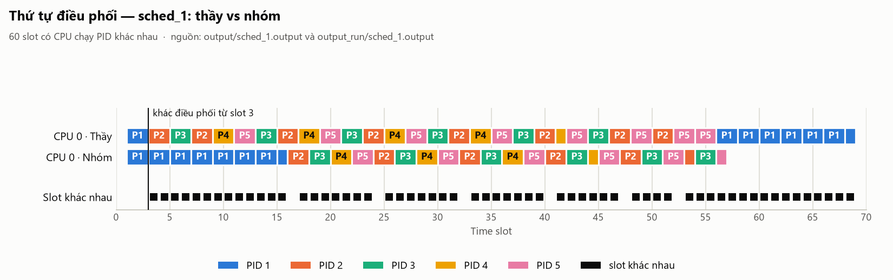
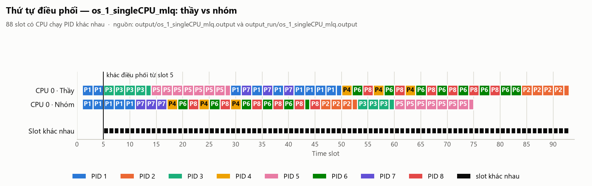
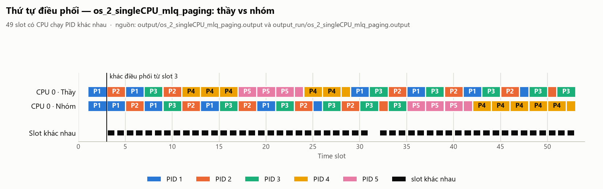
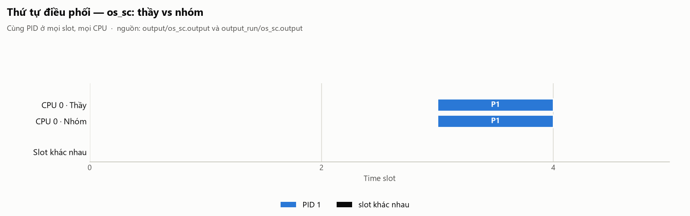
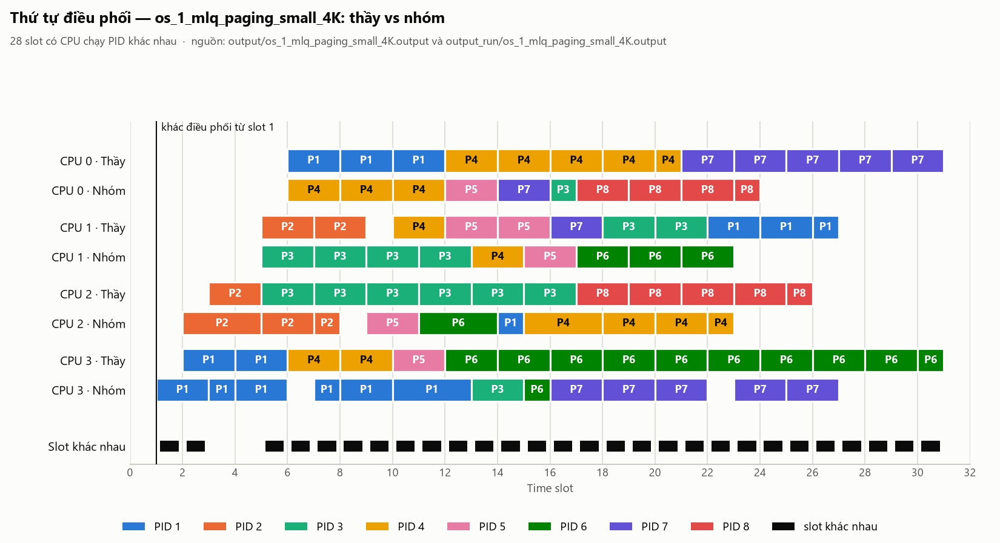

# So sánh output của thầy và output của nhóm

> **Nguồn dữ liệu (chỉ đọc, không sửa):**
> - Output của thầy: `output/*.output`. 14 file này trùng từng byte với `output/` trong bộ đề gốc `hk261_ossim_demacOprx` (kiểm bằng `cmp`).
> - Output của nhóm: `output_run/*.output`, từ lần chạy `./run_tests.sh` ngày 15/11/2026, 19:22:04–19:22:40 (UTC+7).
> - Quy tắc đối chiếu: `DE_BAI.md` mục 2 và nguyên văn `assignment.pdf` trang 12–13 (mục 2.1 Scheduler).
>
> Mọi nhận định trong file này đều kèm số dòng của cả hai log. Ký hiệu `T:15` là dòng 15 trong file của thầy, `N:16` là dòng 16 trong file của nhóm.
> Biểu đồ nằm trong `report/compare/`. Mỗi test có 3 ảnh: `<test>_thay.png` (Gantt thầy), `<test>_nhom.png` (Gantt nhóm) và `<test>_gantt_so_sanh.png` (thứ tự điều phối thầy vs nhóm theo từng slot, có đánh dấu slot khác nhau).

## 1. Tóm tắt

- **14 test** có mặt ở cả hai thư mục được so sánh: 11 test theo yêu cầu, cộng thêm `os_1_singleCPU_mlq_paging`, `os_1_mlq_paging_small_1K` và `os_1_mlq_paging_small_4K`.
- **3/14 test khớp hoàn toàn về điều phối**: `os_sc`, `os_syscall`, `os_syscall_list`. Cùng PID ở mọi slot, mọi CPU. Ba test này chỉ khác ở dòng thông báo (nhóm c).
- **11/14 test khác về điều phối**:
  - **10 test khác do thuật toán**: `sched`, `sched_0`, `sched_1`, `os_1_mlq_paging`, `os_1_singleCPU_mlq`, `os_1_singleCPU_mlq_paging`, `os_1_mlq_paging_small_1K`, `os_1_mlq_paging_small_4K`, `os_2_mlq_paging`, `os_2_singleCPU_mlq_paging`.
  - **1 test chỉ khác khi chạy**: `os_0_mlq_paging`. Log thầy chỉ có 4 process và độ dài chương trình khác (mục 5.4); ở mọi lần dispatch, hai cách tính A và B cho cùng kết quả.
- **Nguyên nhân chính đã kiểm chứng.** Mục 3 định nghĩa hai cách hiểu chính sách MLQ:
  - **Cách A**: giữ trạng thái `curr_prio`/`curr_slot` và phục vụ hết ngân sách của hàng đợi hiện tại. Đây là cách `src/sched.c` của nhóm làm.
  - **Cách B**: mỗi lần chọn đều quét lại từ prio 0.

  Khi tính lại từng lần dispatch, cho phép mọi thứ tự xen kẽ hợp lệ giữa các thread:
  - **Log thầy khớp cách B ở 14/14 test**; cách A thất bại ở 10 test.
  - **Log nhóm khớp cách A ở 14/14 test**; cách B thất bại ở 10 test.
- **Khác khi chạy (nhóm c), độc lập với thuật toán.** Trong 11 log của thầy, nhiều chương trình được dispatch nhiều lần hơn mức số lệnh trong `input/proc/` hiện tại cho phép. Ví dụ `p1s` có 10 lệnh, time slice 2, nên kỳ vọng 5 lần, nhưng log thầy có 10 lần. Log nhóm khớp kỳ vọng ở mọi PID của mọi test. Nguyên nhân phía thầy **chưa xác định** (câu hỏi Q3).

## 2. Bảng tổng hợp

Ý nghĩa các cột:
- *Dòng khớp*: số dòng thuộc dãy con chung dài nhất của hai file (`difflib`, so nguyên dòng).
- *Chỉ thầy* / *Chỉ nhóm*: số dòng còn lại của mỗi bên.
- *Slot khác đầu tiên*: slot đầu tiên có bất kỳ dòng nào khác, kể cả dòng thông báo.
- *Slot khác điều phối*: slot đầu tiên có dòng Dispatched/Put/finished khác.
- *Slot khác do thuật toán*: slot đầu tiên mà tại một lần dispatch, cách A và cách B cho kết quả khác nhau, và hai bên chọn khác nhau (mục b1).

| Test | Dòng thầy / nhóm | Dòng khớp | Chỉ thầy | Chỉ nhóm | Slot khác đầu tiên | Slot khác điều phối | Slot khác do thuật toán | Kết luận |
|---|---|---|---|---|---|---|---|---|
| sched | 73 / 59 | 37 | 36 | 22 | 0 | 5 | **5** | Khác thuật toán (+ khác khi chạy: độ dài p1s, p3s) |
| sched_0 | 120 / 118 | 39 | 81 | 79 | 0 | 5 | **5** | Khác thuật toán (+ khác khi chạy: độ dài s1) |
| sched_1 | 147 / 127 | 51 | 96 | 76 | 0 | 3 | **3** | Khác thuật toán (+ khác khi chạy: độ dài s1, s3) |
| os_0_mlq_paging | 93 / 141 | 48 | 45 | 93 | 0 | 14 | — | **Khác khi chạy** (thầy chỉ 4 process; độ dài p1s) |
| os_1_mlq_paging | 172 / 220 | 43 | 129 | 177 | 1 | 1 | **8** | Khác thuật toán (+ khác thứ tự trong slot, khác khi chạy) |
| os_1_singleCPU_mlq | 212 / 178 | 47 | 165 | 131 | 0 | 5 | **5** | Khác thuật toán (+ khác khi chạy) |
| os_2_mlq_paging | 126 / 230 | 25 | 101 | 205 | 0 | 4 | **16** | Khác thuật toán (+ khác khi chạy: thời điểm nạp ±1) |
| os_2_singleCPU_mlq_paging | 126 / 234 | 39 | 87 | 195 | 0 | 3 | **11** | Khác thuật toán (slot 3 là do loader và CPU chạy đua, mục 5.1) |
| os_sc | 10 / 13 | 9 | 1 | 4 | 0 | — | — | **Khớp hoàn toàn về điều phối**; khác dòng thông báo |
| os_syscall | 21 / 23 | 17 | 4 | 6 | 0 | — | — | **Khớp hoàn toàn về điều phối**; khác dòng thông báo |
| os_syscall_list | 11 / 14 | 11 | 0 | 3 | 0 | — | — | **Khớp hoàn toàn về điều phối**; nhóm in thêm 3 dòng |
| *os_1_singleCPU_mlq_paging* | 212 / 219 | 57 | 155 | 162 | 0 | 8 | **8** | Khác thuật toán (+ khác khi chạy) |
| *os_1_mlq_paging_small_1K* | 167 / 157 | 43 | 124 | 114 | 0 | 1 | **5** | Khác thuật toán (+ khác khi chạy) |
| *os_1_mlq_paging_small_4K* | 168 / 176 | 36 | 132 | 140 | 0 | 1 | **6** | Khác thuật toán (+ khác thứ tự trong slot, khác khi chạy) |

Slot 0 hầu như luôn khác vì nhóm in thêm dòng `Initialized dma software prototype engine (no Verilator RTL)` (ví dụ N:3 trong `sched_0`; thầy không có dòng này). Đây là nhóm c, không ảnh hưởng điều phối.

## 3. Phát hiện chính: hai cách hiểu chính sách MLQ

### 3.1 Quy tắc trong đề

`assignment.pdf` trang 12–13, mục 2.1 (nguyên văn):

> "the traversed step of ready queue list is a fixed formulated number based on the priority, i.e. slot= (MAX PRIO - prio), each queue have only fixed slot to use the CPU and when it is used up, the system must change the resource to the other process in the next queue and left the remaining work for future slot even though it needs a completed round of ready queue."
> "MLQ policy only goes through the fixed step to traverse all the queue in the priority ready queue list."
> "Note that because the loader and the scheduler run concurrently, there may be more than one correct answer for each test."

`DE_BAI.md` dòng 35 tóm tắt lại thành: duyệt theo thứ tự cố định, dùng hết ngân sách (hoặc hàng đợi rỗng) thì chuyển sang hàng đợi kế, phần việc còn lại chờ vòng duyệt sau.

Bộ khung của thầy (`hk261_ossim_demacOprx/src/sched.c`, phía trên `get_mlq_proc()`) có sẵn comment: *"Stateful design for routine calling … State representation prio = 0 .. MAX_PRIO, curr_slot = 0..(MAX_PRIO - prio)"*.

Phần code CPU/loader (`cpu_routine`, `ld_routine` trong `src/os.c`) của nhóm giống hệt bộ khung. Điểm khác duy nhất là nhóm thêm lời gọi `remove_proc()`, và lời gọi này không in gì. Vì vậy thời điểm in Put/Dispatched là như nhau ở hai bên; **chọn PID nào chỉ do `get_mlq_proc()` quyết định**.

### 3.2 Hai cách tính dùng để kiểm

- **Cách A — có trạng thái.** Đây là cách nhóm hiểu đề và cài trong `src/sched.c` dòng 92–132.
  - Giữ `curr_prio` và `curr_slot`.
  - Nếu `q[curr_prio]` khác rỗng và `curr_slot < slot[curr_prio] = 140 − curr_prio`, lấy phần tử đầu `q[curr_prio]` rồi tăng `curr_slot`.
  - Ngược lại, chuyển sang `curr_prio + 1` (vòng tròn qua 140 mức) và đặt `curr_slot = 0`.
- **Cách B — quét lại từ đầu.** Mỗi lần `get_proc()`, quét từ prio 0 và lấy phần tử đầu của hàng đợi khác rỗng đầu tiên. Cách này không giữ trạng thái giữa các lần gọi.

Ở cả hai cách, trong cùng một hàng đợi thì lấy theo FIFO. Trạng thái hàng đợi được dựng lại từ chính log: `Loaded` và `Put` đưa process vào hàng đợi, `Dispatched` lấy ra.

### 3.3 Kiểm chứng trên toàn bộ log

Phép kiểm: với mỗi log, có tồn tại một thứ tự thực thi hợp lệ khiến cách tính dự đoán đúng **mọi** dòng `Dispatched` hay không. "Hợp lệ" nghĩa là trong mỗi slot, giữ nguyên thứ tự các dòng của từng CPU và của loader, nhưng cho phép xen kẽ giữa các thread (lý do ở mục 5.3).

| Test | Số dispatch thầy / nhóm | Log thầy theo A | Log thầy theo B | Log nhóm theo A | Log nhóm theo B |
|---|---|---|---|---|---|
| sched | 16 / 12 | ✗ (từ slot 5) | ✓ | ✓ | ✗ (từ slot 5) |
| sched_0 | 29 / 28 | ✗ (slot 5) | ✓ | ✓ | ✗ (slot 5) |
| sched_1 | 35 / 30 | ✗ (slot 3) | ✓ | ✓ | ✗ (slot 3) |
| os_0_mlq_paging | 14 / 12 | ✓ | ✓ | ✓ | ✓ |
| os_1_mlq_paging | 51 / 42 | ✗ (slot 18) | ✓ | ✓ | ✗ (slot 18) |
| os_1_singleCPU_mlq | 48 / 39 | ✗ (slot 5) | ✓ | ✓ | ✗ (slot 5) |
| os_2_mlq_paging | 36 / 36 | ✗ (slot 18) | ✓ | ✓ | ✗ (slot 18) |
| os_2_singleCPU_mlq_paging | 28 / 28 | ✗ (slot 11) | ✓ | ✓ | ✗ (slot 13) |
| os_sc | 1 / 1 | ✓ | ✓ | ✓ | ✓ |
| os_syscall | 3 / 3 | ✓ | ✓ | ✓ | ✓ |
| os_syscall_list | 1 / 1 | ✓ | ✓ | ✓ | ✓ |
| os_1_singleCPU_mlq_paging | 48 / 39 | ✗ (slot 8) | ✓ | ✓ | ✗ (slot 8) |
| os_1_mlq_paging_small_1K | 51 / 42 | ✗ (slot 12) | ✓ | ✓ | ✗ (slot 9) |
| os_1_mlq_paging_small_4K | 51 / 42 | ✗ (slot 14) | ✓ | ✓ | ✗ (slot 14) |

Kết luận có căn cứ:
- Log của thầy **nhất quán 100% với cách B**.
- Log của nhóm **nhất quán 100% với cách A**, tức đúng như code `src/sched.c`.
- Ở 4 test (os_0, os_sc, os_syscall, os_syscall_list), tại mọi lần dispatch hai cách đều cho cùng kết quả nên không phân biệt được.

Không có mã nguồn lời giải của thầy, nên việc thầy **thật sự** cài theo cách nào là **chưa xác định**. Tôi chỉ khẳng định được rằng log của thầy khớp với cách B.

### 3.4 Giới hạn của dữ liệu: ngân sách `slot[i]` chưa từng cạn

Ở cả hai bộ log, không hàng đợi nào dùng hết ngân sách. Mức sát nhất là prio 130 (ngân sách 10) trong `os_1_mlq_paging*`: thầy dispatch 8 lần, nhóm 7 lần. Các mức prio 0–39 thì ngân sách 101–140, chỉ dùng vài lần.

Vì vậy log **không cho biết** thầy có áp dụng ngân sách `slot[i]` hay không. Cách B có thể là "quét từ prio 0" thuần, hoặc "quét từ prio 0 kèm trừ ngân sách"; hai biến thể này cho cùng kết quả trên mọi log hiện có. Đây là **chưa xác định** (câu hỏi Q1, Q2).

## 4. Trường hợp `sched_0` slot 5: thầy dispatch PID 3, nhóm dispatch PID 1

Input `input/sched_0`: `2 1 4` (time slice 2, 1 CPU, 4 process); P1 `s0` prio 4 vào lúc 0, P2 `s0` prio 4 lúc 1, P3 `s1` prio 0 lúc 4, P4 `s0` prio 0 lúc 5.

**Hai log giống nhau đến hết slot 4** (bỏ qua dòng `Initialized` N:3):

| Sự kiện | Thầy | Nhóm |
|---|---|---|
| Nạp P1 (prio 4), slot 0 | T:3 | N:4 |
| Dispatch P1, slot 1 | T:5 | N:6 |
| Nạp P2 (prio 4), slot 1 | T:6 | N:7 |
| Put P1, dispatch P2, slot 3 | T:9–10 | N:10–11 |
| Nạp P3 (prio 0), slot 4 | T:12 | N:13 |
| Put P2, slot 5 | T:14 | N:15 |
| **Dispatch, slot 5** | **T:15 `CPU 0: Dispatched process  3`** | **N:16 `CPU 0: Dispatched process  1`** |
| Nạp P4 (prio 0), slot 5 | T:16 | N:17 |

**Trạng thái ngay trước lần chọn ở slot 5** (giống nhau ở hai bên): `q[0] = [P3]`, `q[4] = [P1, P2]`. P1 vào lại `q[4]` ở slot 3, P2 vào ở slot 5. P4 chưa vào, vì dòng Loaded của P4 in sau Dispatched ở cả hai bên.

**Tính tay theo cách A (code của nhóm):**
1. Ban đầu `curr_prio = 0`, `curr_slot = 0`.
2. Slot 1: `q[0]` rỗng nên chuyển sang 1, 2, 3, 4 (mỗi bước đặt `curr_slot = 0`). `q[4]` khác rỗng và 0 < `slot[4]` = 136, nên chọn **P1**; `curr_slot = 1`.
3. Slot 3: `curr_prio = 4`, 1 < 136, `q[4] = [P2, P1]`, nên chọn **P2**; `curr_slot = 2`.
4. Slot 5: `curr_prio = 4`, 2 < 136, `q[4] = [P1, P2]` khác rỗng, nên chọn **P1** (khớp N:16). P3 phải chờ đến khi `q[4]` rỗng hoặc dùng hết 136 lượt.

   Trong log nhóm, `q[4]` rỗng khi P1 kết thúc (N:67) và P2 kết thúc (N:70). Con trỏ đi tiếp 5 → … → 139 → 0 và lấy P3 ở N:71.

   Đây là cách đọc sát chữ của đề: *"each queue have only fixed slot to use the CPU and when it is used up, the system must change … to … the next queue"*. Theo cách đọc này, khi chưa dùng hết ngân sách và hàng đợi chưa rỗng thì không chuyển mức.

**Tính tay theo cách B:** quét từ prio 0, thấy `q[0] = [P3]` khác rỗng, nên chọn **P3** (khớp T:15). Sau đó log thầy luân phiên P3/P4 (prio 0) cho đến khi P3 xong (T:50) và P4 xong (T:65). P1/P2 (prio 4) chỉ chạy lại từ T:66.

**Vì sao mỗi bên làm vậy:**
- Nhóm chọn P1 vì `get_mlq_proc()` giữ con trỏ ở mức 4: mức này chưa dùng hết ngân sách (2/136) và chưa rỗng ([src/sched.c:111-118](src/sched.c#L111-L118)).
- Thầy chọn P3. Mọi lần dispatch của thầy ở 14 test đều khớp cách B (mục 3.3). Cơ chế thật trong code của thầy là **chưa xác định**, vì không có mã nguồn lời giải.

**Không phải do chạy song song:** test này chỉ có 1 CPU, và tại thời điểm chọn, P3 đã nằm trong hàng đợi ở cả hai bên (T:12, N:13 đều ở slot 4). Vì vậy ghi chú "loader và scheduler chạy song song" của đề không giải thích được chỗ khác này. Đây là khác biệt về chính sách (nhóm b1).

Một khác biệt riêng, không do thuật toán: trong log thầy, P3 được dispatch 5 lần (T:15, T:24, T:32, T:40, T:48) rồi finished ở T:50. Nhưng chương trình `s1` chỉ có 7 lệnh (`input/proc/s1`: `20 7`), nên với time slice 2 kỳ vọng là 4 lần. Log nhóm dispatch P3 đúng 4 lần (N:71, N:79, N:87, N:95), finished ở N:97. Xem mục 5.4 c1.

## 5. Phân loại các chỗ khác

Bảng đầy đủ từng chỗ khác của mỗi test (số dòng hai bên, nội dung, tính tay) nằm ở **Phụ lục**. Phần này tóm tắt theo nhóm.

### 5.1 Nhóm a: chỉ khác thứ tự in trong cùng một time slot

Các dòng có cùng nội dung ở cả hai bên trong cùng một slot, chỉ khác thứ tự in. Nguyên nhân là các thread CPU và loader cùng in trong một slot.

| Test | Slot | Thầy | Nhóm |
|---|---|---|---|
| os_1_mlq_paging | 12 | T:53 `CPU 2: Dispatched process 5`, T:54–55 `CPU 0: Put/Dispatched 3` | N:82–83 `CPU 0: Put/Dispatched 3`, rồi N:89 `CPU 2: Dispatched process 5` |
| os_1_mlq_paging | 14 | T:64 `CPU 2: Put 5`, T:66–67 `CPU 0: Put/Dispatched 3`, T:68 `Loaded … PID: 6` | N:97, N:99 `CPU 0: Put/Dispatched 3`, N:105 `Loaded … PID: 6`, N:106 `CPU 2: Put 5` |
| os_1_mlq_paging_small_4K | 4 | T:13–14 `CPU 3: Put/Dispatched 1`, T:15 `Loaded … PID: 3` | N:28 `Loaded … PID: 3`, rồi N:30–31 `CPU 3: Put/Dispatched 1` |
| os_1_mlq_paging_small_4K | 16 | T:88 `CPU 3: Put 6`, T:94 `Loaded … PID: 8` | N:124 `Loaded … PID: 8`, N:127 `CPU 3: Put 6` |
| os_2_singleCPU_mlq_paging | 3 | T:8 `Loaded … PID: 2 PRIO: 3`, T:9 `CPU 0: Put 1` | N:9 `CPU 0: Put 1`, N:11 `Loaded … PID: 2 PRIO: 3` |

Ca cuối (`os_2_singleCPU_mlq_paging` slot 3) **có ảnh hưởng tới điều phối**:
- Thầy: P2 vào `q[3]` trước khi P1 bị put, nên `q[3] = [P2, P1]` và cách nào cũng chọn P2 (T:10).
- Nhóm: P1 bị put rồi được chọn lại trước khi loader kịp nạp P2, nên `q[3] = [P1]` và cách nào cũng chọn P1 (N:10).

Đây đúng là trường hợp "loader và scheduler chạy song song" mà đề cho phép. Cả hai bên đều đúng.

### 5.2 Nhóm b: khác nội dung điều phối (chọn PID khác)

Phụ lục chia nhóm này thành ba loại:
- **b1 — do thuật toán:** tại lần dispatch đó, tính trên log của chính bên đó, cách A và cách B cho PID khác nhau, và mỗi bên chọn đúng theo cách của mình.
- **b2 — A = B:** hai cách cho cùng kết quả. PID khác chỉ vì trạng thái hàng đợi đã khác từ một chỗ khác trước đó, hoặc vì CPU/slot nhận việc khác do thread chạy song song. Ví dụ `os_1_mlq_paging` slot 1–2: cùng P1, nhưng thầy CPU 3 ở slot 2 (T:6), nhóm CPU 1 ở slot 1 (N:5).
- **b – hệ quả:** dòng Put/finished/stopped lệch theo vì PID đang chạy đã khác.

**Lần khác đầu tiên do thuật toán (b1) của từng test, kèm tính tay.** Trạng thái hàng đợi dựng từ log của chính bên đó; `q[p]` liệt kê theo FIFO.

| Test | Slot | Thầy | Nhóm | Hàng đợi lúc chọn | Cách A | Cách B |
|---|---|---|---|---|---|---|
| sched | 5 | T:15 dispatch **P4** | N:16 dispatch **P3** | `q[0]=[P4,P1]`, `q[1]=[P3]`; A: `curr_prio=1, curr_slot=1` | P3 (mức 1 còn 138 lượt, chưa rỗng) | P4 |
| sched_0 | 5 | T:15 **P3** | N:16 **P1** | `q[0]=[P3]`, `q[4]=[P1,P2]`; `curr_prio=4, curr_slot=2` | P1 | P3 |
| sched_1 | 3 | T:10 **P2** | N:11 **P1** | `q[0]=[P2]`, `q[4]=[P1]`; `curr_prio=4, curr_slot=1` | P1 | P2 |
| os_1_singleCPU_mlq | 5 | T:16 **P3** | N:17 **P1** | `q[0]=[P3]`, `q[2]=[P1]`, `q[3]=[P4]`, `q[4]=[P2]`; `curr_prio=2, curr_slot=2` | P1 | P3 |
| os_1_singleCPU_mlq_paging | 8 | T:24 **P5** | N:31 **P4** | `q[2]=[P5]`, `q[3]=[P4,P2,P1]`, `q[4]=[P3]`; `curr_prio=3, curr_slot=3` | P4 | P5 |
| os_2_singleCPU_mlq_paging | 11 | T:32 **P4** | N:36 **P2** | thầy: `q[2]=[P4]`, `q[3]=[P1,P3,P2]`; nhóm: `q[3]=[P2,P1,P3]` (P4 chưa vào); `curr_prio=3, curr_slot=5` | thầy: P1 ≠ thực tế; nhóm: P2 = thực tế | thầy: P4 = thực tế |
| os_1_mlq_paging | 8 | T:23 **P1** (CPU 3) | N:42 **P3** (CPU 0) | thầy: `q[15]=[P1]`, `q[130]=[P3]` | thầy: P3 ≠ thực tế | P1 = thực tế |
| os_1_mlq_paging_small_1K | 5 | không có dòng tương ứng ở slot 5 | N:22 **P1**, N:25 **P3** | nhóm: `q[0]=[P3]`, `q[130]=[P1]`; `curr_prio=130, curr_slot=1` | P1 = thực tế | P3 |
| os_1_mlq_paging_small_4K | 6 | T:26 CPU 3 → **P4**, T:27 CPU 0 → P1 | N:48 CPU 0 → P4 (P1 vẫn đang chạy trên CPU 3) | thầy: `q[38]=[P4]`, `q[130]=[P1]`; `curr_prio=120` | thầy: P1 ≠ thực tế (P4) | P4 = thực tế |
| os_2_mlq_paging | 16 | T:62 **P6** | N:122 P3, N:123 P5 | thầy: `q[0]=[P6]`, `q[38]=[P2]`; `curr_prio=15` | thầy: P2 ≠ thực tế | P6 = thực tế |

Ở mọi dòng của bảng: **bên thầy chọn mức prio nhỏ nhất đang có process** (cách B). **Bên nhóm ở lại mức `curr_prio` hiện tại** khi mức đó còn ngân sách và chưa rỗng (cách A).

### 5.3 Vì sao phải xét thứ tự xen kẽ: thứ tự in không phải thứ tự thao tác

Nếu tính lại theo đúng thứ tự in, có 9 lần dispatch của nhóm không khớp cách A. Nhưng cả 9 lần đều rơi vào một trong hai dạng sau:
- **Hai CPU in `Put` liên tiếp rồi mới in `Dispatched`.** Ví dụ `output_run/os_1_mlq_paging.output` N:27 `CPU 2: Put process 2`, N:28 `CPU 1: Put process 1`, N:29 `CPU 2: Dispatched process 2`, N:30 `CPU 1: Dispatched process 1`.

  Trong code bộ khung, mỗi CPU in `Put` rồi mới gọi `put_proc()`, sau đó gọi `get_proc()`. Hai cặp put/get của hai CPU có thể đan xen theo bất kỳ thứ tự nào. Thứ tự hợp lệ "CPU 2 put rồi get P2, sau đó CPU 1 put rồi get P1" khớp cách A.
- **Dòng `Loaded` in trước khi `add_proc()` thật sự đưa process vào hàng đợi.** Ví dụ `output_run/os_2_mlq_paging.output` N:67 `CPU 0: Put process 1`, N:68 `Loaded … PID: 3 PRIO: 39`, N:69 `CPU 0: Dispatched process 1`.

  Nếu CPU 0 gọi `get_proc()` trước khi loader kịp `add_proc(P3)`, thì cách A chọn P1, khớp với log.

Vì vậy mục 3.3 dùng phép kiểm "tồn tại thứ tự xen kẽ hợp lệ". Phép kiểm này không nới lỏng thứ tự giữa các slot, cũng như thứ tự các dòng của cùng một CPU hay của loader. Áp cùng phép kiểm cho log thầy với cách A thì vẫn thất bại (mục 3.3). Như vậy chênh lệch A/B không phải do cách đọc log.

### 5.4 Nhóm c: khác số process, thời điểm nạp, hoặc thông báo

**c1. Độ dài chương trình trong log thầy không khớp `input/proc/` hiện tại** (chưa xác định nguyên nhân).

Phép đo: đếm số dòng `Dispatched process x` của mỗi PID, rồi so với kỳ vọng `ceil(số lệnh / time slice)`, vì mỗi lần dispatch chạy tối đa một time slice. Cách đếm này không phụ thuộc vào việc header `Time slot` được in lệch.

Đo bằng khoảng slot thì có thể lệch ±2 ở test nhiều CPU, vì header do thread timer in xen giữa các dòng của CPU. Ví dụ trong `output_run/os_1_mlq_paging_small_4K.output`, P1 dispatch ở slot 3 (N:16) và bị put ngay ở slot 4 (N:30), dù time slice là 2.

- **Log nhóm: ở cả 14 test, mọi PID có số lần dispatch đúng bằng kỳ vọng.**
- **Log thầy: lệch ở 11 test, và lệch nhất quán theo chương trình.** Riêng `os_2_mlq_paging`, `os_2_singleCPU_mlq_paging`, `os_sc`, `os_syscall`, `os_syscall_list` thì khớp.

| Chương trình (`input/proc/`) | Số lệnh | Time slice | Kỳ vọng | Log thầy | Log nhóm | Test của thầy bị lệch |
|---|---|---|---|---|---|---|
| `p1s` | 10 | 2 | 5 | **10** | 5 | os_1_mlq_paging (P1), small_1K (P4), small_4K (P6), os_1_singleCPU_mlq (P1), os_1_singleCPU_mlq_paging (P5) |
| `p1s` | 10 | 4 | 3 | **5** | 3 | sched (P2) |
| `p1s` | 10 | 6 | 2 | **4** | 2 | os_0_mlq_paging (P2, P3) |
| `s3` | 11 | 2 | 6 | **8** | 6 | sched_1 (P2, P5), os_1_mlq_paging (P5), small_1K (P5), small_4K (P3), os_1_singleCPU_mlq (P6), os_1_singleCPU_mlq_paging (P1) |
| `s1` / `s4` | 7 | 2 | 4 | **5** | 4 | sched_0 (P3), sched_1 (P4), os_1_mlq_paging (P8), small_1K (P3), small_4K (P8), os_1_singleCPU_mlq (P2, P3), os_1_singleCPU_mlq_paging (P3, P8) |
| `p0s` | 14 | 2 | 7 | **8** | 7 | os_1_mlq_paging (P3), small_1K (P1), small_4K (P1) |
| `p3s` | 11 | 4 | 3 | **5** | 3 | sched (P4) |

Trong `os_2_mlq_paging` và `os_2_singleCPU_mlq_paging`, cũng các chương trình `s3` và `s1` đó lại có số lần dispatch đúng kỳ vọng **trong log thầy**. Như vậy các file sample có vẻ không được sinh cùng một lần, với cùng bộ `input/proc/`.

Ví dụ cụ thể, `os_0_mlq_paging`, P2 = `p1s` (10 lệnh), time slice 6:
- Thầy dispatch P2 4 lần (T:8, T:70, T:82, T:90) rồi finished ở T:92.
- Nhóm dispatch 2 lần (N:9, N:132) rồi finished ở N:139.

`input/` của nhóm trùng với `input/` của bộ đề gốc, trừ các file nhóm tự thêm. Như vậy sample output của thầy **có thể** đã được sinh từ một phiên bản `input/proc/` khác, nhưng đây là **chưa xác định** (câu hỏi Q3).

Cũng vì vậy, tổng số dispatch và slot kết thúc khác nhau ở nhiều test, ví dụ `sched` 16 so với 12 lần dispatch.

**c2. `os_0_mlq_paging`: log thầy chỉ có 4 process.**
- `input/os_0_mlq_paging` dòng 1 là `6 2 5` (5 process), và dòng 7 là `5 p1s 0`.
- Log thầy chỉ có Loaded PID 1–4 (T:3, T:6, T:11, T:19), không có PID 5, và kết thúc ở T:93 `CPU 1 stopped`.
- Log nhóm nạp PID 5 ở N:40 (slot 7, vì loader nạp tuần tự và PID 4 có start time 6 > 5).

Nguyên nhân phía thầy **chưa xác định** (câu hỏi Q4).

**c3. Thời điểm nạp lệch ±1 slot** (loader và timer chạy song song). Ví dụ:
- `os_2_mlq_paging`: input start time `5 9 11 14 16 16`. Thầy in Loaded P1 ở slot 4 (T:8); nhóm in ở slot 5 (N:9).
- `os_1_mlq_paging`: start time của P2 là 5. Thầy in ở slot 5 (T:12); nhóm in ở slot 4 (N:12).

Lệch cả hai chiều, ở cả hai bên. Đây là do dòng `Loaded` được in tương đối với header `Time slot` của thread timer, đúng với ghi chú của đề rằng có thể có nhiều đáp án.

**c4. Dòng thông báo chỉ có ở một bên** (không ảnh hưởng điều phối):

| Nội dung | Thầy | Nhóm |
|---|---|---|
| Khởi tạo DMA | `Initialized dma_rtl simulation` (T:4 `os_2_mlq_paging`, T:12 `os_2_singleCPU_mlq_paging`); không có ở test khác | `Initialized dma software prototype engine (no Verilator RTL)` ở mọi test (vd N:3) |
| Syscall 440 | `os_sc`: không có dòng in của syscall 440 (T:7 → T:9) | N:9 `The first system call parameter 1` |
| listsyscall | `os_syscall_list` T:7–8: `0-sys_listsyscall`, `17-sys_memmap` | N:8–10: thêm `440-sys_xxxhandler` |
| Thống kê MM64 | không có | dòng cuối mọi log, vd N:13 `MM64 stats: …` trong `os_sc` |
| Dump bảng trang | 1 dòng ` PDG=b5cfe220b5301d30 P4g=…` (vd T:7 `os_syscall`), có test dạng ` PDG=  0xf7e0… PT=…` (T:11 `os_2_singleCPU_mlq_paging`) | khối `===== PHYSICAL MEMORY AFTER … =====` + `PID=… Region=…` + ` PDG=0x7f…` + `PT[000] page=… -> frame=…` |
| Lỗi cấp phát | không có | `liballoc failed: …`, `Invalid memory operation: …` (vd N:8–9 `os_syscall`) |

**c5. Một dòng hỏng trong log thầy:** `output/os_sc.output` T:8 là `Time slot   ô`, thay cho số slot. Script suy ra đây là slot 4 (giữa slot 3 ở T:6 và cuối file); bên nhóm, dòng tương ứng là N:10 `Time slot   4`.

## 6. Câu hỏi cho nhóm và thầy

**Q1. Chính sách MLQ nào là đúng: giữ con trỏ `curr_prio` (cách A) hay mỗi lần chọn quét lại từ prio 0 (cách B)?**
- Đề (assignment.pdf tr.12) viết: *"each queue have only fixed slot to use the CPU and when it is used up, the system must change the resource to the other process in the next queue and left the remaining work for future slot even though it needs a completed round of ready queue"*. Comment trong bộ khung `sched.c` nói *"Stateful design … curr_slot = 0..(MAX_PRIO - prio)"*. Cả hai đều gợi ý cách A.
- Nhưng sample output khớp cách B ở 14/14 test. Ví dụ `sched_0` slot 5: thầy T:15 `Dispatched process 3`, nhóm N:16 `Dispatched process 1`, với `q[0]=[P3]`, `q[4]=[P1,P2]`.
- Nếu đáp án là B, nhóm cần sửa `get_mlq_proc()`. Nếu là A, nhóm cần được xác nhận rằng khác sample ở các test trong mục 2 là chấp nhận được.

**Q2. "slot" trong `slot[i] = MAX_PRIO − i` đếm theo đơn vị nào: số lần được dispatch hay số time slot CPU?**
- Code nhóm đếm số lần dispatch ([src/sched.c:113-116](src/sched.c#L113-L116)). Với time slice 2, ngân sách 136 lượt tương đương 272 time slot.
- Log hiện có không phân biệt được hai cách đếm, vì không hàng đợi nào dùng hết ngân sách (tối đa 8/10 ở prio 130; mục 3.4). Có nên thêm một test có process prio gần 139 (ngân sách 1–2) để kiểm điểm này không?

**Q3. Sample output được sinh với `input/proc/` phiên bản nào?**
- Trong 11 sample, số lần dispatch vượt `ceil(số lệnh / time slice)`: `p1s` (10 lệnh, time slice 2) có 10 lần thay vì 5, `s3` có 8 thay vì 6, `s1`/`s4` có 5 thay vì 4 (mục 5.4 c1). Ví dụ `os_0_mlq_paging` P2: dispatch ở T:8, T:70, T:82, T:90, so với kỳ vọng 2 lần.
- Trong `os_2_mlq_paging` và `os_2_singleCPU_mlq_paging` của thầy, `s3`/`s1` lại khớp.
- Log nhóm khớp ở mọi PID; ví dụ `os_0_mlq_paging` P2 chỉ dispatch ở N:9 và N:132.
- Nếu sample được sinh từ input khác, thứ tự và thời điểm kết thúc của các process sẽ không so trực tiếp được.

**Q4. `os_0_mlq_paging`: vì sao sample chỉ có 4 process?**
- Input khai báo 5 process (`6 2 5`), và dòng 7 là `5 p1s 0`, có start time 5 nhỏ hơn start time 6 của dòng trước.
- Sample không có PID 5 (Loaded T:3, T:6, T:11, T:19; kết thúc T:93). Nhóm nạp PID 5 ở N:40, slot 7.
- Thứ tự start time không tăng dần là cố ý, hay input của sample khác?

**Q5. Sample `os_sc` và `os_syscall_list` có tính tới syscall 440 không?**
- Đề (mục 1.6.3, `DE_BAI.md` dòng 25) yêu cầu `./os os_sc` in ra `"The first system call parameter <a1>"`.
- Sample `os_sc` không có dòng này (T:7 → T:9). Sample `os_syscall_list` chỉ liệt kê 0 và 17 (T:7–8).
- Nhóm in N:9 `The first system call parameter 1` và thêm N:10 `440-sys_xxxhandler`. Nhóm hiểu sample được tạo trước khi có syscall 440, nhưng nên xác nhận.

**Q6. Định dạng dump bảng trang có được chấm theo sample không?**
- Sample in 1 dòng ` PDG=b5cfe220b5301d30 P4g=…` (vd T:7 `os_syscall`).
- Nhóm in khối `===== PHYSICAL MEMORY AFTER … =====` kèm PID, region, địa chỉ và `PT[...] page -> frame` (vd N:9–12 `os_0_mlq_paging`), cùng dòng `MM64 stats` ở cuối mà đề bắt buộc (DE_BAI.md dòng 55).

**Q7 (cho nhóm). Có nên ghi vào báo cáo rằng `os_2_singleCPU_mlq_paging` slot 3 và các chỗ lệch thời điểm nạp ±1 (mục 5.1, 5.4 c3) là "nhiều đáp án đúng do loader và scheduler chạy song song" như đề cho phép?**
- Bằng chứng: T:8–10 so với N:9–11; T:8 (`os_2_mlq_paging`, slot 4) so với N:9 (slot 5).

---

## Phụ lục: chi tiết từng test

Mỗi bảng liệt kê **mọi slot có khác** (bấm để mở). Cột "Tính tay" ghi:
- hàng đợi dựng lại từ log của chính bên đó **theo thứ tự in**;
- kết quả của cách A (kèm `curr_prio`, `curr_slot`) và cách B tại dòng `Dispatched` đó.

Khi cả A và B đều không khớp với PID thực tế theo thứ tự in, xem mục 5.3. Sau mỗi lần lệch, trạng thái của cách A được đồng bộ lại theo PID thực tế để tính tiếp. Nhóm c có nhiều dòng (ví dụ dump bảng trang) chỉ hiện 3 dòng đầu; số dòng đầy đủ nằm ở cột "Dòng".

### P.1 `sched`

Ảnh: [`sched_thay.png`](report/compare/sched_thay.png) · [`sched_nhom.png`](report/compare/sched_nhom.png) · [`sched_gantt_so_sanh.png`](report/compare/sched_gantt_so_sanh.png)

Bảng từng chỗ khác (20 mục)

| Slot | Loại | Dòng thầy | Nội dung thầy | Dòng nhóm | Nội dung nhóm | Tính tay / ghi chú |
|---|---|---|---|---|---|---|
| 0 | c) khác dòng thông báo | — | — | 3 | `Initialized dma software prototype engine (no Verilator RTL)` |  |
| 5 | b1) chọn PID khác — do thuật toán (A≠B) | 15 | `CPU 1: Dispatched process  4` | 16 | `CPU 1: Dispatched process  3` | Thầy d.15: hàng đợi (dựng từ log, theo thứ tự in): q[0]=[P4,P1], q[1]=[P3]; A (curr_prio=1, curr_slot=1) → P3; B (quét từ prio 0) → P4; thực tế P4 Nhóm d.16: hàng đợi (dựng từ log, theo thứ tự in): q[0]=[P4,P1], q[1]=[P3]; A (curr_prio=1, curr_slot=1) → P3; B (quét từ prio 0) → P4; thực tế P3 |
| 6 | b1) chọn PID khác — do thuật toán (A≠B) | 18 | `CPU 0: Dispatched process  1` | 19 | `CPU 0: Dispatched process  2` | Thầy d.18: hàng đợi (dựng từ log, theo thứ tự in): q[0]=[P1], q[1]=[P3,P2]; A (curr_prio=0, curr_slot=1) → P1; B (quét từ prio 0) → P1; thực tế P1 Nhóm d.19: hàng đợi (dựng từ log, theo thứ tự in): q[0]=[P4,P1], q[1]=[P2]; A (curr_prio=1, curr_slot=2) → P2; B (quét từ prio 0) → P4; thực tế P2 |
| 9 | b1) chọn PID khác — do thuật toán (A≠B) | 22, 23 | `CPU 1: Put process  4 to run queue` `CPU 1: Dispatched process  4` | 23, 24 | `CPU 1: Put process  3 to run queue` `CPU 1: Dispatched process  3` | Thầy d.23: hàng đợi (dựng từ log, theo thứ tự in): q[0]=[P4], q[1]=[P3,P2]; A (curr_prio=0, curr_slot=2) → P4; B (quét từ prio 0) → P4; thực tế P4 Nhóm d.24: hàng đợi (dựng từ log, theo thứ tự in): q[0]=[P4,P1], q[1]=[P3]; A (curr_prio=1, curr_slot=3) → P3; B (quét từ prio 0) → P4; thực tế P3 |
| 10 | b1) chọn PID khác — do thuật toán (A≠B) | 25, 26 | `CPU 0: Put process  1 to run queue` `CPU 0: Dispatched process  1` | 26, 27 | `CPU 0: Put process  2 to run queue` `CPU 0: Dispatched process  2` | Thầy d.26: hàng đợi (dựng từ log, theo thứ tự in): q[0]=[P1], q[1]=[P3,P2]; A (curr_prio=0, curr_slot=3) → P1; B (quét từ prio 0) → P1; thực tế P1 Nhóm d.27: hàng đợi (dựng từ log, theo thứ tự in): q[0]=[P4,P1], q[1]=[P2]; A (curr_prio=1, curr_slot=4) → P2; B (quét từ prio 0) → P4; thực tế P2 |
| 12 | b2) chọn PID/CPU khác — A=B (hệ quả của chỗ khác trước đó, hoặc do thời điểm) | — | — | 30, 31 | `CPU 0: Processed  2 has finished` `CPU 0: Dispatched process  4` | Nhóm d.31: hàng đợi (dựng từ log, theo thứ tự in): q[0]=[P4,P1]; A (curr_prio=1, curr_slot=5) → P4; B (quét từ prio 0) → P4; thực tế P4 |
| 13 | b2) chọn PID/CPU khác — A=B (hệ quả của chỗ khác trước đó, hoặc do thời điểm) | 30, 31 | `CPU 1: Put process  4 to run queue` `CPU 1: Dispatched process  4` | 33, 34 | `CPU 1: Put process  3 to run queue` `CPU 1: Dispatched process  1` | Thầy d.31: hàng đợi (dựng từ log, theo thứ tự in): q[0]=[P4], q[1]=[P3,P2]; A (curr_prio=0, curr_slot=4) → P4; B (quét từ prio 0) → P4; thực tế P4 Nhóm d.34: hàng đợi (dựng từ log, theo thứ tự in): q[0]=[P1], q[1]=[P3]; A (curr_prio=0, curr_slot=1) → P1; B (quét từ prio 0) → P1; thực tế P1 |
| 14 | b2) chọn PID/CPU khác — A=B (hệ quả của chỗ khác trước đó, hoặc do thời điểm) | 33, 34 | `CPU 0: Processed  1 has finished` `CPU 0: Dispatched process  3` | — | — | Thầy d.34: hàng đợi (dựng từ log, theo thứ tự in): q[1]=[P3,P2]; A (curr_prio=0, curr_slot=5) → P3; B (quét từ prio 0) → P3; thực tế P3 |
| 16 | b2) chọn PID/CPU khác — A=B (hệ quả của chỗ khác trước đó, hoặc do thời điểm) | — | — | 38, 39 | `CPU 0: Put process  4 to run queue` `CPU 0: Dispatched process  4` | Nhóm d.39: hàng đợi (dựng từ log, theo thứ tự in): q[0]=[P4], q[1]=[P3]; A (curr_prio=0, curr_slot=2) → P4; B (quét từ prio 0) → P4; thực tế P4 |
| 17 | b1) chọn PID khác — do thuật toán (A≠B) | 38, 39 | `CPU 1: Put process  4 to run queue` `CPU 1: Dispatched process  4` | 41, 42 | `CPU 1: Put process  1 to run queue` `CPU 1: Dispatched process  1` | Thầy d.39: hàng đợi (dựng từ log, theo thứ tự in): q[0]=[P4], q[1]=[P2]; A (curr_prio=1, curr_slot=1) → P2; B (quét từ prio 0) → P4; thực tế P4 Nhóm d.42: hàng đợi (dựng từ log, theo thứ tự in): q[0]=[P1], q[1]=[P3]; A (curr_prio=0, curr_slot=3) → P1; B (quét từ prio 0) → P1; thực tế P1 |
| 18 | b2) chọn PID/CPU khác — A=B (hệ quả của chỗ khác trước đó, hoặc do thời điểm) | 41, 42 | `CPU 0: Put process  3 to run queue` `CPU 0: Dispatched process  2` | — | — | Thầy d.42: hàng đợi (dựng từ log, theo thứ tự in): q[1]=[P2,P3]; A (curr_prio=0, curr_slot=1) → P2; B (quét từ prio 0) → P2; thực tế P2 |
| 20 | b2) chọn PID/CPU khác — A=B (hệ quả của chỗ khác trước đó, hoặc do thời điểm) | — | — | 46, 47 | `CPU 0: Put process  4 to run queue` `CPU 0: Dispatched process  4` | Nhóm d.47: hàng đợi (dựng từ log, theo thứ tự in): q[0]=[P4], q[1]=[P3]; A (curr_prio=0, curr_slot=4) → P4; B (quét từ prio 0) → P4; thực tế P4 |
| 21 | b1) chọn PID khác — do thuật toán (A≠B) | 46, 47 | `CPU 1: Put process  4 to run queue` `CPU 1: Dispatched process  4` | 49, 50 | `CPU 1: Processed  1 has finished` `CPU 1: Dispatched process  3` | Thầy d.47: hàng đợi (dựng từ log, theo thứ tự in): q[0]=[P4], q[1]=[P3]; A (curr_prio=1, curr_slot=1) → P3; B (quét từ prio 0) → P4; thực tế P4 Nhóm d.50: hàng đợi (dựng từ log, theo thứ tự in): q[1]=[P3]; A (curr_prio=0, curr_slot=5) → P3; B (quét từ prio 0) → P3; thực tế P3 |
| 22 | b2) chọn PID/CPU khác — A=B (hệ quả của chỗ khác trước đó, hoặc do thời điểm) | 49, 50, 51, 52 | `CPU 1: Processed  4 has finished` `CPU 1: Dispatched process  3` `CPU 0: Put process  2 to run queue` `CPU 0: Dispatched process  2` | — | — | Thầy d.50: hàng đợi (dựng từ log, theo thứ tự in): q[1]=[P3]; A (curr_prio=0, curr_slot=1) → P3; B (quét từ prio 0) → P3; thực tế P3 Thầy d.52: hàng đợi (dựng từ log, theo thứ tự in): q[1]=[P2]; A (curr_prio=1, curr_slot=1) → P2; B (quét từ prio 0) → P2; thực tế P2 |
| 23 | b) hệ quả (Put/finished/stopped lệch theo) | — | — | 53, 54 | `CPU 0: Processed  4 has finished` `CPU 0 stopped` | PID đang chạy đã khác từ trước nên dòng Put/finished/stopped lệch theo |
| 25 | b) hệ quả (Put/finished/stopped lệch theo) | — | — | 57, 58 | `CPU 1: Processed  3 has finished` `CPU 1 stopped` | PID đang chạy đã khác từ trước nên dòng Put/finished/stopped lệch theo |
| 25 | c) khác dòng thông báo | — | — | 59 | `MM64 stats: directory tables allocated=5 (storage=20 KB), pte walks=0` |  |
| 26 | b2) chọn PID/CPU khác — A=B (hệ quả của chỗ khác trước đó, hoặc do thời điểm) | 57, 58, 59, 60 | `CPU 1: Put process  3 to run queue` `CPU 1: Dispatched process  3` `CPU 0: Put process  2 to run queue` `CPU 0: Dispatched process  2` | — | — | Thầy d.58: hàng đợi (dựng từ log, theo thứ tự in): q[1]=[P3]; A (curr_prio=1, curr_slot=2) → P3; B (quét từ prio 0) → P3; thực tế P3 Thầy d.60: hàng đợi (dựng từ log, theo thứ tự in): q[1]=[P2]; A (curr_prio=1, curr_slot=3) → P2; B (quét từ prio 0) → P2; thực tế P2 |
| 30 | b2) chọn PID/CPU khác — A=B (hệ quả của chỗ khác trước đó, hoặc do thời điểm) | 65, 66, 67, 68 | `CPU 1: Processed  3 has finished` `CPU 1 stopped` `CPU 0: Put process  2 to run queue` `CPU 0: Dispatched process  2` | — | — | Thầy d.68: hàng đợi (dựng từ log, theo thứ tự in): q[1]=[P2]; A (curr_prio=1, curr_slot=4) → P2; B (quét từ prio 0) → P2; thực tế P2 |
| 33 | b) hệ quả (Put/finished/stopped lệch theo) | 72, 73 | `CPU 0: Processed  2 has finished` `CPU 0 stopped` | — | — | PID đang chạy đã khác từ trước nên dòng Put/finished/stopped lệch theo |

### P.2 `sched_0`

Ảnh: [`sched_0_thay.png`](report/compare/sched_0_thay.png) · [`sched_0_nhom.png`](report/compare/sched_0_nhom.png) · [`sched_0_gantt_so_sanh.png`](report/compare/sched_0_gantt_so_sanh.png)

Bảng từng chỗ khác (39 mục)

| Slot | Loại | Dòng thầy | Nội dung thầy | Dòng nhóm | Nội dung nhóm | Tính tay / ghi chú |
|---|---|---|---|---|---|---|
| 0 | c) khác dòng thông báo | — | — | 3 | `Initialized dma software prototype engine (no Verilator RTL)` |  |
| 5 | b1) chọn PID khác — do thuật toán (A≠B) | 15 | `CPU 0: Dispatched process  3` | 16 | `CPU 0: Dispatched process  1` | Thầy d.15: hàng đợi (dựng từ log, theo thứ tự in): q[0]=[P3], q[4]=[P1,P2]; A (curr_prio=4, curr_slot=2) → P1; B (quét từ prio 0) → P3; thực tế P3 Nhóm d.16: hàng đợi (dựng từ log, theo thứ tự in): q[0]=[P3], q[4]=[P1,P2]; A (curr_prio=4, curr_slot=2) → P1; B (quét từ prio 0) → P3; thực tế P1 |
| 7 | b1) chọn PID khác — do thuật toán (A≠B) | 19, 20 | `CPU 0: Put process  3 to run queue` `CPU 0: Dispatched process  4` | 20, 21 | `CPU 0: Put process  1 to run queue` `CPU 0: Dispatched process  2` | Thầy d.20: hàng đợi (dựng từ log, theo thứ tự in): q[0]=[P4,P3], q[4]=[P1,P2]; A (curr_prio=0, curr_slot=1) → P4; B (quét từ prio 0) → P4; thực tế P4 Nhóm d.21: hàng đợi (dựng từ log, theo thứ tự in): q[0]=[P3,P4], q[4]=[P2,P1]; A (curr_prio=4, curr_slot=3) → P2; B (quét từ prio 0) → P3; thực tế P2 |
| 9 | b1) chọn PID khác — do thuật toán (A≠B) | 23, 24 | `CPU 0: Put process  4 to run queue` `CPU 0: Dispatched process  3` | 24, 25 | `CPU 0: Put process  2 to run queue` `CPU 0: Dispatched process  1` | Thầy d.24: hàng đợi (dựng từ log, theo thứ tự in): q[0]=[P3,P4], q[4]=[P1,P2]; A (curr_prio=0, curr_slot=2) → P3; B (quét từ prio 0) → P3; thực tế P3 Nhóm d.25: hàng đợi (dựng từ log, theo thứ tự in): q[0]=[P3,P4], q[4]=[P1,P2]; A (curr_prio=4, curr_slot=4) → P1; B (quét từ prio 0) → P3; thực tế P1 |
| 11 | b1) chọn PID khác — do thuật toán (A≠B) | 27, 28 | `CPU 0: Put process  3 to run queue` `CPU 0: Dispatched process  4` | 28, 29 | `CPU 0: Put process  1 to run queue` `CPU 0: Dispatched process  2` | Thầy d.28: hàng đợi (dựng từ log, theo thứ tự in): q[0]=[P4,P3], q[4]=[P1,P2]; A (curr_prio=0, curr_slot=3) → P4; B (quét từ prio 0) → P4; thực tế P4 Nhóm d.29: hàng đợi (dựng từ log, theo thứ tự in): q[0]=[P3,P4], q[4]=[P2,P1]; A (curr_prio=4, curr_slot=5) → P2; B (quét từ prio 0) → P3; thực tế P2 |
| 13 | b1) chọn PID khác — do thuật toán (A≠B) | 31, 32 | `CPU 0: Put process  4 to run queue` `CPU 0: Dispatched process  3` | 32, 33 | `CPU 0: Put process  2 to run queue` `CPU 0: Dispatched process  1` | Thầy d.32: hàng đợi (dựng từ log, theo thứ tự in): q[0]=[P3,P4], q[4]=[P1,P2]; A (curr_prio=0, curr_slot=4) → P3; B (quét từ prio 0) → P3; thực tế P3 Nhóm d.33: hàng đợi (dựng từ log, theo thứ tự in): q[0]=[P3,P4], q[4]=[P1,P2]; A (curr_prio=4, curr_slot=6) → P1; B (quét từ prio 0) → P3; thực tế P1 |
| 15 | b1) chọn PID khác — do thuật toán (A≠B) | 35, 36 | `CPU 0: Put process  3 to run queue` `CPU 0: Dispatched process  4` | 36, 37 | `CPU 0: Put process  1 to run queue` `CPU 0: Dispatched process  2` | Thầy d.36: hàng đợi (dựng từ log, theo thứ tự in): q[0]=[P4,P3], q[4]=[P1,P2]; A (curr_prio=0, curr_slot=5) → P4; B (quét từ prio 0) → P4; thực tế P4 Nhóm d.37: hàng đợi (dựng từ log, theo thứ tự in): q[0]=[P3,P4], q[4]=[P2,P1]; A (curr_prio=4, curr_slot=7) → P2; B (quét từ prio 0) → P3; thực tế P2 |
| 17 | b1) chọn PID khác — do thuật toán (A≠B) | 39, 40 | `CPU 0: Put process  4 to run queue` `CPU 0: Dispatched process  3` | 40, 41 | `CPU 0: Put process  2 to run queue` `CPU 0: Dispatched process  1` | Thầy d.40: hàng đợi (dựng từ log, theo thứ tự in): q[0]=[P3,P4], q[4]=[P1,P2]; A (curr_prio=0, curr_slot=6) → P3; B (quét từ prio 0) → P3; thực tế P3 Nhóm d.41: hàng đợi (dựng từ log, theo thứ tự in): q[0]=[P3,P4], q[4]=[P1,P2]; A (curr_prio=4, curr_slot=8) → P1; B (quét từ prio 0) → P3; thực tế P1 |
| 19 | b1) chọn PID khác — do thuật toán (A≠B) | 43, 44 | `CPU 0: Put process  3 to run queue` `CPU 0: Dispatched process  4` | 44, 45 | `CPU 0: Put process  1 to run queue` `CPU 0: Dispatched process  2` | Thầy d.44: hàng đợi (dựng từ log, theo thứ tự in): q[0]=[P4,P3], q[4]=[P1,P2]; A (curr_prio=0, curr_slot=7) → P4; B (quét từ prio 0) → P4; thực tế P4 Nhóm d.45: hàng đợi (dựng từ log, theo thứ tự in): q[0]=[P3,P4], q[4]=[P2,P1]; A (curr_prio=4, curr_slot=9) → P2; B (quét từ prio 0) → P3; thực tế P2 |
| 21 | b1) chọn PID khác — do thuật toán (A≠B) | 47, 48 | `CPU 0: Put process  4 to run queue` `CPU 0: Dispatched process  3` | 48, 49 | `CPU 0: Put process  2 to run queue` `CPU 0: Dispatched process  1` | Thầy d.48: hàng đợi (dựng từ log, theo thứ tự in): q[0]=[P3,P4], q[4]=[P1,P2]; A (curr_prio=0, curr_slot=8) → P3; B (quét từ prio 0) → P3; thực tế P3 Nhóm d.49: hàng đợi (dựng từ log, theo thứ tự in): q[0]=[P3,P4], q[4]=[P1,P2]; A (curr_prio=4, curr_slot=10) → P1; B (quét từ prio 0) → P3; thực tế P1 |
| 22 | b2) chọn PID/CPU khác — A=B (hệ quả của chỗ khác trước đó, hoặc do thời điểm) | 50, 51 | `CPU 0: Processed  3 has finished` `CPU 0: Dispatched process  4` | — | — | Thầy d.51: hàng đợi (dựng từ log, theo thứ tự in): q[0]=[P4], q[4]=[P1,P2]; A (curr_prio=0, curr_slot=9) → P4; B (quét từ prio 0) → P4; thực tế P4 |
| 23 | b1) chọn PID khác — do thuật toán (A≠B) | — | — | 52, 53 | `CPU 0: Put process  1 to run queue` `CPU 0: Dispatched process  2` | Nhóm d.53: hàng đợi (dựng từ log, theo thứ tự in): q[0]=[P3,P4], q[4]=[P2,P1]; A (curr_prio=4, curr_slot=11) → P2; B (quét từ prio 0) → P3; thực tế P2 |
| 24 | b2) chọn PID/CPU khác — A=B (hệ quả của chỗ khác trước đó, hoặc do thời điểm) | 54, 55 | `CPU 0: Put process  4 to run queue` `CPU 0: Dispatched process  4` | — | — | Thầy d.55: hàng đợi (dựng từ log, theo thứ tự in): q[0]=[P4], q[4]=[P1,P2]; A (curr_prio=0, curr_slot=10) → P4; B (quét từ prio 0) → P4; thực tế P4 |
| 25 | b1) chọn PID khác — do thuật toán (A≠B) | — | — | 56, 57 | `CPU 0: Put process  2 to run queue` `CPU 0: Dispatched process  1` | Nhóm d.57: hàng đợi (dựng từ log, theo thứ tự in): q[0]=[P3,P4], q[4]=[P1,P2]; A (curr_prio=4, curr_slot=12) → P1; B (quét từ prio 0) → P3; thực tế P1 |
| 26 | b2) chọn PID/CPU khác — A=B (hệ quả của chỗ khác trước đó, hoặc do thời điểm) | 58, 59 | `CPU 0: Put process  4 to run queue` `CPU 0: Dispatched process  4` | — | — | Thầy d.59: hàng đợi (dựng từ log, theo thứ tự in): q[0]=[P4], q[4]=[P1,P2]; A (curr_prio=0, curr_slot=11) → P4; B (quét từ prio 0) → P4; thực tế P4 |
| 27 | b1) chọn PID khác — do thuật toán (A≠B) | — | — | 60, 61 | `CPU 0: Put process  1 to run queue` `CPU 0: Dispatched process  2` | Nhóm d.61: hàng đợi (dựng từ log, theo thứ tự in): q[0]=[P3,P4], q[4]=[P2,P1]; A (curr_prio=4, curr_slot=13) → P2; B (quét từ prio 0) → P3; thực tế P2 |
| 28 | b2) chọn PID/CPU khác — A=B (hệ quả của chỗ khác trước đó, hoặc do thời điểm) | 62, 63 | `CPU 0: Put process  4 to run queue` `CPU 0: Dispatched process  4` | — | — | Thầy d.63: hàng đợi (dựng từ log, theo thứ tự in): q[0]=[P4], q[4]=[P1,P2]; A (curr_prio=0, curr_slot=12) → P4; B (quét từ prio 0) → P4; thực tế P4 |
| 29 | b) hệ quả (Put/finished/stopped lệch theo) | 65 | `CPU 0: Processed  4 has finished` | 64 | `CPU 0: Put process  2 to run queue` | PID đang chạy đã khác từ trước nên dòng Put/finished/stopped lệch theo |
| 30 | b1) chọn PID khác — do thuật toán (A≠B) | — | — | 67, 68 | `CPU 0: Processed  1 has finished` `CPU 0: Dispatched process  2` | Nhóm d.68: hàng đợi (dựng từ log, theo thứ tự in): q[0]=[P3,P4], q[4]=[P2]; A (curr_prio=4, curr_slot=15) → P2; B (quét từ prio 0) → P3; thực tế P2 |
| 31 | b2) chọn PID/CPU khác — A=B (hệ quả của chỗ khác trước đó, hoặc do thời điểm) | 69, 70 | `CPU 0: Put process  1 to run queue` `CPU 0: Dispatched process  2` | 70, 71 | `CPU 0: Processed  2 has finished` `CPU 0: Dispatched process  3` | Thầy d.70: hàng đợi (dựng từ log, theo thứ tự in): q[4]=[P2,P1]; A (curr_prio=4, curr_slot=1) → P2; B (quét từ prio 0) → P2; thực tế P2 Nhóm d.71: hàng đợi (dựng từ log, theo thứ tự in): q[0]=[P3,P4]; A (curr_prio=4, curr_slot=16) → P3; B (quét từ prio 0) → P3; thực tế P3 |
| 33 | b2) chọn PID/CPU khác — A=B (hệ quả của chỗ khác trước đó, hoặc do thời điểm) | 73, 74 | `CPU 0: Put process  2 to run queue` `CPU 0: Dispatched process  1` | 74, 75 | `CPU 0: Put process  3 to run queue` `CPU 0: Dispatched process  4` | Thầy d.74: hàng đợi (dựng từ log, theo thứ tự in): q[4]=[P1,P2]; A (curr_prio=4, curr_slot=2) → P1; B (quét từ prio 0) → P1; thực tế P1 Nhóm d.75: hàng đợi (dựng từ log, theo thứ tự in): q[0]=[P4,P3]; A (curr_prio=0, curr_slot=1) → P4; B (quét từ prio 0) → P4; thực tế P4 |
| 35 | b2) chọn PID/CPU khác — A=B (hệ quả của chỗ khác trước đó, hoặc do thời điểm) | 77, 78 | `CPU 0: Put process  1 to run queue` `CPU 0: Dispatched process  2` | 78, 79 | `CPU 0: Put process  4 to run queue` `CPU 0: Dispatched process  3` | Thầy d.78: hàng đợi (dựng từ log, theo thứ tự in): q[4]=[P2,P1]; A (curr_prio=4, curr_slot=3) → P2; B (quét từ prio 0) → P2; thực tế P2 Nhóm d.79: hàng đợi (dựng từ log, theo thứ tự in): q[0]=[P3,P4]; A (curr_prio=0, curr_slot=2) → P3; B (quét từ prio 0) → P3; thực tế P3 |
| 37 | b2) chọn PID/CPU khác — A=B (hệ quả của chỗ khác trước đó, hoặc do thời điểm) | 81, 82 | `CPU 0: Put process  2 to run queue` `CPU 0: Dispatched process  1` | 82, 83 | `CPU 0: Put process  3 to run queue` `CPU 0: Dispatched process  4` | Thầy d.82: hàng đợi (dựng từ log, theo thứ tự in): q[4]=[P1,P2]; A (curr_prio=4, curr_slot=4) → P1; B (quét từ prio 0) → P1; thực tế P1 Nhóm d.83: hàng đợi (dựng từ log, theo thứ tự in): q[0]=[P4,P3]; A (curr_prio=0, curr_slot=3) → P4; B (quét từ prio 0) → P4; thực tế P4 |
| 39 | b2) chọn PID/CPU khác — A=B (hệ quả của chỗ khác trước đó, hoặc do thời điểm) | 85, 86 | `CPU 0: Put process  1 to run queue` `CPU 0: Dispatched process  2` | 86, 87 | `CPU 0: Put process  4 to run queue` `CPU 0: Dispatched process  3` | Thầy d.86: hàng đợi (dựng từ log, theo thứ tự in): q[4]=[P2,P1]; A (curr_prio=4, curr_slot=5) → P2; B (quét từ prio 0) → P2; thực tế P2 Nhóm d.87: hàng đợi (dựng từ log, theo thứ tự in): q[0]=[P3,P4]; A (curr_prio=0, curr_slot=4) → P3; B (quét từ prio 0) → P3; thực tế P3 |
| 41 | b2) chọn PID/CPU khác — A=B (hệ quả của chỗ khác trước đó, hoặc do thời điểm) | 89, 90 | `CPU 0: Put process  2 to run queue` `CPU 0: Dispatched process  1` | 90, 91 | `CPU 0: Put process  3 to run queue` `CPU 0: Dispatched process  4` | Thầy d.90: hàng đợi (dựng từ log, theo thứ tự in): q[4]=[P1,P2]; A (curr_prio=4, curr_slot=6) → P1; B (quét từ prio 0) → P1; thực tế P1 Nhóm d.91: hàng đợi (dựng từ log, theo thứ tự in): q[0]=[P4,P3]; A (curr_prio=0, curr_slot=5) → P4; B (quét từ prio 0) → P4; thực tế P4 |
| 43 | b2) chọn PID/CPU khác — A=B (hệ quả của chỗ khác trước đó, hoặc do thời điểm) | 93, 94 | `CPU 0: Put process  1 to run queue` `CPU 0: Dispatched process  2` | 94, 95 | `CPU 0: Put process  4 to run queue` `CPU 0: Dispatched process  3` | Thầy d.94: hàng đợi (dựng từ log, theo thứ tự in): q[4]=[P2,P1]; A (curr_prio=4, curr_slot=7) → P2; B (quét từ prio 0) → P2; thực tế P2 Nhóm d.95: hàng đợi (dựng từ log, theo thứ tự in): q[0]=[P3,P4]; A (curr_prio=0, curr_slot=6) → P3; B (quét từ prio 0) → P3; thực tế P3 |
| 44 | b2) chọn PID/CPU khác — A=B (hệ quả của chỗ khác trước đó, hoặc do thời điểm) | — | — | 97, 98 | `CPU 0: Processed  3 has finished` `CPU 0: Dispatched process  4` | Nhóm d.98: hàng đợi (dựng từ log, theo thứ tự in): q[0]=[P4]; A (curr_prio=0, curr_slot=7) → P4; B (quét từ prio 0) → P4; thực tế P4 |
| 45 | b2) chọn PID/CPU khác — A=B (hệ quả của chỗ khác trước đó, hoặc do thời điểm) | 97, 98 | `CPU 0: Put process  2 to run queue` `CPU 0: Dispatched process  1` | — | — | Thầy d.98: hàng đợi (dựng từ log, theo thứ tự in): q[4]=[P1,P2]; A (curr_prio=4, curr_slot=8) → P1; B (quét từ prio 0) → P1; thực tế P1 |
| 46 | b2) chọn PID/CPU khác — A=B (hệ quả của chỗ khác trước đó, hoặc do thời điểm) | — | — | 101, 102 | `CPU 0: Put process  4 to run queue` `CPU 0: Dispatched process  4` | Nhóm d.102: hàng đợi (dựng từ log, theo thứ tự in): q[0]=[P4]; A (curr_prio=0, curr_slot=8) → P4; B (quét từ prio 0) → P4; thực tế P4 |
| 47 | b2) chọn PID/CPU khác — A=B (hệ quả của chỗ khác trước đó, hoặc do thời điểm) | 101, 102 | `CPU 0: Put process  1 to run queue` `CPU 0: Dispatched process  2` | — | — | Thầy d.102: hàng đợi (dựng từ log, theo thứ tự in): q[4]=[P2,P1]; A (curr_prio=4, curr_slot=9) → P2; B (quét từ prio 0) → P2; thực tế P2 |
| 48 | b2) chọn PID/CPU khác — A=B (hệ quả của chỗ khác trước đó, hoặc do thời điểm) | — | — | 105, 106 | `CPU 0: Put process  4 to run queue` `CPU 0: Dispatched process  4` | Nhóm d.106: hàng đợi (dựng từ log, theo thứ tự in): q[0]=[P4]; A (curr_prio=0, curr_slot=9) → P4; B (quét từ prio 0) → P4; thực tế P4 |
| 49 | b2) chọn PID/CPU khác — A=B (hệ quả của chỗ khác trước đó, hoặc do thời điểm) | 105, 106 | `CPU 0: Put process  2 to run queue` `CPU 0: Dispatched process  1` | — | — | Thầy d.106: hàng đợi (dựng từ log, theo thứ tự in): q[4]=[P1,P2]; A (curr_prio=4, curr_slot=10) → P1; B (quét từ prio 0) → P1; thực tế P1 |
| 50 | b2) chọn PID/CPU khác — A=B (hệ quả của chỗ khác trước đó, hoặc do thời điểm) | — | — | 109, 110 | `CPU 0: Put process  4 to run queue` `CPU 0: Dispatched process  4` | Nhóm d.110: hàng đợi (dựng từ log, theo thứ tự in): q[0]=[P4]; A (curr_prio=0, curr_slot=10) → P4; B (quét từ prio 0) → P4; thực tế P4 |
| 51 | b2) chọn PID/CPU khác — A=B (hệ quả của chỗ khác trước đó, hoặc do thời điểm) | 109, 110 | `CPU 0: Put process  1 to run queue` `CPU 0: Dispatched process  2` | — | — | Thầy d.110: hàng đợi (dựng từ log, theo thứ tự in): q[4]=[P2,P1]; A (curr_prio=4, curr_slot=11) → P2; B (quét từ prio 0) → P2; thực tế P2 |
| 52 | b2) chọn PID/CPU khác — A=B (hệ quả của chỗ khác trước đó, hoặc do thời điểm) | — | — | 113, 114 | `CPU 0: Put process  4 to run queue` `CPU 0: Dispatched process  4` | Nhóm d.114: hàng đợi (dựng từ log, theo thứ tự in): q[0]=[P4]; A (curr_prio=0, curr_slot=11) → P4; B (quét từ prio 0) → P4; thực tế P4 |
| 53 | b2) chọn PID/CPU khác — A=B (hệ quả của chỗ khác trước đó, hoặc do thời điểm) | 113, 114 | `CPU 0: Put process  2 to run queue` `CPU 0: Dispatched process  1` | 116, 117 | `CPU 0: Processed  4 has finished` `CPU 0 stopped` | Thầy d.114: hàng đợi (dựng từ log, theo thứ tự in): q[4]=[P1,P2]; A (curr_prio=4, curr_slot=12) → P1; B (quét từ prio 0) → P1; thực tế P1 |
| 53 | c) khác dòng thông báo | — | — | 118 | `MM64 stats: directory tables allocated=5 (storage=20 KB), pte walks=0` |  |
| 54 | b2) chọn PID/CPU khác — A=B (hệ quả của chỗ khác trước đó, hoặc do thời điểm) | 116, 117 | `CPU 0: Processed  1 has finished` `CPU 0: Dispatched process  2` | — | — | Thầy d.117: hàng đợi (dựng từ log, theo thứ tự in): q[4]=[P2]; A (curr_prio=4, curr_slot=13) → P2; B (quét từ prio 0) → P2; thực tế P2 |
| 55 | b) hệ quả (Put/finished/stopped lệch theo) | 119, 120 | `CPU 0: Processed  2 has finished` `CPU 0 stopped` | — | — | PID đang chạy đã khác từ trước nên dòng Put/finished/stopped lệch theo |

### P.3 `sched_1`

Ảnh: [`sched_1_thay.png`](report/compare/sched_1_thay.png) · [`sched_1_nhom.png`](report/compare/sched_1_nhom.png) · [`sched_1_gantt_so_sanh.png`](report/compare/sched_1_gantt_so_sanh.png)

Bảng từng chỗ khác (56 mục)

| Slot | Loại | Dòng thầy | Nội dung thầy | Dòng nhóm | Nội dung nhóm | Tính tay / ghi chú |
|---|---|---|---|---|---|---|
| 0 | c) khác dòng thông báo | — | — | 3 | `Initialized dma software prototype engine (no Verilator RTL)` |  |
| 3 | b1) chọn PID khác — do thuật toán (A≠B) | 10 | `CPU 0: Dispatched process  2` | 11 | `CPU 0: Dispatched process  1` | Thầy d.10: hàng đợi (dựng từ log, theo thứ tự in): q[0]=[P2], q[4]=[P1]; A (curr_prio=4, curr_slot=1) → P1; B (quét từ prio 0) → P2; thực tế P2 Nhóm d.11: hàng đợi (dựng từ log, theo thứ tự in): q[0]=[P2], q[4]=[P1]; A (curr_prio=4, curr_slot=1) → P1; B (quét từ prio 0) → P2; thực tế P1 |
| 5 | b1) chọn PID khác — do thuật toán (A≠B) | 14, 15 | `CPU 0: Put process  2 to run queue` `CPU 0: Dispatched process  3` | 15, 16 | `CPU 0: Put process  1 to run queue` `CPU 0: Dispatched process  1` | Thầy d.15: hàng đợi (dựng từ log, theo thứ tự in): q[0]=[P3,P2], q[4]=[P1]; A (curr_prio=0, curr_slot=1) → P3; B (quét từ prio 0) → P3; thực tế P3 Nhóm d.16: hàng đợi (dựng từ log, theo thứ tự in): q[0]=[P2,P3], q[4]=[P1]; A (curr_prio=4, curr_slot=2) → P1; B (quét từ prio 0) → P2; thực tế P1 |
| 7 | b1) chọn PID khác — do thuật toán (A≠B) | 20, 21 | `CPU 0: Put process  3 to run queue` `CPU 0: Dispatched process  2` | 21, 22 | `CPU 0: Put process  1 to run queue` `CPU 0: Dispatched process  1` | Thầy d.21: hàng đợi (dựng từ log, theo thứ tự in): q[0]=[P2,P4,P5,P3], q[4]=[P1]; A (curr_prio=0, curr_slot=2) → P2; B (quét từ prio 0) → P2; thực tế P2 Nhóm d.22: hàng đợi (dựng từ log, theo thứ tự in): q[0]=[P2,P3,P4,P5], q[4]=[P1]; A (curr_prio=4, curr_slot=3) → P1; B (quét từ prio 0) → P2; thực tế P1 |
| 9 | b1) chọn PID khác — do thuật toán (A≠B) | 24, 25 | `CPU 0: Put process  2 to run queue` `CPU 0: Dispatched process  4` | 25, 26 | `CPU 0: Put process  1 to run queue` `CPU 0: Dispatched process  1` | Thầy d.25: hàng đợi (dựng từ log, theo thứ tự in): q[0]=[P4,P5,P3,P2], q[4]=[P1]; A (curr_prio=0, curr_slot=3) → P4; B (quét từ prio 0) → P4; thực tế P4 Nhóm d.26: hàng đợi (dựng từ log, theo thứ tự in): q[0]=[P2,P3,P4,P5], q[4]=[P1]; A (curr_prio=4, curr_slot=4) → P1; B (quét từ prio 0) → P2; thực tế P1 |
| 11 | b1) chọn PID khác — do thuật toán (A≠B) | 28, 29 | `CPU 0: Put process  4 to run queue` `CPU 0: Dispatched process  5` | 29, 30 | `CPU 0: Put process  1 to run queue` `CPU 0: Dispatched process  1` | Thầy d.29: hàng đợi (dựng từ log, theo thứ tự in): q[0]=[P5,P3,P2,P4], q[4]=[P1]; A (curr_prio=0, curr_slot=4) → P5; B (quét từ prio 0) → P5; thực tế P5 Nhóm d.30: hàng đợi (dựng từ log, theo thứ tự in): q[0]=[P2,P3,P4,P5], q[4]=[P1]; A (curr_prio=4, curr_slot=5) → P1; B (quét từ prio 0) → P2; thực tế P1 |
| 13 | b1) chọn PID khác — do thuật toán (A≠B) | 32, 33 | `CPU 0: Put process  5 to run queue` `CPU 0: Dispatched process  3` | 33, 34 | `CPU 0: Put process  1 to run queue` `CPU 0: Dispatched process  1` | Thầy d.33: hàng đợi (dựng từ log, theo thứ tự in): q[0]=[P3,P2,P4,P5], q[4]=[P1]; A (curr_prio=0, curr_slot=5) → P3; B (quét từ prio 0) → P3; thực tế P3 Nhóm d.34: hàng đợi (dựng từ log, theo thứ tự in): q[0]=[P2,P3,P4,P5], q[4]=[P1]; A (curr_prio=4, curr_slot=6) → P1; B (quét từ prio 0) → P2; thực tế P1 |
| 15 | b1) chọn PID khác — do thuật toán (A≠B) | 36, 37 | `CPU 0: Put process  3 to run queue` `CPU 0: Dispatched process  2` | 37, 38 | `CPU 0: Put process  1 to run queue` `CPU 0: Dispatched process  1` | Thầy d.37: hàng đợi (dựng từ log, theo thứ tự in): q[0]=[P2,P4,P5,P3], q[4]=[P1]; A (curr_prio=0, curr_slot=6) → P2; B (quét từ prio 0) → P2; thực tế P2 Nhóm d.38: hàng đợi (dựng từ log, theo thứ tự in): q[0]=[P2,P3,P4,P5], q[4]=[P1]; A (curr_prio=4, curr_slot=7) → P1; B (quét từ prio 0) → P2; thực tế P1 |
| 16 | b2) chọn PID/CPU khác — A=B (hệ quả của chỗ khác trước đó, hoặc do thời điểm) | — | — | 40, 41 | `CPU 0: Processed  1 has finished` `CPU 0: Dispatched process  2` | Nhóm d.41: hàng đợi (dựng từ log, theo thứ tự in): q[0]=[P2,P3,P4,P5]; A (curr_prio=4, curr_slot=8) → P2; B (quét từ prio 0) → P2; thực tế P2 |
| 17 | b2) chọn PID/CPU khác — A=B (hệ quả của chỗ khác trước đó, hoặc do thời điểm) | 40, 41 | `CPU 0: Put process  2 to run queue` `CPU 0: Dispatched process  4` | — | — | Thầy d.41: hàng đợi (dựng từ log, theo thứ tự in): q[0]=[P4,P5,P3,P2], q[4]=[P1]; A (curr_prio=0, curr_slot=7) → P4; B (quét từ prio 0) → P4; thực tế P4 |
| 18 | b2) chọn PID/CPU khác — A=B (hệ quả của chỗ khác trước đó, hoặc do thời điểm) | — | — | 44, 45 | `CPU 0: Put process  2 to run queue` `CPU 0: Dispatched process  3` | Nhóm d.45: hàng đợi (dựng từ log, theo thứ tự in): q[0]=[P3,P4,P5,P2]; A (curr_prio=0, curr_slot=1) → P3; B (quét từ prio 0) → P3; thực tế P3 |
| 19 | b2) chọn PID/CPU khác — A=B (hệ quả của chỗ khác trước đó, hoặc do thời điểm) | 44, 45 | `CPU 0: Put process  4 to run queue` `CPU 0: Dispatched process  5` | — | — | Thầy d.45: hàng đợi (dựng từ log, theo thứ tự in): q[0]=[P5,P3,P2,P4], q[4]=[P1]; A (curr_prio=0, curr_slot=8) → P5; B (quét từ prio 0) → P5; thực tế P5 |
| 20 | b2) chọn PID/CPU khác — A=B (hệ quả của chỗ khác trước đó, hoặc do thời điểm) | — | — | 48, 49 | `CPU 0: Put process  3 to run queue` `CPU 0: Dispatched process  4` | Nhóm d.49: hàng đợi (dựng từ log, theo thứ tự in): q[0]=[P4,P5,P2,P3]; A (curr_prio=0, curr_slot=2) → P4; B (quét từ prio 0) → P4; thực tế P4 |
| 21 | b2) chọn PID/CPU khác — A=B (hệ quả của chỗ khác trước đó, hoặc do thời điểm) | 48, 49 | `CPU 0: Put process  5 to run queue` `CPU 0: Dispatched process  3` | — | — | Thầy d.49: hàng đợi (dựng từ log, theo thứ tự in): q[0]=[P3,P2,P4,P5], q[4]=[P1]; A (curr_prio=0, curr_slot=9) → P3; B (quét từ prio 0) → P3; thực tế P3 |
| 22 | b2) chọn PID/CPU khác — A=B (hệ quả của chỗ khác trước đó, hoặc do thời điểm) | — | — | 52, 53 | `CPU 0: Put process  4 to run queue` `CPU 0: Dispatched process  5` | Nhóm d.53: hàng đợi (dựng từ log, theo thứ tự in): q[0]=[P5,P2,P3,P4]; A (curr_prio=0, curr_slot=3) → P5; B (quét từ prio 0) → P5; thực tế P5 |
| 23 | b2) chọn PID/CPU khác — A=B (hệ quả của chỗ khác trước đó, hoặc do thời điểm) | 52, 53 | `CPU 0: Put process  3 to run queue` `CPU 0: Dispatched process  2` | — | — | Thầy d.53: hàng đợi (dựng từ log, theo thứ tự in): q[0]=[P2,P4,P5,P3], q[4]=[P1]; A (curr_prio=0, curr_slot=10) → P2; B (quét từ prio 0) → P2; thực tế P2 |
| 24 | b2) chọn PID/CPU khác — A=B (hệ quả của chỗ khác trước đó, hoặc do thời điểm) | — | — | 56, 57 | `CPU 0: Put process  5 to run queue` `CPU 0: Dispatched process  2` | Nhóm d.57: hàng đợi (dựng từ log, theo thứ tự in): q[0]=[P2,P3,P4,P5]; A (curr_prio=0, curr_slot=4) → P2; B (quét từ prio 0) → P2; thực tế P2 |
| 25 | b2) chọn PID/CPU khác — A=B (hệ quả của chỗ khác trước đó, hoặc do thời điểm) | 56, 57 | `CPU 0: Put process  2 to run queue` `CPU 0: Dispatched process  4` | — | — | Thầy d.57: hàng đợi (dựng từ log, theo thứ tự in): q[0]=[P4,P5,P3,P2], q[4]=[P1]; A (curr_prio=0, curr_slot=11) → P4; B (quét từ prio 0) → P4; thực tế P4 |
| 26 | b2) chọn PID/CPU khác — A=B (hệ quả của chỗ khác trước đó, hoặc do thời điểm) | — | — | 60, 61 | `CPU 0: Put process  2 to run queue` `CPU 0: Dispatched process  3` | Nhóm d.61: hàng đợi (dựng từ log, theo thứ tự in): q[0]=[P3,P4,P5,P2]; A (curr_prio=0, curr_slot=5) → P3; B (quét từ prio 0) → P3; thực tế P3 |
| 27 | b2) chọn PID/CPU khác — A=B (hệ quả của chỗ khác trước đó, hoặc do thời điểm) | 60, 61 | `CPU 0: Put process  4 to run queue` `CPU 0: Dispatched process  5` | — | — | Thầy d.61: hàng đợi (dựng từ log, theo thứ tự in): q[0]=[P5,P3,P2,P4], q[4]=[P1]; A (curr_prio=0, curr_slot=12) → P5; B (quét từ prio 0) → P5; thực tế P5 |
| 28 | b2) chọn PID/CPU khác — A=B (hệ quả của chỗ khác trước đó, hoặc do thời điểm) | — | — | 64, 65 | `CPU 0: Put process  3 to run queue` `CPU 0: Dispatched process  4` | Nhóm d.65: hàng đợi (dựng từ log, theo thứ tự in): q[0]=[P4,P5,P2,P3]; A (curr_prio=0, curr_slot=6) → P4; B (quét từ prio 0) → P4; thực tế P4 |
| 29 | b2) chọn PID/CPU khác — A=B (hệ quả của chỗ khác trước đó, hoặc do thời điểm) | 64, 65 | `CPU 0: Put process  5 to run queue` `CPU 0: Dispatched process  3` | — | — | Thầy d.65: hàng đợi (dựng từ log, theo thứ tự in): q[0]=[P3,P2,P4,P5], q[4]=[P1]; A (curr_prio=0, curr_slot=13) → P3; B (quét từ prio 0) → P3; thực tế P3 |
| 30 | b2) chọn PID/CPU khác — A=B (hệ quả của chỗ khác trước đó, hoặc do thời điểm) | — | — | 68, 69 | `CPU 0: Put process  4 to run queue` `CPU 0: Dispatched process  5` | Nhóm d.69: hàng đợi (dựng từ log, theo thứ tự in): q[0]=[P5,P2,P3,P4]; A (curr_prio=0, curr_slot=7) → P5; B (quét từ prio 0) → P5; thực tế P5 |
| 31 | b2) chọn PID/CPU khác — A=B (hệ quả của chỗ khác trước đó, hoặc do thời điểm) | 68, 69 | `CPU 0: Put process  3 to run queue` `CPU 0: Dispatched process  2` | — | — | Thầy d.69: hàng đợi (dựng từ log, theo thứ tự in): q[0]=[P2,P4,P5,P3], q[4]=[P1]; A (curr_prio=0, curr_slot=14) → P2; B (quét từ prio 0) → P2; thực tế P2 |
| 32 | b2) chọn PID/CPU khác — A=B (hệ quả của chỗ khác trước đó, hoặc do thời điểm) | — | — | 72, 73 | `CPU 0: Put process  5 to run queue` `CPU 0: Dispatched process  2` | Nhóm d.73: hàng đợi (dựng từ log, theo thứ tự in): q[0]=[P2,P3,P4,P5]; A (curr_prio=0, curr_slot=8) → P2; B (quét từ prio 0) → P2; thực tế P2 |
| 33 | b2) chọn PID/CPU khác — A=B (hệ quả của chỗ khác trước đó, hoặc do thời điểm) | 72, 73 | `CPU 0: Put process  2 to run queue` `CPU 0: Dispatched process  4` | — | — | Thầy d.73: hàng đợi (dựng từ log, theo thứ tự in): q[0]=[P4,P5,P3,P2], q[4]=[P1]; A (curr_prio=0, curr_slot=15) → P4; B (quét từ prio 0) → P4; thực tế P4 |
| 34 | b2) chọn PID/CPU khác — A=B (hệ quả của chỗ khác trước đó, hoặc do thời điểm) | — | — | 76, 77 | `CPU 0: Put process  2 to run queue` `CPU 0: Dispatched process  3` | Nhóm d.77: hàng đợi (dựng từ log, theo thứ tự in): q[0]=[P3,P4,P5,P2]; A (curr_prio=0, curr_slot=9) → P3; B (quét từ prio 0) → P3; thực tế P3 |
| 35 | b2) chọn PID/CPU khác — A=B (hệ quả của chỗ khác trước đó, hoặc do thời điểm) | 76, 77 | `CPU 0: Put process  4 to run queue` `CPU 0: Dispatched process  5` | — | — | Thầy d.77: hàng đợi (dựng từ log, theo thứ tự in): q[0]=[P5,P3,P2,P4], q[4]=[P1]; A (curr_prio=0, curr_slot=16) → P5; B (quét từ prio 0) → P5; thực tế P5 |
| 36 | b2) chọn PID/CPU khác — A=B (hệ quả của chỗ khác trước đó, hoặc do thời điểm) | — | — | 80, 81 | `CPU 0: Put process  3 to run queue` `CPU 0: Dispatched process  4` | Nhóm d.81: hàng đợi (dựng từ log, theo thứ tự in): q[0]=[P4,P5,P2,P3]; A (curr_prio=0, curr_slot=10) → P4; B (quét từ prio 0) → P4; thực tế P4 |
| 37 | b2) chọn PID/CPU khác — A=B (hệ quả của chỗ khác trước đó, hoặc do thời điểm) | 80, 81 | `CPU 0: Put process  5 to run queue` `CPU 0: Dispatched process  3` | — | — | Thầy d.81: hàng đợi (dựng từ log, theo thứ tự in): q[0]=[P3,P2,P4,P5], q[4]=[P1]; A (curr_prio=0, curr_slot=17) → P3; B (quét từ prio 0) → P3; thực tế P3 |
| 38 | b2) chọn PID/CPU khác — A=B (hệ quả của chỗ khác trước đó, hoặc do thời điểm) | — | — | 84, 85 | `CPU 0: Put process  4 to run queue` `CPU 0: Dispatched process  5` | Nhóm d.85: hàng đợi (dựng từ log, theo thứ tự in): q[0]=[P5,P2,P3,P4]; A (curr_prio=0, curr_slot=11) → P5; B (quét từ prio 0) → P5; thực tế P5 |
| 39 | b2) chọn PID/CPU khác — A=B (hệ quả của chỗ khác trước đó, hoặc do thời điểm) | 84, 85 | `CPU 0: Put process  3 to run queue` `CPU 0: Dispatched process  2` | — | — | Thầy d.85: hàng đợi (dựng từ log, theo thứ tự in): q[0]=[P2,P4,P5,P3], q[4]=[P1]; A (curr_prio=0, curr_slot=18) → P2; B (quét từ prio 0) → P2; thực tế P2 |
| 40 | b2) chọn PID/CPU khác — A=B (hệ quả của chỗ khác trước đó, hoặc do thời điểm) | — | — | 88, 89 | `CPU 0: Put process  5 to run queue` `CPU 0: Dispatched process  2` | Nhóm d.89: hàng đợi (dựng từ log, theo thứ tự in): q[0]=[P2,P3,P4,P5]; A (curr_prio=0, curr_slot=12) → P2; B (quét từ prio 0) → P2; thực tế P2 |
| 41 | b2) chọn PID/CPU khác — A=B (hệ quả của chỗ khác trước đó, hoặc do thời điểm) | 88, 89 | `CPU 0: Put process  2 to run queue` `CPU 0: Dispatched process  4` | — | — | Thầy d.89: hàng đợi (dựng từ log, theo thứ tự in): q[0]=[P4,P5,P3,P2], q[4]=[P1]; A (curr_prio=0, curr_slot=19) → P4; B (quét từ prio 0) → P4; thực tế P4 |
| 42 | b2) chọn PID/CPU khác — A=B (hệ quả của chỗ khác trước đó, hoặc do thời điểm) | 91, 92 | `CPU 0: Processed  4 has finished` `CPU 0: Dispatched process  5` | 92, 93 | `CPU 0: Put process  2 to run queue` `CPU 0: Dispatched process  3` | Thầy d.92: hàng đợi (dựng từ log, theo thứ tự in): q[0]=[P5,P3,P2], q[4]=[P1]; A (curr_prio=0, curr_slot=20) → P5; B (quét từ prio 0) → P5; thực tế P5 Nhóm d.93: hàng đợi (dựng từ log, theo thứ tự in): q[0]=[P3,P4,P5,P2]; A (curr_prio=0, curr_slot=13) → P3; B (quét từ prio 0) → P3; thực tế P3 |
| 44 | b2) chọn PID/CPU khác — A=B (hệ quả của chỗ khác trước đó, hoặc do thời điểm) | 95, 96 | `CPU 0: Put process  5 to run queue` `CPU 0: Dispatched process  3` | 96, 97 | `CPU 0: Put process  3 to run queue` `CPU 0: Dispatched process  4` | Thầy d.96: hàng đợi (dựng từ log, theo thứ tự in): q[0]=[P3,P2,P5], q[4]=[P1]; A (curr_prio=0, curr_slot=21) → P3; B (quét từ prio 0) → P3; thực tế P3 Nhóm d.97: hàng đợi (dựng từ log, theo thứ tự in): q[0]=[P4,P5,P2,P3]; A (curr_prio=0, curr_slot=14) → P4; B (quét từ prio 0) → P4; thực tế P4 |
| 45 | b2) chọn PID/CPU khác — A=B (hệ quả của chỗ khác trước đó, hoặc do thời điểm) | — | — | 99, 100 | `CPU 0: Processed  4 has finished` `CPU 0: Dispatched process  5` | Nhóm d.100: hàng đợi (dựng từ log, theo thứ tự in): q[0]=[P5,P2,P3]; A (curr_prio=0, curr_slot=15) → P5; B (quét từ prio 0) → P5; thực tế P5 |
| 46 | b2) chọn PID/CPU khác — A=B (hệ quả của chỗ khác trước đó, hoặc do thời điểm) | 99, 100 | `CPU 0: Processed  3 has finished` `CPU 0: Dispatched process  2` | — | — | Thầy d.100: hàng đợi (dựng từ log, theo thứ tự in): q[0]=[P2,P5], q[4]=[P1]; A (curr_prio=0, curr_slot=22) → P2; B (quét từ prio 0) → P2; thực tế P2 |
| 47 | b2) chọn PID/CPU khác — A=B (hệ quả của chỗ khác trước đó, hoặc do thời điểm) | — | — | 103, 104 | `CPU 0: Put process  5 to run queue` `CPU 0: Dispatched process  2` | Nhóm d.104: hàng đợi (dựng từ log, theo thứ tự in): q[0]=[P2,P3,P5]; A (curr_prio=0, curr_slot=16) → P2; B (quét từ prio 0) → P2; thực tế P2 |
| 48 | b2) chọn PID/CPU khác — A=B (hệ quả của chỗ khác trước đó, hoặc do thời điểm) | 103, 104 | `CPU 0: Put process  2 to run queue` `CPU 0: Dispatched process  5` | — | — | Thầy d.104: hàng đợi (dựng từ log, theo thứ tự in): q[0]=[P5,P2], q[4]=[P1]; A (curr_prio=0, curr_slot=23) → P5; B (quét từ prio 0) → P5; thực tế P5 |
| 49 | b2) chọn PID/CPU khác — A=B (hệ quả của chỗ khác trước đó, hoặc do thời điểm) | — | — | 107, 108 | `CPU 0: Put process  2 to run queue` `CPU 0: Dispatched process  3` | Nhóm d.108: hàng đợi (dựng từ log, theo thứ tự in): q[0]=[P3,P5,P2]; A (curr_prio=0, curr_slot=17) → P3; B (quét từ prio 0) → P3; thực tế P3 |
| 50 | b2) chọn PID/CPU khác — A=B (hệ quả của chỗ khác trước đó, hoặc do thời điểm) | 107, 108 | `CPU 0: Put process  5 to run queue` `CPU 0: Dispatched process  2` | — | — | Thầy d.108: hàng đợi (dựng từ log, theo thứ tự in): q[0]=[P2,P5], q[4]=[P1]; A (curr_prio=0, curr_slot=24) → P2; B (quét từ prio 0) → P2; thực tế P2 |
| 51 | b2) chọn PID/CPU khác — A=B (hệ quả của chỗ khác trước đó, hoặc do thời điểm) | — | — | 111, 112 | `CPU 0: Put process  3 to run queue` `CPU 0: Dispatched process  5` | Nhóm d.112: hàng đợi (dựng từ log, theo thứ tự in): q[0]=[P5,P2,P3]; A (curr_prio=0, curr_slot=18) → P5; B (quét từ prio 0) → P5; thực tế P5 |
| 52 | b2) chọn PID/CPU khác — A=B (hệ quả của chỗ khác trước đó, hoặc do thời điểm) | 111, 112 | `CPU 0: Processed  2 has finished` `CPU 0: Dispatched process  5` | — | — | Thầy d.112: hàng đợi (dựng từ log, theo thứ tự in): q[0]=[P5], q[4]=[P1]; A (curr_prio=0, curr_slot=25) → P5; B (quét từ prio 0) → P5; thực tế P5 |
| 53 | b2) chọn PID/CPU khác — A=B (hệ quả của chỗ khác trước đó, hoặc do thời điểm) | — | — | 115, 116 | `CPU 0: Put process  5 to run queue` `CPU 0: Dispatched process  2` | Nhóm d.116: hàng đợi (dựng từ log, theo thứ tự in): q[0]=[P2,P3,P5]; A (curr_prio=0, curr_slot=19) → P2; B (quét từ prio 0) → P2; thực tế P2 |
| 54 | b2) chọn PID/CPU khác — A=B (hệ quả của chỗ khác trước đó, hoặc do thời điểm) | 115, 116 | `CPU 0: Put process  5 to run queue` `CPU 0: Dispatched process  5` | 118, 119 | `CPU 0: Processed  2 has finished` `CPU 0: Dispatched process  3` | Thầy d.116: hàng đợi (dựng từ log, theo thứ tự in): q[0]=[P5], q[4]=[P1]; A (curr_prio=0, curr_slot=26) → P5; B (quét từ prio 0) → P5; thực tế P5 Nhóm d.119: hàng đợi (dựng từ log, theo thứ tự in): q[0]=[P3,P5]; A (curr_prio=0, curr_slot=20) → P3; B (quét từ prio 0) → P3; thực tế P3 |
| 56 | b2) chọn PID/CPU khác — A=B (hệ quả của chỗ khác trước đó, hoặc do thời điểm) | 119, 120 | `CPU 0: Processed  5 has finished` `CPU 0: Dispatched process  1` | 122, 123 | `CPU 0: Processed  3 has finished` `CPU 0: Dispatched process  5` | Thầy d.120: hàng đợi (dựng từ log, theo thứ tự in): q[4]=[P1]; A (curr_prio=0, curr_slot=27) → P1; B (quét từ prio 0) → P1; thực tế P1 Nhóm d.123: hàng đợi (dựng từ log, theo thứ tự in): q[0]=[P5]; A (curr_prio=0, curr_slot=21) → P5; B (quét từ prio 0) → P5; thực tế P5 |
| 57 | b) hệ quả (Put/finished/stopped lệch theo) | — | — | 125, 126 | `CPU 0: Processed  5 has finished` `CPU 0 stopped` | PID đang chạy đã khác từ trước nên dòng Put/finished/stopped lệch theo |
| 57 | c) khác dòng thông báo | — | — | 127 | `MM64 stats: directory tables allocated=6 (storage=24 KB), pte walks=0` |  |
| 58 | b2) chọn PID/CPU khác — A=B (hệ quả của chỗ khác trước đó, hoặc do thời điểm) | 123, 124 | `CPU 0: Put process  1 to run queue` `CPU 0: Dispatched process  1` | — | — | Thầy d.124: hàng đợi (dựng từ log, theo thứ tự in): q[4]=[P1]; A (curr_prio=4, curr_slot=1) → P1; B (quét từ prio 0) → P1; thực tế P1 |
| 60 | b2) chọn PID/CPU khác — A=B (hệ quả của chỗ khác trước đó, hoặc do thời điểm) | 127, 128 | `CPU 0: Put process  1 to run queue` `CPU 0: Dispatched process  1` | — | — | Thầy d.128: hàng đợi (dựng từ log, theo thứ tự in): q[4]=[P1]; A (curr_prio=4, curr_slot=2) → P1; B (quét từ prio 0) → P1; thực tế P1 |
| 62 | b2) chọn PID/CPU khác — A=B (hệ quả của chỗ khác trước đó, hoặc do thời điểm) | 131, 132 | `CPU 0: Put process  1 to run queue` `CPU 0: Dispatched process  1` | — | — | Thầy d.132: hàng đợi (dựng từ log, theo thứ tự in): q[4]=[P1]; A (curr_prio=4, curr_slot=3) → P1; B (quét từ prio 0) → P1; thực tế P1 |
| 64 | b2) chọn PID/CPU khác — A=B (hệ quả của chỗ khác trước đó, hoặc do thời điểm) | 135, 136 | `CPU 0: Put process  1 to run queue` `CPU 0: Dispatched process  1` | — | — | Thầy d.136: hàng đợi (dựng từ log, theo thứ tự in): q[4]=[P1]; A (curr_prio=4, curr_slot=4) → P1; B (quét từ prio 0) → P1; thực tế P1 |
| 66 | b2) chọn PID/CPU khác — A=B (hệ quả của chỗ khác trước đó, hoặc do thời điểm) | 139, 140 | `CPU 0: Put process  1 to run queue` `CPU 0: Dispatched process  1` | — | — | Thầy d.140: hàng đợi (dựng từ log, theo thứ tự in): q[4]=[P1]; A (curr_prio=4, curr_slot=5) → P1; B (quét từ prio 0) → P1; thực tế P1 |
| 68 | b2) chọn PID/CPU khác — A=B (hệ quả của chỗ khác trước đó, hoặc do thời điểm) | 143, 144 | `CPU 0: Put process  1 to run queue` `CPU 0: Dispatched process  1` | — | — | Thầy d.144: hàng đợi (dựng từ log, theo thứ tự in): q[4]=[P1]; A (curr_prio=4, curr_slot=6) → P1; B (quét từ prio 0) → P1; thực tế P1 |
| 69 | b) hệ quả (Put/finished/stopped lệch theo) | 146, 147 | `CPU 0: Processed  1 has finished` `CPU 0 stopped` | — | — | PID đang chạy đã khác từ trước nên dòng Put/finished/stopped lệch theo |

### P.4 `os_0_mlq_paging`

Ảnh: [`os_0_mlq_paging_thay.png`](report/compare/os_0_mlq_paging_thay.png) · [`os_0_mlq_paging_nhom.png`](report/compare/os_0_mlq_paging_nhom.png) · [`os_0_mlq_paging_gantt_so_sanh.png`](report/compare/os_0_mlq_paging_gantt_so_sanh.png)

Bảng từng chỗ khác (36 mục)

| Slot | Loại | Dòng thầy | Nội dung thầy | Dòng nhóm | Nội dung nhóm | Tính tay / ghi chú |
|---|---|---|---|---|---|---|
| 0 | c) khác dòng thông báo | — | — | 3 | `Initialized dma software prototype engine (no Verilator RTL)` |  |
| 2 | c) khác dòng thông báo | 9 | `PDG=b52fd220b4908850 P4g=b52fd220b4909860 PUD=b52fd220b490a870 PMD=b52fd220b490b880` | 10, 11, 12, 13 | `===== PHYSICAL MEMORY AFTER ALLOCATION =====` `PID=1 - Region=0 - Address=0 - Size=300 byte` `PDG=0x7f04800048d0 P4g=0x7f047c000bb0 PUD=0x7f047c001bc0 PMD=0x7f047c002bd0` … (+1 dòng) |  |
| 3 | c) khác dòng thông báo | 12 | `PDG=b52fd220b490f210 P4g=b52fd220b4910220 PUD=b52fd220b4911230 PMD=b52fd220b4912240` | 15, 16, 17, 18 | `===== PHYSICAL MEMORY AFTER ALLOCATION =====` `PID=1 - Region=4 - Address=300 - Size=300 byte` `PDG=0x7f04800048d0 P4g=0x7f047c000bb0 PUD=0x7f047c001bc0 PMD=0x7f047c002bd0` … (+1 dòng) |  |
| 4 | c) khác dòng thông báo | 14 | `PDG=b52fd230b490f210 P4g=b52fd230b4910220 PUD=b52fd230b4911230 PMD=b52fd230b4912240` | 21, 22, 23, 24, 25 | `libfree:284` `===== PHYSICAL MEMORY AFTER DEALLOCATION =====` `PID=1 - Region=0` … (+2 dòng) |  |
| 5 | c) khác dòng thông báo | 16 | `PDG=b52fd220b490f210 P4g=b52fd220b4910220 PUD=b52fd220b4911230 PMD=b52fd220b4912240` | 27, 28, 29, 30 | `===== PHYSICAL MEMORY AFTER ALLOCATION =====` `PID=1 - Region=1 - Address=0 - Size=100 byte` `PDG=0x7f04800048d0 P4g=0x7f047c000bb0 PUD=0x7f047c001bc0 PMD=0x7f047c002bd0` … (+1 dòng) |  |
| 6 | c) khác dòng thông báo | 18 | `PDG=b52fd210b490f210 P4g=b52fd210b4910220 PUD=b52fd210b4911230 PMD=b52fd210b4912240` | 32, 33, 34, 35 | `===== PHYSICAL MEMORY AFTER WRITING =====` `write region=1 offset=20 value=100` `PDG=0x7f04800048d0 P4g=0x7f047c000bb0 PUD=0x7f047c001bc0 PMD=0x7f047c002bd0` … (+1 dòng) |  |
| 7 | c) khác thời điểm nạp | — | — | 40 | `Loaded a process at input/proc/p1s, PID: 5 PRIO: 0` |  |
| 9 | c) khác dòng thông báo | 27 | `PDG=b5afe220b4915b40 P4g=b5afe220b4916b50 PUD=b5afe220b4917b60 PMD=b5afe220b4918b70` | 45, 46, 47, 48 | `===== PHYSICAL MEMORY AFTER ALLOCATION =====` `PID=4 - Region=0 - Address=0 - Size=300 byte` `PDG=0x7f048000ce60 P4g=0x7f0474000bb0 PUD=0x7f0474001bc0 PMD=0x7f0474002bd0` … (+1 dòng) |  |
| 10 | c) khác dòng thông báo | 29, 30 | `liballoc:178` `PDG=b5afe220b4915b40 P4g=b5afe220b4916b50 PUD=b5afe220b4917b60 PMD=b5afe220b4918b70` | 50, 51, 52, 53 | `===== PHYSICAL MEMORY AFTER ALLOCATION =====` `PID=4 - Region=4 - Address=300 - Size=300 byte` `PDG=0x7f048000ce60 P4g=0x7f0474000bb0 PUD=0x7f0474001bc0 PMD=0x7f0474002bd0` … (+1 dòng) |  |
| 11 | c) khác dòng thông báo | 32 | `PDG=b5afe230b4915b40 P4g=b5afe230b4916b50 PUD=b5afe230b4917b60 PMD=b5afe230b4918b70` | 55, 56, 57, 58, 59 | `libfree:284` `===== PHYSICAL MEMORY AFTER DEALLOCATION =====` `PID=4 - Region=0` … (+2 dòng) |  |
| 12 | c) khác dòng thông báo | 34 | `PDG=b5afe220b4915b40 P4g=b5afe220b4916b50 PUD=b5afe220b4917b60 PMD=b5afe220b4918b70` | 61, 62, 63, 64 | `===== PHYSICAL MEMORY AFTER ALLOCATION =====` `PID=4 - Region=1 - Address=0 - Size=100 byte` `PDG=0x7f048000ce60 P4g=0x7f0474000bb0 PUD=0x7f0474001bc0 PMD=0x7f0474002bd0` … (+1 dòng) |  |
| 13 | c) khác dòng thông báo | 38 | `PDG=b5afe210b4915b40 P4g=b5afe210b4916b50 PUD=b5afe210b4917b60 PMD=b5afe210b4918b70` | 68, 69, 70, 71, 72, 73, 74, 75, 76 | `libread:489` `===== PHYSICAL MEMORY AFTER READING =====` `read region=1 offset=20 value=100` … (+6 dòng) |  |
| 14 | b2) chọn PID/CPU khác — A=B (hệ quả của chỗ khác trước đó, hoặc do thời điểm) | 41 | `CPU 0: Dispatched process  3` | 80 | `CPU 0: Dispatched process  5` | Thầy d.41: hàng đợi (dựng từ log, theo thứ tự in): q[0]=[P3,P4], q[15]=[P2]; A (curr_prio=0, curr_slot=3) → P3; B (quét từ prio 0) → P3; thực tế P3 Nhóm d.80: hàng đợi (dựng từ log, theo thứ tự in): q[0]=[P5,P3,P4], q[15]=[P2]; A (curr_prio=0, curr_slot=3) → P5; B (quét từ prio 0) → P5; thực tế P5 |
| 14 | c) khác dòng thông báo | — | — | 78 | `Invalid memory operation: PID=1 write on unallocated region 2` |  |
| 15 | c) khác dòng thông báo | — | — | 82, 83 | `libread:489` `Invalid memory operation: PID=1 read on unallocated region 2` |  |
| 16 | c) khác dòng thông báo | 44 | `PDG=b52fd230b4915b40 P4g=b52fd230b4916b50 PUD=b52fd230b4917b60 PMD=b52fd230b4918b70` | 85 | `Invalid memory operation: PID=1 write on unallocated region 3` |  |
| 17 | c) khác dòng thông báo | 46 | `PDG=b52fd210b4915b40 P4g=b52fd210b4916b50 PUD=b52fd210b4917b60 PMD=b52fd210b4918b70` | 87, 88 | `libread:489` `Invalid memory operation: PID=1 read on unallocated region 3` |  |
| 19 | b2) chọn PID/CPU khác — A=B (hệ quả của chỗ khác trước đó, hoặc do thời điểm) | 50 | `CPU 1: Dispatched process  4` | 92 | `CPU 1: Dispatched process  3` | Thầy d.50: hàng đợi (dựng từ log, theo thứ tự in): q[0]=[P4,P1], q[15]=[P2]; A (curr_prio=0, curr_slot=4) → P4; B (quét từ prio 0) → P4; thực tế P4 Nhóm d.92: hàng đợi (dựng từ log, theo thứ tự in): q[0]=[P3,P4,P1], q[15]=[P2]; A (curr_prio=0, curr_slot=4) → P3; B (quét từ prio 0) → P3; thực tế P3 |
| 20 | b2) chọn PID/CPU khác — A=B (hệ quả của chỗ khác trước đó, hoặc do thời điểm) | 52, 53 | `CPU 0: Put process  3 to run queue` `CPU 0: Dispatched process  1` | 94, 95 | `CPU 0: Put process  5 to run queue` `CPU 0: Dispatched process  4` | Thầy d.53: hàng đợi (dựng từ log, theo thứ tự in): q[0]=[P1,P3], q[15]=[P2]; A (curr_prio=0, curr_slot=5) → P1; B (quét từ prio 0) → P1; thực tế P1 Nhóm d.95: hàng đợi (dựng từ log, theo thứ tự in): q[0]=[P4,P1,P5], q[15]=[P2]; A (curr_prio=0, curr_slot=5) → P4; B (quét từ prio 0) → P4; thực tế P4 |
| 20 | c) khác dòng thông báo | — | — | 96, 97, 98, 99, 100 | `libread:489` `===== PHYSICAL MEMORY AFTER READING =====` `read region=1 offset=20 value=100` … (+2 dòng) |  |
| 21 | c) khác dòng thông báo | 55 | `PDG=b5afe210b4915b40 P4g=b5afe210b4916b50 PUD=b5afe210b4917b60 PMD=b5afe210b4918b70` | 102 | `Invalid memory operation: PID=4 write on unallocated region 2` |  |
| 22 | c) khác dòng thông báo | — | — | 104, 105 | `libread:489` `Invalid memory operation: PID=4 read on unallocated region 2` |  |
| 23 | b2) chọn PID/CPU khác — A=B (hệ quả của chỗ khác trước đó, hoặc do thời điểm) | 59, 60 | `CPU 0: Processed  1 has finished` `CPU 0: Dispatched process  3` | 107, 108 | `CPU 1: Processed  3 has finished` `CPU 1: Dispatched process  1` | Thầy d.60: hàng đợi (dựng từ log, theo thứ tự in): q[0]=[P3], q[15]=[P2]; A (curr_prio=0, curr_slot=6) → P3; B (quét từ prio 0) → P3; thực tế P3 Nhóm d.108: hàng đợi (dựng từ log, theo thứ tự in): q[0]=[P1,P5], q[15]=[P2]; A (curr_prio=0, curr_slot=6) → P1; B (quét từ prio 0) → P1; thực tế P1 |
| 23 | c) khác dòng thông báo | 58 | `PDG=b52fd210b4915b40 P4g=b52fd210b4916b50 PUD=b52fd210b4917b60 PMD=b52fd210b4918b70` | 109, 110, 111, 112, 113, 114 | `libfree:284` `===== PHYSICAL MEMORY AFTER DEALLOCATION =====` `PID=1 - Region=4` … (+3 dòng) |  |
| 24 | c) khác dòng thông báo | — | — | 116, 117 | `libread:489` `Invalid memory operation: PID=4 read on unallocated region 3` |  |
| 25 | b2) chọn PID/CPU khác — A=B (hệ quả của chỗ khác trước đó, hoặc do thời điểm) | 63, 64 | `CPU 1: Put process  4 to run queue` `CPU 1: Dispatched process  4` | 119, 120 | `CPU 1: Processed  1 has finished` `CPU 1: Dispatched process  5` | Thầy d.64: hàng đợi (dựng từ log, theo thứ tự in): q[0]=[P4], q[15]=[P2]; A (curr_prio=0, curr_slot=7) → P4; B (quét từ prio 0) → P4; thực tế P4 Nhóm d.120: hàng đợi (dựng từ log, theo thứ tự in): q[0]=[P5], q[15]=[P2]; A (curr_prio=0, curr_slot=7) → P5; B (quét từ prio 0) → P5; thực tế P5 |
| 26 | b2) chọn PID/CPU khác — A=B (hệ quả của chỗ khác trước đó, hoặc do thời điểm) | — | — | 122, 123 | `CPU 0: Put process  4 to run queue` `CPU 0: Dispatched process  4` | Nhóm d.123: hàng đợi (dựng từ log, theo thứ tự in): q[0]=[P4], q[15]=[P2]; A (curr_prio=0, curr_slot=8) → P4; B (quét từ prio 0) → P4; thực tế P4 |
| 26 | c) khác dòng thông báo | 66 | `PDG=b52fd210b4915b40 P4g=b52fd210b4916b50 PUD=b52fd210b4917b60 PMD=b52fd210b4918b70` | 124, 125, 126, 127, 128 | `libfree:284` `===== PHYSICAL MEMORY AFTER DEALLOCATION =====` `PID=4 - Region=4` … (+2 dòng) |  |
| 28 | b2) chọn PID/CPU khác — A=B (hệ quả của chỗ khác trước đó, hoặc do thời điểm) | 69, 70 | `CPU 1: Processed  4 has finished` `CPU 1: Dispatched process  2` | 131, 132 | `CPU 0: Processed  4 has finished` `CPU 0: Dispatched process  2` | Thầy d.70: hàng đợi (dựng từ log, theo thứ tự in): q[15]=[P2]; A (curr_prio=0, curr_slot=8) → P2; B (quét từ prio 0) → P2; thực tế P2 Nhóm d.132: hàng đợi (dựng từ log, theo thứ tự in): q[15]=[P2]; A (curr_prio=0, curr_slot=9) → P2; B (quét từ prio 0) → P2; thực tế P2 |
| 29 | b2) chọn PID/CPU khác — A=B (hệ quả của chỗ khác trước đó, hoặc do thời điểm) | 72, 73 | `CPU 0: Put process  3 to run queue` `CPU 0: Dispatched process  3` | 134, 135 | `CPU 1: Processed  5 has finished` `CPU 1 stopped` | Thầy d.73: hàng đợi (dựng từ log, theo thứ tự in): q[0]=[P3]; A (curr_prio=15, curr_slot=1) → P3; B (quét từ prio 0) → P3; thực tế P3 |
| 30 | b) hệ quả (Put/finished/stopped lệch theo) | 75, 76 | `CPU 0: Processed  3 has finished` `CPU 0 stopped` | — | — | PID đang chạy đã khác từ trước nên dòng Put/finished/stopped lệch theo |
| 32 | b) hệ quả (Put/finished/stopped lệch theo) | — | — | 139, 140 | `CPU 0: Processed  2 has finished` `CPU 0 stopped` | PID đang chạy đã khác từ trước nên dòng Put/finished/stopped lệch theo |
| 32 | c) khác dòng thông báo | — | — | 141 | `MM64 stats: directory tables allocated=14 (storage=56 KB), pte walks=38` |  |
| 34 | b2) chọn PID/CPU khác — A=B (hệ quả của chỗ khác trước đó, hoặc do thời điểm) | 81, 82 | `CPU 1: Put process  2 to run queue` `CPU 1: Dispatched process  2` | — | — | Thầy d.82: hàng đợi (dựng từ log, theo thứ tự in): q[15]=[P2]; A (curr_prio=0, curr_slot=1) → P2; B (quét từ prio 0) → P2; thực tế P2 |
| 40 | b2) chọn PID/CPU khác — A=B (hệ quả của chỗ khác trước đó, hoặc do thời điểm) | 89, 90 | `CPU 1: Put process  2 to run queue` `CPU 1: Dispatched process  2` | — | — | Thầy d.90: hàng đợi (dựng từ log, theo thứ tự in): q[15]=[P2]; A (curr_prio=15, curr_slot=1) → P2; B (quét từ prio 0) → P2; thực tế P2 |
| 41 | b) hệ quả (Put/finished/stopped lệch theo) | 92, 93 | `CPU 1: Processed  2 has finished` `CPU 1 stopped` | — | — | PID đang chạy đã khác từ trước nên dòng Put/finished/stopped lệch theo |

### P.5 `os_1_mlq_paging`

Ảnh: [`os_1_mlq_paging_thay.png`](report/compare/os_1_mlq_paging_thay.png) · [`os_1_mlq_paging_nhom.png`](report/compare/os_1_mlq_paging_nhom.png) · [`os_1_mlq_paging_gantt_so_sanh.png`](report/compare/os_1_mlq_paging_gantt_so_sanh.png)

Bảng từng chỗ khác (57 mục)

| Slot | Loại | Dòng thầy | Nội dung thầy | Dòng nhóm | Nội dung nhóm | Tính tay / ghi chú |
|---|---|---|---|---|---|---|
| 1 | b2) chọn PID/CPU khác — A=B (hệ quả của chỗ khác trước đó, hoặc do thời điểm) | — | — | 5 | `CPU 1: Dispatched process  1` | Nhóm d.5: hàng đợi (dựng từ log, theo thứ tự in): q[15]=[P1]; A (curr_prio=0, curr_slot=0) → P1; B (quét từ prio 0) → P1; thực tế P1 |
| 2 | b2) chọn PID/CPU khác — A=B (hệ quả của chỗ khác trước đó, hoặc do thời điểm) | 6 | `CPU 3: Dispatched process  1` | — | — | Thầy d.6: hàng đợi (dựng từ log, theo thứ tự in): q[15]=[P1]; A (curr_prio=0, curr_slot=0) → P1; B (quét từ prio 0) → P1; thực tế P1 |
| 2 | c) khác dòng thông báo | — | — | 7 | `Initialized dma software prototype engine (no Verilator RTL)` |  |
| 3 | b2) chọn PID/CPU khác — A=B (hệ quả của chỗ khác trước đó, hoặc do thời điểm) | — | — | 9, 10 | `CPU 1: Put process  1 to run queue` `CPU 1: Dispatched process  1` | Nhóm d.10: hàng đợi (dựng từ log, theo thứ tự in): q[15]=[P1]; A (curr_prio=15, curr_slot=1) → P1; B (quét từ prio 0) → P1; thực tế P1 |
| 4 | b2) chọn PID/CPU khác — A=B (hệ quả của chỗ khác trước đó, hoặc do thời điểm) | 9, 10 | `CPU 3: Put process  1 to run queue` `CPU 3: Dispatched process  1` | 13, 14, 15 | `CPU 2: Dispatched process  2` `CPU 1: Put process  1 to run queue` `CPU 1: Dispatched process  1` | Thầy d.10: hàng đợi (dựng từ log, theo thứ tự in): q[15]=[P1]; A (curr_prio=15, curr_slot=1) → P1; B (quét từ prio 0) → P1; thực tế P1 Nhóm d.13: hàng đợi (dựng từ log, theo thứ tự in): q[120]=[P2]; A (curr_prio=15, curr_slot=2) → P2; B (quét từ prio 0) → P2; thực tế P2 Nhóm d.15: hàng đợi (dựng từ log, theo thứ tự in): q[15]=[P1]; A (curr_prio=120, curr_slot=1) → P1; B (quét từ prio 0) → P1; thực tế P1 |
| 4 | c) khác thời điểm nạp | — | — | 12 | `Loaded a process at input/proc/m0s, PID: 2 PRIO: 120` |  |
| 5 | c) khác thời điểm nạp | 12 | `Loaded a process at input/proc/m0s, PID: 2 PRIO: 120` | — | — |  |
| 5 | c) khác dòng thông báo | — | — | 17, 18, 19, 20, 21, 22, 23, 24 | `===== PHYSICAL MEMORY AFTER ALLOCATION =====` `PID=2 - Region=0 - Address=0 - Size=300 byte` `PDG=0x7f5d480075e0 P4g=0x7f5d44000bb0 PUD=0x7f5d44001bc0 PMD=0x7f5d44002bd0` … (+5 dòng) |  |
| 6 | b2) chọn PID/CPU khác — A=B (hệ quả của chỗ khác trước đó, hoặc do thời điểm) | 14, 15, 16 | `CPU 3: Put process  1 to run queue` `CPU 3: Dispatched process  1` `CPU 2: Dispatched process  2` | — | — | Thầy d.15: hàng đợi (dựng từ log, theo thứ tự in): q[15]=[P1], q[120]=[P2]; A (curr_prio=15, curr_slot=2) → P1; B (quét từ prio 0) → P1; thực tế P1 Thầy d.16: hàng đợi (dựng từ log, theo thứ tự in): q[120]=[P2]; A (curr_prio=15, curr_slot=3) → P2; B (quét từ prio 0) → P2; thực tế P2 |
| 6 | c) khác dòng thông báo | 17 | `PDG=b4afc220b3908710 P4g=b4afc220b3909720 PUD=b4afc220b390a730 PMD=b4afc220b390b740` | — | — |  |
| 7 | b2) chọn PID/CPU khác — A=B (hệ quả của chỗ khác trước đó, hoặc do thời điểm) | — | — | 27, 28, 29, 30 | `CPU 2: Put process  2 to run queue` `CPU 1: Put process  1 to run queue` `CPU 2: Dispatched process  2` `CPU 1: Dispatched process  1` | Nhóm d.29: hàng đợi (dựng từ log, theo thứ tự in): q[15]=[P1], q[120]=[P2]; A (curr_prio=15, curr_slot=1) → P1; B (quét từ prio 0) → P1; thực tế P2 — *xem mục 5.3: thứ tự in ≠ thứ tự thao tác* Nhóm d.30: hàng đợi (dựng từ log, theo thứ tự in): q[15]=[P1]; A (curr_prio=120, curr_slot=1) → P1; B (quét từ prio 0) → P1; thực tế P1 |
| 7 | c) khác dòng thông báo | 20 | `PDG=b4afc220b390f040 P4g=b4afc220b3910050 PUD=b4afc220b3911060 PMD=b4afc220b3912070` | 31, 32, 33, 34, 35, 37, 38, 39, 40 | `libfree:284` `===== PHYSICAL MEMORY AFTER DEALLOCATION =====` `PID=2 - Region=0` … (+6 dòng) |  |
| 8 | b1) chọn PID khác — do thuật toán (A≠B) | 22, 23, 24, 25, 26 | `CPU 3: Put process  1 to run queue` `CPU 3: Dispatched process  1` `CPU 1: Dispatched process  3` `CPU 2: Put process  2 to run queue` `CPU 2: Dispatched process  2` | 42 | `CPU 0: Dispatched process  3` | Thầy d.23: hàng đợi (dựng từ log, theo thứ tự in): q[15]=[P1], q[130]=[P3]; A (curr_prio=120, curr_slot=1) → P3; B (quét từ prio 0) → P1; thực tế P1 Thầy d.24: hàng đợi (dựng từ log, theo thứ tự in): q[130]=[P3]; A (curr_prio=15, curr_slot=1) → P3; B (quét từ prio 0) → P3; thực tế P3 Thầy d.26: hàng đợi (dựng từ log, theo thứ tự in): q[120]=[P2]; A (curr_prio=130, curr_slot=1) → P2; B (quét từ prio 0) → P2; thực tế P2 Nhóm d.42: hàng đợi (dựng từ log, theo thứ tự in): q[130]=[P3]; A (curr_prio=15, curr_slot=1) → P3; B (quét từ prio 0) → P3; thực tế P3 |
| 8 | c) khác dòng thông báo | 27, 28 | `libfree:218` `PDG=b4afc230b390f040 P4g=b4afc230b3910050 PUD=b4afc230b3911060 PMD=b4afc230b3912070` | — | — |  |
| 9 | b2) chọn PID/CPU khác — A=B (hệ quả của chỗ khác trước đó, hoặc do thời điểm) | — | — | 44, 45, 46, 47, 57 | `CPU 1: Put process  1 to run queue` `CPU 1: Dispatched process  1` `CPU 2: Put process  2 to run queue` `CPU 2: Dispatched process  2` `CPU 3: Dispatched process  4` | Nhóm d.45: hàng đợi (dựng từ log, theo thứ tự in): q[15]=[P1]; A (curr_prio=130, curr_slot=1) → P1; B (quét từ prio 0) → P1; thực tế P1 Nhóm d.47: hàng đợi (dựng từ log, theo thứ tự in): q[120]=[P2]; A (curr_prio=15, curr_slot=1) → P2; B (quét từ prio 0) → P2; thực tế P2 Nhóm d.57: hàng đợi (dựng từ log, theo thứ tự in): q[38]=[P4]; A (curr_prio=120, curr_slot=1) → P4; B (quét từ prio 0) → P4; thực tế P4 |
| 9 | c) khác dòng thông báo | 31, 32 | `PDG=b52fd220b3915970 P4g=b52fd220b3916980 PUD=b52fd220b3917990 PMD=b52fd220b39189a0` `PDG=b4afc220b3915970 P4g=b4afc220b3916980 PUD=b4afc220b3917990 PMD=b4afc220b39189a0` | 49, 50, 51, 52, 53, 54, 55, 56 | `===== PHYSICAL MEMORY AFTER ALLOCATION =====` `PID=3 - Region=0 - Address=0 - Size=300 byte` `PDG=0x7f5d4800a1d0 P4g=0x7f5d3c000bb0 PUD=0x7f5d3c001bc0 PMD=0x7f5d3c002bd0` … (+5 dòng) |  |
| 10 | b2) chọn PID/CPU khác — A=B (hệ quả của chỗ khác trước đó, hoặc do thời điểm) | 34, 35, 36, 37, 38, 39 | `CPU 3: Put process  1 to run queue` `CPU 3: Dispatched process  1` `CPU 1: Put process  3 to run queue` `CPU 1: Dispatched process  4` `CPU 2: Put process  2 to run queue` `CPU 2: Dispatched process  2` | 63 | `CPU 0: Put process  3 to run queue` | Thầy d.35: hàng đợi (dựng từ log, theo thứ tự in): q[15]=[P1], q[38]=[P4]; A (curr_prio=120, curr_slot=1) → P1; B (quét từ prio 0) → P1; thực tế P1 Thầy d.37: hàng đợi (dựng từ log, theo thứ tự in): q[38]=[P4], q[130]=[P3]; A (curr_prio=15, curr_slot=1) → P4; B (quét từ prio 0) → P4; thực tế P4 Thầy d.39: hàng đợi (dựng từ log, theo thứ tự in): q[120]=[P2], q[130]=[P3]; A (curr_prio=38, curr_slot=1) → P2; B (quét từ prio 0) → P2; thực tế P2 |
| 10 | c) khác dòng thông báo | 40, 42 | `PDG=b4afc210b3915970 P4g=b4afc210b3916980 PUD=b4afc210b3917990 PMD=b4afc210b39189a0` `PDG=b5afe220b3915970 P4g=b5afe220b3916980 PUD=b5afe220b3917990 PMD=b5afe220b39189a0` | 59, 60, 61, 62, 65, 66, 67, 68 | `===== PHYSICAL MEMORY AFTER WRITING =====` `write region=2 offset=1000 value=1` `PDG=0x7f5d480075e0 P4g=0x7f5d44000bb0 PUD=0x7f5d44001bc0 PMD=0x7f5d44002bd0` … (+5 dòng) |  |
| 11 | b2) chọn PID/CPU khác — A=B (hệ quả của chỗ khác trước đó, hoặc do thời điểm) | — | — | 70, 72, 74 | `CPU 1: Processed  1 has finished` `CPU 2: Processed  2 has finished` `CPU 2: Dispatched process  5` | Nhóm d.74: hàng đợi (dựng từ log, theo thứ tự in): q[39]=[P5]; A (curr_prio=130, curr_slot=1) → P5; B (quét từ prio 0) → P5; thực tế P5 |
| 11 | c) khác dòng thông báo | 44, 45 | `PDG=b4afc210b3915970 P4g=b4afc210b3916980 PUD=b4afc210b3917990 PMD=b4afc210b39189a0` `PDG=b5afe230b3915970 P4g=b5afe230b3916980 PUD=b5afe230b3917990 PMD=b5afe230b39189a0` | 73, 75, 76, 77, 78 | `libfree:284` `===== PHYSICAL MEMORY AFTER DEALLOCATION =====` `PID=3 - Region=0` … (+2 dòng) |  |
| 12 | a) khác thứ tự trong slot | 53, 54, 55 | `CPU 2: Dispatched process  5` `CPU 0: Put process  3 to run queue` `CPU 0: Dispatched process  3` | 82, 83, 89 | `CPU 0: Put process  3 to run queue` `CPU 0: Dispatched process  3` `CPU 2: Dispatched process  5` | cùng các dòng, thứ tự in khác (thread song song) |
| 12 | b2) chọn PID/CPU khác — A=B (hệ quả của chỗ khác trước đó, hoặc do thời điểm) | 48, 49, 50, 51, 52 | `CPU 3: Put process  1 to run queue` `CPU 3: Dispatched process  1` `CPU 1: Put process  4 to run queue` `CPU 1: Dispatched process  4` `CPU 2: Processed  2 has finished` | 80, 81, 88 | `CPU 3: Put process  4 to run queue` `CPU 3: Dispatched process  4` `CPU 2: Put process  5 to run queue` | Thầy d.49: hàng đợi (dựng từ log, theo thứ tự in): q[15]=[P1], q[39]=[P5]; A (curr_prio=130, curr_slot=1) → P1; B (quét từ prio 0) → P1; thực tế P1 Thầy d.51: hàng đợi (dựng từ log, theo thứ tự in): q[38]=[P4], q[39]=[P5]; A (curr_prio=15, curr_slot=1) → P4; B (quét từ prio 0) → P4; thực tế P4 Nhóm d.81: hàng đợi (dựng từ log, theo thứ tự in): q[38]=[P4]; A (curr_prio=39, curr_slot=1) → P4; B (quét từ prio 0) → P4; thực tế P4 |
| 12 | c) khác dòng thông báo | 56 | `PDG=b5afe220b391c480 P4g=b5afe220b391d490 PUD=b5afe220b391e4a0 PMD=b5afe220b391f4b0` | 84, 85, 86, 87 | `===== PHYSICAL MEMORY AFTER ALLOCATION =====` `PID=3 - Region=1 - Address=0 - Size=100 byte` `PDG=0x7f5d4800a1d0 P4g=0x7f5d3c000bb0 PUD=0x7f5d3c001bc0 PMD=0x7f5d3c002bd0` … (+1 dòng) |  |
| 13 | c) khác dòng thông báo | 58 | `PDG=b5afe210b391c480 P4g=b5afe210b391d490 PUD=b5afe210b391e4a0 PMD=b5afe210b391f4b0` | 91, 92, 93, 94 | `===== PHYSICAL MEMORY AFTER WRITING =====` `write region=1 offset=20 value=100` `PDG=0x7f5d4800a1d0 P4g=0x7f5d3c000bb0 PUD=0x7f5d3c001bc0 PMD=0x7f5d3c002bd0` … (+1 dòng) |  |
| 14 | a) khác thứ tự trong slot | 64, 66, 67, 68 | `CPU 2: Put process  5 to run queue` `CPU 0: Put process  3 to run queue` `CPU 0: Dispatched process  3` `Loaded a process at input/proc/m1s, PID: 6 PRIO: 15` | 97, 99, 105, 106 | `CPU 0: Put process  3 to run queue` `CPU 0: Dispatched process  3` `Loaded a process at input/proc/m1s, PID: 6 PRIO: 15` `CPU 2: Put process  5 to run queue` | cùng các dòng, thứ tự in khác (thread song song) |
| 14 | b1) chọn PID khác — do thuật toán (A≠B) | 60, 61, 62, 63, 65 | `CPU 3: Put process  1 to run queue` `CPU 3: Dispatched process  1` `CPU 1: Put process  4 to run queue` `CPU 1: Dispatched process  4` `CPU 2: Dispatched process  5` | 96, 98, 107 | `CPU 3: Put process  4 to run queue` `CPU 3: Dispatched process  4` `CPU 2: Dispatched process  6` | Thầy d.61: hàng đợi (dựng từ log, theo thứ tự in): q[15]=[P1]; A (curr_prio=130, curr_slot=1) → P1; B (quét từ prio 0) → P1; thực tế P1 Thầy d.63: hàng đợi (dựng từ log, theo thứ tự in): q[38]=[P4]; A (curr_prio=15, curr_slot=1) → P4; B (quét từ prio 0) → P4; thực tế P4 Thầy d.65: hàng đợi (dựng từ log, theo thứ tự in): q[39]=[P5]; A (curr_prio=38, curr_slot=1) → P5; B (quét từ prio 0) → P5; thực tế P5 Nhóm d.98: hàng đợi (dựng từ log, theo thứ tự in): q[38]=[P4], q[130]=[P3]; A (curr_prio=39, curr_slot=1) → P3; B (quét từ prio 0) → P4; thực tế P4 Nhóm d.107: hàng đợi (dựng từ log, theo thứ tự in): q[15]=[P6], q[39]=[P5]; A (curr_prio=130, curr_slot=1) → P6; B (quét từ prio 0) → P6; thực tế P6 |
| 14 | c) khác dòng thông báo | — | — | 100, 101, 102, 103, 104 | `libread:489` `===== PHYSICAL MEMORY AFTER READING =====` `read region=1 offset=20 value=100` … (+2 dòng) |  |
| 15 | b2) chọn PID/CPU khác — A=B (hệ quả của chỗ khác trước đó, hoặc do thời điểm) | — | — | 109, 115, 116 | `CPU 1: Dispatched process  5` `CPU 3: Put process  4 to run queue` `CPU 3: Dispatched process  4` | Nhóm d.109: hàng đợi (dựng từ log, theo thứ tự in): q[39]=[P5]; A (curr_prio=15, curr_slot=1) → P5; B (quét từ prio 0) → P5; thực tế P5 Nhóm d.116: hàng đợi (dựng từ log, theo thứ tự in): q[38]=[P4]; A (curr_prio=39, curr_slot=1) → P4; B (quét từ prio 0) → P4; thực tế P4 |
| 15 | c) khác dòng thông báo | — | — | 110, 111, 112, 113, 114 | `===== PHYSICAL MEMORY AFTER ALLOCATION =====` `PID=6 - Region=0 - Address=0 - Size=300 byte` `PDG=0x7f5d48012400 P4g=0x7f5d44004c70 PUD=0x7f5d44005c80 PMD=0x7f5d44006c90` … (+2 dòng) |  |
| 16 | b2) chọn PID/CPU khác — A=B (hệ quả của chỗ khác trước đó, hoặc do thời điểm) | 71, 72, 73, 74, 75, 76, 78 | `CPU 3: Put process  1 to run queue` `CPU 3: Dispatched process  6` `CPU 2: Put process  5 to run queue` `CPU 2: Dispatched process  1` `CPU 1: Put process  4 to run queue` `CPU 1: Dispatched process  4` `CPU 0: Dispatched process  5` | 124, 127, 128 | `CPU 0: Dispatched process  3` `CPU 2: Put process  6 to run queue` `CPU 2: Dispatched process  6` | Thầy d.72: hàng đợi (dựng từ log, theo thứ tự in): q[15]=[P6,P1]; A (curr_prio=130, curr_slot=1) → P6; B (quét từ prio 0) → P6; thực tế P6 Thầy d.74: hàng đợi (dựng từ log, theo thứ tự in): q[15]=[P1], q[39]=[P5]; A (curr_prio=15, curr_slot=1) → P1; B (quét từ prio 0) → P1; thực tế P1 Thầy d.76: hàng đợi (dựng từ log, theo thứ tự in): q[38]=[P4], q[39]=[P5]; A (curr_prio=15, curr_slot=2) → P4; B (quét từ prio 0) → P4; thực tế P4 Thầy d.78: hàng đợi (dựng từ log, theo thứ tự in): q[39]=[P5], q[130]=[P3]; A (curr_prio=38, curr_slot=1) → P5; B (quét từ prio 0) → P5; thực tế P5 Nhóm d.124: hàng đợi (dựng từ log, theo thứ tự in): q[120]=[P7], q[130]=[P3]; A (curr_prio=38, curr_slot=1) → P7; B (quét từ prio 0) → P7; thực tế P3 — *xem mục 5.3: thứ tự in ≠ thứ tự thao tác* Nhóm d.128: hàng đợi (dựng từ log, theo thứ tự in): q[15]=[P6], q[120]=[P7]; A (curr_prio=130, curr_slot=1) → P6; B (quét từ prio 0) → P6; thực tế P6 |
| 16 | c) khác dòng thông báo | 80, 81 | `liballoc:178` `PDG=b42fb220b3929580 P4g=b42fb220b392a590 PUD=b42fb220b392b5a0 PMD=b42fb220b392c5b0` | 119, 120, 122, 123, 125, 126, 129, 130, 131, 132, 133 | `===== PHYSICAL MEMORY AFTER ALLOCATION =====` `PID=6 - Region=1 - Address=300 - Size=100 byte` `PDG=0x7f5d48012400 P4g=0x7f5d44004c70 PUD=0x7f5d44005c80 PMD=0x7f5d44006c90` … (+8 dòng) |  |
| 17 | b2) chọn PID/CPU khác — A=B (hệ quả của chỗ khác trước đó, hoặc do thời điểm) | — | — | 135, 136 | `CPU 1: Put process  5 to run queue` `CPU 1: Dispatched process  5` | Nhóm d.136: hàng đợi (dựng từ log, theo thứ tự in): q[39]=[P5], q[120]=[P7]; A (curr_prio=15, curr_slot=1) → P5; B (quét từ prio 0) → P5; thực tế P5 |
| 17 | c) khác dòng thông báo | 84 | `PDG=b42fb220b392fde0 P4g=b42fb220b3930df0 PUD=b42fb220b3931e00 PMD=b42fb220b3932e10` | 137 | `Invalid memory operation: PID=3 write on unallocated region 3` |  |
| 18 | b1) chọn PID khác — do thuật toán (A≠B) | 86, 87, 88, 89, 91, 92, 93, 94 | `CPU 3: Put process  6 to run queue` `CPU 3: Dispatched process  8` `CPU 2: Put process  1 to run queue` `CPU 2: Dispatched process  6` `CPU 1: Put process  4 to run queue` `CPU 1: Dispatched process  1` `CPU 0: Put process  5 to run queue` `CPU 0: Dispatched process  4` | 140, 141, 146, 147 | `CPU 3: Put process  4 to run queue` `CPU 3: Dispatched process  7` `CPU 0: Put process  3 to run queue` `CPU 0: Dispatched process  3` | Thầy d.87: hàng đợi (dựng từ log, theo thứ tự in): q[0]=[P8], q[15]=[P6], q[120]=[P7], q[130]=[P3]; A (curr_prio=39, curr_slot=1) → P7; B (quét từ prio 0) → P8; thực tế P8 Thầy d.89: hàng đợi (dựng từ log, theo thứ tự in): q[15]=[P6,P1], q[120]=[P7], q[130]=[P3]; A (curr_prio=0, curr_slot=1) → P6; B (quét từ prio 0) → P6; thực tế P6 Thầy d.92: hàng đợi (dựng từ log, theo thứ tự in): q[15]=[P1], q[38]=[P4], q[120]=[P7], q[130]=[P3]; A (curr_prio=15, curr_slot=1) → P1; B (quét từ prio 0) → P1; thực tế P1 Thầy d.94: hàng đợi (dựng từ log, theo thứ tự in): q[38]=[P4], q[39]=[P5], q[120]=[P7], q[130]=[P3]; A (curr_prio=15, curr_slot=2) → P4; B (quét từ prio 0) → P4; thực tế P4 Nhóm d.141: hàng đợi (dựng từ log, theo thứ tự in): q[0]=[P8], q[38]=[P4], q[120]=[P7]; A (curr_prio=39, curr_slot=1) → P7; B (quét từ prio 0) → P8; thực tế P7 Nhóm d.147: hàng đợi (dựng từ log, theo thứ tự in): q[0]=[P8], q[38]=[P4], q[130]=[P3]; A (curr_prio=120, curr_slot=1) → P3; B (quét từ prio 0) → P8; thực tế P3 |
| 18 | c) khác dòng thông báo | 90 | `PDG=b4afc230b392fde0 P4g=b4afc230b3930df0 PUD=b4afc230b3931e00 PMD=b4afc230b3932e10` | 142, 143, 144, 145, 148, 149 | `===== PHYSICAL MEMORY AFTER ALLOCATION =====` `PID=6 - Region=2 - Address=0 - Size=100 byte` `PDG=0x7f5d48012400 P4g=0x7f5d44004c70 PUD=0x7f5d44005c80 PMD=0x7f5d44006c90` … (+3 dòng) |  |
| 19 | b2) chọn PID/CPU khác — A=B (hệ quả của chỗ khác trước đó, hoặc do thời điểm) | — | — | 151, 152, 153, 154, 160, 161 | `CPU 2: Put process  6 to run queue` `CPU 2: Dispatched process  8` `CPU 1: Put process  5 to run queue` `CPU 1: Dispatched process  6` `CPU 3: Put process  7 to run queue` `CPU 3: Dispatched process  4` | Nhóm d.152: hàng đợi (dựng từ log, theo thứ tự in): q[0]=[P8], q[15]=[P6], q[38]=[P4]; A (curr_prio=130, curr_slot=1) → P8; B (quét từ prio 0) → P8; thực tế P8 Nhóm d.154: hàng đợi (dựng từ log, theo thứ tự in): q[15]=[P6], q[38]=[P4], q[39]=[P5]; A (curr_prio=0, curr_slot=1) → P6; B (quét từ prio 0) → P6; thực tế P6 Nhóm d.161: hàng đợi (dựng từ log, theo thứ tự in): q[38]=[P4], q[39]=[P5], q[120]=[P7]; A (curr_prio=15, curr_slot=1) → P4; B (quét từ prio 0) → P4; thực tế P4 |
| 19 | c) khác dòng thông báo | 96 | `PDG=b4afc220b392fde0 P4g=b4afc220b3930df0 PUD=b4afc220b3931e00 PMD=b4afc220b3932e10` | 155, 156, 157, 158, 159 | `libfree:284` `===== PHYSICAL MEMORY AFTER DEALLOCATION =====` `PID=6 - Region=2` … (+2 dòng) |  |
| 20 | b1) chọn PID khác — do thuật toán (A≠B) | 98, 99, 100, 101, 102, 103, 105, 106 | `CPU 3: Put process  8 to run queue` `CPU 3: Dispatched process  8` `CPU 1: Put process  1 to run queue` `CPU 1: Dispatched process  1` `CPU 2: Put process  6 to run queue` `CPU 2: Dispatched process  6` `CPU 0: Put process  4 to run queue` `CPU 0: Dispatched process  4` | 163, 164, 170, 171 | `CPU 0: Put process  3 to run queue` `CPU 0: Dispatched process  5` `CPU 2: Put process  8 to run queue` `CPU 2: Dispatched process  7` | Thầy d.99: hàng đợi (dựng từ log, theo thứ tự in): q[0]=[P8], q[39]=[P5], q[120]=[P7], q[130]=[P3]; A (curr_prio=38, curr_slot=1) → P5; B (quét từ prio 0) → P8; thực tế P8 Thầy d.101: hàng đợi (dựng từ log, theo thứ tự in): q[15]=[P1], q[39]=[P5], q[120]=[P7], q[130]=[P3]; A (curr_prio=0, curr_slot=1) → P1; B (quét từ prio 0) → P1; thực tế P1 Thầy d.103: hàng đợi (dựng từ log, theo thứ tự in): q[15]=[P6], q[39]=[P5], q[120]=[P7], q[130]=[P3]; A (curr_prio=15, curr_slot=1) → P6; B (quét từ prio 0) → P6; thực tế P6 Thầy d.106: hàng đợi (dựng từ log, theo thứ tự in): q[38]=[P4], q[39]=[P5], q[120]=[P7], q[130]=[P3]; A (curr_prio=15, curr_slot=2) → P4; B (quét từ prio 0) → P4; thực tế P4 Nhóm d.164: hàng đợi (dựng từ log, theo thứ tự in): q[39]=[P5], q[120]=[P7], q[130]=[P3]; A (curr_prio=38, curr_slot=1) → P5; B (quét từ prio 0) → P5; thực tế P5 Nhóm d.171: hàng đợi (dựng từ log, theo thứ tự in): q[0]=[P8], q[120]=[P7], q[130]=[P3]; A (curr_prio=39, curr_slot=1) → P7; B (quét từ prio 0) → P8; thực tế P7 |
| 20 | c) khác dòng thông báo | 104 | `PDG=b4afc230b392fde0 P4g=b4afc230b3930df0 PUD=b4afc230b3931e00 PMD=b4afc230b3932e10` | 165, 166, 167, 168, 169 | `libfree:284` `===== PHYSICAL MEMORY AFTER DEALLOCATION =====` `PID=6 - Region=1` … (+2 dòng) |  |
| 21 | b1) chọn PID khác — do thuật toán (A≠B) | 108, 109 | `CPU 1: Processed  1 has finished` `CPU 1: Dispatched process  5` | 173, 174, 180, 181 | `CPU 1: Processed  6 has finished` `CPU 1: Dispatched process  3` `CPU 3: Put process  4 to run queue` `CPU 3: Dispatched process  8` | Thầy d.109: hàng đợi (dựng từ log, theo thứ tự in): q[39]=[P5], q[120]=[P7], q[130]=[P3]; A (curr_prio=38, curr_slot=1) → P5; B (quét từ prio 0) → P5; thực tế P5 Nhóm d.174: hàng đợi (dựng từ log, theo thứ tự in): q[0]=[P8], q[130]=[P3]; A (curr_prio=120, curr_slot=1) → P3; B (quét từ prio 0) → P8; thực tế P3 Nhóm d.181: hàng đợi (dựng từ log, theo thứ tự in): q[0]=[P8], q[38]=[P4]; A (curr_prio=130, curr_slot=1) → P8; B (quét từ prio 0) → P8; thực tế P8 |
| 21 | c) khác dòng thông báo | 110 | `PDG=b4afc230b392fde0 P4g=b4afc230b3930df0 PUD=b4afc230b3931e00 PMD=b4afc230b3932e10` | 175, 176, 177, 178, 179 | `libfree:284` `===== PHYSICAL MEMORY AFTER DEALLOCATION =====` `PID=3 - Region=4` … (+2 dòng) |  |
| 22 | b1) chọn PID khác — do thuật toán (A≠B) | 112, 113, 114, 115, 116 | `CPU 3: Put process  8 to run queue` `CPU 3: Dispatched process  8` `CPU 2: Processed  6 has finished` `CPU 2: Dispatched process  7` `CPU 0: Put process  4 to run queue` | 183, 185, 186 | `CPU 0: Put process  5 to run queue` `CPU 2: Put process  7 to run queue` `CPU 2: Dispatched process  5` | Thầy d.113: hàng đợi (dựng từ log, theo thứ tự in): q[0]=[P8], q[120]=[P7], q[130]=[P3]; A (curr_prio=39, curr_slot=1) → P7; B (quét từ prio 0) → P8; thực tế P8 Thầy d.115: hàng đợi (dựng từ log, theo thứ tự in): q[120]=[P7], q[130]=[P3]; A (curr_prio=0, curr_slot=1) → P7; B (quét từ prio 0) → P7; thực tế P7 Nhóm d.186: hàng đợi (dựng từ log, theo thứ tự in): q[39]=[P5], q[120]=[P7]; A (curr_prio=38, curr_slot=1) → P5; B (quét từ prio 0) → P5; thực tế P5 |
| 23 | b2) chọn PID/CPU khác — A=B (hệ quả của chỗ khác trước đó, hoặc do thời điểm) | 119, 120 | `CPU 1: Put process  5 to run queue` `CPU 1: Dispatched process  5` | 188, 189, 190, 191 | `CPU 1: Processed  3 has finished` `CPU 1: Dispatched process  7` `CPU 3: Put process  8 to run queue` `CPU 3: Dispatched process  8` | Thầy d.120: hàng đợi (dựng từ log, theo thứ tự in): q[39]=[P5], q[130]=[P3]; A (curr_prio=38, curr_slot=1) → P5; B (quét từ prio 0) → P5; thực tế P5 Nhóm d.189: hàng đợi (dựng từ log, theo thứ tự in): q[120]=[P7]; A (curr_prio=39, curr_slot=1) → P7; B (quét từ prio 0) → P7; thực tế P7 Nhóm d.191: hàng đợi (dựng từ log, theo thứ tự in): q[0]=[P8]; A (curr_prio=120, curr_slot=1) → P8; B (quét từ prio 0) → P8; thực tế P8 |
| 24 | b1) chọn PID khác — do thuật toán (A≠B) | 122, 123, 124, 125 | `CPU 3: Put process  8 to run queue` `CPU 3: Dispatched process  8` `CPU 2: Put process  7 to run queue` `CPU 2: Dispatched process  7` | 195, 196 | `CPU 2: Processed  5 has finished` `CPU 2 stopped` | Thầy d.123: hàng đợi (dựng từ log, theo thứ tự in): q[0]=[P8], q[130]=[P3]; A (curr_prio=39, curr_slot=1) → P3; B (quét từ prio 0) → P8; thực tế P8 Thầy d.125: hàng đợi (dựng từ log, theo thứ tự in): q[120]=[P7], q[130]=[P3]; A (curr_prio=0, curr_slot=1) → P7; B (quét từ prio 0) → P7; thực tế P7 |
| 25 | b2) chọn PID/CPU khác — A=B (hệ quả của chỗ khác trước đó, hoặc do thời điểm) | 129, 130, 131, 132 | `CPU 1: Put process  5 to run queue` `CPU 1: Dispatched process  5` `CPU 0: Processed  4 has finished` `CPU 0: Dispatched process  3` | 198, 199 | `CPU 1: Put process  7 to run queue` `CPU 1: Dispatched process  7` | Thầy d.130: hàng đợi (dựng từ log, theo thứ tự in): q[39]=[P5], q[130]=[P3]; A (curr_prio=38, curr_slot=1) → P5; B (quét từ prio 0) → P5; thực tế P5 Thầy d.132: hàng đợi (dựng từ log, theo thứ tự in): q[130]=[P3]; A (curr_prio=39, curr_slot=1) → P3; B (quét từ prio 0) → P3; thực tế P3 Nhóm d.199: hàng đợi (dựng từ log, theo thứ tự in): q[120]=[P7]; A (curr_prio=38, curr_slot=1) → P7; B (quét từ prio 0) → P7; thực tế P7 |
| 26 | b2) chọn PID/CPU khác — A=B (hệ quả của chỗ khác trước đó, hoặc do thời điểm) | 136, 137 | `CPU 2: Put process  7 to run queue` `CPU 2: Dispatched process  7` | 203, 204 | `CPU 0: Put process  4 to run queue` `CPU 0: Dispatched process  4` | Thầy d.137: hàng đợi (dựng từ log, theo thứ tự in): q[120]=[P7]; A (curr_prio=0, curr_slot=1) → P7; B (quét từ prio 0) → P7; thực tế P7 Nhóm d.204: hàng đợi (dựng từ log, theo thứ tự in): q[38]=[P4]; A (curr_prio=0, curr_slot=1) → P4; B (quét từ prio 0) → P4; thực tế P4 |
| 26 | c) khác dòng thông báo | 138 | `PDG=b5afe230b392fde0 P4g=b5afe230b3930df0 PUD=b5afe230b3931e00 PMD=b5afe230b3932e10` | — | — |  |
| 27 | b2) chọn PID/CPU khác — A=B (hệ quả của chỗ khác trước đó, hoặc do thời điểm) | 142, 143, 144, 145 | `CPU 1: Put process  5 to run queue` `CPU 1: Dispatched process  5` `CPU 0: Put process  3 to run queue` `CPU 0: Dispatched process  3` | 207, 208, 209, 210 | `CPU 1: Put process  7 to run queue` `CPU 1: Dispatched process  7` `CPU 0: Processed  4 has finished` `CPU 0 stopped` | Thầy d.143: hàng đợi (dựng từ log, theo thứ tự in): q[39]=[P5]; A (curr_prio=120, curr_slot=1) → P5; B (quét từ prio 0) → P5; thực tế P5 Thầy d.145: hàng đợi (dựng từ log, theo thứ tự in): q[130]=[P3]; A (curr_prio=39, curr_slot=1) → P3; B (quét từ prio 0) → P3; thực tế P3 Nhóm d.208: hàng đợi (dựng từ log, theo thứ tự in): q[120]=[P7]; A (curr_prio=38, curr_slot=1) → P7; B (quét từ prio 0) → P7; thực tế P7 |
| 27 | c) khác dòng thông báo | 146 | `PDG=b5afe210b392fde0 P4g=b5afe210b3930df0 PUD=b5afe210b3931e00 PMD=b5afe210b3932e10` | — | — |  |
| 28 | b2) chọn PID/CPU khác — A=B (hệ quả của chỗ khác trước đó, hoặc do thời điểm) | 148, 149 | `CPU 2: Put process  7 to run queue` `CPU 2: Dispatched process  7` | — | — | Thầy d.149: hàng đợi (dựng từ log, theo thứ tự in): q[120]=[P7]; A (curr_prio=130, curr_slot=1) → P7; B (quét từ prio 0) → P7; thực tế P7 |
| 29 | b2) chọn PID/CPU khác — A=B (hệ quả của chỗ khác trước đó, hoặc do thời điểm) | 151, 152, 153, 154 | `CPU 1: Put process  5 to run queue` `CPU 1: Dispatched process  5` `CPU 0: Put process  3 to run queue` `CPU 0: Dispatched process  3` | 214, 215 | `CPU 1: Put process  7 to run queue` `CPU 1: Dispatched process  7` | Thầy d.152: hàng đợi (dựng từ log, theo thứ tự in): q[39]=[P5]; A (curr_prio=120, curr_slot=1) → P5; B (quét từ prio 0) → P5; thực tế P5 Thầy d.154: hàng đợi (dựng từ log, theo thứ tự in): q[130]=[P3]; A (curr_prio=39, curr_slot=1) → P3; B (quét từ prio 0) → P3; thực tế P3 Nhóm d.215: hàng đợi (dựng từ log, theo thứ tự in): q[120]=[P7]; A (curr_prio=120, curr_slot=1) → P7; B (quét từ prio 0) → P7; thực tế P7 |
| 30 | b2) chọn PID/CPU khác — A=B (hệ quả của chỗ khác trước đó, hoặc do thời điểm) | 156, 157 | `CPU 2: Put process  7 to run queue` `CPU 2: Dispatched process  7` | — | — | Thầy d.157: hàng đợi (dựng từ log, theo thứ tự in): q[120]=[P7]; A (curr_prio=130, curr_slot=1) → P7; B (quét từ prio 0) → P7; thực tế P7 |
| 30 | c) khác dòng thông báo | 158 | `PDG=b5afe210b392fde0 P4g=b5afe210b3930df0 PUD=b5afe210b3931e00 PMD=b5afe210b3932e10` | — | — |  |
| 31 | b2) chọn PID/CPU khác — A=B (hệ quả của chỗ khác trước đó, hoặc do thời điểm) | 160, 162, 163 | `CPU 1: Processed  5 has finished` `CPU 0: Put process  3 to run queue` `CPU 0: Dispatched process  3` | 218 | `CPU 1: Processed  7 has finished` | Thầy d.163: hàng đợi (dựng từ log, theo thứ tự in): q[130]=[P3]; A (curr_prio=120, curr_slot=1) → P3; B (quét từ prio 0) → P3; thực tế P3 |
| 31 | c) khác dòng thông báo | — | — | 220 | `MM64 stats: directory tables allocated=21 (storage=84 KB), pte walks=49` |  |
| 32 | b2) chọn PID/CPU khác — A=B (hệ quả của chỗ khác trước đó, hoặc do thời điểm) | 165, 166, 167, 168 | `CPU 2: Put process  7 to run queue` `CPU 2: Dispatched process  7` `CPU 0: Processed  3 has finished` `CPU 0 stopped` | — | — | Thầy d.166: hàng đợi (dựng từ log, theo thứ tự in): q[120]=[P7]; A (curr_prio=130, curr_slot=1) → P7; B (quét từ prio 0) → P7; thực tế P7 |
| 34 | b) hệ quả (Put/finished/stopped lệch theo) | 171, 172 | `CPU 2: Processed  7 has finished` `CPU 2 stopped` | — | — | PID đang chạy đã khác từ trước nên dòng Put/finished/stopped lệch theo |

### P.6 `os_1_singleCPU_mlq`

Ảnh: [`os_1_singleCPU_mlq_thay.png`](report/compare/os_1_singleCPU_mlq_thay.png) · [`os_1_singleCPU_mlq_nhom.png`](report/compare/os_1_singleCPU_mlq_nhom.png) · [`os_1_singleCPU_mlq_gantt_so_sanh.png`](report/compare/os_1_singleCPU_mlq_gantt_so_sanh.png)

Bảng từng chỗ khác (88 mục)

| Slot | Loại | Dòng thầy | Nội dung thầy | Dòng nhóm | Nội dung nhóm | Tính tay / ghi chú |
|---|---|---|---|---|---|---|
| 0 | c) khác dòng thông báo | — | — | 3 | `Initialized dma software prototype engine (no Verilator RTL)` |  |
| 5 | b1) chọn PID khác — do thuật toán (A≠B) | 16 | `CPU 0: Dispatched process  3` | 17 | `CPU 0: Dispatched process  1` | Thầy d.16: hàng đợi (dựng từ log, theo thứ tự in): q[0]=[P3], q[2]=[P1], q[3]=[P4], q[4]=[P2]; A (curr_prio=2, curr_slot=2) → P1; B (quét từ prio 0) → P3; thực tế P3 Nhóm d.17: hàng đợi (dựng từ log, theo thứ tự in): q[0]=[P3], q[2]=[P1], q[3]=[P4], q[4]=[P2]; A (curr_prio=2, curr_slot=2) → P1; B (quét từ prio 0) → P3; thực tế P1 |
| 7 | b1) chọn PID khác — do thuật toán (A≠B) | 20, 21 | `CPU 0: Put process  3 to run queue` `CPU 0: Dispatched process  3` | 21, 22 | `CPU 0: Put process  1 to run queue` `CPU 0: Dispatched process  1` | Thầy d.21: hàng đợi (dựng từ log, theo thứ tự in): q[0]=[P3], q[1]=[P5], q[2]=[P1], q[3]=[P4], q[4]=[P2]; A (curr_prio=0, curr_slot=1) → P3; B (quét từ prio 0) → P3; thực tế P3 Nhóm d.22: hàng đợi (dựng từ log, theo thứ tự in): q[0]=[P3], q[1]=[P5], q[2]=[P1], q[3]=[P4], q[4]=[P2]; A (curr_prio=2, curr_slot=3) → P1; B (quét từ prio 0) → P3; thực tế P1 |
| 9 | b1) chọn PID khác — do thuật toán (A≠B) | 25, 26 | `CPU 0: Put process  3 to run queue` `CPU 0: Dispatched process  3` | 26, 27 | `CPU 0: Put process  1 to run queue` `CPU 0: Dispatched process  1` | Thầy d.26: hàng đợi (dựng từ log, theo thứ tự in): q[0]=[P3], q[1]=[P5], q[2]=[P1], q[3]=[P4,P6], q[4]=[P2]; A (curr_prio=0, curr_slot=2) → P3; B (quét từ prio 0) → P3; thực tế P3 Nhóm d.27: hàng đợi (dựng từ log, theo thứ tự in): q[0]=[P3], q[1]=[P5], q[2]=[P1], q[3]=[P4,P6], q[4]=[P2]; A (curr_prio=2, curr_slot=4) → P1; B (quét từ prio 0) → P3; thực tế P1 |
| 11 | b1) chọn PID khác — do thuật toán (A≠B) | 31, 32 | `CPU 0: Put process  3 to run queue` `CPU 0: Dispatched process  3` | 32, 33 | `CPU 0: Processed  1 has finished` `CPU 0: Dispatched process  7` | Thầy d.32: hàng đợi (dựng từ log, theo thứ tự in): q[0]=[P3], q[1]=[P5], q[2]=[P1,P7], q[3]=[P4,P6,P8], q[4]=[P2]; A (curr_prio=0, curr_slot=3) → P3; B (quét từ prio 0) → P3; thực tế P3 Nhóm d.33: hàng đợi (dựng từ log, theo thứ tự in): q[0]=[P3], q[1]=[P5], q[2]=[P7], q[3]=[P4,P6,P8], q[4]=[P2]; A (curr_prio=2, curr_slot=5) → P7; B (quét từ prio 0) → P3; thực tế P7 |
| 11 | c) khác dòng thông báo | — | — | 34 | `liballoc failed: PID=7 region=0 size=300` |  |
| 12 | c) khác dòng thông báo | — | — | 36 | `liballoc failed: PID=7 region=1 size=100` |  |
| 13 | b1) chọn PID khác — do thuật toán (A≠B) | 35, 36 | `CPU 0: Put process  3 to run queue` `CPU 0: Dispatched process  3` | 38, 39 | `CPU 0: Put process  7 to run queue` `CPU 0: Dispatched process  7` | Thầy d.36: hàng đợi (dựng từ log, theo thứ tự in): q[0]=[P3], q[1]=[P5], q[2]=[P1,P7], q[3]=[P4,P6,P8], q[4]=[P2]; A (curr_prio=0, curr_slot=4) → P3; B (quét từ prio 0) → P3; thực tế P3 Nhóm d.39: hàng đợi (dựng từ log, theo thứ tự in): q[0]=[P3], q[1]=[P5], q[2]=[P7], q[3]=[P4,P6,P8], q[4]=[P2]; A (curr_prio=2, curr_slot=6) → P7; B (quét từ prio 0) → P3; thực tế P7 |
| 13 | c) khác dòng thông báo | — | — | 40 | `libfree failed: PID=7 region=0` |  |
| 14 | b2) chọn PID/CPU khác — A=B (hệ quả của chỗ khác trước đó, hoặc do thời điểm) | 38, 39 | `CPU 0: Processed  3 has finished` `CPU 0: Dispatched process  5` | — | — | Thầy d.39: hàng đợi (dựng từ log, theo thứ tự in): q[1]=[P5], q[2]=[P1,P7], q[3]=[P4,P6,P8], q[4]=[P2]; A (curr_prio=0, curr_slot=5) → P5; B (quét từ prio 0) → P5; thực tế P5 |
| 14 | c) khác dòng thông báo | — | — | 42 | `liballoc failed: PID=7 region=2 size=100` |  |
| 15 | b1) chọn PID khác — do thuật toán (A≠B) | — | — | 44, 45 | `CPU 0: Put process  7 to run queue` `CPU 0: Dispatched process  7` | Nhóm d.45: hàng đợi (dựng từ log, theo thứ tự in): q[0]=[P3], q[1]=[P5], q[2]=[P7], q[3]=[P4,P6,P8], q[4]=[P2]; A (curr_prio=2, curr_slot=7) → P7; B (quét từ prio 0) → P3; thực tế P7 |
| 15 | c) khác dòng thông báo | — | — | 46 | `libfree failed: PID=7 region=2` |  |
| 16 | b2) chọn PID/CPU khác — A=B (hệ quả của chỗ khác trước đó, hoặc do thời điểm) | 42, 43 | `CPU 0: Put process  5 to run queue` `CPU 0: Dispatched process  5` | — | — | Thầy d.43: hàng đợi (dựng từ log, theo thứ tự in): q[1]=[P5], q[2]=[P1,P7], q[3]=[P4,P6,P8], q[4]=[P2]; A (curr_prio=1, curr_slot=1) → P5; B (quét từ prio 0) → P5; thực tế P5 |
| 16 | c) khác dòng thông báo | — | — | 48 | `libfree failed: PID=7 region=1` |  |
| 17 | b1) chọn PID khác — do thuật toán (A≠B) | — | — | 50, 51 | `CPU 0: Processed  7 has finished` `CPU 0: Dispatched process  4` | Nhóm d.51: hàng đợi (dựng từ log, theo thứ tự in): q[0]=[P3], q[1]=[P5], q[3]=[P4,P6,P8], q[4]=[P2]; A (curr_prio=2, curr_slot=8) → P4; B (quét từ prio 0) → P3; thực tế P4 |
| 17 | c) khác dòng thông báo | — | — | 52 | `liballoc failed: PID=4 region=0 size=300` |  |
| 18 | b2) chọn PID/CPU khác — A=B (hệ quả của chỗ khác trước đó, hoặc do thời điểm) | 46, 47 | `CPU 0: Put process  5 to run queue` `CPU 0: Dispatched process  5` | — | — | Thầy d.47: hàng đợi (dựng từ log, theo thứ tự in): q[1]=[P5], q[2]=[P1,P7], q[3]=[P4,P6,P8], q[4]=[P2]; A (curr_prio=1, curr_slot=2) → P5; B (quét từ prio 0) → P5; thực tế P5 |
| 18 | c) khác dòng thông báo | — | — | 54 | `liballoc failed: PID=4 region=1 size=100` |  |
| 19 | b1) chọn PID khác — do thuật toán (A≠B) | — | — | 56, 57 | `CPU 0: Put process  4 to run queue` `CPU 0: Dispatched process  6` | Nhóm d.57: hàng đợi (dựng từ log, theo thứ tự in): q[0]=[P3], q[1]=[P5], q[3]=[P6,P8,P4], q[4]=[P2]; A (curr_prio=3, curr_slot=1) → P6; B (quét từ prio 0) → P3; thực tế P6 |
| 20 | b2) chọn PID/CPU khác — A=B (hệ quả của chỗ khác trước đó, hoặc do thời điểm) | 50, 51 | `CPU 0: Put process  5 to run queue` `CPU 0: Dispatched process  5` | — | — | Thầy d.51: hàng đợi (dựng từ log, theo thứ tự in): q[1]=[P5], q[2]=[P1,P7], q[3]=[P4,P6,P8], q[4]=[P2]; A (curr_prio=1, curr_slot=3) → P5; B (quét từ prio 0) → P5; thực tế P5 |
| 21 | b1) chọn PID khác — do thuật toán (A≠B) | — | — | 60, 61 | `CPU 0: Put process  6 to run queue` `CPU 0: Dispatched process  8` | Nhóm d.61: hàng đợi (dựng từ log, theo thứ tự in): q[0]=[P3], q[1]=[P5], q[3]=[P8,P4,P6], q[4]=[P2]; A (curr_prio=3, curr_slot=2) → P8; B (quét từ prio 0) → P3; thực tế P8 |
| 22 | b2) chọn PID/CPU khác — A=B (hệ quả của chỗ khác trước đó, hoặc do thời điểm) | 54, 55 | `CPU 0: Put process  5 to run queue` `CPU 0: Dispatched process  5` | — | — | Thầy d.55: hàng đợi (dựng từ log, theo thứ tự in): q[1]=[P5], q[2]=[P1,P7], q[3]=[P4,P6,P8], q[4]=[P2]; A (curr_prio=1, curr_slot=4) → P5; B (quét từ prio 0) → P5; thực tế P5 |
| 23 | b1) chọn PID khác — do thuật toán (A≠B) | — | — | 64, 65 | `CPU 0: Put process  8 to run queue` `CPU 0: Dispatched process  4` | Nhóm d.65: hàng đợi (dựng từ log, theo thứ tự in): q[0]=[P3], q[1]=[P5], q[3]=[P4,P6,P8], q[4]=[P2]; A (curr_prio=3, curr_slot=3) → P4; B (quét từ prio 0) → P3; thực tế P4 |
| 23 | c) khác dòng thông báo | — | — | 66 | `libfree failed: PID=4 region=0` |  |
| 24 | b2) chọn PID/CPU khác — A=B (hệ quả của chỗ khác trước đó, hoặc do thời điểm) | 58, 59 | `CPU 0: Put process  5 to run queue` `CPU 0: Dispatched process  5` | — | — | Thầy d.59: hàng đợi (dựng từ log, theo thứ tự in): q[1]=[P5], q[2]=[P1,P7], q[3]=[P4,P6,P8], q[4]=[P2]; A (curr_prio=1, curr_slot=5) → P5; B (quét từ prio 0) → P5; thực tế P5 |
| 24 | c) khác dòng thông báo | — | — | 68 | `liballoc failed: PID=4 region=2 size=100` |  |
| 25 | b1) chọn PID khác — do thuật toán (A≠B) | — | — | 70, 71 | `CPU 0: Put process  4 to run queue` `CPU 0: Dispatched process  6` | Nhóm d.71: hàng đợi (dựng từ log, theo thứ tự in): q[0]=[P3], q[1]=[P5], q[3]=[P6,P8,P4], q[4]=[P2]; A (curr_prio=3, curr_slot=4) → P6; B (quét từ prio 0) → P3; thực tế P6 |
| 26 | b2) chọn PID/CPU khác — A=B (hệ quả của chỗ khác trước đó, hoặc do thời điểm) | 62, 63 | `CPU 0: Put process  5 to run queue` `CPU 0: Dispatched process  5` | — | — | Thầy d.63: hàng đợi (dựng từ log, theo thứ tự in): q[1]=[P5], q[2]=[P1,P7], q[3]=[P4,P6,P8], q[4]=[P2]; A (curr_prio=1, curr_slot=6) → P5; B (quét từ prio 0) → P5; thực tế P5 |
| 27 | b1) chọn PID khác — do thuật toán (A≠B) | — | — | 74, 75 | `CPU 0: Put process  6 to run queue` `CPU 0: Dispatched process  8` | Nhóm d.75: hàng đợi (dựng từ log, theo thứ tự in): q[0]=[P3], q[1]=[P5], q[3]=[P8,P4,P6], q[4]=[P2]; A (curr_prio=3, curr_slot=5) → P8; B (quét từ prio 0) → P3; thực tế P8 |
| 28 | b2) chọn PID/CPU khác — A=B (hệ quả của chỗ khác trước đó, hoặc do thời điểm) | 66, 67 | `CPU 0: Put process  5 to run queue` `CPU 0: Dispatched process  5` | — | — | Thầy d.67: hàng đợi (dựng từ log, theo thứ tự in): q[1]=[P5], q[2]=[P1,P7], q[3]=[P4,P6,P8], q[4]=[P2]; A (curr_prio=1, curr_slot=7) → P5; B (quét từ prio 0) → P5; thực tế P5 |
| 29 | b1) chọn PID khác — do thuật toán (A≠B) | 69, 70 | `CPU 0: Processed  5 has finished` `CPU 0: Dispatched process  1` | 78, 79 | `CPU 0: Put process  8 to run queue` `CPU 0: Dispatched process  4` | Thầy d.70: hàng đợi (dựng từ log, theo thứ tự in): q[2]=[P1,P7], q[3]=[P4,P6,P8], q[4]=[P2]; A (curr_prio=1, curr_slot=8) → P1; B (quét từ prio 0) → P1; thực tế P1 Nhóm d.79: hàng đợi (dựng từ log, theo thứ tự in): q[0]=[P3], q[1]=[P5], q[3]=[P4,P6,P8], q[4]=[P2]; A (curr_prio=3, curr_slot=6) → P4; B (quét từ prio 0) → P3; thực tế P4 |
| 29 | c) khác dòng thông báo | — | — | 80 | `Invalid memory operation: PID=4 write on unallocated region 1` |  |
| 30 | c) khác dòng thông báo | — | — | 82 | `Invalid memory operation: PID=4 write on unallocated region 2` |  |
| 31 | b1) chọn PID khác — do thuật toán (A≠B) | 73, 74 | `CPU 0: Put process  1 to run queue` `CPU 0: Dispatched process  7` | 84, 85 | `CPU 0: Processed  4 has finished` `CPU 0: Dispatched process  6` | Thầy d.74: hàng đợi (dựng từ log, theo thứ tự in): q[2]=[P7,P1], q[3]=[P4,P6,P8], q[4]=[P2]; A (curr_prio=2, curr_slot=1) → P7; B (quét từ prio 0) → P7; thực tế P7 Nhóm d.85: hàng đợi (dựng từ log, theo thứ tự in): q[0]=[P3], q[1]=[P5], q[3]=[P6,P8], q[4]=[P2]; A (curr_prio=3, curr_slot=7) → P6; B (quét từ prio 0) → P3; thực tế P6 |
| 31 | c) khác dòng thông báo | 75 | `PDG=b5cfe220b532fb20 P4g=b5cfe220b5330b30 PUD=b5cfe220b5331b40 PMD=b5cfe220b5332b50` | — | — |  |
| 32 | c) khác dòng thông báo | 77 | `PDG=b5cfe220b532fb20 P4g=b5cfe220b5330b30 PUD=b5cfe220b5331b40 PMD=b5cfe220b5332b50` | — | — |  |
| 33 | b1) chọn PID khác — do thuật toán (A≠B) | 79, 80 | `CPU 0: Put process  7 to run queue` `CPU 0: Dispatched process  1` | 88, 89 | `CPU 0: Put process  6 to run queue` `CPU 0: Dispatched process  8` | Thầy d.80: hàng đợi (dựng từ log, theo thứ tự in): q[2]=[P1,P7], q[3]=[P4,P6,P8], q[4]=[P2]; A (curr_prio=2, curr_slot=2) → P1; B (quét từ prio 0) → P1; thực tế P1 Nhóm d.89: hàng đợi (dựng từ log, theo thứ tự in): q[0]=[P3], q[1]=[P5], q[3]=[P8,P6], q[4]=[P2]; A (curr_prio=3, curr_slot=8) → P8; B (quét từ prio 0) → P3; thực tế P8 |
| 35 | b1) chọn PID khác — do thuật toán (A≠B) | 83, 84 | `CPU 0: Put process  1 to run queue` `CPU 0: Dispatched process  7` | 92, 93 | `CPU 0: Put process  8 to run queue` `CPU 0: Dispatched process  6` | Thầy d.84: hàng đợi (dựng từ log, theo thứ tự in): q[2]=[P7,P1], q[3]=[P4,P6,P8], q[4]=[P2]; A (curr_prio=2, curr_slot=3) → P7; B (quét từ prio 0) → P7; thực tế P7 Nhóm d.93: hàng đợi (dựng từ log, theo thứ tự in): q[0]=[P3], q[1]=[P5], q[3]=[P6,P8], q[4]=[P2]; A (curr_prio=3, curr_slot=9) → P6; B (quét từ prio 0) → P3; thực tế P6 |
| 35 | c) khác dòng thông báo | 85 | `PDG=b5cfe230b532fb20 P4g=b5cfe230b5330b30 PUD=b5cfe230b5331b40 PMD=b5cfe230b5332b50` | — | — |  |
| 36 | c) khác dòng thông báo | 87 | `PDG=b5cfe220b532fb20 P4g=b5cfe220b5330b30 PUD=b5cfe220b5331b40 PMD=b5cfe220b5332b50` | — | — |  |
| 37 | b1) chọn PID khác — do thuật toán (A≠B) | 89, 90 | `CPU 0: Put process  7 to run queue` `CPU 0: Dispatched process  1` | 96, 97 | `CPU 0: Put process  6 to run queue` `CPU 0: Dispatched process  8` | Thầy d.90: hàng đợi (dựng từ log, theo thứ tự in): q[2]=[P1,P7], q[3]=[P4,P6,P8], q[4]=[P2]; A (curr_prio=2, curr_slot=4) → P1; B (quét từ prio 0) → P1; thực tế P1 Nhóm d.97: hàng đợi (dựng từ log, theo thứ tự in): q[0]=[P3], q[1]=[P5], q[3]=[P8,P6], q[4]=[P2]; A (curr_prio=3, curr_slot=10) → P8; B (quét từ prio 0) → P3; thực tế P8 |
| 39 | b1) chọn PID khác — do thuật toán (A≠B) | 93, 94 | `CPU 0: Put process  1 to run queue` `CPU 0: Dispatched process  7` | 100, 101 | `CPU 0: Put process  8 to run queue` `CPU 0: Dispatched process  6` | Thầy d.94: hàng đợi (dựng từ log, theo thứ tự in): q[2]=[P7,P1], q[3]=[P4,P6,P8], q[4]=[P2]; A (curr_prio=2, curr_slot=5) → P7; B (quét từ prio 0) → P7; thực tế P7 Nhóm d.101: hàng đợi (dựng từ log, theo thứ tự in): q[0]=[P3], q[1]=[P5], q[3]=[P6,P8], q[4]=[P2]; A (curr_prio=3, curr_slot=11) → P6; B (quét từ prio 0) → P3; thực tế P6 |
| 39 | c) khác dòng thông báo | 95 | `PDG=b5cfe230b532fb20 P4g=b5cfe230b5330b30 PUD=b5cfe230b5331b40 PMD=b5cfe230b5332b50` | — | — |  |
| 40 | c) khác dòng thông báo | 97 | `PDG=b5cfe230b532fb20 P4g=b5cfe230b5330b30 PUD=b5cfe230b5331b40 PMD=b5cfe230b5332b50` | — | — |  |
| 41 | b1) chọn PID khác — do thuật toán (A≠B) | 99, 100 | `CPU 0: Processed  7 has finished` `CPU 0: Dispatched process  1` | 104, 105 | `CPU 0: Put process  6 to run queue` `CPU 0: Dispatched process  8` | Thầy d.100: hàng đợi (dựng từ log, theo thứ tự in): q[2]=[P1], q[3]=[P4,P6,P8], q[4]=[P2]; A (curr_prio=2, curr_slot=6) → P1; B (quét từ prio 0) → P1; thực tế P1 Nhóm d.105: hàng đợi (dựng từ log, theo thứ tự in): q[0]=[P3], q[1]=[P5], q[3]=[P8,P6], q[4]=[P2]; A (curr_prio=3, curr_slot=12) → P8; B (quét từ prio 0) → P3; thực tế P8 |
| 43 | b1) chọn PID khác — do thuật toán (A≠B) | 103, 104 | `CPU 0: Put process  1 to run queue` `CPU 0: Dispatched process  1` | 108, 109 | `CPU 0: Put process  8 to run queue` `CPU 0: Dispatched process  6` | Thầy d.104: hàng đợi (dựng từ log, theo thứ tự in): q[2]=[P1], q[3]=[P4,P6,P8], q[4]=[P2]; A (curr_prio=2, curr_slot=7) → P1; B (quét từ prio 0) → P1; thực tế P1 Nhóm d.109: hàng đợi (dựng từ log, theo thứ tự in): q[0]=[P3], q[1]=[P5], q[3]=[P6,P8], q[4]=[P2]; A (curr_prio=3, curr_slot=13) → P6; B (quét từ prio 0) → P3; thực tế P6 |
| 44 | b1) chọn PID khác — do thuật toán (A≠B) | — | — | 111, 112 | `CPU 0: Processed  6 has finished` `CPU 0: Dispatched process  8` | Nhóm d.112: hàng đợi (dựng từ log, theo thứ tự in): q[0]=[P3], q[1]=[P5], q[3]=[P8], q[4]=[P2]; A (curr_prio=3, curr_slot=14) → P8; B (quét từ prio 0) → P3; thực tế P8 |
| 45 | b2) chọn PID/CPU khác — A=B (hệ quả của chỗ khác trước đó, hoặc do thời điểm) | 107, 108 | `CPU 0: Put process  1 to run queue` `CPU 0: Dispatched process  1` | — | — | Thầy d.108: hàng đợi (dựng từ log, theo thứ tự in): q[2]=[P1], q[3]=[P4,P6,P8], q[4]=[P2]; A (curr_prio=2, curr_slot=8) → P1; B (quét từ prio 0) → P1; thực tế P1 |
| 46 | b1) chọn PID khác — do thuật toán (A≠B) | — | — | 115, 116 | `CPU 0: Processed  8 has finished` `CPU 0: Dispatched process  2` | Nhóm d.116: hàng đợi (dựng từ log, theo thứ tự in): q[0]=[P3], q[1]=[P5], q[4]=[P2]; A (curr_prio=3, curr_slot=15) → P2; B (quét từ prio 0) → P3; thực tế P2 |
| 47 | b2) chọn PID/CPU khác — A=B (hệ quả của chỗ khác trước đó, hoặc do thời điểm) | 111, 112 | `CPU 0: Put process  1 to run queue` `CPU 0: Dispatched process  1` | — | — | Thầy d.112: hàng đợi (dựng từ log, theo thứ tự in): q[2]=[P1], q[3]=[P4,P6,P8], q[4]=[P2]; A (curr_prio=2, curr_slot=9) → P1; B (quét từ prio 0) → P1; thực tế P1 |
| 48 | b1) chọn PID khác — do thuật toán (A≠B) | — | — | 119, 120 | `CPU 0: Put process  2 to run queue` `CPU 0: Dispatched process  2` | Nhóm d.120: hàng đợi (dựng từ log, theo thứ tự in): q[0]=[P3], q[1]=[P5], q[4]=[P2]; A (curr_prio=4, curr_slot=1) → P2; B (quét từ prio 0) → P3; thực tế P2 |
| 49 | b2) chọn PID/CPU khác — A=B (hệ quả của chỗ khác trước đó, hoặc do thời điểm) | 115, 116 | `CPU 0: Put process  1 to run queue` `CPU 0: Dispatched process  1` | — | — | Thầy d.116: hàng đợi (dựng từ log, theo thứ tự in): q[2]=[P1], q[3]=[P4,P6,P8], q[4]=[P2]; A (curr_prio=2, curr_slot=10) → P1; B (quét từ prio 0) → P1; thực tế P1 |
| 50 | b1) chọn PID khác — do thuật toán (A≠B) | 118, 119 | `CPU 0: Processed  1 has finished` `CPU 0: Dispatched process  4` | 123, 124 | `CPU 0: Put process  2 to run queue` `CPU 0: Dispatched process  2` | Thầy d.119: hàng đợi (dựng từ log, theo thứ tự in): q[3]=[P4,P6,P8], q[4]=[P2]; A (curr_prio=2, curr_slot=11) → P4; B (quét từ prio 0) → P4; thực tế P4 Nhóm d.124: hàng đợi (dựng từ log, theo thứ tự in): q[0]=[P3], q[1]=[P5], q[4]=[P2]; A (curr_prio=4, curr_slot=2) → P2; B (quét từ prio 0) → P3; thực tế P2 |
| 50 | c) khác dòng thông báo | 120 | `PDG=b5cfe220b532fb20 P4g=b5cfe220b5330b30 PUD=b5cfe220b5331b40 PMD=b5cfe220b5332b50` | — | — |  |
| 51 | c) khác dòng thông báo | 122 | `PDG=b5cfe220b532fb20 P4g=b5cfe220b5330b30 PUD=b5cfe220b5331b40 PMD=b5cfe220b5332b50` | — | — |  |
| 52 | b1) chọn PID khác — do thuật toán (A≠B) | 124, 125 | `CPU 0: Put process  4 to run queue` `CPU 0: Dispatched process  6` | 127, 128 | `CPU 0: Put process  2 to run queue` `CPU 0: Dispatched process  2` | Thầy d.125: hàng đợi (dựng từ log, theo thứ tự in): q[3]=[P6,P8,P4], q[4]=[P2]; A (curr_prio=3, curr_slot=1) → P6; B (quét từ prio 0) → P6; thực tế P6 Nhóm d.128: hàng đợi (dựng từ log, theo thứ tự in): q[0]=[P3], q[1]=[P5], q[4]=[P2]; A (curr_prio=4, curr_slot=3) → P2; B (quét từ prio 0) → P3; thực tế P2 |
| 53 | b2) chọn PID/CPU khác — A=B (hệ quả của chỗ khác trước đó, hoặc do thời điểm) | — | — | 130, 131 | `CPU 0: Processed  2 has finished` `CPU 0: Dispatched process  3` | Nhóm d.131: hàng đợi (dựng từ log, theo thứ tự in): q[0]=[P3], q[1]=[P5]; A (curr_prio=4, curr_slot=4) → P3; B (quét từ prio 0) → P3; thực tế P3 |
| 54 | b2) chọn PID/CPU khác — A=B (hệ quả của chỗ khác trước đó, hoặc do thời điểm) | 128, 129 | `CPU 0: Put process  6 to run queue` `CPU 0: Dispatched process  8` | — | — | Thầy d.129: hàng đợi (dựng từ log, theo thứ tự in): q[3]=[P8,P4,P6], q[4]=[P2]; A (curr_prio=3, curr_slot=2) → P8; B (quét từ prio 0) → P8; thực tế P8 |
| 55 | b2) chọn PID/CPU khác — A=B (hệ quả của chỗ khác trước đó, hoặc do thời điểm) | — | — | 134, 135 | `CPU 0: Put process  3 to run queue` `CPU 0: Dispatched process  3` | Nhóm d.135: hàng đợi (dựng từ log, theo thứ tự in): q[0]=[P3], q[1]=[P5]; A (curr_prio=0, curr_slot=1) → P3; B (quét từ prio 0) → P3; thực tế P3 |
| 56 | b2) chọn PID/CPU khác — A=B (hệ quả của chỗ khác trước đó, hoặc do thời điểm) | 132, 133 | `CPU 0: Put process  8 to run queue` `CPU 0: Dispatched process  4` | — | — | Thầy d.133: hàng đợi (dựng từ log, theo thứ tự in): q[3]=[P4,P6,P8], q[4]=[P2]; A (curr_prio=3, curr_slot=3) → P4; B (quét từ prio 0) → P4; thực tế P4 |
| 56 | c) khác dòng thông báo | 134 | `PDG=b5cfe230b532fb20 P4g=b5cfe230b5330b30 PUD=b5cfe230b5331b40 PMD=b5cfe230b5332b50` | — | — |  |
| 57 | b2) chọn PID/CPU khác — A=B (hệ quả của chỗ khác trước đó, hoặc do thời điểm) | — | — | 138, 139 | `CPU 0: Put process  3 to run queue` `CPU 0: Dispatched process  3` | Nhóm d.139: hàng đợi (dựng từ log, theo thứ tự in): q[0]=[P3], q[1]=[P5]; A (curr_prio=0, curr_slot=2) → P3; B (quét từ prio 0) → P3; thực tế P3 |
| 57 | c) khác dòng thông báo | 136 | `PDG=b5cfe220b532fb20 P4g=b5cfe220b5330b30 PUD=b5cfe220b5331b40 PMD=b5cfe220b5332b50` | — | — |  |
| 58 | b2) chọn PID/CPU khác — A=B (hệ quả của chỗ khác trước đó, hoặc do thời điểm) | 138, 139 | `CPU 0: Put process  4 to run queue` `CPU 0: Dispatched process  6` | — | — | Thầy d.139: hàng đợi (dựng từ log, theo thứ tự in): q[3]=[P6,P8,P4], q[4]=[P2]; A (curr_prio=3, curr_slot=4) → P6; B (quét từ prio 0) → P6; thực tế P6 |
| 59 | b2) chọn PID/CPU khác — A=B (hệ quả của chỗ khác trước đó, hoặc do thời điểm) | — | — | 142, 143 | `CPU 0: Put process  3 to run queue` `CPU 0: Dispatched process  3` | Nhóm d.143: hàng đợi (dựng từ log, theo thứ tự in): q[0]=[P3], q[1]=[P5]; A (curr_prio=0, curr_slot=3) → P3; B (quét từ prio 0) → P3; thực tế P3 |
| 60 | b2) chọn PID/CPU khác — A=B (hệ quả của chỗ khác trước đó, hoặc do thời điểm) | 142, 143 | `CPU 0: Put process  6 to run queue` `CPU 0: Dispatched process  8` | 145, 146 | `CPU 0: Processed  3 has finished` `CPU 0: Dispatched process  5` | Thầy d.143: hàng đợi (dựng từ log, theo thứ tự in): q[3]=[P8,P4,P6], q[4]=[P2]; A (curr_prio=3, curr_slot=5) → P8; B (quét từ prio 0) → P8; thực tế P8 Nhóm d.146: hàng đợi (dựng từ log, theo thứ tự in): q[1]=[P5]; A (curr_prio=0, curr_slot=4) → P5; B (quét từ prio 0) → P5; thực tế P5 |
| 62 | b2) chọn PID/CPU khác — A=B (hệ quả của chỗ khác trước đó, hoặc do thời điểm) | 146, 147 | `CPU 0: Put process  8 to run queue` `CPU 0: Dispatched process  4` | 149, 150 | `CPU 0: Put process  5 to run queue` `CPU 0: Dispatched process  5` | Thầy d.147: hàng đợi (dựng từ log, theo thứ tự in): q[3]=[P4,P6,P8], q[4]=[P2]; A (curr_prio=3, curr_slot=6) → P4; B (quét từ prio 0) → P4; thực tế P4 Nhóm d.150: hàng đợi (dựng từ log, theo thứ tự in): q[1]=[P5]; A (curr_prio=1, curr_slot=1) → P5; B (quét từ prio 0) → P5; thực tế P5 |
| 62 | c) khác dòng thông báo | 148 | `PDG=b5cfe210b532fb20 P4g=b5cfe210b5330b30 PUD=b5cfe210b5331b40 PMD=b5cfe210b5332b50` | — | — |  |
| 63 | c) khác dòng thông báo | 150 | `PDG=b5cfe210b532fb20 P4g=b5cfe210b5330b30 PUD=b5cfe210b5331b40 PMD=b5cfe210b5332b50` | — | — |  |
| 64 | b2) chọn PID/CPU khác — A=B (hệ quả của chỗ khác trước đó, hoặc do thời điểm) | 152, 153 | `CPU 0: Processed  4 has finished` `CPU 0: Dispatched process  6` | 153, 154 | `CPU 0: Put process  5 to run queue` `CPU 0: Dispatched process  5` | Thầy d.153: hàng đợi (dựng từ log, theo thứ tự in): q[3]=[P6,P8], q[4]=[P2]; A (curr_prio=3, curr_slot=7) → P6; B (quét từ prio 0) → P6; thực tế P6 Nhóm d.154: hàng đợi (dựng từ log, theo thứ tự in): q[1]=[P5]; A (curr_prio=1, curr_slot=2) → P5; B (quét từ prio 0) → P5; thực tế P5 |
| 66 | b2) chọn PID/CPU khác — A=B (hệ quả của chỗ khác trước đó, hoặc do thời điểm) | 156, 157 | `CPU 0: Put process  6 to run queue` `CPU 0: Dispatched process  8` | 157, 158 | `CPU 0: Put process  5 to run queue` `CPU 0: Dispatched process  5` | Thầy d.157: hàng đợi (dựng từ log, theo thứ tự in): q[3]=[P8,P6], q[4]=[P2]; A (curr_prio=3, curr_slot=8) → P8; B (quét từ prio 0) → P8; thực tế P8 Nhóm d.158: hàng đợi (dựng từ log, theo thứ tự in): q[1]=[P5]; A (curr_prio=1, curr_slot=3) → P5; B (quét từ prio 0) → P5; thực tế P5 |
| 68 | b2) chọn PID/CPU khác — A=B (hệ quả của chỗ khác trước đó, hoặc do thời điểm) | 160, 161 | `CPU 0: Put process  8 to run queue` `CPU 0: Dispatched process  6` | 161, 162 | `CPU 0: Put process  5 to run queue` `CPU 0: Dispatched process  5` | Thầy d.161: hàng đợi (dựng từ log, theo thứ tự in): q[3]=[P6,P8], q[4]=[P2]; A (curr_prio=3, curr_slot=9) → P6; B (quét từ prio 0) → P6; thực tế P6 Nhóm d.162: hàng đợi (dựng từ log, theo thứ tự in): q[1]=[P5]; A (curr_prio=1, curr_slot=4) → P5; B (quét từ prio 0) → P5; thực tế P5 |
| 70 | b2) chọn PID/CPU khác — A=B (hệ quả của chỗ khác trước đó, hoặc do thời điểm) | 164, 165 | `CPU 0: Put process  6 to run queue` `CPU 0: Dispatched process  8` | 165, 166 | `CPU 0: Put process  5 to run queue` `CPU 0: Dispatched process  5` | Thầy d.165: hàng đợi (dựng từ log, theo thứ tự in): q[3]=[P8,P6], q[4]=[P2]; A (curr_prio=3, curr_slot=10) → P8; B (quét từ prio 0) → P8; thực tế P8 Nhóm d.166: hàng đợi (dựng từ log, theo thứ tự in): q[1]=[P5]; A (curr_prio=1, curr_slot=5) → P5; B (quét từ prio 0) → P5; thực tế P5 |
| 72 | b2) chọn PID/CPU khác — A=B (hệ quả của chỗ khác trước đó, hoặc do thời điểm) | 168, 169 | `CPU 0: Put process  8 to run queue` `CPU 0: Dispatched process  6` | 169, 170 | `CPU 0: Put process  5 to run queue` `CPU 0: Dispatched process  5` | Thầy d.169: hàng đợi (dựng từ log, theo thứ tự in): q[3]=[P6,P8], q[4]=[P2]; A (curr_prio=3, curr_slot=11) → P6; B (quét từ prio 0) → P6; thực tế P6 Nhóm d.170: hàng đợi (dựng từ log, theo thứ tự in): q[1]=[P5]; A (curr_prio=1, curr_slot=6) → P5; B (quét từ prio 0) → P5; thực tế P5 |
| 74 | b2) chọn PID/CPU khác — A=B (hệ quả của chỗ khác trước đó, hoặc do thời điểm) | 172, 173 | `CPU 0: Put process  6 to run queue` `CPU 0: Dispatched process  8` | 173, 174 | `CPU 0: Put process  5 to run queue` `CPU 0: Dispatched process  5` | Thầy d.173: hàng đợi (dựng từ log, theo thứ tự in): q[3]=[P8,P6], q[4]=[P2]; A (curr_prio=3, curr_slot=12) → P8; B (quét từ prio 0) → P8; thực tế P8 Nhóm d.174: hàng đợi (dựng từ log, theo thứ tự in): q[1]=[P5]; A (curr_prio=1, curr_slot=7) → P5; B (quét từ prio 0) → P5; thực tế P5 |
| 75 | b) hệ quả (Put/finished/stopped lệch theo) | — | — | 176, 177 | `CPU 0: Processed  5 has finished` `CPU 0 stopped` | PID đang chạy đã khác từ trước nên dòng Put/finished/stopped lệch theo |
| 75 | c) khác dòng thông báo | — | — | 178 | `MM64 stats: directory tables allocated=9 (storage=36 KB), pte walks=0` |  |
| 76 | b2) chọn PID/CPU khác — A=B (hệ quả của chỗ khác trước đó, hoặc do thời điểm) | 176, 177 | `CPU 0: Put process  8 to run queue` `CPU 0: Dispatched process  6` | — | — | Thầy d.177: hàng đợi (dựng từ log, theo thứ tự in): q[3]=[P6,P8], q[4]=[P2]; A (curr_prio=3, curr_slot=13) → P6; B (quét từ prio 0) → P6; thực tế P6 |
| 78 | b2) chọn PID/CPU khác — A=B (hệ quả của chỗ khác trước đó, hoặc do thời điểm) | 180, 181 | `CPU 0: Put process  6 to run queue` `CPU 0: Dispatched process  8` | — | — | Thầy d.181: hàng đợi (dựng từ log, theo thứ tự in): q[3]=[P8,P6], q[4]=[P2]; A (curr_prio=3, curr_slot=14) → P8; B (quét từ prio 0) → P8; thực tế P8 |
| 80 | b2) chọn PID/CPU khác — A=B (hệ quả của chỗ khác trước đó, hoặc do thời điểm) | 184, 185 | `CPU 0: Processed  8 has finished` `CPU 0: Dispatched process  6` | — | — | Thầy d.185: hàng đợi (dựng từ log, theo thứ tự in): q[3]=[P6], q[4]=[P2]; A (curr_prio=3, curr_slot=15) → P6; B (quét từ prio 0) → P6; thực tế P6 |
| 82 | b2) chọn PID/CPU khác — A=B (hệ quả của chỗ khác trước đó, hoặc do thời điểm) | 188, 189 | `CPU 0: Put process  6 to run queue` `CPU 0: Dispatched process  6` | — | — | Thầy d.189: hàng đợi (dựng từ log, theo thứ tự in): q[3]=[P6], q[4]=[P2]; A (curr_prio=3, curr_slot=16) → P6; B (quét từ prio 0) → P6; thực tế P6 |
| 84 | b2) chọn PID/CPU khác — A=B (hệ quả của chỗ khác trước đó, hoặc do thời điểm) | 192, 193 | `CPU 0: Processed  6 has finished` `CPU 0: Dispatched process  2` | — | — | Thầy d.193: hàng đợi (dựng từ log, theo thứ tự in): q[4]=[P2]; A (curr_prio=3, curr_slot=17) → P2; B (quét từ prio 0) → P2; thực tế P2 |
| 86 | b2) chọn PID/CPU khác — A=B (hệ quả của chỗ khác trước đó, hoặc do thời điểm) | 196, 197 | `CPU 0: Put process  2 to run queue` `CPU 0: Dispatched process  2` | — | — | Thầy d.197: hàng đợi (dựng từ log, theo thứ tự in): q[4]=[P2]; A (curr_prio=4, curr_slot=1) → P2; B (quét từ prio 0) → P2; thực tế P2 |
| 88 | b2) chọn PID/CPU khác — A=B (hệ quả của chỗ khác trước đó, hoặc do thời điểm) | 200, 201 | `CPU 0: Put process  2 to run queue` `CPU 0: Dispatched process  2` | — | — | Thầy d.201: hàng đợi (dựng từ log, theo thứ tự in): q[4]=[P2]; A (curr_prio=4, curr_slot=2) → P2; B (quét từ prio 0) → P2; thực tế P2 |
| 90 | b2) chọn PID/CPU khác — A=B (hệ quả của chỗ khác trước đó, hoặc do thời điểm) | 204, 205 | `CPU 0: Put process  2 to run queue` `CPU 0: Dispatched process  2` | — | — | Thầy d.205: hàng đợi (dựng từ log, theo thứ tự in): q[4]=[P2]; A (curr_prio=4, curr_slot=3) → P2; B (quét từ prio 0) → P2; thực tế P2 |
| 92 | b2) chọn PID/CPU khác — A=B (hệ quả của chỗ khác trước đó, hoặc do thời điểm) | 208, 209 | `CPU 0: Put process  2 to run queue` `CPU 0: Dispatched process  2` | — | — | Thầy d.209: hàng đợi (dựng từ log, theo thứ tự in): q[4]=[P2]; A (curr_prio=4, curr_slot=4) → P2; B (quét từ prio 0) → P2; thực tế P2 |
| 93 | b) hệ quả (Put/finished/stopped lệch theo) | 211, 212 | `CPU 0: Processed  2 has finished` `CPU 0 stopped` | — | — | PID đang chạy đã khác từ trước nên dòng Put/finished/stopped lệch theo |

### P.7 `os_2_mlq_paging`

Ảnh: [`os_2_mlq_paging_thay.png`](report/compare/os_2_mlq_paging_thay.png) · [`os_2_mlq_paging_nhom.png`](report/compare/os_2_mlq_paging_nhom.png) · [`os_2_mlq_paging_gantt_so_sanh.png`](report/compare/os_2_mlq_paging_gantt_so_sanh.png)

Bảng từng chỗ khác (60 mục)

| Slot | Loại | Dòng thầy | Nội dung thầy | Dòng nhóm | Nội dung nhóm | Tính tay / ghi chú |
|---|---|---|---|---|---|---|
| 0 | c) khác dòng thông báo | — | — | 3 | `Initialized dma software prototype engine (no Verilator RTL)` |  |
| 1 | c) khác dòng thông báo | 4 | `Initialized dma_rtl simulation` | — | — |  |
| 4 | b2) chọn PID/CPU khác — A=B (hệ quả của chỗ khác trước đó, hoặc do thời điểm) | 9 | `CPU 3: Dispatched process  1` | — | — | Thầy d.9: hàng đợi (dựng từ log, theo thứ tự in): q[120]=[P1]; A (curr_prio=0, curr_slot=0) → P1; B (quét từ prio 0) → P1; thực tế P1 |
| 4 | c) khác thời điểm nạp | 8 | `Loaded a process at input/proc/m2s, PID: 1 PRIO: 120` | — | — |  |
| 4 | c) khác dòng thông báo | 10 | `PDG=  0xed1000004b80 P4D=  0xed0ff8012350 PUD=  0xed0ff8013360 PMD=  0xed0ff8014370PT=  0x` | — | — |  |
| 5 | b2) chọn PID/CPU khác — A=B (hệ quả của chỗ khác trước đó, hoặc do thời điểm) | — | — | 10 | `CPU 0: Dispatched process  1` | Nhóm d.10: hàng đợi (dựng từ log, theo thứ tự in): q[120]=[P1]; A (curr_prio=0, curr_slot=0) → P1; B (quét từ prio 0) → P1; thực tế P1 |
| 5 | c) khác thời điểm nạp | — | — | 9 | `Loaded a process at input/proc/m2s, PID: 1 PRIO: 120` |  |
| 5 | c) khác dòng thông báo | — | — | 11, 12, 13, 14 | `===== PHYSICAL MEMORY AFTER ALLOCATION =====` `PID=1 - Region=0 - Address=0 - Size=300 byte` `PDG=0x7f6c34004850 P4g=0x7f6c2c000bb0 PUD=0x7f6c2c001bc0 PMD=0x7f6c2c002bd0` … (+1 dòng) |  |
| 6 | b2) chọn PID/CPU khác — A=B (hệ quả của chỗ khác trước đó, hoặc do thời điểm) | 14, 15 | `CPU 3: Put process  1 to run queue` `CPU 3: Dispatched process  1` | — | — | Thầy d.15: hàng đợi (dựng từ log, theo thứ tự in): q[120]=[P1]; A (curr_prio=120, curr_slot=1) → P1; B (quét từ prio 0) → P1; thực tế P1 |
| 6 | c) khác dòng thông báo | 13, 16 | `PDG=  0xed1000004b80 P4D=  0xed0ff8012350 PUD=  0xed0ff8013360 PMD=  0xed0ff8014370PT=  0x` `PDG=  0xed1000004b80 P4D=  0xed0ff8012350 PUD=  0xed0ff8013360 PMD=  0xed0ff8014370PT=  0x` | 16, 17, 18, 19 | `===== PHYSICAL MEMORY AFTER ALLOCATION =====` `PID=1 - Region=1 - Address=300 - Size=100 byte` `PDG=0x7f6c34004850 P4g=0x7f6c2c000bb0 PUD=0x7f6c2c001bc0 PMD=0x7f6c2c002bd0` … (+1 dòng) |  |
| 7 | b2) chọn PID/CPU khác — A=B (hệ quả của chỗ khác trước đó, hoặc do thời điểm) | — | — | 21, 22 | `CPU 0: Put process  1 to run queue` `CPU 0: Dispatched process  1` | Nhóm d.22: hàng đợi (dựng từ log, theo thứ tự in): q[120]=[P1]; A (curr_prio=120, curr_slot=1) → P1; B (quét từ prio 0) → P1; thực tế P1 |
| 7 | c) khác dòng thông báo | — | — | 23, 24, 25, 26, 27 | `libfree:284` `===== PHYSICAL MEMORY AFTER DEALLOCATION =====` `PID=1 - Region=0` … (+2 dòng) |  |
| 8 | b2) chọn PID/CPU khác — A=B (hệ quả của chỗ khác trước đó, hoặc do thời điểm) | 19 | `CPU 2: Dispatched process  2` | — | — | Thầy d.19: hàng đợi (dựng từ log, theo thứ tự in): q[38]=[P2]; A (curr_prio=120, curr_slot=2) → P2; B (quét từ prio 0) → P2; thực tế P2 |
| 8 | c) khác thời điểm nạp | 18 | `Loaded a process at input/proc/s0, PID: 2 PRIO: 38` | — | — |  |
| 8 | c) khác dòng thông báo | — | — | 29, 30 | `===== KERNEL MEMORY AFTER KMALLOC =====` `PID=1 - Region=2 - KernelAddress=0x100000000000000 - Size=200 byte` |  |
| 9 | b2) chọn PID/CPU khác — A=B (hệ quả của chỗ khác trước đó, hoặc do thời điểm) | 21, 22 | `CPU 3: Put process  1 to run queue` `CPU 3: Dispatched process  1` | 32, 33, 63 | `CPU 0: Put process  1 to run queue` `CPU 0: Dispatched process  1` `CPU 3: Dispatched process  2` | Thầy d.22: hàng đợi (dựng từ log, theo thứ tự in): q[120]=[P1]; A (curr_prio=38, curr_slot=1) → P1; B (quét từ prio 0) → P1; thực tế P1 Nhóm d.33: hàng đợi (dựng từ log, theo thứ tự in): q[120]=[P1]; A (curr_prio=120, curr_slot=2) → P1; B (quét từ prio 0) → P1; thực tế P1 Nhóm d.63: hàng đợi (dựng từ log, theo thứ tự in): q[38]=[P2]; A (curr_prio=120, curr_slot=3) → P2; B (quét từ prio 0) → P2; thực tế P2 |
| 9 | c) khác thời điểm nạp | — | — | 34 | `Loaded a process at input/proc/s0, PID: 2 PRIO: 38` |  |
| 9 | c) khác dòng thông báo | — | — | 35, 36, 37, 38, 39, 40, 41, 42, 43, 44, 45, 46, 47, 48, 49, 50, 51, 52, 53, 54, 55, 56, 57, 58, 59, 60, 61, 62 | `Memory bank [0] attached to OS MEMRAM: 1048576 bytes at address 0x7f6c41ca0010` `dma_testbench modeo with dpi_dma_copy from memory bank` `dpi_dma_copy: src=300, dst=4096, len=4` … (+25 dòng) |  |
| 10 | b2) chọn PID/CPU khác — A=B (hệ quả của chỗ khác trước đó, hoặc do thời điểm) | 25, 26, 27 | `CPU 2: Put process  2 to run queue` `CPU 2: Dispatched process  2` `CPU 1: Dispatched process  3` | — | — | Thầy d.26: hàng đợi (dựng từ log, theo thứ tự in): q[38]=[P2], q[39]=[P3]; A (curr_prio=120, curr_slot=1) → P2; B (quét từ prio 0) → P2; thực tế P2 Thầy d.27: hàng đợi (dựng từ log, theo thứ tự in): q[39]=[P3]; A (curr_prio=38, curr_slot=1) → P3; B (quét từ prio 0) → P3; thực tế P3 |
| 10 | c) khác thời điểm nạp | 24 | `Loaded a process at input/proc/s3, PID: 3 PRIO: 39` | — | — |  |
| 10 | c) khác dòng thông báo | — | — | 65 | `copy_from_user failed: PID=1 invalid kernel region 4` |  |
| 11 | b2) chọn PID/CPU khác — A=B (hệ quả của chỗ khác trước đó, hoặc do thời điểm) | 29, 30 | `CPU 3: Put process  1 to run queue` `CPU 3: Dispatched process  1` | 67, 69, 72, 73, 74 | `CPU 0: Put process  1 to run queue` `CPU 0: Dispatched process  1` `CPU 3: Put process  2 to run queue` `CPU 3: Dispatched process  2` `CPU 2: Dispatched process  3` | Thầy d.30: hàng đợi (dựng từ log, theo thứ tự in): q[120]=[P1]; A (curr_prio=39, curr_slot=1) → P1; B (quét từ prio 0) → P1; thực tế P1 Nhóm d.69: hàng đợi (dựng từ log, theo thứ tự in): q[39]=[P3], q[120]=[P1]; A (curr_prio=38, curr_slot=1) → P3; B (quét từ prio 0) → P3; thực tế P1 — *xem mục 5.3: thứ tự in ≠ thứ tự thao tác* Nhóm d.73: hàng đợi (dựng từ log, theo thứ tự in): q[38]=[P2], q[39]=[P3]; A (curr_prio=120, curr_slot=1) → P2; B (quét từ prio 0) → P2; thực tế P2 Nhóm d.74: hàng đợi (dựng từ log, theo thứ tự in): q[39]=[P3]; A (curr_prio=38, curr_slot=1) → P3; B (quét từ prio 0) → P3; thực tế P3 |
| 11 | c) khác thời điểm nạp | — | — | 68 | `Loaded a process at input/proc/s3, PID: 3 PRIO: 39` |  |
| 11 | c) khác dòng thông báo | — | — | 70, 71 | `===== KERNEL MEMORY AFTER KMALLOC =====` `PID=1 - Region=4 - KernelAddress=0x100000000001000 - Size=200 byte` |  |
| 12 | b2) chọn PID/CPU khác — A=B (hệ quả của chỗ khác trước đó, hoặc do thời điểm) | 32, 33, 34, 35, 36, 37 | `CPU 2: Put process  2 to run queue` `CPU 2: Dispatched process  2` `CPU 3: Put process  1 to run queue` `CPU 3: Dispatched process  1` `CPU 1: Put process  3 to run queue` `CPU 1: Dispatched process  3` | — | — | Thầy d.33: hàng đợi (dựng từ log, theo thứ tự in): q[38]=[P2]; A (curr_prio=120, curr_slot=1) → P2; B (quét từ prio 0) → P2; thực tế P2 Thầy d.35: hàng đợi (dựng từ log, theo thứ tự in): q[120]=[P1]; A (curr_prio=38, curr_slot=1) → P1; B (quét từ prio 0) → P1; thực tế P1 Thầy d.37: hàng đợi (dựng từ log, theo thứ tự in): q[39]=[P3]; A (curr_prio=120, curr_slot=1) → P3; B (quét từ prio 0) → P3; thực tế P3 |
| 12 | c) khác dòng thông báo | — | — | 76 | `copy_to_user failed: PID=1 invalid kernel region 3` |  |
| 13 | b2) chọn PID/CPU khác — A=B (hệ quả của chỗ khác trước đó, hoặc do thời điểm) | 41 | `CPU 0: Dispatched process  4` | 78, 79, 85, 86, 87, 88 | `CPU 0: Put process  1 to run queue` `CPU 0: Dispatched process  1` `CPU 3: Put process  2 to run queue` `CPU 3: Dispatched process  2` `CPU 2: Put process  3 to run queue` `CPU 2: Dispatched process  3` | Thầy d.41: hàng đợi (dựng từ log, theo thứ tự in): q[15]=[P4]; A (curr_prio=39, curr_slot=1) → P4; B (quét từ prio 0) → P4; thực tế P4 Nhóm d.79: hàng đợi (dựng từ log, theo thứ tự in): q[120]=[P1]; A (curr_prio=39, curr_slot=1) → P1; B (quét từ prio 0) → P1; thực tế P1 Nhóm d.86: hàng đợi (dựng từ log, theo thứ tự in): q[38]=[P2]; A (curr_prio=120, curr_slot=1) → P2; B (quét từ prio 0) → P2; thực tế P2 Nhóm d.88: hàng đợi (dựng từ log, theo thứ tự in): q[39]=[P3]; A (curr_prio=38, curr_slot=1) → P3; B (quét từ prio 0) → P3; thực tế P3 |
| 13 | c) khác dòng thông báo | 40, 42 | `PDG=  0xed1000004b80 P4D=  0xed0ff8012350 PUD=  0xed0ff8013360 PMD=  0xed0ff8014370PT=  0x` `PDG=  0xed100000ce70 P4D=  0xed0ffc000ba0 PUD=  0xed0ffc001bb0 PMD=  0xed0ffc002bc0PT=  0x` | 80, 81, 82, 83, 84 | `libfree:284` `===== PHYSICAL MEMORY AFTER DEALLOCATION =====` `PID=1 - Region=2` … (+2 dòng) |  |
| 14 | b2) chọn PID/CPU khác — A=B (hệ quả của chỗ khác trước đó, hoặc do thời điểm) | — | — | 91 | `CPU 1: Dispatched process  4` | Nhóm d.91: hàng đợi (dựng từ log, theo thứ tự in): q[15]=[P4]; A (curr_prio=39, curr_slot=1) → P4; B (quét từ prio 0) → P4; thực tế P4 |
| 14 | c) khác dòng thông báo | — | — | 92, 93, 94, 95, 96, 97, 98, 99, 100 | `===== PHYSICAL MEMORY AFTER ALLOCATION =====` `PID=4 - Region=0 - Address=0 - Size=300 byte` `PDG=0x7f6c3400ce40 P4g=0x7f6c30000bb0 PUD=0x7f6c30001bc0 PMD=0x7f6c30002bd0` … (+6 dòng) |  |
| 15 | b2) chọn PID/CPU khác — A=B (hệ quả của chỗ khác trước đó, hoặc do thời điểm) | 45, 46, 47, 48, 51, 52 | `CPU 2: Put process  2 to run queue` `CPU 2: Dispatched process  2` `CPU 1: Put process  3 to run queue` `CPU 1: Dispatched process  3` `CPU 3: Put process  1 to run queue` `CPU 3: Dispatched process  1` | 102, 103, 109 | `CPU 0: Put process  1 to run queue` `CPU 0: Dispatched process  1` `CPU 3: Put process  2 to run queue` | Thầy d.46: hàng đợi (dựng từ log, theo thứ tự in): q[38]=[P2]; A (curr_prio=15, curr_slot=1) → P2; B (quét từ prio 0) → P2; thực tế P2 Thầy d.48: hàng đợi (dựng từ log, theo thứ tự in): q[39]=[P3]; A (curr_prio=38, curr_slot=1) → P3; B (quét từ prio 0) → P3; thực tế P3 Thầy d.52: hàng đợi (dựng từ log, theo thứ tự in): q[120]=[P1]; A (curr_prio=39, curr_slot=1) → P1; B (quét từ prio 0) → P1; thực tế P1 Nhóm d.103: hàng đợi (dựng từ log, theo thứ tự in): q[120]=[P1]; A (curr_prio=15, curr_slot=1) → P1; B (quét từ prio 0) → P1; thực tế P1 |
| 15 | c) khác thời điểm nạp | 53 | `Loaded a process at input/proc/s2, PID: 5 PRIO: 120` | — | — |  |
| 15 | c) khác dòng thông báo | 49, 50 | `liballoc:179` `PDG=  0xed100000ce70 P4D=  0xed0ffc000ba0 PUD=  0xed0ffc001bb0 PMD=  0xed0ffc002bc0PT=  0x` | 104, 105, 106, 107, 108 | `libfree failed: PID=1 region=3` `===== PHYSICAL MEMORY AFTER ALLOCATION =====` `PID=4 - Region=1 - Address=300 - Size=100 byte` … (+2 dòng) |  |
| 16 | b1) chọn PID khác — do thuật toán (A≠B) | 55, 56, 57, 61, 62, 63, 64 | `CPU 3: Processed  1 has finished` `CPU 3: Dispatched process  5` `CPU 0: Put process  4 to run queue` `CPU 2: Put process  2 to run queue` `CPU 2: Dispatched process  6` `CPU 1: Put process  3 to run queue` `CPU 1: Dispatched process  2` | 111, 112, 113, 114, 122, 123 | `CPU 2: Put process  3 to run queue` `CPU 3: Dispatched process  2` `CPU 1: Put process  4 to run queue` `CPU 0: Processed  1 has finished` `CPU 1: Dispatched process  3` `CPU 2: Dispatched process  5` | Thầy d.56: hàng đợi (dựng từ log, theo thứ tự in): q[120]=[P5]; A (curr_prio=120, curr_slot=1) → P5; B (quét từ prio 0) → P5; thực tế P5 Thầy d.62: hàng đợi (dựng từ log, theo thứ tự in): q[0]=[P6], q[38]=[P2]; A (curr_prio=15, curr_slot=1) → P2; B (quét từ prio 0) → P6; thực tế P6 Thầy d.64: hàng đợi (dựng từ log, theo thứ tự in): q[38]=[P2], q[39]=[P3]; A (curr_prio=0, curr_slot=1) → P2; B (quét từ prio 0) → P2; thực tế P2 Nhóm d.112: hàng đợi (dựng từ log, theo thứ tự in): q[38]=[P2], q[39]=[P3]; A (curr_prio=120, curr_slot=1) → P2; B (quét từ prio 0) → P2; thực tế P2 Nhóm d.122: hàng đợi (dựng từ log, theo thứ tự in): q[39]=[P3], q[120]=[P5]; A (curr_prio=15, curr_slot=1) → P3; B (quét từ prio 0) → P3; thực tế P3 Nhóm d.123: hàng đợi (dựng từ log, theo thứ tự in): q[120]=[P5]; A (curr_prio=39, curr_slot=1) → P5; B (quét từ prio 0) → P5; thực tế P5 |
| 16 | c) khác thời điểm nạp | 60 | `Loaded a process at input/proc/s1, PID: 6 PRIO: 0` | 115 | `Loaded a process at input/proc/s2, PID: 5 PRIO: 120` |  |
| 16 | c) khác dòng thông báo | 59 | `PDG=  0xed100000ce70 P4D=  0xed0ffc000ba0 PUD=  0xed0ffc001bb0 PMD=  0xed0ffc002bc0PT=  0x` | 117, 118, 119, 120, 121 | `libfree:284` `===== PHYSICAL MEMORY AFTER DEALLOCATION =====` `PID=4 - Region=0` … (+2 dòng) |  |
| 17 | b2) chọn PID/CPU khác — A=B (hệ quả của chỗ khác trước đó, hoặc do thời điểm) | 66, 67 | `CPU 3: Put process  5 to run queue` `CPU 3: Dispatched process  3` | 128, 129 | `CPU 3: Put process  2 to run queue` `CPU 3: Dispatched process  6` | Thầy d.67: hàng đợi (dựng từ log, theo thứ tự in): q[39]=[P3], q[120]=[P5]; A (curr_prio=38, curr_slot=1) → P3; B (quét từ prio 0) → P3; thực tế P3 Nhóm d.129: hàng đợi (dựng từ log, theo thứ tự in): q[0]=[P6], q[38]=[P2]; A (curr_prio=120, curr_slot=1) → P6; B (quét từ prio 0) → P6; thực tế P6 |
| 17 | c) khác thời điểm nạp | — | — | 127 | `Loaded a process at input/proc/s1, PID: 6 PRIO: 0` |  |
| 17 | c) khác dòng thông báo | — | — | 125, 126 | `===== KERNEL MEMORY AFTER KMALLOC =====` `PID=4 - Region=2 - KernelAddress=0x100000000002000 - Size=200 byte` |  |
| 18 | b1) chọn PID khác — do thuật toán (A≠B) | 70, 71, 72, 73, 74 | `CPU 0: Dispatched process  4` `CPU 2: Put process  6 to run queue` `CPU 2: Dispatched process  6` `CPU 1: Put process  2 to run queue` `CPU 1: Dispatched process  2` | 131, 132, 133, 135, 136 | `CPU 2: Put process  5 to run queue` `CPU 2: Dispatched process  2` `CPU 1: Put process  3 to run queue` `CPU 0: Dispatched process  5` `CPU 1: Dispatched process  4` | Thầy d.70: hàng đợi (dựng từ log, theo thứ tự in): q[15]=[P4], q[120]=[P5]; A (curr_prio=39, curr_slot=1) → P5; B (quét từ prio 0) → P4; thực tế P4 Thầy d.72: hàng đợi (dựng từ log, theo thứ tự in): q[0]=[P6], q[120]=[P5]; A (curr_prio=15, curr_slot=1) → P5; B (quét từ prio 0) → P6; thực tế P6 Thầy d.74: hàng đợi (dựng từ log, theo thứ tự in): q[38]=[P2], q[120]=[P5]; A (curr_prio=0, curr_slot=1) → P2; B (quét từ prio 0) → P2; thực tế P2 Nhóm d.132: hàng đợi (dựng từ log, theo thứ tự in): q[38]=[P2], q[120]=[P5]; A (curr_prio=0, curr_slot=1) → P2; B (quét từ prio 0) → P2; thực tế P2 Nhóm d.135: hàng đợi (dựng từ log, theo thứ tự in): q[15]=[P4], q[39]=[P3], q[120]=[P5]; A (curr_prio=38, curr_slot=1) → P3; B (quét từ prio 0) → P4; thực tế P5 — *xem mục 5.3: thứ tự in ≠ thứ tự thao tác* Nhóm d.136: hàng đợi (dựng từ log, theo thứ tự in): q[15]=[P4], q[39]=[P3]; A (curr_prio=120, curr_slot=1) → P4; B (quét từ prio 0) → P4; thực tế P4 |
| 18 | c) khác dòng thông báo | — | — | 137, 138, 139, 140, 141, 142, 143, 144, 145, 146, 147, 148, 149, 150, 151, 152, 153, 154, 155, 156, 157, 158, 159, 160, 161, 162, 163 | `dma_testbench modeo with dpi_dma_copy from memory bank` `dpi_dma_copy: src=4396, dst=12288, len=4` `Before copy:` … (+24 dòng) |  |
| 19 | b) hệ quả (Put/finished/stopped lệch theo) | 76 | `CPU 3: Put process  3 to run queue` | 166 | `CPU 3: Put process  6 to run queue` | PID đang chạy đã khác từ trước nên dòng Put/finished/stopped lệch theo |
| 19 | c) khác dòng thông báo | — | — | 165 | `copy_from_user failed: PID=4 invalid kernel region 4` |  |
| 20 | b1) chọn PID khác — do thuật toán (A≠B) | 79, 80, 81, 82, 83, 84 | `CPU 0: Put process  4 to run queue` `CPU 0: Dispatched process  4` `CPU 2: Put process  6 to run queue` `CPU 2: Dispatched process  6` `CPU 1: Put process  2 to run queue` `CPU 1: Dispatched process  2` | 169, 170, 171, 172, 173, 174 | `CPU 0: Put process  5 to run queue` `CPU 0: Dispatched process  5` `CPU 1: Put process  4 to run queue` `CPU 1: Dispatched process  6` `CPU 2: Put process  2 to run queue` `CPU 2: Dispatched process  4` | Thầy d.80: hàng đợi (dựng từ log, theo thứ tự in): q[15]=[P4], q[120]=[P5]; A (curr_prio=39, curr_slot=1) → P5; B (quét từ prio 0) → P4; thực tế P4 Thầy d.82: hàng đợi (dựng từ log, theo thứ tự in): q[0]=[P6], q[120]=[P5]; A (curr_prio=15, curr_slot=1) → P5; B (quét từ prio 0) → P6; thực tế P6 Thầy d.84: hàng đợi (dựng từ log, theo thứ tự in): q[38]=[P2], q[120]=[P5]; A (curr_prio=0, curr_slot=1) → P2; B (quét từ prio 0) → P2; thực tế P2 Nhóm d.170: hàng đợi (dựng từ log, theo thứ tự in): q[0]=[P6], q[120]=[P5]; A (curr_prio=39, curr_slot=1) → P5; B (quét từ prio 0) → P6; thực tế P5 Nhóm d.172: hàng đợi (dựng từ log, theo thứ tự in): q[0]=[P6], q[15]=[P4]; A (curr_prio=120, curr_slot=1) → P6; B (quét từ prio 0) → P6; thực tế P6 Nhóm d.174: hàng đợi (dựng từ log, theo thứ tự in): q[15]=[P4], q[38]=[P2]; A (curr_prio=0, curr_slot=1) → P4; B (quét từ prio 0) → P4; thực tế P4 |
| 20 | c) khác dòng thông báo | — | — | 175, 176 | `===== KERNEL MEMORY AFTER KMALLOC =====` `PID=4 - Region=4 - KernelAddress=0x100000000003000 - Size=200 byte` |  |
| 21 | b1) chọn PID khác — do thuật toán (A≠B) | 86, 87 | `CPU 3: Put process  3 to run queue` `CPU 3: Dispatched process  3` | 179, 180, 186, 187 | `CPU 2: Put process  4 to run queue` `CPU 2: Dispatched process  4` `CPU 1: Put process  6 to run queue` `CPU 1: Dispatched process  2` | Thầy d.87: hàng đợi (dựng từ log, theo thứ tự in): q[39]=[P3], q[120]=[P5]; A (curr_prio=38, curr_slot=1) → P3; B (quét từ prio 0) → P3; thực tế P3 Nhóm d.180: hàng đợi (dựng từ log, theo thứ tự in): q[15]=[P4], q[38]=[P2]; A (curr_prio=15, curr_slot=1) → P4; B (quét từ prio 0) → P4; thực tế P4 Nhóm d.187: hàng đợi (dựng từ log, theo thứ tự in): q[0]=[P6], q[38]=[P2]; A (curr_prio=15, curr_slot=2) → P2; B (quét từ prio 0) → P6; thực tế P2 |
| 21 | c) khác dòng thông báo | — | — | 178, 181, 182, 183, 184, 185 | `copy_to_user failed: PID=4 invalid kernel region 3` `libfree:284` `===== PHYSICAL MEMORY AFTER DEALLOCATION =====` … (+3 dòng) |  |
| 22 | b1) chọn PID khác — do thuật toán (A≠B) | 89, 90, 91, 92, 93, 94, 95, 96 | `CPU 0: Put process  4 to run queue` `CPU 0: Dispatched process  4` `CPU 3: Processed  3 has finished` `CPU 3: Dispatched process  5` `CPU 2: Put process  6 to run queue` `CPU 2: Dispatched process  6` `CPU 1: Put process  2 to run queue` `CPU 1: Dispatched process  2` | 189, 190, 191, 192 | `CPU 3: Put process  3 to run queue` `CPU 3: Dispatched process  3` `CPU 0: Put process  5 to run queue` `CPU 0: Dispatched process  5` | Thầy d.90: hàng đợi (dựng từ log, theo thứ tự in): q[15]=[P4], q[120]=[P5]; A (curr_prio=39, curr_slot=1) → P5; B (quét từ prio 0) → P4; thực tế P4 Thầy d.92: hàng đợi (dựng từ log, theo thứ tự in): q[120]=[P5]; A (curr_prio=15, curr_slot=1) → P5; B (quét từ prio 0) → P5; thực tế P5 Thầy d.94: hàng đợi (dựng từ log, theo thứ tự in): q[0]=[P6]; A (curr_prio=120, curr_slot=1) → P6; B (quét từ prio 0) → P6; thực tế P6 Thầy d.96: hàng đợi (dựng từ log, theo thứ tự in): q[38]=[P2]; A (curr_prio=0, curr_slot=1) → P2; B (quét từ prio 0) → P2; thực tế P2 Nhóm d.190: hàng đợi (dựng từ log, theo thứ tự in): q[0]=[P6], q[39]=[P3]; A (curr_prio=38, curr_slot=1) → P3; B (quét từ prio 0) → P6; thực tế P3 Nhóm d.192: hàng đợi (dựng từ log, theo thứ tự in): q[0]=[P6], q[120]=[P5]; A (curr_prio=39, curr_slot=1) → P5; B (quét từ prio 0) → P6; thực tế P5 |
| 23 | b2) chọn PID/CPU khác — A=B (hệ quả của chỗ khác trước đó, hoặc do thời điểm) | 99, 100, 101, 102 | `CPU 2: Processed  6 has finished` `CPU 2 stopped` `CPU 1: Processed  2 has finished` `CPU 1 stopped` | 199, 200 | `CPU 3: Put process  3 to run queue` `CPU 3: Dispatched process  6` | Nhóm d.200: hàng đợi (dựng từ log, theo thứ tự in): q[0]=[P6], q[39]=[P3]; A (curr_prio=120, curr_slot=1) → P6; B (quét từ prio 0) → P6; thực tế P6 |
| 23 | c) khác dòng thông báo | 98 | `PDG=  0xed100000ce70 P4D=  0xed0ffc000ba0 PUD=  0xed0ffc001bb0 PMD=  0xed0ffc002bc0PT=  0x` | 194, 195, 196, 197, 198 | `libfree:284` `===== PHYSICAL MEMORY AFTER DEALLOCATION =====` `PID=4 - Region=1` … (+2 dòng) |  |
| 24 | b2) chọn PID/CPU khác — A=B (hệ quả của chỗ khác trước đó, hoặc do thời điểm) | 104, 105, 106, 107 | `CPU 0: Put process  4 to run queue` `CPU 0: Dispatched process  4` `CPU 3: Put process  5 to run queue` `CPU 3: Dispatched process  5` | 202, 203, 204, 205, 207, 208, 209, 210 | `CPU 2: Put process  4 to run queue` `CPU 1: Put process  2 to run queue` `CPU 2: Dispatched process  4` `CPU 1: Dispatched process  2` `CPU 0: Put process  5 to run queue` `CPU 0: Dispatched process  3` `CPU 2: Processed  4 has finished` `CPU 2: Dispatched process  5` | Thầy d.105: hàng đợi (dựng từ log, theo thứ tự in): q[15]=[P4]; A (curr_prio=38, curr_slot=1) → P4; B (quét từ prio 0) → P4; thực tế P4 Thầy d.107: hàng đợi (dựng từ log, theo thứ tự in): q[120]=[P5]; A (curr_prio=15, curr_slot=1) → P5; B (quét từ prio 0) → P5; thực tế P5 Nhóm d.204: hàng đợi (dựng từ log, theo thứ tự in): q[15]=[P4], q[38]=[P2], q[39]=[P3]; A (curr_prio=0, curr_slot=1) → P4; B (quét từ prio 0) → P4; thực tế P4 Nhóm d.205: hàng đợi (dựng từ log, theo thứ tự in): q[38]=[P2], q[39]=[P3]; A (curr_prio=15, curr_slot=1) → P2; B (quét từ prio 0) → P2; thực tế P2 Nhóm d.208: hàng đợi (dựng từ log, theo thứ tự in): q[39]=[P3], q[120]=[P5]; A (curr_prio=38, curr_slot=1) → P3; B (quét từ prio 0) → P3; thực tế P3 Nhóm d.210: hàng đợi (dựng từ log, theo thứ tự in): q[120]=[P5]; A (curr_prio=39, curr_slot=1) → P5; B (quét từ prio 0) → P5; thực tế P5 |
| 24 | c) khác dòng thông báo | — | — | 206 | `libfree failed: PID=4 region=3` |  |
| 25 | b) hệ quả (Put/finished/stopped lệch theo) | 109 | `CPU 0: Processed  4 has finished` | 212 | `CPU 0: Processed  3 has finished` | PID đang chạy đã khác từ trước nên dòng Put/finished/stopped lệch theo |
| 26 | b2) chọn PID/CPU khác — A=B (hệ quả của chỗ khác trước đó, hoặc do thời điểm) | 112, 113 | `CPU 3: Put process  5 to run queue` `CPU 3: Dispatched process  5` | 215, 216, 217, 218 | `CPU 3: Put process  6 to run queue` `CPU 3: Dispatched process  6` `CPU 1: Put process  2 to run queue` `CPU 1: Dispatched process  2` | Thầy d.113: hàng đợi (dựng từ log, theo thứ tự in): q[120]=[P5]; A (curr_prio=120, curr_slot=1) → P5; B (quét từ prio 0) → P5; thực tế P5 Nhóm d.216: hàng đợi (dựng từ log, theo thứ tự in): q[0]=[P6]; A (curr_prio=120, curr_slot=1) → P6; B (quét từ prio 0) → P6; thực tế P6 Nhóm d.218: hàng đợi (dựng từ log, theo thứ tự in): q[38]=[P2]; A (curr_prio=0, curr_slot=1) → P2; B (quét từ prio 0) → P2; thực tế P2 |
| 27 | b2) chọn PID/CPU khác — A=B (hệ quả của chỗ khác trước đó, hoặc do thời điểm) | — | — | 220, 221, 222, 223, 224, 225 | `CPU 3: Processed  6 has finished` `CPU 2: Put process  5 to run queue` `CPU 2: Dispatched process  5` `CPU 1: Processed  2 has finished` `CPU 1 stopped` `CPU 3 stopped` | Nhóm d.222: hàng đợi (dựng từ log, theo thứ tự in): q[120]=[P5]; A (curr_prio=38, curr_slot=1) → P5; B (quét từ prio 0) → P5; thực tế P5 |
| 28 | b2) chọn PID/CPU khác — A=B (hệ quả của chỗ khác trước đó, hoặc do thời điểm) | 116, 117 | `CPU 3: Put process  5 to run queue` `CPU 3: Dispatched process  5` | — | — | Thầy d.117: hàng đợi (dựng từ log, theo thứ tự in): q[120]=[P5]; A (curr_prio=120, curr_slot=2) → P5; B (quét từ prio 0) → P5; thực tế P5 |
| 29 | b) hệ quả (Put/finished/stopped lệch theo) | — | — | 228, 229 | `CPU 2: Processed  5 has finished` `CPU 2 stopped` | PID đang chạy đã khác từ trước nên dòng Put/finished/stopped lệch theo |
| 29 | c) khác dòng thông báo | — | — | 230 | `MM64 stats: directory tables allocated=19 (storage=76 KB), pte walks=40` |  |
| 30 | b2) chọn PID/CPU khác — A=B (hệ quả của chỗ khác trước đó, hoặc do thời điểm) | 120, 121 | `CPU 3: Put process  5 to run queue` `CPU 3: Dispatched process  5` | — | — | Thầy d.121: hàng đợi (dựng từ log, theo thứ tự in): q[120]=[P5]; A (curr_prio=120, curr_slot=3) → P5; B (quét từ prio 0) → P5; thực tế P5 |
| 32 | b) hệ quả (Put/finished/stopped lệch theo) | 124, 125 | `CPU 3: Processed  5 has finished` `CPU 3 stopped` | — | — | PID đang chạy đã khác từ trước nên dòng Put/finished/stopped lệch theo |

### P.8 `os_2_singleCPU_mlq_paging`

Ảnh: [`os_2_singleCPU_mlq_paging_thay.png`](report/compare/os_2_singleCPU_mlq_paging_thay.png) · [`os_2_singleCPU_mlq_paging_nhom.png`](report/compare/os_2_singleCPU_mlq_paging_nhom.png) · [`os_2_singleCPU_mlq_paging_gantt_so_sanh.png`](report/compare/os_2_singleCPU_mlq_paging_gantt_so_sanh.png)

Bảng từng chỗ khác (65 mục)

| Slot | Loại | Dòng thầy | Nội dung thầy | Dòng nhóm | Nội dung nhóm | Tính tay / ghi chú |
|---|---|---|---|---|---|---|
| 0 | c) khác dòng thông báo | — | — | 3 | `Initialized dma software prototype engine (no Verilator RTL)` |  |
| 3 | a) khác thứ tự trong slot | 8, 9 | `Loaded a process at input/proc/m2s, PID: 2 PRIO: 3` `CPU 0: Put process  1 to run queue` | 9, 11 | `CPU 0: Put process  1 to run queue` `Loaded a process at input/proc/m2s, PID: 2 PRIO: 3` | cùng các dòng, thứ tự in khác (thread song song) |
| 3 | b2) chọn PID/CPU khác — A=B (hệ quả của chỗ khác trước đó, hoặc do thời điểm) | 10 | `CPU 0: Dispatched process  2` | 10 | `CPU 0: Dispatched process  1` | Thầy d.10: hàng đợi (dựng từ log, theo thứ tự in): q[3]=[P2,P1]; A (curr_prio=3, curr_slot=1) → P2; B (quét từ prio 0) → P2; thực tế P2 Nhóm d.10: hàng đợi (dựng từ log, theo thứ tự in): q[3]=[P1]; A (curr_prio=3, curr_slot=1) → P1; B (quét từ prio 0) → P1; thực tế P1 |
| 3 | c) khác dòng thông báo | 11, 12 | `PDG=  0xf7e0440076f0 P4D=  0xf7e040000ba0 PUD=  0xf7e040001bb0 PMD=  0xf7e040002bc0PT=  0x` `Initialized dma_rtl simulation` | — | — |  |
| 4 | c) khác dòng thông báo | 14 | `PDG=  0xf7e0440076f0 P4D=  0xf7e040000ba0 PUD=  0xf7e040001bb0 PMD=  0xf7e040002bc0PT=  0x` | — | — |  |
| 5 | b2) chọn PID/CPU khác — A=B (hệ quả của chỗ khác trước đó, hoặc do thời điểm) | 17, 18 | `CPU 0: Put process  2 to run queue` `CPU 0: Dispatched process  1` | 14, 15 | `CPU 0: Put process  1 to run queue` `CPU 0: Dispatched process  2` | Thầy d.18: hàng đợi (dựng từ log, theo thứ tự in): q[3]=[P1,P3,P2]; A (curr_prio=3, curr_slot=2) → P1; B (quét từ prio 0) → P1; thực tế P1 Nhóm d.15: hàng đợi (dựng từ log, theo thứ tự in): q[3]=[P2,P1]; A (curr_prio=3, curr_slot=2) → P2; B (quét từ prio 0) → P2; thực tế P2 |
| 5 | c) khác dòng thông báo | — | — | 17, 18, 19, 20 | `===== PHYSICAL MEMORY AFTER ALLOCATION =====` `PID=2 - Region=0 - Address=0 - Size=300 byte` `PDG=0x7f71e40076c0 P4g=0x7f71e8000bb0 PUD=0x7f71e8001bc0 PMD=0x7f71e8002bd0` … (+1 dòng) |  |
| 6 | c) khác dòng thông báo | — | — | 22, 23, 24, 25 | `===== PHYSICAL MEMORY AFTER ALLOCATION =====` `PID=2 - Region=1 - Address=300 - Size=100 byte` `PDG=0x7f71e40076c0 P4g=0x7f71e8000bb0 PUD=0x7f71e8001bc0 PMD=0x7f71e8002bd0` … (+1 dòng) |  |
| 7 | b2) chọn PID/CPU khác — A=B (hệ quả của chỗ khác trước đó, hoặc do thời điểm) | 21, 22 | `CPU 0: Put process  1 to run queue` `CPU 0: Dispatched process  3` | 27, 28 | `CPU 0: Put process  2 to run queue` `CPU 0: Dispatched process  1` | Thầy d.22: hàng đợi (dựng từ log, theo thứ tự in): q[3]=[P3,P2,P1]; A (curr_prio=3, curr_slot=3) → P3; B (quét từ prio 0) → P3; thực tế P3 Nhóm d.28: hàng đợi (dựng từ log, theo thứ tự in): q[3]=[P1,P3,P2]; A (curr_prio=3, curr_slot=3) → P1; B (quét từ prio 0) → P1; thực tế P1 |
| 9 | b2) chọn PID/CPU khác — A=B (hệ quả của chỗ khác trước đó, hoặc do thời điểm) | 25, 26 | `CPU 0: Put process  3 to run queue` `CPU 0: Dispatched process  2` | 31, 32 | `CPU 0: Put process  1 to run queue` `CPU 0: Dispatched process  3` | Thầy d.26: hàng đợi (dựng từ log, theo thứ tự in): q[3]=[P2,P1,P3]; A (curr_prio=3, curr_slot=4) → P2; B (quét từ prio 0) → P2; thực tế P2 Nhóm d.32: hàng đợi (dựng từ log, theo thứ tự in): q[3]=[P3,P2,P1]; A (curr_prio=3, curr_slot=4) → P3; B (quét từ prio 0) → P3; thực tế P3 |
| 9 | c) khác dòng thông báo | 27 | `PDG=  0xf7e0440076f0 P4D=  0xf7e040000ba0 PUD=  0xf7e040001bb0 PMD=  0xf7e040002bc0PT=  0x` | — | — |  |
| 11 | b1) chọn PID khác — do thuật toán (A≠B) | 31, 32 | `CPU 0: Put process  2 to run queue` `CPU 0: Dispatched process  4` | 35, 36 | `CPU 0: Put process  3 to run queue` `CPU 0: Dispatched process  2` | Thầy d.32: hàng đợi (dựng từ log, theo thứ tự in): q[2]=[P4], q[3]=[P1,P3,P2]; A (curr_prio=3, curr_slot=5) → P1; B (quét từ prio 0) → P4; thực tế P4 Nhóm d.36: hàng đợi (dựng từ log, theo thứ tự in): q[3]=[P2,P1,P3]; A (curr_prio=3, curr_slot=5) → P2; B (quét từ prio 0) → P2; thực tế P2 |
| 11 | c) khác dòng thông báo | 33 | `PDG=  0xf7e04400ce00 P4D=  0xf7e040008cf0 PUD=  0xf7e040009d00 PMD=  0xf7e04000ad10PT=  0x` | 37, 38, 39, 40, 41 | `libfree:284` `===== PHYSICAL MEMORY AFTER DEALLOCATION =====` `PID=2 - Region=0` … (+2 dòng) |  |
| 12 | c) khác dòng thông báo | 35 | `PDG=  0xf7e04400ce00 P4D=  0xf7e040008cf0 PUD=  0xf7e040009d00 PMD=  0xf7e04000ad10PT=  0x` | 44, 45 | `===== KERNEL MEMORY AFTER KMALLOC =====` `PID=2 - Region=2 - KernelAddress=0x100000000000000 - Size=200 byte` |  |
| 13 | b1) chọn PID khác — do thuật toán (A≠B) | 37, 38 | `CPU 0: Put process  4 to run queue` `CPU 0: Dispatched process  4` | 47, 48 | `CPU 0: Put process  2 to run queue` `CPU 0: Dispatched process  1` | Thầy d.38: hàng đợi (dựng từ log, theo thứ tự in): q[2]=[P4], q[3]=[P1,P3,P2]; A (curr_prio=2, curr_slot=1) → P4; B (quét từ prio 0) → P4; thực tế P4 Nhóm d.48: hàng đợi (dựng từ log, theo thứ tự in): q[2]=[P4], q[3]=[P1,P3,P2]; A (curr_prio=3, curr_slot=6) → P1; B (quét từ prio 0) → P4; thực tế P1 |
| 13 | c) khác dòng thông báo | 39 | `PDG=  0xf7e04400ce00 P4D=  0xf7e040008cf0 PUD=  0xf7e040009d00 PMD=  0xf7e04000ad10PT=  0x` | — | — |  |
| 15 | b1) chọn PID khác — do thuật toán (A≠B) | 42, 43 | `CPU 0: Put process  4 to run queue` `CPU 0: Dispatched process  4` | 51, 52 | `CPU 0: Put process  1 to run queue` `CPU 0: Dispatched process  3` | Thầy d.43: hàng đợi (dựng từ log, theo thứ tự in): q[2]=[P4], q[3]=[P1,P3,P2]; A (curr_prio=2, curr_slot=2) → P4; B (quét từ prio 0) → P4; thực tế P4 Nhóm d.52: hàng đợi (dựng từ log, theo thứ tự in): q[2]=[P4], q[3]=[P3,P2,P1]; A (curr_prio=3, curr_slot=7) → P3; B (quét từ prio 0) → P4; thực tế P3 |
| 17 | b1) chọn PID khác — do thuật toán (A≠B) | 47, 48 | `CPU 0: Put process  4 to run queue` `CPU 0: Dispatched process  5` | 56, 57 | `CPU 0: Put process  3 to run queue` `CPU 0: Dispatched process  2` | Thầy d.48: hàng đợi (dựng từ log, theo thứ tự in): q[0]=[P5], q[2]=[P4], q[3]=[P1,P3,P2]; A (curr_prio=2, curr_slot=3) → P4; B (quét từ prio 0) → P5; thực tế P5 Nhóm d.57: hàng đợi (dựng từ log, theo thứ tự in): q[0]=[P5], q[2]=[P4], q[3]=[P2,P1,P3]; A (curr_prio=3, curr_slot=8) → P2; B (quét từ prio 0) → P5; thực tế P2 |
| 17 | c) khác dòng thông báo | — | — | 58, 59, 60, 61, 62, 63, 64, 65, 66, 67, 68, 69, 70, 71, 72, 73, 74, 75, 76, 77, 78, 79, 80, 81, 82, 83, 84, 85 | `Memory bank [0] attached to OS MEMRAM: 1048576 bytes at address 0x7f71f36e0010` `dma_testbench modeo with dpi_dma_copy from memory bank` `dpi_dma_copy: src=300, dst=4096, len=4` … (+25 dòng) |  |
| 18 | c) khác dòng thông báo | — | — | 87 | `copy_from_user failed: PID=2 invalid kernel region 4` |  |
| 19 | b1) chọn PID khác — do thuật toán (A≠B) | 51, 52 | `CPU 0: Put process  5 to run queue` `CPU 0: Dispatched process  5` | 89, 90 | `CPU 0: Put process  2 to run queue` `CPU 0: Dispatched process  1` | Thầy d.52: hàng đợi (dựng từ log, theo thứ tự in): q[0]=[P5], q[2]=[P4], q[3]=[P1,P3,P2]; A (curr_prio=0, curr_slot=1) → P5; B (quét từ prio 0) → P5; thực tế P5 Nhóm d.90: hàng đợi (dựng từ log, theo thứ tự in): q[0]=[P5], q[2]=[P4], q[3]=[P1,P3,P2]; A (curr_prio=3, curr_slot=9) → P1; B (quét từ prio 0) → P5; thực tế P1 |
| 21 | b1) chọn PID khác — do thuật toán (A≠B) | 55, 56 | `CPU 0: Put process  5 to run queue` `CPU 0: Dispatched process  5` | 93, 94 | `CPU 0: Put process  1 to run queue` `CPU 0: Dispatched process  3` | Thầy d.56: hàng đợi (dựng từ log, theo thứ tự in): q[0]=[P5], q[2]=[P4], q[3]=[P1,P3,P2]; A (curr_prio=0, curr_slot=2) → P5; B (quét từ prio 0) → P5; thực tế P5 Nhóm d.94: hàng đợi (dựng từ log, theo thứ tự in): q[0]=[P5], q[2]=[P4], q[3]=[P3,P2,P1]; A (curr_prio=3, curr_slot=10) → P3; B (quét từ prio 0) → P5; thực tế P3 |
| 23 | b1) chọn PID khác — do thuật toán (A≠B) | 59, 60 | `CPU 0: Put process  5 to run queue` `CPU 0: Dispatched process  5` | 97, 98 | `CPU 0: Put process  3 to run queue` `CPU 0: Dispatched process  2` | Thầy d.60: hàng đợi (dựng từ log, theo thứ tự in): q[0]=[P5], q[2]=[P4], q[3]=[P1,P3,P2]; A (curr_prio=0, curr_slot=3) → P5; B (quét từ prio 0) → P5; thực tế P5 Nhóm d.98: hàng đợi (dựng từ log, theo thứ tự in): q[0]=[P5], q[2]=[P4], q[3]=[P2,P1,P3]; A (curr_prio=3, curr_slot=11) → P2; B (quét từ prio 0) → P5; thực tế P2 |
| 23 | c) khác dòng thông báo | — | — | 99, 100 | `===== KERNEL MEMORY AFTER KMALLOC =====` `PID=2 - Region=4 - KernelAddress=0x100000000001000 - Size=200 byte` |  |
| 24 | b2) chọn PID/CPU khác — A=B (hệ quả của chỗ khác trước đó, hoặc do thời điểm) | 62, 63 | `CPU 0: Processed  5 has finished` `CPU 0: Dispatched process  4` | — | — | Thầy d.63: hàng đợi (dựng từ log, theo thứ tự in): q[2]=[P4], q[3]=[P1,P3,P2]; A (curr_prio=0, curr_slot=4) → P4; B (quét từ prio 0) → P4; thực tế P4 |
| 24 | c) khác dòng thông báo | — | — | 102 | `copy_to_user failed: PID=2 invalid kernel region 3` |  |
| 25 | b1) chọn PID khác — do thuật toán (A≠B) | — | — | 104, 105 | `CPU 0: Put process  2 to run queue` `CPU 0: Dispatched process  1` | Nhóm d.105: hàng đợi (dựng từ log, theo thứ tự in): q[0]=[P5], q[2]=[P4], q[3]=[P1,P3,P2]; A (curr_prio=3, curr_slot=12) → P1; B (quét từ prio 0) → P5; thực tế P1 |
| 26 | b1) chọn PID khác — do thuật toán (A≠B) | 66, 67 | `CPU 0: Put process  4 to run queue` `CPU 0: Dispatched process  4` | 107, 108 | `CPU 0: Processed  1 has finished` `CPU 0: Dispatched process  3` | Thầy d.67: hàng đợi (dựng từ log, theo thứ tự in): q[2]=[P4], q[3]=[P1,P3,P2]; A (curr_prio=2, curr_slot=1) → P4; B (quét từ prio 0) → P4; thực tế P4 Nhóm d.108: hàng đợi (dựng từ log, theo thứ tự in): q[0]=[P5], q[2]=[P4], q[3]=[P3,P2]; A (curr_prio=3, curr_slot=13) → P3; B (quét từ prio 0) → P5; thực tế P3 |
| 27 | c) khác dòng thông báo | 69 | `PDG=  0xf7e04400ce00 P4D=  0xf7e040008cf0 PUD=  0xf7e040009d00 PMD=  0xf7e04000ad10PT=  0x` | — | — |  |
| 28 | b1) chọn PID khác — do thuật toán (A≠B) | 71, 72 | `CPU 0: Put process  4 to run queue` `CPU 0: Dispatched process  4` | 111, 112 | `CPU 0: Put process  3 to run queue` `CPU 0: Dispatched process  2` | Thầy d.72: hàng đợi (dựng từ log, theo thứ tự in): q[2]=[P4], q[3]=[P1,P3,P2]; A (curr_prio=2, curr_slot=2) → P4; B (quét từ prio 0) → P4; thực tế P4 Nhóm d.112: hàng đợi (dựng từ log, theo thứ tự in): q[0]=[P5], q[2]=[P4], q[3]=[P2,P3]; A (curr_prio=3, curr_slot=14) → P2; B (quét từ prio 0) → P5; thực tế P2 |
| 28 | c) khác dòng thông báo | — | — | 113, 114, 115, 116, 117 | `libfree:284` `===== PHYSICAL MEMORY AFTER DEALLOCATION =====` `PID=2 - Region=2` … (+2 dòng) |  |
| 29 | b2) chọn PID/CPU khác — A=B (hệ quả của chỗ khác trước đó, hoặc do thời điểm) | 74, 75 | `CPU 0: Processed  4 has finished` `CPU 0: Dispatched process  1` | — | — | Thầy d.75: hàng đợi (dựng từ log, theo thứ tự in): q[3]=[P1,P3,P2]; A (curr_prio=2, curr_slot=3) → P1; B (quét từ prio 0) → P1; thực tế P1 |
| 29 | c) khác dòng thông báo | — | — | 119, 120, 121, 122, 123 | `libfree:284` `===== PHYSICAL MEMORY AFTER DEALLOCATION =====` `PID=2 - Region=1` … (+2 dòng) |  |
| 30 | b1) chọn PID khác — do thuật toán (A≠B) | — | — | 125, 126 | `CPU 0: Put process  2 to run queue` `CPU 0: Dispatched process  3` | Nhóm d.126: hàng đợi (dựng từ log, theo thứ tự in): q[0]=[P5], q[2]=[P4], q[3]=[P3,P2]; A (curr_prio=3, curr_slot=15) → P3; B (quét từ prio 0) → P5; thực tế P3 |
| 31 | b2) chọn PID/CPU khác — A=B (hệ quả của chỗ khác trước đó, hoặc do thời điểm) | 78, 79 | `CPU 0: Put process  1 to run queue` `CPU 0: Dispatched process  3` | — | — | Thầy d.79: hàng đợi (dựng từ log, theo thứ tự in): q[3]=[P3,P2,P1]; A (curr_prio=3, curr_slot=1) → P3; B (quét từ prio 0) → P3; thực tế P3 |
| 32 | b1) chọn PID khác — do thuật toán (A≠B) | — | — | 129, 130 | `CPU 0: Put process  3 to run queue` `CPU 0: Dispatched process  2` | Nhóm d.130: hàng đợi (dựng từ log, theo thứ tự in): q[0]=[P5], q[2]=[P4], q[3]=[P2,P3]; A (curr_prio=3, curr_slot=16) → P2; B (quét từ prio 0) → P5; thực tế P2 |
| 32 | c) khác dòng thông báo | — | — | 131 | `libfree failed: PID=2 region=3` |  |
| 33 | b1) chọn PID khác — do thuật toán (A≠B) | 82, 83 | `CPU 0: Put process  3 to run queue` `CPU 0: Dispatched process  2` | 133, 134 | `CPU 0: Processed  2 has finished` `CPU 0: Dispatched process  3` | Thầy d.83: hàng đợi (dựng từ log, theo thứ tự in): q[3]=[P2,P1,P3]; A (curr_prio=3, curr_slot=2) → P2; B (quét từ prio 0) → P2; thực tế P2 Nhóm d.134: hàng đợi (dựng từ log, theo thứ tự in): q[0]=[P5], q[2]=[P4], q[3]=[P3]; A (curr_prio=3, curr_slot=17) → P3; B (quét từ prio 0) → P5; thực tế P3 |
| 35 | b2) chọn PID/CPU khác — A=B (hệ quả của chỗ khác trước đó, hoặc do thời điểm) | 86, 87 | `CPU 0: Put process  2 to run queue` `CPU 0: Dispatched process  1` | 137, 138 | `CPU 0: Processed  3 has finished` `CPU 0: Dispatched process  5` | Thầy d.87: hàng đợi (dựng từ log, theo thứ tự in): q[3]=[P1,P3,P2]; A (curr_prio=3, curr_slot=3) → P1; B (quét từ prio 0) → P1; thực tế P1 Nhóm d.138: hàng đợi (dựng từ log, theo thứ tự in): q[0]=[P5], q[2]=[P4]; A (curr_prio=3, curr_slot=18) → P5; B (quét từ prio 0) → P5; thực tế P5 |
| 37 | b2) chọn PID/CPU khác — A=B (hệ quả của chỗ khác trước đó, hoặc do thời điểm) | 90, 91 | `CPU 0: Put process  1 to run queue` `CPU 0: Dispatched process  3` | 141, 142 | `CPU 0: Put process  5 to run queue` `CPU 0: Dispatched process  5` | Thầy d.91: hàng đợi (dựng từ log, theo thứ tự in): q[3]=[P3,P2,P1]; A (curr_prio=3, curr_slot=4) → P3; B (quét từ prio 0) → P3; thực tế P3 Nhóm d.142: hàng đợi (dựng từ log, theo thứ tự in): q[0]=[P5], q[2]=[P4]; A (curr_prio=0, curr_slot=1) → P5; B (quét từ prio 0) → P5; thực tế P5 |
| 39 | b2) chọn PID/CPU khác — A=B (hệ quả của chỗ khác trước đó, hoặc do thời điểm) | 94, 95 | `CPU 0: Put process  3 to run queue` `CPU 0: Dispatched process  2` | 145, 146 | `CPU 0: Put process  5 to run queue` `CPU 0: Dispatched process  5` | Thầy d.95: hàng đợi (dựng từ log, theo thứ tự in): q[3]=[P2,P1,P3]; A (curr_prio=3, curr_slot=5) → P2; B (quét từ prio 0) → P2; thực tế P2 Nhóm d.146: hàng đợi (dựng từ log, theo thứ tự in): q[0]=[P5], q[2]=[P4]; A (curr_prio=0, curr_slot=2) → P5; B (quét từ prio 0) → P5; thực tế P5 |
| 41 | b2) chọn PID/CPU khác — A=B (hệ quả của chỗ khác trước đó, hoặc do thời điểm) | 98, 99 | `CPU 0: Put process  2 to run queue` `CPU 0: Dispatched process  1` | 149, 150 | `CPU 0: Put process  5 to run queue` `CPU 0: Dispatched process  5` | Thầy d.99: hàng đợi (dựng từ log, theo thứ tự in): q[3]=[P1,P3,P2]; A (curr_prio=3, curr_slot=6) → P1; B (quét từ prio 0) → P1; thực tế P1 Nhóm d.150: hàng đợi (dựng từ log, theo thứ tự in): q[0]=[P5], q[2]=[P4]; A (curr_prio=0, curr_slot=3) → P5; B (quét từ prio 0) → P5; thực tế P5 |
| 42 | b2) chọn PID/CPU khác — A=B (hệ quả của chỗ khác trước đó, hoặc do thời điểm) | — | — | 152, 153 | `CPU 0: Processed  5 has finished` `CPU 0: Dispatched process  4` | Nhóm d.153: hàng đợi (dựng từ log, theo thứ tự in): q[2]=[P4]; A (curr_prio=0, curr_slot=4) → P4; B (quét từ prio 0) → P4; thực tế P4 |
| 42 | c) khác dòng thông báo | — | — | 154, 155, 156, 157 | `===== PHYSICAL MEMORY AFTER ALLOCATION =====` `PID=4 - Region=0 - Address=0 - Size=300 byte` `PDG=0x7f71e400cdd0 P4g=0x7f71e8008df0 PUD=0x7f71e8009e00 PMD=0x7f71e800ae10` … (+1 dòng) |  |
| 43 | b2) chọn PID/CPU khác — A=B (hệ quả của chỗ khác trước đó, hoặc do thời điểm) | 102, 103 | `CPU 0: Put process  1 to run queue` `CPU 0: Dispatched process  3` | — | — | Thầy d.103: hàng đợi (dựng từ log, theo thứ tự in): q[3]=[P3,P2,P1]; A (curr_prio=3, curr_slot=7) → P3; B (quét từ prio 0) → P3; thực tế P3 |
| 43 | c) khác dòng thông báo | — | — | 159, 160, 161, 162 | `===== PHYSICAL MEMORY AFTER ALLOCATION =====` `PID=4 - Region=1 - Address=300 - Size=100 byte` `PDG=0x7f71e400cdd0 P4g=0x7f71e8008df0 PUD=0x7f71e8009e00 PMD=0x7f71e800ae10` … (+1 dòng) |  |
| 44 | b2) chọn PID/CPU khác — A=B (hệ quả của chỗ khác trước đó, hoặc do thời điểm) | — | — | 164, 165 | `CPU 0: Put process  4 to run queue` `CPU 0: Dispatched process  4` | Nhóm d.165: hàng đợi (dựng từ log, theo thứ tự in): q[2]=[P4]; A (curr_prio=2, curr_slot=1) → P4; B (quét từ prio 0) → P4; thực tế P4 |
| 44 | c) khác dòng thông báo | — | — | 166, 167, 168, 169, 170 | `libfree:284` `===== PHYSICAL MEMORY AFTER DEALLOCATION =====` `PID=4 - Region=0` … (+2 dòng) |  |
| 45 | b2) chọn PID/CPU khác — A=B (hệ quả của chỗ khác trước đó, hoặc do thời điểm) | 106, 107 | `CPU 0: Put process  3 to run queue` `CPU 0: Dispatched process  2` | — | — | Thầy d.107: hàng đợi (dựng từ log, theo thứ tự in): q[3]=[P2,P1,P3]; A (curr_prio=3, curr_slot=8) → P2; B (quét từ prio 0) → P2; thực tế P2 |
| 45 | c) khác dòng thông báo | — | — | 172, 173 | `===== KERNEL MEMORY AFTER KMALLOC =====` `PID=4 - Region=2 - KernelAddress=0x100000000002000 - Size=200 byte` |  |
| 46 | b2) chọn PID/CPU khác — A=B (hệ quả của chỗ khác trước đó, hoặc do thời điểm) | — | — | 175, 176 | `CPU 0: Put process  4 to run queue` `CPU 0: Dispatched process  4` | Nhóm d.176: hàng đợi (dựng từ log, theo thứ tự in): q[2]=[P4]; A (curr_prio=2, curr_slot=2) → P4; B (quét từ prio 0) → P4; thực tế P4 |
| 46 | c) khác dòng thông báo | 109 | `PDG=  0xf7e0440076f0 P4D=  0xf7e040000ba0 PUD=  0xf7e040001bb0 PMD=  0xf7e040002bc0PT=  0x` | 177, 178, 179, 180, 181, 182, 183, 184, 185, 186, 187, 188, 189, 190, 191, 192, 193, 194, 195, 196, 197, 198, 199, 200, 201, 202, 203 | `dma_testbench modeo with dpi_dma_copy from memory bank` `dpi_dma_copy: src=4396, dst=12288, len=4` `Before copy:` … (+24 dòng) |  |
| 47 | b2) chọn PID/CPU khác — A=B (hệ quả của chỗ khác trước đó, hoặc do thời điểm) | 111, 112 | `CPU 0: Put process  2 to run queue` `CPU 0: Dispatched process  1` | — | — | Thầy d.112: hàng đợi (dựng từ log, theo thứ tự in): q[3]=[P1,P3,P2]; A (curr_prio=3, curr_slot=9) → P1; B (quét từ prio 0) → P1; thực tế P1 |
| 47 | c) khác dòng thông báo | — | — | 205 | `copy_from_user failed: PID=4 invalid kernel region 4` |  |
| 48 | b2) chọn PID/CPU khác — A=B (hệ quả của chỗ khác trước đó, hoặc do thời điểm) | 114, 115 | `CPU 0: Processed  1 has finished` `CPU 0: Dispatched process  3` | 207, 208 | `CPU 0: Put process  4 to run queue` `CPU 0: Dispatched process  4` | Thầy d.115: hàng đợi (dựng từ log, theo thứ tự in): q[3]=[P3,P2]; A (curr_prio=3, curr_slot=10) → P3; B (quét từ prio 0) → P3; thực tế P3 Nhóm d.208: hàng đợi (dựng từ log, theo thứ tự in): q[2]=[P4]; A (curr_prio=2, curr_slot=3) → P4; B (quét từ prio 0) → P4; thực tế P4 |
| 48 | c) khác dòng thông báo | — | — | 209, 210 | `===== KERNEL MEMORY AFTER KMALLOC =====` `PID=4 - Region=4 - KernelAddress=0x100000000003000 - Size=200 byte` |  |
| 49 | c) khác dòng thông báo | — | — | 212 | `copy_to_user failed: PID=4 invalid kernel region 3` |  |
| 50 | b2) chọn PID/CPU khác — A=B (hệ quả của chỗ khác trước đó, hoặc do thời điểm) | 118, 119 | `CPU 0: Put process  3 to run queue` `CPU 0: Dispatched process  2` | 214, 215 | `CPU 0: Put process  4 to run queue` `CPU 0: Dispatched process  4` | Thầy d.119: hàng đợi (dựng từ log, theo thứ tự in): q[3]=[P2,P3]; A (curr_prio=3, curr_slot=11) → P2; B (quét từ prio 0) → P2; thực tế P2 Nhóm d.215: hàng đợi (dựng từ log, theo thứ tự in): q[2]=[P4]; A (curr_prio=2, curr_slot=4) → P4; B (quét từ prio 0) → P4; thực tế P4 |
| 50 | c) khác dòng thông báo | — | — | 216, 217, 218, 219, 220 | `libfree:284` `===== PHYSICAL MEMORY AFTER DEALLOCATION =====` `PID=4 - Region=2` … (+2 dòng) |  |
| 51 | b2) chọn PID/CPU khác — A=B (hệ quả của chỗ khác trước đó, hoặc do thời điểm) | 121, 122 | `CPU 0: Processed  2 has finished` `CPU 0: Dispatched process  3` | — | — | Thầy d.122: hàng đợi (dựng từ log, theo thứ tự in): q[3]=[P3]; A (curr_prio=3, curr_slot=12) → P3; B (quét từ prio 0) → P3; thực tế P3 |
| 51 | c) khác dòng thông báo | — | — | 222, 223, 224, 225, 226 | `libfree:284` `===== PHYSICAL MEMORY AFTER DEALLOCATION =====` `PID=4 - Region=1` … (+2 dòng) |  |
| 52 | b2) chọn PID/CPU khác — A=B (hệ quả của chỗ khác trước đó, hoặc do thời điểm) | — | — | 228, 229 | `CPU 0: Put process  4 to run queue` `CPU 0: Dispatched process  4` | Nhóm d.229: hàng đợi (dựng từ log, theo thứ tự in): q[2]=[P4]; A (curr_prio=2, curr_slot=5) → P4; B (quét từ prio 0) → P4; thực tế P4 |
| 52 | c) khác dòng thông báo | — | — | 230 | `libfree failed: PID=4 region=3` |  |
| 53 | b) hệ quả (Put/finished/stopped lệch theo) | 125 | `CPU 0: Processed  3 has finished` | 232 | `CPU 0: Processed  4 has finished` | PID đang chạy đã khác từ trước nên dòng Put/finished/stopped lệch theo |
| 53 | c) khác dòng thông báo | — | — | 234 | `MM64 stats: directory tables allocated=18 (storage=72 KB), pte walks=40` |  |

### P.9 `os_sc`

Ảnh: [`os_sc_thay.png`](report/compare/os_sc_thay.png) · [`os_sc_nhom.png`](report/compare/os_sc_nhom.png) · [`os_sc_gantt_so_sanh.png`](report/compare/os_sc_gantt_so_sanh.png)

- **Bất thường trong log thầy**, dòng 8: `Time slot   ô` — số time slot không đọc được ('ô'), suy ra = 4.

Bảng từng chỗ khác (3 mục)

| Slot | Loại | Dòng thầy | Nội dung thầy | Dòng nhóm | Nội dung nhóm | Tính tay / ghi chú |
|---|---|---|---|---|---|---|
| 0 | c) khác dòng thông báo | — | — | 3 | `Initialized dma software prototype engine (no Verilator RTL)` |  |
| 3 | c) khác dòng thông báo | — | — | 9 | `The first system call parameter 1` |  |
| 4 | c) khác dòng thông báo | — | — | 13 | `MM64 stats: directory tables allocated=2 (storage=8 KB), pte walks=0` |  |

### P.10 `os_syscall`

Ảnh: [`os_syscall_thay.png`](report/compare/os_syscall_thay.png) · [`os_syscall_nhom.png`](report/compare/os_syscall_nhom.png) · [`os_syscall_gantt_so_sanh.png`](report/compare/os_syscall_gantt_so_sanh.png)

Bảng từng chỗ khác (6 mục)

| Slot | Loại | Dòng thầy | Nội dung thầy | Dòng nhóm | Nội dung nhóm | Tính tay / ghi chú |
|---|---|---|---|---|---|---|
| 0 | c) khác dòng thông báo | — | — | 3 | `Initialized dma software prototype engine (no Verilator RTL)` |  |
| 2 | c) khác dòng thông báo | 7 | `PDG=b5cfe220b5301d30 P4g=b5cfe220b5302d40 PUD=b5cfe220b5303d50 PMD=b5cfe220b5304d60` | 8 | `liballoc failed: PID=1 region=1 size=100` |  |
| 3 | c) khác dòng thông báo | 9 | `PDG=b5cfe210b5301d30 P4g=b5cfe210b5302d40 PUD=b5cfe210b5303d50 PMD=b5cfe210b5304d60` | 10 | `Invalid memory operation: PID=1 write on unallocated region 1` |  |
| 4 | c) khác dòng thông báo | 13 | `PDG=b5cfe210b5301d30 P4g=b5cfe210b5302d40 PUD=b5cfe210b5303d50 PMD=b5cfe210b5304d60` | 14 | `Invalid memory operation: PID=1 write on unallocated region 1` |  |
| 5 | c) khác dòng thông báo | 15 | `PDG=b5cfe210b5301d30 P4g=b5cfe210b5302d40 PUD=b5cfe210b5303d50 PMD=b5cfe210b5304d60` | 16 | `Invalid memory operation: PID=1 write on unallocated region 1` |  |
| 7 | c) khác dòng thông báo | — | — | 23 | `MM64 stats: directory tables allocated=2 (storage=8 KB), pte walks=0` |  |

### P.11 `os_syscall_list`

Ảnh: [`os_syscall_list_thay.png`](report/compare/os_syscall_list_thay.png) · [`os_syscall_list_nhom.png`](report/compare/os_syscall_list_nhom.png) · [`os_syscall_list_gantt_so_sanh.png`](report/compare/os_syscall_list_gantt_so_sanh.png)

Bảng từng chỗ khác (3 mục)

| Slot | Loại | Dòng thầy | Nội dung thầy | Dòng nhóm | Nội dung nhóm | Tính tay / ghi chú |
|---|---|---|---|---|---|---|
| 0 | c) khác dòng thông báo | — | — | 3 | `Initialized dma software prototype engine (no Verilator RTL)` |  |
| 2 | c) khác dòng thông báo | — | — | 10 | `440-sys_xxxhandler` |  |
| 3 | c) khác dòng thông báo | — | — | 14 | `MM64 stats: directory tables allocated=2 (storage=8 KB), pte walks=0` |  |

### P.12 `os_1_singleCPU_mlq_paging`

Ảnh: [`os_1_singleCPU_mlq_paging_thay.png`](report/compare/os_1_singleCPU_mlq_paging_thay.png) · [`os_1_singleCPU_mlq_paging_nhom.png`](report/compare/os_1_singleCPU_mlq_paging_nhom.png) · [`os_1_singleCPU_mlq_paging_gantt_so_sanh.png`](report/compare/os_1_singleCPU_mlq_paging_gantt_so_sanh.png)

Bảng từng chỗ khác (85 mục)

| Slot | Loại | Dòng thầy | Nội dung thầy | Dòng nhóm | Nội dung nhóm | Tính tay / ghi chú |
|---|---|---|---|---|---|---|
| 0 | c) khác dòng thông báo | — | — | 3 | `Initialized dma software prototype engine (no Verilator RTL)` |  |
| 4 | c) khác dòng thông báo | 13 | `PDG=b5bfe220b520ef10 P4g=b5bfe220b520ff20 PUD=b5bfe220b5210f30 PMD=b5bfe220b5211f40` | 13, 14, 15, 16 | `===== PHYSICAL MEMORY AFTER ALLOCATION =====` `PID=2 - Region=0 - Address=0 - Size=300 byte` `PDG=0x7f05e4007600 P4g=0x7f05dc000bb0 PUD=0x7f05dc001bc0 PMD=0x7f05dc002bd0` … (+1 dòng) |  |
| 5 | c) khác dòng thông báo | 16 | `PDG=b5bfe220b52157e0 P4g=b5bfe220b52167f0 PUD=b5bfe220b5217800 PMD=b5bfe220b5218810` | 19, 20, 21, 22 | `===== PHYSICAL MEMORY AFTER ALLOCATION =====` `PID=2 - Region=1 - Address=300 - Size=100 byte` `PDG=0x7f05e4007600 P4g=0x7f05dc000bb0 PUD=0x7f05dc001bc0 PMD=0x7f05dc002bd0` … (+1 dòng) |  |
| 8 | b1) chọn PID khác — do thuật toán (A≠B) | 24 | `CPU 0: Dispatched process  5` | 31 | `CPU 0: Dispatched process  4` | Thầy d.24: hàng đợi (dựng từ log, theo thứ tự in): q[2]=[P5], q[3]=[P4,P2,P1], q[4]=[P3]; A (curr_prio=3, curr_slot=3) → P4; B (quét từ prio 0) → P5; thực tế P5 Nhóm d.31: hàng đợi (dựng từ log, theo thứ tự in): q[2]=[P5], q[3]=[P4,P2,P1], q[4]=[P3]; A (curr_prio=3, curr_slot=3) → P4; B (quét từ prio 0) → P5; thực tế P4 |
| 10 | b1) chọn PID khác — do thuật toán (A≠B) | 28, 29 | `CPU 0: Put process  5 to run queue` `CPU 0: Dispatched process  6` | 35, 36 | `CPU 0: Put process  4 to run queue` `CPU 0: Dispatched process  2` | Thầy d.29: hàng đợi (dựng từ log, theo thứ tự in): q[1]=[P6], q[2]=[P5], q[3]=[P4,P2,P1], q[4]=[P3]; A (curr_prio=2, curr_slot=1) → P5; B (quét từ prio 0) → P6; thực tế P6 Nhóm d.36: hàng đợi (dựng từ log, theo thứ tự in): q[1]=[P6], q[2]=[P5], q[3]=[P2,P1,P4], q[4]=[P3]; A (curr_prio=3, curr_slot=4) → P2; B (quét từ prio 0) → P6; thực tế P2 |
| 10 | c) khác dòng thông báo | — | — | 37, 38, 39, 40, 41 | `libfree:284` `===== PHYSICAL MEMORY AFTER DEALLOCATION =====` `PID=2 - Region=0` … (+2 dòng) |  |
| 11 | c) khác dòng thông báo | — | — | 43, 44, 45, 46 | `===== PHYSICAL MEMORY AFTER ALLOCATION =====` `PID=2 - Region=2 - Address=0 - Size=100 byte` `PDG=0x7f05e4007600 P4g=0x7f05dc000bb0 PUD=0x7f05dc001bc0 PMD=0x7f05dc002bd0` … (+1 dòng) |  |
| 12 | b1) chọn PID khác — do thuật toán (A≠B) | 33, 34 | `CPU 0: Put process  6 to run queue` `CPU 0: Dispatched process  6` | 49, 50 | `CPU 0: Put process  2 to run queue` `CPU 0: Dispatched process  1` | Thầy d.34: hàng đợi (dựng từ log, theo thứ tự in): q[1]=[P6], q[2]=[P5,P7], q[3]=[P4,P2,P1], q[4]=[P3]; A (curr_prio=1, curr_slot=1) → P6; B (quét từ prio 0) → P6; thực tế P6 Nhóm d.50: hàng đợi (dựng từ log, theo thứ tự in): q[1]=[P6], q[2]=[P5,P7], q[3]=[P1,P4,P2], q[4]=[P3]; A (curr_prio=3, curr_slot=5) → P1; B (quét từ prio 0) → P6; thực tế P1 |
| 14 | b1) chọn PID khác — do thuật toán (A≠B) | 37, 38 | `CPU 0: Put process  6 to run queue` `CPU 0: Dispatched process  6` | 53, 54 | `CPU 0: Put process  1 to run queue` `CPU 0: Dispatched process  4` | Thầy d.38: hàng đợi (dựng từ log, theo thứ tự in): q[1]=[P6], q[2]=[P5,P7], q[3]=[P4,P2,P1], q[4]=[P3]; A (curr_prio=1, curr_slot=2) → P6; B (quét từ prio 0) → P6; thực tế P6 Nhóm d.54: hàng đợi (dựng từ log, theo thứ tự in): q[1]=[P6], q[2]=[P5,P7], q[3]=[P4,P2,P1], q[4]=[P3]; A (curr_prio=3, curr_slot=6) → P4; B (quét từ prio 0) → P6; thực tế P4 |
| 16 | b1) chọn PID khác — do thuật toán (A≠B) | 41, 42 | `CPU 0: Put process  6 to run queue` `CPU 0: Dispatched process  6` | 57, 58 | `CPU 0: Put process  4 to run queue` `CPU 0: Dispatched process  2` | Thầy d.42: hàng đợi (dựng từ log, theo thứ tự in): q[1]=[P6], q[2]=[P5,P7], q[3]=[P4,P2,P1], q[4]=[P3]; A (curr_prio=1, curr_slot=3) → P6; B (quét từ prio 0) → P6; thực tế P6 Nhóm d.58: hàng đợi (dựng từ log, theo thứ tự in): q[1]=[P6], q[2]=[P5,P7], q[3]=[P2,P1,P4], q[4]=[P3]; A (curr_prio=3, curr_slot=7) → P2; B (quét từ prio 0) → P6; thực tế P2 |
| 16 | c) khác dòng thông báo | — | — | 59, 60, 61, 62 | `===== PHYSICAL MEMORY AFTER WRITING =====` `write region=1 offset=20 value=102` `PDG=0x7f05e4007600 P4g=0x7f05dc000bb0 PUD=0x7f05dc001bc0 PMD=0x7f05dc002bd0` … (+1 dòng) |  |
| 17 | c) khác dòng thông báo | — | — | 65, 66, 67, 68 | `===== PHYSICAL MEMORY AFTER WRITING =====` `write region=2 offset=1000 value=1` `PDG=0x7f05e4007600 P4g=0x7f05dc000bb0 PUD=0x7f05dc001bc0 PMD=0x7f05dc002bd0` … (+1 dòng) |  |
| 18 | b1) chọn PID khác — do thuật toán (A≠B) | 46, 47 | `CPU 0: Put process  6 to run queue` `CPU 0: Dispatched process  8` | 70, 71 | `CPU 0: Processed  2 has finished` `CPU 0: Dispatched process  1` | Thầy d.47: hàng đợi (dựng từ log, theo thứ tự in): q[0]=[P8], q[1]=[P6], q[2]=[P5,P7], q[3]=[P4,P2,P1], q[4]=[P3]; A (curr_prio=1, curr_slot=4) → P6; B (quét từ prio 0) → P8; thực tế P8 Nhóm d.71: hàng đợi (dựng từ log, theo thứ tự in): q[0]=[P8], q[1]=[P6], q[2]=[P5,P7], q[3]=[P1,P4], q[4]=[P3]; A (curr_prio=3, curr_slot=8) → P1; B (quét từ prio 0) → P8; thực tế P1 |
| 20 | b1) chọn PID khác — do thuật toán (A≠B) | 50, 51 | `CPU 0: Put process  8 to run queue` `CPU 0: Dispatched process  8` | 74, 75 | `CPU 0: Put process  1 to run queue` `CPU 0: Dispatched process  4` | Thầy d.51: hàng đợi (dựng từ log, theo thứ tự in): q[0]=[P8], q[1]=[P6], q[2]=[P5,P7], q[3]=[P4,P2,P1], q[4]=[P3]; A (curr_prio=0, curr_slot=1) → P8; B (quét từ prio 0) → P8; thực tế P8 Nhóm d.75: hàng đợi (dựng từ log, theo thứ tự in): q[0]=[P8], q[1]=[P6], q[2]=[P5,P7], q[3]=[P4,P1], q[4]=[P3]; A (curr_prio=3, curr_slot=9) → P4; B (quét từ prio 0) → P8; thực tế P4 |
| 22 | b1) chọn PID khác — do thuật toán (A≠B) | 54, 55 | `CPU 0: Put process  8 to run queue` `CPU 0: Dispatched process  8` | 78, 79 | `CPU 0: Put process  4 to run queue` `CPU 0: Dispatched process  1` | Thầy d.55: hàng đợi (dựng từ log, theo thứ tự in): q[0]=[P8], q[1]=[P6], q[2]=[P5,P7], q[3]=[P4,P2,P1], q[4]=[P3]; A (curr_prio=0, curr_slot=2) → P8; B (quét từ prio 0) → P8; thực tế P8 Nhóm d.79: hàng đợi (dựng từ log, theo thứ tự in): q[0]=[P8], q[1]=[P6], q[2]=[P5,P7], q[3]=[P1,P4], q[4]=[P3]; A (curr_prio=3, curr_slot=10) → P1; B (quét từ prio 0) → P8; thực tế P1 |
| 24 | b1) chọn PID khác — do thuật toán (A≠B) | 58, 59 | `CPU 0: Put process  8 to run queue` `CPU 0: Dispatched process  8` | 82, 83 | `CPU 0: Put process  1 to run queue` `CPU 0: Dispatched process  4` | Thầy d.59: hàng đợi (dựng từ log, theo thứ tự in): q[0]=[P8], q[1]=[P6], q[2]=[P5,P7], q[3]=[P4,P2,P1], q[4]=[P3]; A (curr_prio=0, curr_slot=3) → P8; B (quét từ prio 0) → P8; thực tế P8 Nhóm d.83: hàng đợi (dựng từ log, theo thứ tự in): q[0]=[P8], q[1]=[P6], q[2]=[P5,P7], q[3]=[P4,P1], q[4]=[P3]; A (curr_prio=3, curr_slot=11) → P4; B (quét từ prio 0) → P8; thực tế P4 |
| 26 | b1) chọn PID khác — do thuật toán (A≠B) | 62, 63 | `CPU 0: Put process  8 to run queue` `CPU 0: Dispatched process  8` | 86, 87 | `CPU 0: Put process  4 to run queue` `CPU 0: Dispatched process  1` | Thầy d.63: hàng đợi (dựng từ log, theo thứ tự in): q[0]=[P8], q[1]=[P6], q[2]=[P5,P7], q[3]=[P4,P2,P1], q[4]=[P3]; A (curr_prio=0, curr_slot=4) → P8; B (quét từ prio 0) → P8; thực tế P8 Nhóm d.87: hàng đợi (dựng từ log, theo thứ tự in): q[0]=[P8], q[1]=[P6], q[2]=[P5,P7], q[3]=[P1,P4], q[4]=[P3]; A (curr_prio=3, curr_slot=12) → P1; B (quét từ prio 0) → P8; thực tế P1 |
| 27 | b1) chọn PID khác — do thuật toán (A≠B) | 65, 66 | `CPU 0: Processed  8 has finished` `CPU 0: Dispatched process  6` | 89, 90 | `CPU 0: Processed  1 has finished` `CPU 0: Dispatched process  4` | Thầy d.66: hàng đợi (dựng từ log, theo thứ tự in): q[1]=[P6], q[2]=[P5,P7], q[3]=[P4,P2,P1], q[4]=[P3]; A (curr_prio=0, curr_slot=5) → P6; B (quét từ prio 0) → P6; thực tế P6 Nhóm d.90: hàng đợi (dựng từ log, theo thứ tự in): q[0]=[P8], q[1]=[P6], q[2]=[P5,P7], q[3]=[P4], q[4]=[P3]; A (curr_prio=3, curr_slot=13) → P4; B (quét từ prio 0) → P8; thực tế P4 |
| 29 | b1) chọn PID khác — do thuật toán (A≠B) | 69, 70 | `CPU 0: Put process  6 to run queue` `CPU 0: Dispatched process  6` | 93, 94 | `CPU 0: Put process  4 to run queue` `CPU 0: Dispatched process  4` | Thầy d.70: hàng đợi (dựng từ log, theo thứ tự in): q[1]=[P6], q[2]=[P5,P7], q[3]=[P4,P2,P1], q[4]=[P3]; A (curr_prio=1, curr_slot=1) → P6; B (quét từ prio 0) → P6; thực tế P6 Nhóm d.94: hàng đợi (dựng từ log, theo thứ tự in): q[0]=[P8], q[1]=[P6], q[2]=[P5,P7], q[3]=[P4], q[4]=[P3]; A (curr_prio=3, curr_slot=14) → P4; B (quét từ prio 0) → P8; thực tế P4 |
| 31 | b1) chọn PID khác — do thuật toán (A≠B) | 73, 74 | `CPU 0: Put process  6 to run queue` `CPU 0: Dispatched process  6` | 97, 98 | `CPU 0: Processed  4 has finished` `CPU 0: Dispatched process  3` | Thầy d.74: hàng đợi (dựng từ log, theo thứ tự in): q[1]=[P6], q[2]=[P5,P7], q[3]=[P4,P2,P1], q[4]=[P3]; A (curr_prio=1, curr_slot=2) → P6; B (quét từ prio 0) → P6; thực tế P6 Nhóm d.98: hàng đợi (dựng từ log, theo thứ tự in): q[0]=[P8], q[1]=[P6], q[2]=[P5,P7], q[4]=[P3]; A (curr_prio=3, curr_slot=15) → P3; B (quét từ prio 0) → P8; thực tế P3 |
| 33 | b1) chọn PID khác — do thuật toán (A≠B) | 77, 78 | `CPU 0: Put process  6 to run queue` `CPU 0: Dispatched process  6` | 101, 102 | `CPU 0: Put process  3 to run queue` `CPU 0: Dispatched process  3` | Thầy d.78: hàng đợi (dựng từ log, theo thứ tự in): q[1]=[P6], q[2]=[P5,P7], q[3]=[P4,P2,P1], q[4]=[P3]; A (curr_prio=1, curr_slot=3) → P6; B (quét từ prio 0) → P6; thực tế P6 Nhóm d.102: hàng đợi (dựng từ log, theo thứ tự in): q[0]=[P8], q[1]=[P6], q[2]=[P5,P7], q[4]=[P3]; A (curr_prio=4, curr_slot=1) → P3; B (quét từ prio 0) → P8; thực tế P3 |
| 34 | b2) chọn PID/CPU khác — A=B (hệ quả của chỗ khác trước đó, hoặc do thời điểm) | 80, 81 | `CPU 0: Processed  6 has finished` `CPU 0: Dispatched process  5` | — | — | Thầy d.81: hàng đợi (dựng từ log, theo thứ tự in): q[2]=[P5,P7], q[3]=[P4,P2,P1], q[4]=[P3]; A (curr_prio=1, curr_slot=4) → P5; B (quét từ prio 0) → P5; thực tế P5 |
| 35 | b1) chọn PID khác — do thuật toán (A≠B) | — | — | 105, 106 | `CPU 0: Put process  3 to run queue` `CPU 0: Dispatched process  3` | Nhóm d.106: hàng đợi (dựng từ log, theo thứ tự in): q[0]=[P8], q[1]=[P6], q[2]=[P5,P7], q[4]=[P3]; A (curr_prio=4, curr_slot=2) → P3; B (quét từ prio 0) → P8; thực tế P3 |
| 36 | b2) chọn PID/CPU khác — A=B (hệ quả của chỗ khác trước đó, hoặc do thời điểm) | 84, 85 | `CPU 0: Put process  5 to run queue` `CPU 0: Dispatched process  7` | — | — | Thầy d.85: hàng đợi (dựng từ log, theo thứ tự in): q[2]=[P7,P5], q[3]=[P4,P2,P1], q[4]=[P3]; A (curr_prio=2, curr_slot=1) → P7; B (quét từ prio 0) → P7; thực tế P7 |
| 36 | c) khác dòng thông báo | 86 | `PDG=b5bfe220b522fb20 P4g=b5bfe220b5230b30 PUD=b5bfe220b5231b40 PMD=b5bfe220b5232b50` | — | — |  |
| 37 | b1) chọn PID khác — do thuật toán (A≠B) | — | — | 109, 110 | `CPU 0: Put process  3 to run queue` `CPU 0: Dispatched process  3` | Nhóm d.110: hàng đợi (dựng từ log, theo thứ tự in): q[0]=[P8], q[1]=[P6], q[2]=[P5,P7], q[4]=[P3]; A (curr_prio=4, curr_slot=3) → P3; B (quét từ prio 0) → P8; thực tế P3 |
| 37 | c) khác dòng thông báo | 88 | `PDG=b5bfe220b522fb20 P4g=b5bfe220b5230b30 PUD=b5bfe220b5231b40 PMD=b5bfe220b5232b50` | — | — |  |
| 38 | b2) chọn PID/CPU khác — A=B (hệ quả của chỗ khác trước đó, hoặc do thời điểm) | 90, 91 | `CPU 0: Put process  7 to run queue` `CPU 0: Dispatched process  5` | 112, 113 | `CPU 0: Processed  3 has finished` `CPU 0: Dispatched process  8` | Thầy d.91: hàng đợi (dựng từ log, theo thứ tự in): q[2]=[P5,P7], q[3]=[P4,P2,P1], q[4]=[P3]; A (curr_prio=2, curr_slot=2) → P5; B (quét từ prio 0) → P5; thực tế P5 Nhóm d.113: hàng đợi (dựng từ log, theo thứ tự in): q[0]=[P8], q[1]=[P6], q[2]=[P5,P7]; A (curr_prio=4, curr_slot=4) → P8; B (quét từ prio 0) → P8; thực tế P8 |
| 40 | b2) chọn PID/CPU khác — A=B (hệ quả của chỗ khác trước đó, hoặc do thời điểm) | 94, 95 | `CPU 0: Put process  5 to run queue` `CPU 0: Dispatched process  7` | 116, 117 | `CPU 0: Put process  8 to run queue` `CPU 0: Dispatched process  8` | Thầy d.95: hàng đợi (dựng từ log, theo thứ tự in): q[2]=[P7,P5], q[3]=[P4,P2,P1], q[4]=[P3]; A (curr_prio=2, curr_slot=3) → P7; B (quét từ prio 0) → P7; thực tế P7 Nhóm d.117: hàng đợi (dựng từ log, theo thứ tự in): q[0]=[P8], q[1]=[P6], q[2]=[P5,P7]; A (curr_prio=0, curr_slot=1) → P8; B (quét từ prio 0) → P8; thực tế P8 |
| 40 | c) khác dòng thông báo | 96 | `PDG=b5bfe230b522fb20 P4g=b5bfe230b5230b30 PUD=b5bfe230b5231b40 PMD=b5bfe230b5232b50` | — | — |  |
| 41 | c) khác dòng thông báo | 98 | `PDG=b5bfe220b522fb20 P4g=b5bfe220b5230b30 PUD=b5bfe220b5231b40 PMD=b5bfe220b5232b50` | — | — |  |
| 42 | b2) chọn PID/CPU khác — A=B (hệ quả của chỗ khác trước đó, hoặc do thời điểm) | 100, 101 | `CPU 0: Put process  7 to run queue` `CPU 0: Dispatched process  5` | 120, 121 | `CPU 0: Put process  8 to run queue` `CPU 0: Dispatched process  8` | Thầy d.101: hàng đợi (dựng từ log, theo thứ tự in): q[2]=[P5,P7], q[3]=[P4,P2,P1], q[4]=[P3]; A (curr_prio=2, curr_slot=4) → P5; B (quét từ prio 0) → P5; thực tế P5 Nhóm d.121: hàng đợi (dựng từ log, theo thứ tự in): q[0]=[P8], q[1]=[P6], q[2]=[P5,P7]; A (curr_prio=0, curr_slot=2) → P8; B (quét từ prio 0) → P8; thực tế P8 |
| 44 | b2) chọn PID/CPU khác — A=B (hệ quả của chỗ khác trước đó, hoặc do thời điểm) | 104, 105 | `CPU 0: Put process  5 to run queue` `CPU 0: Dispatched process  7` | 124, 125 | `CPU 0: Put process  8 to run queue` `CPU 0: Dispatched process  8` | Thầy d.105: hàng đợi (dựng từ log, theo thứ tự in): q[2]=[P7,P5], q[3]=[P4,P2,P1], q[4]=[P3]; A (curr_prio=2, curr_slot=5) → P7; B (quét từ prio 0) → P7; thực tế P7 Nhóm d.125: hàng đợi (dựng từ log, theo thứ tự in): q[0]=[P8], q[1]=[P6], q[2]=[P5,P7]; A (curr_prio=0, curr_slot=3) → P8; B (quét từ prio 0) → P8; thực tế P8 |
| 44 | c) khác dòng thông báo | 106 | `PDG=b5bfe230b522fb20 P4g=b5bfe230b5230b30 PUD=b5bfe230b5231b40 PMD=b5bfe230b5232b50` | — | — |  |
| 45 | b2) chọn PID/CPU khác — A=B (hệ quả của chỗ khác trước đó, hoặc do thời điểm) | — | — | 127, 128 | `CPU 0: Processed  8 has finished` `CPU 0: Dispatched process  6` | Nhóm d.128: hàng đợi (dựng từ log, theo thứ tự in): q[1]=[P6], q[2]=[P5,P7]; A (curr_prio=0, curr_slot=4) → P6; B (quét từ prio 0) → P6; thực tế P6 |
| 45 | c) khác dòng thông báo | 108 | `PDG=b5bfe230b522fb20 P4g=b5bfe230b5230b30 PUD=b5bfe230b5231b40 PMD=b5bfe230b5232b50` | — | — |  |
| 46 | b2) chọn PID/CPU khác — A=B (hệ quả của chỗ khác trước đó, hoặc do thời điểm) | 110, 111 | `CPU 0: Processed  7 has finished` `CPU 0: Dispatched process  5` | — | — | Thầy d.111: hàng đợi (dựng từ log, theo thứ tự in): q[2]=[P5], q[3]=[P4,P2,P1], q[4]=[P3]; A (curr_prio=2, curr_slot=6) → P5; B (quét từ prio 0) → P5; thực tế P5 |
| 47 | b2) chọn PID/CPU khác — A=B (hệ quả của chỗ khác trước đó, hoặc do thời điểm) | — | — | 131, 132 | `CPU 0: Put process  6 to run queue` `CPU 0: Dispatched process  6` | Nhóm d.132: hàng đợi (dựng từ log, theo thứ tự in): q[1]=[P6], q[2]=[P5,P7]; A (curr_prio=1, curr_slot=1) → P6; B (quét từ prio 0) → P6; thực tế P6 |
| 48 | b2) chọn PID/CPU khác — A=B (hệ quả của chỗ khác trước đó, hoặc do thời điểm) | 114, 115 | `CPU 0: Put process  5 to run queue` `CPU 0: Dispatched process  5` | — | — | Thầy d.115: hàng đợi (dựng từ log, theo thứ tự in): q[2]=[P5], q[3]=[P4,P2,P1], q[4]=[P3]; A (curr_prio=2, curr_slot=7) → P5; B (quét từ prio 0) → P5; thực tế P5 |
| 49 | b2) chọn PID/CPU khác — A=B (hệ quả của chỗ khác trước đó, hoặc do thời điểm) | — | — | 135, 136 | `CPU 0: Put process  6 to run queue` `CPU 0: Dispatched process  6` | Nhóm d.136: hàng đợi (dựng từ log, theo thứ tự in): q[1]=[P6], q[2]=[P5,P7]; A (curr_prio=1, curr_slot=2) → P6; B (quét từ prio 0) → P6; thực tế P6 |
| 50 | b2) chọn PID/CPU khác — A=B (hệ quả của chỗ khác trước đó, hoặc do thời điểm) | 118, 119 | `CPU 0: Put process  5 to run queue` `CPU 0: Dispatched process  5` | — | — | Thầy d.119: hàng đợi (dựng từ log, theo thứ tự in): q[2]=[P5], q[3]=[P4,P2,P1], q[4]=[P3]; A (curr_prio=2, curr_slot=8) → P5; B (quét từ prio 0) → P5; thực tế P5 |
| 51 | b2) chọn PID/CPU khác — A=B (hệ quả của chỗ khác trước đó, hoặc do thời điểm) | — | — | 139, 140 | `CPU 0: Put process  6 to run queue` `CPU 0: Dispatched process  6` | Nhóm d.140: hàng đợi (dựng từ log, theo thứ tự in): q[1]=[P6], q[2]=[P5,P7]; A (curr_prio=1, curr_slot=3) → P6; B (quét từ prio 0) → P6; thực tế P6 |
| 52 | b2) chọn PID/CPU khác — A=B (hệ quả của chỗ khác trước đó, hoặc do thời điểm) | 122, 123 | `CPU 0: Put process  5 to run queue` `CPU 0: Dispatched process  5` | — | — | Thầy d.123: hàng đợi (dựng từ log, theo thứ tự in): q[2]=[P5], q[3]=[P4,P2,P1], q[4]=[P3]; A (curr_prio=2, curr_slot=9) → P5; B (quét từ prio 0) → P5; thực tế P5 |
| 53 | b2) chọn PID/CPU khác — A=B (hệ quả của chỗ khác trước đó, hoặc do thời điểm) | — | — | 143, 144 | `CPU 0: Put process  6 to run queue` `CPU 0: Dispatched process  6` | Nhóm d.144: hàng đợi (dựng từ log, theo thứ tự in): q[1]=[P6], q[2]=[P5,P7]; A (curr_prio=1, curr_slot=4) → P6; B (quét từ prio 0) → P6; thực tế P6 |
| 54 | b2) chọn PID/CPU khác — A=B (hệ quả của chỗ khác trước đó, hoặc do thời điểm) | 126, 127 | `CPU 0: Put process  5 to run queue` `CPU 0: Dispatched process  5` | — | — | Thầy d.127: hàng đợi (dựng từ log, theo thứ tự in): q[2]=[P5], q[3]=[P4,P2,P1], q[4]=[P3]; A (curr_prio=2, curr_slot=10) → P5; B (quét từ prio 0) → P5; thực tế P5 |
| 55 | b2) chọn PID/CPU khác — A=B (hệ quả của chỗ khác trước đó, hoặc do thời điểm) | — | — | 147, 148 | `CPU 0: Put process  6 to run queue` `CPU 0: Dispatched process  6` | Nhóm d.148: hàng đợi (dựng từ log, theo thứ tự in): q[1]=[P6], q[2]=[P5,P7]; A (curr_prio=1, curr_slot=5) → P6; B (quét từ prio 0) → P6; thực tế P6 |
| 56 | b2) chọn PID/CPU khác — A=B (hệ quả của chỗ khác trước đó, hoặc do thời điểm) | 130, 131 | `CPU 0: Put process  5 to run queue` `CPU 0: Dispatched process  5` | — | — | Thầy d.131: hàng đợi (dựng từ log, theo thứ tự in): q[2]=[P5], q[3]=[P4,P2,P1], q[4]=[P3]; A (curr_prio=2, curr_slot=11) → P5; B (quét từ prio 0) → P5; thực tế P5 |
| 57 | b2) chọn PID/CPU khác — A=B (hệ quả của chỗ khác trước đó, hoặc do thời điểm) | 133, 134 | `CPU 0: Processed  5 has finished` `CPU 0: Dispatched process  4` | 151, 152 | `CPU 0: Put process  6 to run queue` `CPU 0: Dispatched process  6` | Thầy d.134: hàng đợi (dựng từ log, theo thứ tự in): q[3]=[P4,P2,P1], q[4]=[P3]; A (curr_prio=2, curr_slot=12) → P4; B (quét từ prio 0) → P4; thực tế P4 Nhóm d.152: hàng đợi (dựng từ log, theo thứ tự in): q[1]=[P6], q[2]=[P5,P7]; A (curr_prio=1, curr_slot=6) → P6; B (quét từ prio 0) → P6; thực tế P6 |
| 59 | b2) chọn PID/CPU khác — A=B (hệ quả của chỗ khác trước đó, hoặc do thời điểm) | 137, 138 | `CPU 0: Put process  4 to run queue` `CPU 0: Dispatched process  2` | 155, 156 | `CPU 0: Put process  6 to run queue` `CPU 0: Dispatched process  6` | Thầy d.138: hàng đợi (dựng từ log, theo thứ tự in): q[3]=[P2,P1,P4], q[4]=[P3]; A (curr_prio=3, curr_slot=1) → P2; B (quét từ prio 0) → P2; thực tế P2 Nhóm d.156: hàng đợi (dựng từ log, theo thứ tự in): q[1]=[P6], q[2]=[P5,P7]; A (curr_prio=1, curr_slot=7) → P6; B (quét từ prio 0) → P6; thực tế P6 |
| 60 | b2) chọn PID/CPU khác — A=B (hệ quả của chỗ khác trước đó, hoặc do thời điểm) | — | — | 158, 159 | `CPU 0: Processed  6 has finished` `CPU 0: Dispatched process  5` | Nhóm d.159: hàng đợi (dựng từ log, theo thứ tự in): q[2]=[P5,P7]; A (curr_prio=1, curr_slot=8) → P5; B (quét từ prio 0) → P5; thực tế P5 |
| 60 | c) khác dòng thông báo | 140 | `PDG=b5bfe220b522fb20 P4g=b5bfe220b5230b30 PUD=b5bfe220b5231b40 PMD=b5bfe220b5232b50` | — | — |  |
| 61 | b2) chọn PID/CPU khác — A=B (hệ quả của chỗ khác trước đó, hoặc do thời điểm) | 142, 143 | `CPU 0: Put process  2 to run queue` `CPU 0: Dispatched process  1` | — | — | Thầy d.143: hàng đợi (dựng từ log, theo thứ tự in): q[3]=[P1,P4,P2], q[4]=[P3]; A (curr_prio=3, curr_slot=2) → P1; B (quét từ prio 0) → P1; thực tế P1 |
| 62 | b2) chọn PID/CPU khác — A=B (hệ quả của chỗ khác trước đó, hoặc do thời điểm) | — | — | 162, 163 | `CPU 0: Put process  5 to run queue` `CPU 0: Dispatched process  7` | Nhóm d.163: hàng đợi (dựng từ log, theo thứ tự in): q[2]=[P7,P5]; A (curr_prio=2, curr_slot=1) → P7; B (quét từ prio 0) → P7; thực tế P7 |
| 62 | c) khác dòng thông báo | — | — | 164, 165, 166, 167 | `===== PHYSICAL MEMORY AFTER ALLOCATION =====` `PID=7 - Region=0 - Address=0 - Size=300 byte` `PDG=0x7f05e4014e80 P4g=0x7f05dc004c70 PUD=0x7f05dc005c80 PMD=0x7f05dc006c90` … (+1 dòng) |  |
| 63 | b2) chọn PID/CPU khác — A=B (hệ quả của chỗ khác trước đó, hoặc do thời điểm) | 146, 147 | `CPU 0: Put process  1 to run queue` `CPU 0: Dispatched process  4` | — | — | Thầy d.147: hàng đợi (dựng từ log, theo thứ tự in): q[3]=[P4,P2,P1], q[4]=[P3]; A (curr_prio=3, curr_slot=3) → P4; B (quét từ prio 0) → P4; thực tế P4 |
| 63 | c) khác dòng thông báo | — | — | 169, 170, 171, 172 | `===== PHYSICAL MEMORY AFTER ALLOCATION =====` `PID=7 - Region=1 - Address=300 - Size=100 byte` `PDG=0x7f05e4014e80 P4g=0x7f05dc004c70 PUD=0x7f05dc005c80 PMD=0x7f05dc006c90` … (+1 dòng) |  |
| 64 | b2) chọn PID/CPU khác — A=B (hệ quả của chỗ khác trước đó, hoặc do thời điểm) | — | — | 174, 175 | `CPU 0: Put process  7 to run queue` `CPU 0: Dispatched process  5` | Nhóm d.175: hàng đợi (dựng từ log, theo thứ tự in): q[2]=[P5,P7]; A (curr_prio=2, curr_slot=2) → P5; B (quét từ prio 0) → P5; thực tế P5 |
| 65 | b2) chọn PID/CPU khác — A=B (hệ quả của chỗ khác trước đó, hoặc do thời điểm) | 150, 151 | `CPU 0: Put process  4 to run queue` `CPU 0: Dispatched process  2` | — | — | Thầy d.151: hàng đợi (dựng từ log, theo thứ tự in): q[3]=[P2,P1,P4], q[4]=[P3]; A (curr_prio=3, curr_slot=4) → P2; B (quét từ prio 0) → P2; thực tế P2 |
| 65 | c) khác dòng thông báo | 152 | `PDG=b5bfe210b522fb20 P4g=b5bfe210b5230b30 PUD=b5bfe210b5231b40 PMD=b5bfe210b5232b50` | — | — |  |
| 66 | b2) chọn PID/CPU khác — A=B (hệ quả của chỗ khác trước đó, hoặc do thời điểm) | — | — | 178, 179 | `CPU 0: Put process  5 to run queue` `CPU 0: Dispatched process  7` | Nhóm d.179: hàng đợi (dựng từ log, theo thứ tự in): q[2]=[P7,P5]; A (curr_prio=2, curr_slot=3) → P7; B (quét từ prio 0) → P7; thực tế P7 |
| 66 | c) khác dòng thông báo | 154 | `PDG=b5bfe210b522fb20 P4g=b5bfe210b5230b30 PUD=b5bfe210b5231b40 PMD=b5bfe210b5232b50` | 180, 181, 182, 183, 184 | `libfree:284` `===== PHYSICAL MEMORY AFTER DEALLOCATION =====` `PID=7 - Region=0` … (+2 dòng) |  |
| 67 | b2) chọn PID/CPU khác — A=B (hệ quả của chỗ khác trước đó, hoặc do thời điểm) | 156, 157 | `CPU 0: Processed  2 has finished` `CPU 0: Dispatched process  1` | — | — | Thầy d.157: hàng đợi (dựng từ log, theo thứ tự in): q[3]=[P1,P4], q[4]=[P3]; A (curr_prio=3, curr_slot=5) → P1; B (quét từ prio 0) → P1; thực tế P1 |
| 67 | c) khác dòng thông báo | — | — | 186, 187, 188, 189 | `===== PHYSICAL MEMORY AFTER ALLOCATION =====` `PID=7 - Region=2 - Address=0 - Size=100 byte` `PDG=0x7f05e4014e80 P4g=0x7f05dc004c70 PUD=0x7f05dc005c80 PMD=0x7f05dc006c90` … (+1 dòng) |  |
| 68 | b2) chọn PID/CPU khác — A=B (hệ quả của chỗ khác trước đó, hoặc do thời điểm) | — | — | 191, 192 | `CPU 0: Put process  7 to run queue` `CPU 0: Dispatched process  5` | Nhóm d.192: hàng đợi (dựng từ log, theo thứ tự in): q[2]=[P5,P7]; A (curr_prio=2, curr_slot=4) → P5; B (quét từ prio 0) → P5; thực tế P5 |
| 69 | b2) chọn PID/CPU khác — A=B (hệ quả của chỗ khác trước đó, hoặc do thời điểm) | 160, 161 | `CPU 0: Put process  1 to run queue` `CPU 0: Dispatched process  4` | — | — | Thầy d.161: hàng đợi (dựng từ log, theo thứ tự in): q[3]=[P4,P1], q[4]=[P3]; A (curr_prio=3, curr_slot=6) → P4; B (quét từ prio 0) → P4; thực tế P4 |
| 70 | b2) chọn PID/CPU khác — A=B (hệ quả của chỗ khác trước đó, hoặc do thời điểm) | — | — | 195, 196 | `CPU 0: Put process  5 to run queue` `CPU 0: Dispatched process  7` | Nhóm d.196: hàng đợi (dựng từ log, theo thứ tự in): q[2]=[P7,P5]; A (curr_prio=2, curr_slot=5) → P7; B (quét từ prio 0) → P7; thực tế P7 |
| 70 | c) khác dòng thông báo | — | — | 197, 198, 199, 200, 201 | `libfree:284` `===== PHYSICAL MEMORY AFTER DEALLOCATION =====` `PID=7 - Region=2` … (+2 dòng) |  |
| 71 | b2) chọn PID/CPU khác — A=B (hệ quả của chỗ khác trước đó, hoặc do thời điểm) | 164, 165 | `CPU 0: Put process  4 to run queue` `CPU 0: Dispatched process  1` | — | — | Thầy d.165: hàng đợi (dựng từ log, theo thứ tự in): q[3]=[P1,P4], q[4]=[P3]; A (curr_prio=3, curr_slot=7) → P1; B (quét từ prio 0) → P1; thực tế P1 |
| 71 | c) khác dòng thông báo | — | — | 203, 204, 205, 206, 207 | `libfree:284` `===== PHYSICAL MEMORY AFTER DEALLOCATION =====` `PID=7 - Region=1` … (+2 dòng) |  |
| 72 | b2) chọn PID/CPU khác — A=B (hệ quả của chỗ khác trước đó, hoặc do thời điểm) | — | — | 209, 210 | `CPU 0: Processed  7 has finished` `CPU 0: Dispatched process  5` | Nhóm d.210: hàng đợi (dựng từ log, theo thứ tự in): q[2]=[P5]; A (curr_prio=2, curr_slot=6) → P5; B (quét từ prio 0) → P5; thực tế P5 |
| 73 | b2) chọn PID/CPU khác — A=B (hệ quả của chỗ khác trước đó, hoặc do thời điểm) | 168, 169 | `CPU 0: Put process  1 to run queue` `CPU 0: Dispatched process  4` | — | — | Thầy d.169: hàng đợi (dựng từ log, theo thứ tự in): q[3]=[P4,P1], q[4]=[P3]; A (curr_prio=3, curr_slot=8) → P4; B (quét từ prio 0) → P4; thực tế P4 |
| 74 | b2) chọn PID/CPU khác — A=B (hệ quả của chỗ khác trước đó, hoặc do thời điểm) | — | — | 213, 214 | `CPU 0: Put process  5 to run queue` `CPU 0: Dispatched process  5` | Nhóm d.214: hàng đợi (dựng từ log, theo thứ tự in): q[2]=[P5]; A (curr_prio=2, curr_slot=7) → P5; B (quét từ prio 0) → P5; thực tế P5 |
| 75 | b2) chọn PID/CPU khác — A=B (hệ quả của chỗ khác trước đó, hoặc do thời điểm) | 172, 173 | `CPU 0: Put process  4 to run queue` `CPU 0: Dispatched process  1` | — | — | Thầy d.173: hàng đợi (dựng từ log, theo thứ tự in): q[3]=[P1,P4], q[4]=[P3]; A (curr_prio=3, curr_slot=9) → P1; B (quét từ prio 0) → P1; thực tế P1 |
| 76 | b) hệ quả (Put/finished/stopped lệch theo) | — | — | 217, 218 | `CPU 0: Processed  5 has finished` `CPU 0 stopped` | PID đang chạy đã khác từ trước nên dòng Put/finished/stopped lệch theo |
| 76 | c) khác dòng thông báo | — | — | 219 | `MM64 stats: directory tables allocated=17 (storage=68 KB), pte walks=30` |  |
| 77 | b2) chọn PID/CPU khác — A=B (hệ quả của chỗ khác trước đó, hoặc do thời điểm) | 176, 177 | `CPU 0: Put process  1 to run queue` `CPU 0: Dispatched process  4` | — | — | Thầy d.177: hàng đợi (dựng từ log, theo thứ tự in): q[3]=[P4,P1], q[4]=[P3]; A (curr_prio=3, curr_slot=10) → P4; B (quét từ prio 0) → P4; thực tế P4 |
| 79 | b2) chọn PID/CPU khác — A=B (hệ quả của chỗ khác trước đó, hoặc do thời điểm) | 180, 181 | `CPU 0: Put process  4 to run queue` `CPU 0: Dispatched process  1` | — | — | Thầy d.181: hàng đợi (dựng từ log, theo thứ tự in): q[3]=[P1,P4], q[4]=[P3]; A (curr_prio=3, curr_slot=11) → P1; B (quét từ prio 0) → P1; thực tế P1 |
| 81 | b2) chọn PID/CPU khác — A=B (hệ quả của chỗ khác trước đó, hoặc do thời điểm) | 184, 185 | `CPU 0: Put process  1 to run queue` `CPU 0: Dispatched process  4` | — | — | Thầy d.185: hàng đợi (dựng từ log, theo thứ tự in): q[3]=[P4,P1], q[4]=[P3]; A (curr_prio=3, curr_slot=12) → P4; B (quét từ prio 0) → P4; thực tế P4 |
| 83 | b2) chọn PID/CPU khác — A=B (hệ quả của chỗ khác trước đó, hoặc do thời điểm) | 188, 189 | `CPU 0: Processed  4 has finished` `CPU 0: Dispatched process  1` | — | — | Thầy d.189: hàng đợi (dựng từ log, theo thứ tự in): q[3]=[P1], q[4]=[P3]; A (curr_prio=3, curr_slot=13) → P1; B (quét từ prio 0) → P1; thực tế P1 |
| 85 | b2) chọn PID/CPU khác — A=B (hệ quả của chỗ khác trước đó, hoặc do thời điểm) | 192, 193 | `CPU 0: Processed  1 has finished` `CPU 0: Dispatched process  3` | — | — | Thầy d.193: hàng đợi (dựng từ log, theo thứ tự in): q[4]=[P3]; A (curr_prio=3, curr_slot=14) → P3; B (quét từ prio 0) → P3; thực tế P3 |
| 87 | b2) chọn PID/CPU khác — A=B (hệ quả của chỗ khác trước đó, hoặc do thời điểm) | 196, 197 | `CPU 0: Put process  3 to run queue` `CPU 0: Dispatched process  3` | — | — | Thầy d.197: hàng đợi (dựng từ log, theo thứ tự in): q[4]=[P3]; A (curr_prio=4, curr_slot=1) → P3; B (quét từ prio 0) → P3; thực tế P3 |
| 89 | b2) chọn PID/CPU khác — A=B (hệ quả của chỗ khác trước đó, hoặc do thời điểm) | 200, 201 | `CPU 0: Put process  3 to run queue` `CPU 0: Dispatched process  3` | — | — | Thầy d.201: hàng đợi (dựng từ log, theo thứ tự in): q[4]=[P3]; A (curr_prio=4, curr_slot=2) → P3; B (quét từ prio 0) → P3; thực tế P3 |
| 91 | b2) chọn PID/CPU khác — A=B (hệ quả của chỗ khác trước đó, hoặc do thời điểm) | 204, 205 | `CPU 0: Put process  3 to run queue` `CPU 0: Dispatched process  3` | — | — | Thầy d.205: hàng đợi (dựng từ log, theo thứ tự in): q[4]=[P3]; A (curr_prio=4, curr_slot=3) → P3; B (quét từ prio 0) → P3; thực tế P3 |
| 93 | b2) chọn PID/CPU khác — A=B (hệ quả của chỗ khác trước đó, hoặc do thời điểm) | 208, 209 | `CPU 0: Put process  3 to run queue` `CPU 0: Dispatched process  3` | — | — | Thầy d.209: hàng đợi (dựng từ log, theo thứ tự in): q[4]=[P3]; A (curr_prio=4, curr_slot=4) → P3; B (quét từ prio 0) → P3; thực tế P3 |
| 94 | b) hệ quả (Put/finished/stopped lệch theo) | 211, 212 | `CPU 0: Processed  3 has finished` `CPU 0 stopped` | — | — | PID đang chạy đã khác từ trước nên dòng Put/finished/stopped lệch theo |

### P.13 `os_1_mlq_paging_small_1K`

Ảnh: [`os_1_mlq_paging_small_1K_thay.png`](report/compare/os_1_mlq_paging_small_1K_thay.png) · [`os_1_mlq_paging_small_1K_nhom.png`](report/compare/os_1_mlq_paging_small_1K_nhom.png) · [`os_1_mlq_paging_small_1K_gantt_so_sanh.png`](report/compare/os_1_mlq_paging_small_1K_gantt_so_sanh.png)

Bảng từng chỗ khác (52 mục)

| Slot | Loại | Dòng thầy | Nội dung thầy | Dòng nhóm | Nội dung nhóm | Tính tay / ghi chú |
|---|---|---|---|---|---|---|
| 0 | c) khác dòng thông báo | — | — | 2 | `Initialized dma software prototype engine (no Verilator RTL)` |  |
| 1 | b2) chọn PID/CPU khác — A=B (hệ quả của chỗ khác trước đó, hoặc do thời điểm) | — | — | 6 | `CPU 3: Dispatched process  1` | Nhóm d.6: hàng đợi (dựng từ log, theo thứ tự in): q[130]=[P1]; A (curr_prio=0, curr_slot=0) → P1; B (quét từ prio 0) → P1; thực tế P1 |
| 2 | b2) chọn PID/CPU khác — A=B (hệ quả của chỗ khác trước đó, hoặc do thời điểm) | 6 | `CPU 3: Dispatched process  1` | — | — | Thầy d.6: hàng đợi (dựng từ log, theo thứ tự in): q[130]=[P1]; A (curr_prio=0, curr_slot=0) → P1; B (quét từ prio 0) → P1; thực tế P1 |
| 3 | b2) chọn PID/CPU khác — A=B (hệ quả của chỗ khác trước đó, hoặc do thời điểm) | — | — | 11 | `CPU 2: Dispatched process  2` | Nhóm d.11: hàng đợi (dựng từ log, theo thứ tự in): q[120]=[P2]; A (curr_prio=130, curr_slot=1) → P2; B (quét từ prio 0) → P2; thực tế P2 |
| 3 | c) khác dòng thông báo | 9 | `PDG=b44fb220b3b08680 P4g=b44fb220b3b09690 PUD=b44fb220b3b0a6a0 PMD=b44fb220b3b0b6b0` | 9 | `liballoc failed: PID=1 region=0 size=300` |  |
| 4 | b2) chọn PID/CPU khác — A=B (hệ quả của chỗ khác trước đó, hoặc do thời điểm) | 11 | `CPU 2: Dispatched process  2` | — | — | Thầy d.11: hàng đợi (dựng từ log, theo thứ tự in): q[120]=[P2]; A (curr_prio=130, curr_slot=1) → P2; B (quét từ prio 0) → P2; thực tế P2 |
| 4 | c) khác dòng thông báo | 14, 15 | `PDG=b4cfc220b3b08680 P4g=b4cfc220b3b09690 PUD=b4cfc220b3b0a6a0 PMD=b4cfc220b3b0b6b0` `PDG=b44fb220b3b08680 P4g=b44fb220b3b09690 PUD=b44fb220b3b0a6a0 PMD=b44fb220b3b0b6b0` | 15, 16 | `liballoc failed: PID=2 region=0 size=300` `liballoc failed: PID=1 region=4 size=300` |  |
| 5 | b1) chọn PID khác — do thuật toán (A≠B) | — | — | 21, 22, 24, 25 | `CPU 3: Put process  1 to run queue` `CPU 3: Dispatched process  1` `CPU 2: Put process  2 to run queue` `CPU 2: Dispatched process  3` | Nhóm d.22: hàng đợi (dựng từ log, theo thứ tự in): q[0]=[P3], q[130]=[P1]; A (curr_prio=130, curr_slot=1) → P1; B (quét từ prio 0) → P3; thực tế P1 Nhóm d.25: hàng đợi (dựng từ log, theo thứ tự in): q[0]=[P3], q[120]=[P2]; A (curr_prio=130, curr_slot=2) → P3; B (quét từ prio 0) → P3; thực tế P3 |
| 5 | c) khác dòng thông báo | 17, 19 | `PDG=b44fb230b3b08680 P4g=b44fb230b3b09690 PUD=b44fb230b3b0a6a0 PMD=b44fb230b3b0b6b0` `PDG=b4cfc220b3b0f070 P4g=b4cfc220b3b10080 PUD=b4cfc220b3b11090 PMD=b4cfc220b3b120a0` | 18, 20, 23 | `liballoc failed: PID=2 region=1 size=100` `libfree failed: PID=1 region=0` `liballoc failed: PID=1 region=1 size=100` |  |
| 6 | b1) chọn PID khác — do thuật toán (A≠B) | 21, 22, 23, 24, 26 | `CPU 3: Put process  1 to run queue` `CPU 3: Dispatched process  3` `CPU 2: Put process  2 to run queue` `CPU 2: Dispatched process  2` `CPU 1: Dispatched process  1` | 27 | `CPU 1: Dispatched process  2` | Thầy d.22: hàng đợi (dựng từ log, theo thứ tự in): q[0]=[P3], q[130]=[P1]; A (curr_prio=130, curr_slot=1) → P1; B (quét từ prio 0) → P3; thực tế P3 Thầy d.24: hàng đợi (dựng từ log, theo thứ tự in): q[120]=[P2], q[130]=[P1]; A (curr_prio=0, curr_slot=1) → P2; B (quét từ prio 0) → P2; thực tế P2 Thầy d.26: hàng đợi (dựng từ log, theo thứ tự in): q[130]=[P1]; A (curr_prio=120, curr_slot=1) → P1; B (quét từ prio 0) → P1; thực tế P1 Nhóm d.27: hàng đợi (dựng từ log, theo thứ tự in): q[120]=[P2]; A (curr_prio=0, curr_slot=1) → P2; B (quét từ prio 0) → P2; thực tế P2 |
| 6 | c) khác dòng thông báo | 25, 28 | `PDG=b4cfc230b3b0f070 P4g=b4cfc230b3b10080 PUD=b4cfc230b3b11090 PMD=b4cfc230b3b120a0` `PDG=b54fd220b3b15a90 P4g=b54fd220b3b16aa0 PUD=b54fd220b3b17ab0 PMD=b54fd220b3b18ac0` | 28 | `libfree failed: PID=2 region=0` |  |
| 7 | b2) chọn PID/CPU khác — A=B (hệ quả của chỗ khác trước đó, hoặc do thời điểm) | — | — | 34, 35 | `CPU 3: Put process  1 to run queue` `CPU 3: Dispatched process  1` | Nhóm d.35: hàng đợi (dựng từ log, theo thứ tự in): q[130]=[P1]; A (curr_prio=15, curr_slot=1) → P1; B (quét từ prio 0) → P1; thực tế P1 |
| 7 | c) khác dòng thông báo | 30, 32 | `PDG=b54fd210b3b15a90 P4g=b54fd210b3b16aa0 PUD=b54fd210b3b17ab0 PMD=b54fd210b3b18ac0` `PDG=b4cfc220b3b15a90 P4g=b4cfc220b3b16aa0 PUD=b4cfc220b3b17ab0 PMD=b4cfc220b3b18ac0` | 31, 33, 36, 37 | `Invalid memory operation: PID=1 write on unallocated region 1` `liballoc failed: PID=2 region=2 size=100` `libread:489` … (+1 dòng) |  |
| 8 | b2) chọn PID/CPU khác — A=B (hệ quả của chỗ khác trước đó, hoặc do thời điểm) | 34, 35, 36, 37, 38, 39 | `CPU 3: Put process  3 to run queue` `CPU 3: Dispatched process  3` `CPU 1: Put process  1 to run queue` `CPU 1: Dispatched process  1` `CPU 2: Put process  2 to run queue` `CPU 2: Dispatched process  2` | 39, 40, 41, 42 | `CPU 1: Put process  2 to run queue` `CPU 2: Put process  3 to run queue` `CPU 2: Dispatched process  3` `CPU 1: Dispatched process  2` | Thầy d.35: hàng đợi (dựng từ log, theo thứ tự in): q[0]=[P3]; A (curr_prio=15, curr_slot=1) → P3; B (quét từ prio 0) → P3; thực tế P3 Thầy d.37: hàng đợi (dựng từ log, theo thứ tự in): q[130]=[P1]; A (curr_prio=0, curr_slot=1) → P1; B (quét từ prio 0) → P1; thực tế P1 Thầy d.39: hàng đợi (dựng từ log, theo thứ tự in): q[120]=[P2]; A (curr_prio=130, curr_slot=1) → P2; B (quét từ prio 0) → P2; thực tế P2 Nhóm d.41: hàng đợi (dựng từ log, theo thứ tự in): q[0]=[P3], q[120]=[P2]; A (curr_prio=130, curr_slot=1) → P3; B (quét từ prio 0) → P3; thực tế P3 Nhóm d.42: hàng đợi (dựng từ log, theo thứ tự in): q[120]=[P2]; A (curr_prio=0, curr_slot=1) → P2; B (quét từ prio 0) → P2; thực tế P2 |
| 8 | c) khác thời điểm nạp | — | — | 45 | `Loaded a process at input/proc/s3, PID: 5 PRIO: 39` |  |
| 8 | c) khác dòng thông báo | 40 | `PDG=b4cfc210b3b15a90 P4g=b4cfc210b3b16aa0 PUD=b4cfc210b3b17ab0 PMD=b4cfc210b3b18ac0` | 43, 44 | `Invalid memory operation: PID=2 write on unallocated region 1` `Invalid memory operation: PID=1 write on unallocated region 2` |  |
| 9 | b1) chọn PID khác — do thuật toán (A≠B) | — | — | 50, 51 | `CPU 2: Put process  3 to run queue` `CPU 2: Dispatched process  5` | Nhóm d.51: hàng đợi (dựng từ log, theo thứ tự in): q[0]=[P3], q[39]=[P5]; A (curr_prio=15, curr_slot=1) → P5; B (quét từ prio 0) → P3; thực tế P5 |
| 9 | c) khác thời điểm nạp | 45 | `Loaded a process at input/proc/s3, PID: 5 PRIO: 39` | — | — |  |
| 9 | c) khác dòng thông báo | 42 | `PDG=b4cfc210b3b15a90 P4g=b4cfc210b3b16aa0 PUD=b4cfc210b3b17ab0 PMD=b4cfc210b3b18ac0` | 47 | `Invalid memory operation: PID=2 write on unallocated region 2` |  |
| 10 | b1) chọn PID khác — do thuật toán (A≠B) | 47, 48, 49, 50, 51, 52 | `CPU 3: Put process  3 to run queue` `CPU 3: Dispatched process  3` `CPU 1: Put process  1 to run queue` `CPU 1: Dispatched process  5` `CPU 2: Processed  2 has finished` `CPU 2: Dispatched process  1` | 53, 54, 55, 58 | `CPU 3: Put process  1 to run queue` `CPU 1: Processed  2 has finished` `CPU 3: Dispatched process  1` `CPU 1: Dispatched process  3` | Thầy d.48: hàng đợi (dựng từ log, theo thứ tự in): q[0]=[P3], q[39]=[P5]; A (curr_prio=15, curr_slot=1) → P5; B (quét từ prio 0) → P3; thực tế P3 Thầy d.50: hàng đợi (dựng từ log, theo thứ tự in): q[39]=[P5], q[130]=[P1]; A (curr_prio=0, curr_slot=1) → P5; B (quét từ prio 0) → P5; thực tế P5 Thầy d.52: hàng đợi (dựng từ log, theo thứ tự in): q[130]=[P1]; A (curr_prio=39, curr_slot=1) → P1; B (quét từ prio 0) → P1; thực tế P1 Nhóm d.55: hàng đợi (dựng từ log, theo thứ tự in): q[0]=[P3], q[130]=[P1]; A (curr_prio=39, curr_slot=1) → P1; B (quét từ prio 0) → P3; thực tế P1 Nhóm d.58: hàng đợi (dựng từ log, theo thứ tự in): q[0]=[P3]; A (curr_prio=130, curr_slot=1) → P3; B (quét từ prio 0) → P3; thực tế P3 |
| 10 | c) khác dòng thông báo | — | — | 56, 57, 60 | `libread:489` `Invalid memory operation: PID=1 read on unallocated region 2` `Invalid memory operation: PID=1 write on unallocated region 3` |  |
| 11 | b2) chọn PID/CPU khác — A=B (hệ quả của chỗ khác trước đó, hoặc do thời điểm) | — | — | 65, 66 | `CPU 3: Put process  1 to run queue` `CPU 3: Dispatched process  7` | Nhóm d.66: hàng đợi (dựng từ log, theo thứ tự in): q[15]=[P7], q[120]=[P6], q[130]=[P1]; A (curr_prio=15, curr_slot=1) → P7; B (quét từ prio 0) → P7; thực tế P7 |
| 11 | c) khác dòng thông báo | 55 | `PDG=b4cfc230b3b22d00 P4g=b4cfc230b3b23d10 PUD=b4cfc230b3b24d20 PMD=b4cfc230b3b25d30` | — | — |  |
| 12 | b1) chọn PID khác — do thuật toán (A≠B) | 60, 61, 62, 63, 64, 65 | `CPU 3: Put process  3 to run queue` `CPU 3: Dispatched process  3` `CPU 1: Put process  5 to run queue` `CPU 1: Dispatched process  7` `CPU 2: Put process  1 to run queue` `CPU 2: Dispatched process  5` | 69, 70, 71, 72 | `CPU 2: Put process  5 to run queue` `CPU 1: Put process  3 to run queue` `CPU 1: Dispatched process  6` `CPU 2: Dispatched process  1` | Thầy d.61: hàng đợi (dựng từ log, theo thứ tự in): q[0]=[P3], q[15]=[P7], q[120]=[P6]; A (curr_prio=15, curr_slot=1) → P7; B (quét từ prio 0) → P3; thực tế P3 Thầy d.63: hàng đợi (dựng từ log, theo thứ tự in): q[15]=[P7], q[39]=[P5], q[120]=[P6]; A (curr_prio=0, curr_slot=1) → P7; B (quét từ prio 0) → P7; thực tế P7 Thầy d.65: hàng đợi (dựng từ log, theo thứ tự in): q[39]=[P5], q[120]=[P6], q[130]=[P1]; A (curr_prio=15, curr_slot=1) → P5; B (quét từ prio 0) → P5; thực tế P5 Nhóm d.71: hàng đợi (dựng từ log, theo thứ tự in): q[0]=[P3], q[39]=[P5], q[120]=[P6], q[130]=[P1]; A (curr_prio=15, curr_slot=2) → P5; B (quét từ prio 0) → P3; thực tế P6 — *xem mục 5.3: thứ tự in ≠ thứ tự thao tác* Nhóm d.72: hàng đợi (dựng từ log, theo thứ tự in): q[0]=[P3], q[39]=[P5], q[130]=[P1]; A (curr_prio=120, curr_slot=1) → P1; B (quét từ prio 0) → P3; thực tế P1 |
| 12 | c) khác dòng thông báo | 67 | `PDG=b54fd220b3b2fe40 P4g=b54fd220b3b30e50 PUD=b54fd220b3b31e60 PMD=b54fd220b3b32e70` | 68, 73, 74, 76 | `liballoc failed: PID=7 region=0 size=300` `libread:489` `Invalid memory operation: PID=1 read on unallocated region 3` … (+1 dòng) |  |
| 13 | b1) chọn PID khác — do thuật toán (A≠B) | 70 | `CPU 0: Dispatched process  4` | 79 | `CPU 0: Dispatched process  3` | Thầy d.70: hàng đợi (dựng từ log, theo thứ tự in): q[15]=[P4], q[38]=[P8], q[120]=[P6], q[130]=[P1]; A (curr_prio=39, curr_slot=1) → P6; B (quét từ prio 0) → P4; thực tế P4 Nhóm d.79: hàng đợi (dựng từ log, theo thứ tự in): q[0]=[P3], q[15]=[P4], q[38]=[P8], q[39]=[P5]; A (curr_prio=130, curr_slot=1) → P3; B (quét từ prio 0) → P3; thực tế P3 |
| 13 | c) khác dòng thông báo | 71 | `PDG=b54fd220b3b2fe40 P4g=b54fd220b3b30e50 PUD=b54fd220b3b31e60 PMD=b54fd220b3b32e70` | — | — |  |
| 14 | b1) chọn PID khác — do thuật toán (A≠B) | 73, 74, 75, 76, 77, 78 | `CPU 3: Put process  3 to run queue` `CPU 3: Dispatched process  3` `CPU 2: Put process  5 to run queue` `CPU 2: Dispatched process  8` `CPU 1: Put process  7 to run queue` `CPU 1: Dispatched process  7` | 81, 82, 83, 84, 85, 86, 87, 89 | `CPU 2: Put process  1 to run queue` `CPU 2: Dispatched process  4` `CPU 3: Put process  7 to run queue` `CPU 1: Put process  6 to run queue` `CPU 3: Dispatched process  7` `CPU 1: Dispatched process  8` `CPU 0: Processed  3 has finished` `CPU 0: Dispatched process  5` | Thầy d.74: hàng đợi (dựng từ log, theo thứ tự in): q[0]=[P3], q[38]=[P8], q[120]=[P6], q[130]=[P1]; A (curr_prio=15, curr_slot=1) → P8; B (quét từ prio 0) → P3; thực tế P3 Thầy d.76: hàng đợi (dựng từ log, theo thứ tự in): q[38]=[P8], q[39]=[P5], q[120]=[P6], q[130]=[P1]; A (curr_prio=0, curr_slot=1) → P8; B (quét từ prio 0) → P8; thực tế P8 Thầy d.78: hàng đợi (dựng từ log, theo thứ tự in): q[15]=[P7], q[39]=[P5], q[120]=[P6], q[130]=[P1]; A (curr_prio=38, curr_slot=1) → P5; B (quét từ prio 0) → P7; thực tế P7 Nhóm d.82: hàng đợi (dựng từ log, theo thứ tự in): q[15]=[P4], q[38]=[P8], q[39]=[P5], q[130]=[P1]; A (curr_prio=0, curr_slot=1) → P4; B (quét từ prio 0) → P4; thực tế P4 Nhóm d.85: hàng đợi (dựng từ log, theo thứ tự in): q[15]=[P7], q[38]=[P8], q[39]=[P5], q[120]=[P6], q[130]=[P1]; A (curr_prio=15, curr_slot=1) → P7; B (quét từ prio 0) → P7; thực tế P7 Nhóm d.86: hàng đợi (dựng từ log, theo thứ tự in): q[38]=[P8], q[39]=[P5], q[120]=[P6], q[130]=[P1]; A (curr_prio=15, curr_slot=2) → P8; B (quét từ prio 0) → P8; thực tế P8 Nhóm d.89: hàng đợi (dựng từ log, theo thứ tự in): q[39]=[P5], q[120]=[P6], q[130]=[P1]; A (curr_prio=38, curr_slot=1) → P5; B (quét từ prio 0) → P5; thực tế P5 |
| 14 | c) khác dòng thông báo | 79 | `PDG=b54fd230b3b2fe40 P4g=b54fd230b3b30e50 PUD=b54fd230b3b31e60 PMD=b54fd230b3b32e70` | 88, 90 | `libfree failed: PID=7 region=0` `liballoc failed: PID=7 region=2 size=100` |  |
| 15 | b1) chọn PID khác — do thuật toán (A≠B) | 81, 82, 83, 84 | `CPU 3: Processed  3 has finished` `CPU 3: Dispatched process  5` `CPU 0: Put process  4 to run queue` `CPU 0: Dispatched process  4` | 92, 93 | `CPU 3: Put process  7 to run queue` `CPU 3: Dispatched process  6` | Thầy d.82: hàng đợi (dựng từ log, theo thứ tự in): q[39]=[P5], q[120]=[P6], q[130]=[P1]; A (curr_prio=15, curr_slot=1) → P5; B (quét từ prio 0) → P5; thực tế P5 Thầy d.84: hàng đợi (dựng từ log, theo thứ tự in): q[15]=[P4], q[120]=[P6], q[130]=[P1]; A (curr_prio=39, curr_slot=1) → P6; B (quét từ prio 0) → P4; thực tế P4 Nhóm d.93: hàng đợi (dựng từ log, theo thứ tự in): q[15]=[P7], q[120]=[P6], q[130]=[P1]; A (curr_prio=39, curr_slot=1) → P6; B (quét từ prio 0) → P7; thực tế P6 |
| 15 | c) khác dòng thông báo | 85 | `PDG=b54fd220b3b2fe40 P4g=b54fd220b3b30e50 PUD=b54fd220b3b31e60 PMD=b54fd220b3b32e70` | — | — |  |
| 16 | b1) chọn PID khác — do thuật toán (A≠B) | 87, 88, 89, 90 | `CPU 2: Put process  8 to run queue` `CPU 2: Dispatched process  8` `CPU 1: Put process  7 to run queue` `CPU 1: Dispatched process  7` | 95, 96, 98, 99, 100, 102 | `CPU 2: Put process  4 to run queue` `CPU 2: Dispatched process  1` `CPU 0: Put process  5 to run queue` `CPU 1: Put process  8 to run queue` `CPU 0: Dispatched process  7` `CPU 1: Dispatched process  4` | Thầy d.88: hàng đợi (dựng từ log, theo thứ tự in): q[38]=[P8], q[120]=[P6], q[130]=[P1]; A (curr_prio=15, curr_slot=1) → P8; B (quét từ prio 0) → P8; thực tế P8 Thầy d.90: hàng đợi (dựng từ log, theo thứ tự in): q[15]=[P7], q[120]=[P6], q[130]=[P1]; A (curr_prio=38, curr_slot=1) → P6; B (quét từ prio 0) → P7; thực tế P7 Nhóm d.96: hàng đợi (dựng từ log, theo thứ tự in): q[15]=[P7,P4], q[130]=[P1]; A (curr_prio=120, curr_slot=1) → P1; B (quét từ prio 0) → P7; thực tế P1 Nhóm d.100: hàng đợi (dựng từ log, theo thứ tự in): q[15]=[P7,P4], q[38]=[P8], q[39]=[P5]; A (curr_prio=130, curr_slot=1) → P7; B (quét từ prio 0) → P7; thực tế P7 Nhóm d.102: hàng đợi (dựng từ log, theo thứ tự in): q[15]=[P4], q[38]=[P8], q[39]=[P5]; A (curr_prio=15, curr_slot=1) → P4; B (quét từ prio 0) → P4; thực tế P4 |
| 16 | c) khác dòng thông báo | 91 | `PDG=b54fd230b3b2fe40 P4g=b54fd230b3b30e50 PUD=b54fd230b3b31e60 PMD=b54fd230b3b32e70` | 97, 101 | `libfree failed: PID=1 region=4` `libfree failed: PID=7 region=2` |  |
| 17 | b1) chọn PID khác — do thuật toán (A≠B) | 93, 94, 96, 97 | `CPU 3: Put process  5 to run queue` `CPU 3: Dispatched process  5` `CPU 0: Put process  4 to run queue` `CPU 0: Dispatched process  4` | 105, 106 | `CPU 3: Put process  6 to run queue` `CPU 2: Processed  1 has finished` | Thầy d.94: hàng đợi (dựng từ log, theo thứ tự in): q[39]=[P5], q[120]=[P6], q[130]=[P1]; A (curr_prio=15, curr_slot=1) → P5; B (quét từ prio 0) → P5; thực tế P5 Thầy d.97: hàng đợi (dựng từ log, theo thứ tự in): q[15]=[P4], q[120]=[P6], q[130]=[P1]; A (curr_prio=39, curr_slot=1) → P6; B (quét từ prio 0) → P4; thực tế P4 |
| 17 | c) khác dòng thông báo | 95 | `PDG=b54fd230b3b2fe40 P4g=b54fd230b3b30e50 PUD=b54fd230b3b31e60 PMD=b54fd230b3b32e70` | 104 | `libfree failed: PID=7 region=1` |  |
| 18 | b2) chọn PID/CPU khác — A=B (hệ quả của chỗ khác trước đó, hoặc do thời điểm) | 99, 100, 101, 102 | `CPU 2: Put process  8 to run queue` `CPU 2: Dispatched process  8` `CPU 1: Processed  7 has finished` `CPU 1: Dispatched process  6` | 108, 109, 110, 111, 112, 113 | `CPU 3: Dispatched process  8` `CPU 1: Processed  4 has finished` `CPU 1: Dispatched process  5` `CPU 0: Processed  7 has finished` `CPU 0: Dispatched process  6` `CPU 2 stopped` | Thầy d.100: hàng đợi (dựng từ log, theo thứ tự in): q[38]=[P8], q[120]=[P6], q[130]=[P1]; A (curr_prio=15, curr_slot=1) → P8; B (quét từ prio 0) → P8; thực tế P8 Thầy d.102: hàng đợi (dựng từ log, theo thứ tự in): q[120]=[P6], q[130]=[P1]; A (curr_prio=38, curr_slot=1) → P6; B (quét từ prio 0) → P6; thực tế P6 Nhóm d.108: hàng đợi (dựng từ log, theo thứ tự in): q[38]=[P8], q[39]=[P5], q[120]=[P6]; A (curr_prio=15, curr_slot=2) → P8; B (quét từ prio 0) → P8; thực tế P8 Nhóm d.110: hàng đợi (dựng từ log, theo thứ tự in): q[39]=[P5], q[120]=[P6]; A (curr_prio=38, curr_slot=1) → P5; B (quét từ prio 0) → P5; thực tế P5 Nhóm d.112: hàng đợi (dựng từ log, theo thứ tự in): q[120]=[P6]; A (curr_prio=39, curr_slot=1) → P6; B (quét từ prio 0) → P6; thực tế P6 |
| 19 | b1) chọn PID khác — do thuật toán (A≠B) | 104, 105, 106, 107 | `CPU 3: Put process  5 to run queue` `CPU 3: Dispatched process  5` `CPU 0: Put process  4 to run queue` `CPU 0: Dispatched process  4` | 115, 116 | `CPU 3: Put process  8 to run queue` `CPU 3: Dispatched process  8` | Thầy d.105: hàng đợi (dựng từ log, theo thứ tự in): q[39]=[P5], q[130]=[P1]; A (curr_prio=120, curr_slot=1) → P1; B (quét từ prio 0) → P5; thực tế P5 Thầy d.107: hàng đợi (dựng từ log, theo thứ tự in): q[15]=[P4], q[130]=[P1]; A (curr_prio=39, curr_slot=1) → P1; B (quét từ prio 0) → P4; thực tế P4 Nhóm d.116: hàng đợi (dựng từ log, theo thứ tự in): q[38]=[P8]; A (curr_prio=120, curr_slot=1) → P8; B (quét từ prio 0) → P8; thực tế P8 |
| 20 | b2) chọn PID/CPU khác — A=B (hệ quả của chỗ khác trước đó, hoặc do thời điểm) | 109, 110, 111, 112 | `CPU 2: Put process  8 to run queue` `CPU 2: Dispatched process  8` `CPU 1: Put process  6 to run queue` `CPU 1: Dispatched process  6` | 118, 119, 120, 121 | `CPU 1: Put process  5 to run queue` `CPU 1: Dispatched process  5` `CPU 0: Put process  6 to run queue` `CPU 0: Dispatched process  6` | Thầy d.110: hàng đợi (dựng từ log, theo thứ tự in): q[38]=[P8], q[130]=[P1]; A (curr_prio=15, curr_slot=1) → P8; B (quét từ prio 0) → P8; thực tế P8 Thầy d.112: hàng đợi (dựng từ log, theo thứ tự in): q[120]=[P6], q[130]=[P1]; A (curr_prio=38, curr_slot=1) → P6; B (quét từ prio 0) → P6; thực tế P6 Nhóm d.119: hàng đợi (dựng từ log, theo thứ tự in): q[39]=[P5]; A (curr_prio=38, curr_slot=1) → P5; B (quét từ prio 0) → P5; thực tế P5 Nhóm d.121: hàng đợi (dựng từ log, theo thứ tự in): q[120]=[P6]; A (curr_prio=39, curr_slot=1) → P6; B (quét từ prio 0) → P6; thực tế P6 |
| 21 | b1) chọn PID khác — do thuật toán (A≠B) | 114, 115, 116, 117 | `CPU 3: Put process  5 to run queue` `CPU 3: Dispatched process  5` `CPU 0: Put process  4 to run queue` `CPU 0: Dispatched process  4` | — | — | Thầy d.115: hàng đợi (dựng từ log, theo thứ tự in): q[39]=[P5], q[130]=[P1]; A (curr_prio=120, curr_slot=1) → P1; B (quét từ prio 0) → P5; thực tế P5 Thầy d.117: hàng đợi (dựng từ log, theo thứ tự in): q[15]=[P4], q[130]=[P1]; A (curr_prio=39, curr_slot=1) → P1; B (quét từ prio 0) → P4; thực tế P4 |
| 22 | b2) chọn PID/CPU khác — A=B (hệ quả của chỗ khác trước đó, hoặc do thời điểm) | 119, 120, 121, 122 | `CPU 2: Put process  8 to run queue` `CPU 2: Dispatched process  8` `CPU 1: Put process  6 to run queue` `CPU 1: Dispatched process  6` | 124, 125, 126, 127, 128, 129 | `CPU 3: Put process  8 to run queue` `CPU 3: Dispatched process  8` `CPU 1: Put process  5 to run queue` `CPU 1: Dispatched process  5` `CPU 0: Put process  6 to run queue` `CPU 0: Dispatched process  6` | Thầy d.120: hàng đợi (dựng từ log, theo thứ tự in): q[38]=[P8], q[130]=[P1]; A (curr_prio=15, curr_slot=1) → P8; B (quét từ prio 0) → P8; thực tế P8 Thầy d.122: hàng đợi (dựng từ log, theo thứ tự in): q[120]=[P6], q[130]=[P1]; A (curr_prio=38, curr_slot=1) → P6; B (quét từ prio 0) → P6; thực tế P6 Nhóm d.125: hàng đợi (dựng từ log, theo thứ tự in): q[38]=[P8]; A (curr_prio=120, curr_slot=1) → P8; B (quét từ prio 0) → P8; thực tế P8 Nhóm d.127: hàng đợi (dựng từ log, theo thứ tự in): q[39]=[P5]; A (curr_prio=38, curr_slot=1) → P5; B (quét từ prio 0) → P5; thực tế P5 Nhóm d.129: hàng đợi (dựng từ log, theo thứ tự in): q[120]=[P6]; A (curr_prio=39, curr_slot=1) → P6; B (quét từ prio 0) → P6; thực tế P6 |
| 23 | b1) chọn PID khác — do thuật toán (A≠B) | 124, 125, 126, 127 | `CPU 3: Put process  5 to run queue` `CPU 3: Dispatched process  5` `CPU 0: Put process  4 to run queue` `CPU 0: Dispatched process  4` | 131, 132 | `CPU 3: Put process  8 to run queue` `CPU 3: Dispatched process  8` | Thầy d.125: hàng đợi (dựng từ log, theo thứ tự in): q[39]=[P5], q[130]=[P1]; A (curr_prio=120, curr_slot=1) → P1; B (quét từ prio 0) → P5; thực tế P5 Thầy d.127: hàng đợi (dựng từ log, theo thứ tự in): q[15]=[P4], q[130]=[P1]; A (curr_prio=39, curr_slot=1) → P1; B (quét từ prio 0) → P4; thực tế P4 Nhóm d.132: hàng đợi (dựng từ log, theo thứ tự in): q[38]=[P8]; A (curr_prio=120, curr_slot=1) → P8; B (quét từ prio 0) → P8; thực tế P8 |
| 24 | b2) chọn PID/CPU khác — A=B (hệ quả của chỗ khác trước đó, hoặc do thời điểm) | 129, 130, 131, 132 | `CPU 2: Put process  8 to run queue` `CPU 2: Dispatched process  8` `CPU 1: Put process  6 to run queue` `CPU 1: Dispatched process  6` | 134, 135, 136, 137 | `CPU 1: Put process  5 to run queue` `CPU 1: Dispatched process  5` `CPU 0: Put process  6 to run queue` `CPU 0: Dispatched process  6` | Thầy d.130: hàng đợi (dựng từ log, theo thứ tự in): q[38]=[P8], q[130]=[P1]; A (curr_prio=15, curr_slot=1) → P8; B (quét từ prio 0) → P8; thực tế P8 Thầy d.132: hàng đợi (dựng từ log, theo thứ tự in): q[120]=[P6], q[130]=[P1]; A (curr_prio=38, curr_slot=1) → P6; B (quét từ prio 0) → P6; thực tế P6 Nhóm d.135: hàng đợi (dựng từ log, theo thứ tự in): q[39]=[P5]; A (curr_prio=38, curr_slot=1) → P5; B (quét từ prio 0) → P5; thực tế P5 Nhóm d.137: hàng đợi (dựng từ log, theo thứ tự in): q[120]=[P6]; A (curr_prio=39, curr_slot=1) → P6; B (quét từ prio 0) → P6; thực tế P6 |
| 25 | b1) chọn PID khác — do thuật toán (A≠B) | 134, 135, 136, 137 | `CPU 3: Put process  5 to run queue` `CPU 3: Dispatched process  5` `CPU 0: Put process  4 to run queue` `CPU 0: Dispatched process  4` | 139, 140 | `CPU 1: Processed  5 has finished` `CPU 1 stopped` | Thầy d.135: hàng đợi (dựng từ log, theo thứ tự in): q[39]=[P5], q[130]=[P1]; A (curr_prio=120, curr_slot=1) → P1; B (quét từ prio 0) → P5; thực tế P5 Thầy d.137: hàng đợi (dựng từ log, theo thứ tự in): q[15]=[P4], q[130]=[P1]; A (curr_prio=39, curr_slot=1) → P1; B (quét từ prio 0) → P4; thực tế P4 |
| 26 | b2) chọn PID/CPU khác — A=B (hệ quả của chỗ khác trước đó, hoặc do thời điểm) | 139, 140, 141, 142, 143, 144 | `CPU 2: Put process  8 to run queue` `CPU 2: Dispatched process  8` `CPU 1: Put process  6 to run queue` `CPU 1: Dispatched process  6` `CPU 0: Processed  4 has finished` `CPU 0: Dispatched process  1` | 142, 143, 144, 145 | `CPU 3: Put process  8 to run queue` `CPU 3: Dispatched process  8` `CPU 0: Processed  6 has finished` `CPU 0 stopped` | Thầy d.140: hàng đợi (dựng từ log, theo thứ tự in): q[38]=[P8], q[130]=[P1]; A (curr_prio=15, curr_slot=1) → P8; B (quét từ prio 0) → P8; thực tế P8 Thầy d.142: hàng đợi (dựng từ log, theo thứ tự in): q[120]=[P6], q[130]=[P1]; A (curr_prio=38, curr_slot=1) → P6; B (quét từ prio 0) → P6; thực tế P6 Thầy d.144: hàng đợi (dựng từ log, theo thứ tự in): q[130]=[P1]; A (curr_prio=120, curr_slot=1) → P1; B (quét từ prio 0) → P1; thực tế P1 Nhóm d.143: hàng đợi (dựng từ log, theo thứ tự in): q[38]=[P8]; A (curr_prio=120, curr_slot=1) → P8; B (quét từ prio 0) → P8; thực tế P8 |
| 26 | c) khác dòng thông báo | 145 | `PDG=b5cfe210b3b2fe40 P4g=b5cfe210b3b30e50 PUD=b5cfe210b3b31e60 PMD=b5cfe210b3b32e70` | — | — |  |
| 27 | b) hệ quả (Put/finished/stopped lệch theo) | 147, 148 | `CPU 3: Processed  5 has finished` `CPU 3 stopped` | — | — | PID đang chạy đã khác từ trước nên dòng Put/finished/stopped lệch theo |
| 28 | b2) chọn PID/CPU khác — A=B (hệ quả của chỗ khác trước đó, hoặc do thời điểm) | 150, 151, 152, 153, 154, 155 | `CPU 2: Put process  8 to run queue` `CPU 2: Dispatched process  8` `CPU 1: Put process  6 to run queue` `CPU 1: Dispatched process  6` `CPU 0: Put process  1 to run queue` `CPU 0: Dispatched process  1` | 148, 149 | `CPU 3: Put process  8 to run queue` `CPU 3: Dispatched process  8` | Thầy d.151: hàng đợi (dựng từ log, theo thứ tự in): q[38]=[P8]; A (curr_prio=130, curr_slot=1) → P8; B (quét từ prio 0) → P8; thực tế P8 Thầy d.153: hàng đợi (dựng từ log, theo thứ tự in): q[120]=[P6]; A (curr_prio=38, curr_slot=1) → P6; B (quét từ prio 0) → P6; thực tế P6 Thầy d.155: hàng đợi (dựng từ log, theo thứ tự in): q[130]=[P1]; A (curr_prio=120, curr_slot=1) → P1; B (quét từ prio 0) → P1; thực tế P1 Nhóm d.149: hàng đợi (dựng từ log, theo thứ tự in): q[38]=[P8]; A (curr_prio=38, curr_slot=1) → P8; B (quét từ prio 0) → P8; thực tế P8 |
| 29 | b) hệ quả (Put/finished/stopped lệch theo) | 157, 158 | `CPU 2: Processed  8 has finished` `CPU 2 stopped` | — | — | PID đang chạy đã khác từ trước nên dòng Put/finished/stopped lệch theo |
| 29 | c) khác dòng thông báo | 159 | `PDG=b5cfe210b3b2fe40 P4g=b5cfe210b3b30e50 PUD=b5cfe210b3b31e60 PMD=b5cfe210b3b32e70` | — | — |  |
| 30 | b2) chọn PID/CPU khác — A=B (hệ quả của chỗ khác trước đó, hoặc do thời điểm) | 161, 162, 163, 164 | `CPU 1: Processed  6 has finished` `CPU 1 stopped` `CPU 0: Put process  1 to run queue` `CPU 0: Dispatched process  1` | 152, 153 | `CPU 3: Put process  8 to run queue` `CPU 3: Dispatched process  8` | Thầy d.164: hàng đợi (dựng từ log, theo thứ tự in): q[130]=[P1]; A (curr_prio=130, curr_slot=1) → P1; B (quét từ prio 0) → P1; thực tế P1 Nhóm d.153: hàng đợi (dựng từ log, theo thứ tự in): q[38]=[P8]; A (curr_prio=38, curr_slot=2) → P8; B (quét từ prio 0) → P8; thực tế P8 |
| 31 | b) hệ quả (Put/finished/stopped lệch theo) | 166, 167 | `CPU 0: Processed  1 has finished` `CPU 0 stopped` | 155, 156 | `CPU 3: Processed  8 has finished` `CPU 3 stopped` | PID đang chạy đã khác từ trước nên dòng Put/finished/stopped lệch theo |
| 31 | c) khác dòng thông báo | — | — | 157 | `MM64 stats: directory tables allocated=9 (storage=36 KB), pte walks=0` |  |

### P.14 `os_1_mlq_paging_small_4K`

Ảnh: [`os_1_mlq_paging_small_4K_thay.png`](report/compare/os_1_mlq_paging_small_4K_thay.png) · [`os_1_mlq_paging_small_4K_nhom.png`](report/compare/os_1_mlq_paging_small_4K_nhom.png) · [`os_1_mlq_paging_small_4K_gantt_so_sanh.png`](report/compare/os_1_mlq_paging_small_4K_gantt_so_sanh.png)

Bảng từng chỗ khác (52 mục)

| Slot | Loại | Dòng thầy | Nội dung thầy | Dòng nhóm | Nội dung nhóm | Tính tay / ghi chú |
|---|---|---|---|---|---|---|
| 0 | c) khác dòng thông báo | — | — | 3 | `Initialized dma software prototype engine (no Verilator RTL)` |  |
| 1 | b2) chọn PID/CPU khác — A=B (hệ quả của chỗ khác trước đó, hoặc do thời điểm) | — | — | 6 | `CPU 3: Dispatched process  1` | Nhóm d.6: hàng đợi (dựng từ log, theo thứ tự in): q[130]=[P1]; A (curr_prio=0, curr_slot=0) → P1; B (quét từ prio 0) → P1; thực tế P1 |
| 2 | b2) chọn PID/CPU khác — A=B (hệ quả của chỗ khác trước đó, hoặc do thời điểm) | 6 | `CPU 3: Dispatched process  1` | 13 | `CPU 2: Dispatched process  2` | Thầy d.6: hàng đợi (dựng từ log, theo thứ tự in): q[130]=[P1]; A (curr_prio=0, curr_slot=0) → P1; B (quét từ prio 0) → P1; thực tế P1 Nhóm d.13: hàng đợi (dựng từ log, theo thứ tự in): q[120]=[P2]; A (curr_prio=130, curr_slot=1) → P2; B (quét từ prio 0) → P2; thực tế P2 |
| 2 | c) khác dòng thông báo | — | — | 8, 9, 10, 11 | `===== PHYSICAL MEMORY AFTER ALLOCATION =====` `PID=1 - Region=0 - Address=0 - Size=300 byte` `PDG=0x7fc9bc0048d0 P4g=0x7fc9b4000bb0 PUD=0x7fc9b4001bc0 PMD=0x7fc9b4002bd0` … (+1 dòng) |  |
| 3 | b2) chọn PID/CPU khác — A=B (hệ quả của chỗ khác trước đó, hoặc do thời điểm) | 9 | `CPU 2: Dispatched process  2` | 15, 16 | `CPU 3: Put process  1 to run queue` `CPU 3: Dispatched process  1` | Thầy d.9: hàng đợi (dựng từ log, theo thứ tự in): q[120]=[P2]; A (curr_prio=130, curr_slot=1) → P2; B (quét từ prio 0) → P2; thực tế P2 Nhóm d.16: hàng đợi (dựng từ log, theo thứ tự in): q[130]=[P1]; A (curr_prio=120, curr_slot=1) → P1; B (quét từ prio 0) → P1; thực tế P1 |
| 3 | c) khác dòng thông báo | 10, 11 | `PDG=b44fb220b3b08680 P4g=b44fb220b3b09690 PUD=b44fb220b3b0a6a0 PMD=b44fb220b3b0b6b0` `PDG=b4cfc220b3b08680 P4g=b4cfc220b3b09690 PUD=b4cfc220b3b0a6a0 PMD=b4cfc220b3b0b6b0` | 17, 18, 19, 20, 21 | `liballoc failed: PID=2 region=0 size=300` `===== PHYSICAL MEMORY AFTER ALLOCATION =====` `PID=1 - Region=4 - Address=300 - Size=300 byte` … (+2 dòng) |  |
| 4 | a) khác thứ tự trong slot | 13, 14, 15 | `CPU 3: Put process  1 to run queue` `CPU 3: Dispatched process  1` `Loaded a process at input/proc/s3, PID: 3 PRIO: 39` | 28, 30, 31 | `Loaded a process at input/proc/s3, PID: 3 PRIO: 39` `CPU 3: Put process  1 to run queue` `CPU 3: Dispatched process  1` | cùng các dòng, thứ tự in khác (thread song song) |
| 4 | c) khác dòng thông báo | 16, 17 | `PDG=b4cfc220b3b0f170 P4g=b4cfc220b3b10180 PUD=b4cfc220b3b11190 PMD=b4cfc220b3b121a0` `PDG=b44fb220b3b0f170 P4g=b44fb220b3b10180 PUD=b44fb220b3b11190 PMD=b44fb220b3b121a0` | 23, 24, 25, 26, 27, 29, 32, 33, 34, 35 | `libfree:284` `liballoc failed: PID=2 region=1 size=100` `===== PHYSICAL MEMORY AFTER DEALLOCATION =====` … (+7 dòng) |  |
| 5 | b2) chọn PID/CPU khác — A=B (hệ quả của chỗ khác trước đó, hoặc do thời điểm) | 21, 22 | `CPU 2: Dispatched process  3` `CPU 1: Dispatched process  2` | 38, 39 | `CPU 1: Dispatched process  3` `CPU 2: Dispatched process  2` | Thầy d.21: hàng đợi (dựng từ log, theo thứ tự in): q[39]=[P3], q[120]=[P2]; A (curr_prio=130, curr_slot=1) → P3; B (quét từ prio 0) → P3; thực tế P3 Thầy d.22: hàng đợi (dựng từ log, theo thứ tự in): q[120]=[P2]; A (curr_prio=39, curr_slot=1) → P2; B (quét từ prio 0) → P2; thực tế P2 Nhóm d.38: hàng đợi (dựng từ log, theo thứ tự in): q[39]=[P3], q[120]=[P2]; A (curr_prio=130, curr_slot=2) → P3; B (quét từ prio 0) → P3; thực tế P3 Nhóm d.39: hàng đợi (dựng từ log, theo thứ tự in): q[120]=[P2]; A (curr_prio=39, curr_slot=1) → P2; B (quét từ prio 0) → P2; thực tế P2 |
| 5 | c) khác dòng thông báo | 19 | `PDG=b44fb230b3b0f170 P4g=b44fb230b3b10180 PUD=b44fb230b3b11190 PMD=b44fb230b3b121a0` | 40, 42, 43 | `libfree failed: PID=2 region=0` `===== PHYSICAL MEMORY AFTER WRITING =====` `write region=1 offset=20 value=100` |  |
| 6 | b1) chọn PID khác — do thuật toán (A≠B) | 26, 27 | `CPU 3: Dispatched process  4` `CPU 0: Dispatched process  1` | 48 | `CPU 0: Dispatched process  4` | Thầy d.26: hàng đợi (dựng từ log, theo thứ tự in): q[38]=[P4], q[130]=[P1]; A (curr_prio=120, curr_slot=1) → P1; B (quét từ prio 0) → P4; thực tế P4 Thầy d.27: hàng đợi (dựng từ log, theo thứ tự in): q[130]=[P1]; A (curr_prio=38, curr_slot=1) → P1; B (quét từ prio 0) → P1; thực tế P1 Nhóm d.48: hàng đợi (dựng từ log, theo thứ tự in): q[38]=[P4]; A (curr_prio=120, curr_slot=1) → P4; B (quét từ prio 0) → P4; thực tế P4 |
| 6 | c) khác dòng thông báo | 28, 29 | `PDG=b54fd220b3b15ae0 P4g=b54fd220b3b16af0 PUD=b54fd220b3b17b00 PMD=b54fd220b3b18b10` `PDG=b5cfe220b3b15ae0 P4g=b5cfe220b3b16af0 PUD=b5cfe220b3b17b00 PMD=b5cfe220b3b18b10` | 45, 46, 47 | `PDG=0x7fc9bc0048d0 P4g=0x7fc9b4000bb0 PUD=0x7fc9b4001bc0 PMD=0x7fc9b4002bd0` `liballoc failed: PID=2 region=2 size=100` `PT[000] page=0 -> frame=0 (present)` |  |
| 7 | b2) chọn PID/CPU khác — A=B (hệ quả của chỗ khác trước đó, hoặc do thời điểm) | 31, 32, 33, 34 | `CPU 2: Put process  3 to run queue` `CPU 2: Dispatched process  3` `CPU 1: Put process  2 to run queue` `CPU 1: Dispatched process  2` | 51, 52, 54, 55, 57 | `CPU 3: Dispatched process  1` `CPU 2: Put process  2 to run queue` `CPU 2: Dispatched process  2` `CPU 1: Put process  3 to run queue` `CPU 1: Dispatched process  3` | Thầy d.32: hàng đợi (dựng từ log, theo thứ tự in): q[39]=[P3]; A (curr_prio=130, curr_slot=1) → P3; B (quét từ prio 0) → P3; thực tế P3 Thầy d.34: hàng đợi (dựng từ log, theo thứ tự in): q[120]=[P2]; A (curr_prio=39, curr_slot=1) → P2; B (quét từ prio 0) → P2; thực tế P2 Nhóm d.51: hàng đợi (dựng từ log, theo thứ tự in): q[130]=[P1]; A (curr_prio=38, curr_slot=1) → P1; B (quét từ prio 0) → P1; thực tế P1 Nhóm d.54: hàng đợi (dựng từ log, theo thứ tự in): q[120]=[P2]; A (curr_prio=130, curr_slot=1) → P2; B (quét từ prio 0) → P2; thực tế P2 Nhóm d.57: hàng đợi (dựng từ log, theo thứ tự in): q[39]=[P3]; A (curr_prio=120, curr_slot=1) → P3; B (quét từ prio 0) → P3; thực tế P3 |
| 7 | c) khác dòng thông báo | 35, 36 | `PDG=b54fd210b3b15ae0 P4g=b54fd210b3b16af0 PUD=b54fd210b3b17b00 PMD=b54fd210b3b18b10` `PDG=b5cfe210b3b15ae0 P4g=b5cfe210b3b16af0 PUD=b5cfe210b3b17b00 PMD=b5cfe210b3b18b10` | 53, 56, 58, 59, 60, 61, 62 | `libread:489` `Invalid memory operation: PID=2 write on unallocated region 1` `===== PHYSICAL MEMORY AFTER READING =====` … (+4 dòng) |  |
| 8 | b2) chọn PID/CPU khác — A=B (hệ quả của chỗ khác trước đó, hoặc do thời điểm) | 38, 39, 41, 42 | `CPU 3: Put process  4 to run queue` `CPU 3: Dispatched process  4` `CPU 0: Put process  1 to run queue` `CPU 0: Dispatched process  1` | 64, 66, 67, 68, 71 | `CPU 0: Put process  4 to run queue` `CPU 0: Dispatched process  4` `CPU 3: Put process  1 to run queue` `CPU 3: Dispatched process  1` `CPU 2: Processed  2 has finished` | Thầy d.39: hàng đợi (dựng từ log, theo thứ tự in): q[38]=[P4]; A (curr_prio=120, curr_slot=1) → P4; B (quét từ prio 0) → P4; thực tế P4 Thầy d.42: hàng đợi (dựng từ log, theo thứ tự in): q[130]=[P1]; A (curr_prio=38, curr_slot=1) → P1; B (quét từ prio 0) → P1; thực tế P1 Nhóm d.66: hàng đợi (dựng từ log, theo thứ tự in): q[38]=[P4]; A (curr_prio=39, curr_slot=1) → P4; B (quét từ prio 0) → P4; thực tế P4 Nhóm d.68: hàng đợi (dựng từ log, theo thứ tự in): q[130]=[P1]; A (curr_prio=38, curr_slot=1) → P1; B (quét từ prio 0) → P1; thực tế P1 |
| 8 | c) khác dòng thông báo | 40 | `PDG=b54fd210b3b15ae0 P4g=b54fd210b3b16af0 PUD=b54fd210b3b17b00 PMD=b54fd210b3b18b10` | 65, 69, 70 | `Invalid memory operation: PID=2 write on unallocated region 2` `libread:489` `Invalid memory operation: PID=1 read on unallocated region 2` |  |
| 9 | b2) chọn PID/CPU khác — A=B (hệ quả của chỗ khác trước đó, hoặc do thời điểm) | 44, 45, 46 | `CPU 2: Put process  3 to run queue` `CPU 2: Dispatched process  3` `CPU 1: Processed  2 has finished` | 73, 75, 77 | `CPU 1: Put process  3 to run queue` `CPU 1: Dispatched process  3` `CPU 2: Dispatched process  5` | Thầy d.45: hàng đợi (dựng từ log, theo thứ tự in): q[39]=[P3]; A (curr_prio=130, curr_slot=1) → P3; B (quét từ prio 0) → P3; thực tế P3 Nhóm d.75: hàng đợi (dựng từ log, theo thứ tự in): q[15]=[P5], q[39]=[P3]; A (curr_prio=130, curr_slot=1) → P5; B (quét từ prio 0) → P5; thực tế P3 — *xem mục 5.3: thứ tự in ≠ thứ tự thao tác* Nhóm d.77: hàng đợi (dựng từ log, theo thứ tự in): q[15]=[P5]; A (curr_prio=39, curr_slot=1) → P5; B (quét từ prio 0) → P5; thực tế P5 |
| 9 | c) khác dòng thông báo | 47 | `libread:426` | 76, 78 | `Invalid memory operation: PID=1 write on unallocated region 3` `liballoc failed: PID=5 region=0 size=300` |  |
| 10 | b2) chọn PID/CPU khác — A=B (hệ quả của chỗ khác trước đó, hoặc do thời điểm) | 50, 51, 52, 53, 54 | `CPU 3: Put process  4 to run queue` `CPU 3: Dispatched process  5` `CPU 1: Dispatched process  4` `CPU 0: Put process  1 to run queue` `CPU 0: Dispatched process  1` | 80, 81, 82, 83 | `CPU 0: Put process  4 to run queue` `CPU 0: Dispatched process  4` `CPU 3: Put process  1 to run queue` `CPU 3: Dispatched process  1` | Thầy d.51: hàng đợi (dựng từ log, theo thứ tự in): q[15]=[P5], q[38]=[P4]; A (curr_prio=39, curr_slot=1) → P5; B (quét từ prio 0) → P5; thực tế P5 Thầy d.52: hàng đợi (dựng từ log, theo thứ tự in): q[38]=[P4]; A (curr_prio=15, curr_slot=1) → P4; B (quét từ prio 0) → P4; thực tế P4 Thầy d.54: hàng đợi (dựng từ log, theo thứ tự in): q[130]=[P1]; A (curr_prio=38, curr_slot=1) → P1; B (quét từ prio 0) → P1; thực tế P1 Nhóm d.81: hàng đợi (dựng từ log, theo thứ tự in): q[38]=[P4]; A (curr_prio=15, curr_slot=1) → P4; B (quét từ prio 0) → P4; thực tế P4 Nhóm d.83: hàng đợi (dựng từ log, theo thứ tự in): q[130]=[P1]; A (curr_prio=38, curr_slot=1) → P1; B (quét từ prio 0) → P1; thực tế P1 |
| 10 | c) khác dòng thông báo | 55 | `PDG=b44fb220b3b1c2d0 P4g=b44fb220b3b1d2e0 PUD=b44fb220b3b1e2f0 PMD=b44fb220b3b1f300` | 84, 85 | `libread:489` `Invalid memory operation: PID=1 read on unallocated region 3` |  |
| 11 | b2) chọn PID/CPU khác — A=B (hệ quả của chỗ khác trước đó, hoặc do thời điểm) | 57, 58 | `CPU 2: Put process  3 to run queue` `CPU 2: Dispatched process  3` | 88, 89, 91, 92 | `CPU 1: Put process  3 to run queue` `CPU 1: Dispatched process  3` `CPU 2: Put process  5 to run queue` `CPU 2: Dispatched process  6` | Thầy d.58: hàng đợi (dựng từ log, theo thứ tự in): q[39]=[P3]; A (curr_prio=130, curr_slot=1) → P3; B (quét từ prio 0) → P3; thực tế P3 Nhóm d.89: hàng đợi (dựng từ log, theo thứ tự in): q[39]=[P3]; A (curr_prio=130, curr_slot=1) → P3; B (quét từ prio 0) → P3; thực tế P3 Nhóm d.92: hàng đợi (dựng từ log, theo thứ tự in): q[15]=[P6,P5]; A (curr_prio=39, curr_slot=1) → P6; B (quét từ prio 0) → P6; thực tế P6 |
| 11 | c) khác dòng thông báo | 59, 61 | `PDG=b5cfe230b3b1c2d0 P4g=b5cfe230b3b1d2e0 PUD=b5cfe230b3b1e2f0 PMD=b5cfe230b3b1f300` `PDG=b44fb220b3b22c90 P4g=b44fb220b3b23ca0 PUD=b44fb220b3b24cb0 PMD=b44fb220b3b25cc0` | 87 | `liballoc failed: PID=5 region=1 size=100` |  |
| 12 | b2) chọn PID/CPU khác — A=B (hệ quả của chỗ khác trước đó, hoặc do thời điểm) | 63, 64, 65, 66, 68, 69 | `CPU 3: Put process  5 to run queue` `CPU 3: Dispatched process  6` `CPU 1: Put process  4 to run queue` `CPU 1: Dispatched process  5` `CPU 0: Put process  1 to run queue` `CPU 0: Dispatched process  4` | 94, 95 | `CPU 0: Put process  4 to run queue` `CPU 0: Dispatched process  5` | Thầy d.64: hàng đợi (dựng từ log, theo thứ tự in): q[15]=[P6,P5]; A (curr_prio=39, curr_slot=1) → P6; B (quét từ prio 0) → P6; thực tế P6 Thầy d.66: hàng đợi (dựng từ log, theo thứ tự in): q[15]=[P5], q[38]=[P4]; A (curr_prio=15, curr_slot=1) → P5; B (quét từ prio 0) → P5; thực tế P5 Thầy d.69: hàng đợi (dựng từ log, theo thứ tự in): q[38]=[P4], q[130]=[P1]; A (curr_prio=15, curr_slot=2) → P4; B (quét từ prio 0) → P4; thực tế P4 Nhóm d.95: hàng đợi (dựng từ log, theo thứ tự in): q[15]=[P5], q[38]=[P4]; A (curr_prio=15, curr_slot=1) → P5; B (quét từ prio 0) → P5; thực tế P5 |
| 12 | c) khác dòng thông báo | 67 | `PDG=b54fd230b3b22c90 P4g=b54fd230b3b23ca0 PUD=b54fd230b3b24cb0 PMD=b54fd230b3b25cc0` | 96 | `libfree failed: PID=5 region=0` |  |
| 13 | b2) chọn PID/CPU khác — A=B (hệ quả của chỗ khác trước đó, hoặc do thời điểm) | 71, 72 | `CPU 2: Put process  3 to run queue` `CPU 2: Dispatched process  3` | 98, 99, 100, 101 | `CPU 1: Put process  3 to run queue` `CPU 1: Dispatched process  4` `CPU 3: Put process  1 to run queue` `CPU 3: Dispatched process  3` | Thầy d.72: hàng đợi (dựng từ log, theo thứ tự in): q[39]=[P3], q[130]=[P1]; A (curr_prio=38, curr_slot=1) → P3; B (quét từ prio 0) → P3; thực tế P3 Nhóm d.99: hàng đợi (dựng từ log, theo thứ tự in): q[38]=[P4], q[39]=[P3]; A (curr_prio=15, curr_slot=2) → P4; B (quét từ prio 0) → P4; thực tế P4 Nhóm d.101: hàng đợi (dựng từ log, theo thứ tự in): q[39]=[P3], q[130]=[P1]; A (curr_prio=38, curr_slot=1) → P3; B (quét từ prio 0) → P3; thực tế P3 |
| 13 | c) khác dòng thông báo | 74 | `PDG=b54fd220b3b29560 P4g=b54fd220b3b2a570 PUD=b54fd220b3b2b580 PMD=b54fd220b3b2c590` | 103 | `liballoc failed: PID=5 region=2 size=100` |  |
| 14 | b1) chọn PID khác — do thuật toán (A≠B) | 76, 77, 78, 79, 81, 82 | `CPU 3: Put process  6 to run queue` `CPU 3: Dispatched process  6` `CPU 1: Put process  5 to run queue` `CPU 1: Dispatched process  5` `CPU 0: Put process  4 to run queue` `CPU 0: Dispatched process  4` | 105, 106, 107, 108 | `CPU 0: Put process  5 to run queue` `CPU 0: Dispatched process  7` `CPU 2: Put process  6 to run queue` `CPU 2: Dispatched process  1` | Thầy d.77: hàng đợi (dựng từ log, theo thứ tự in): q[15]=[P6], q[120]=[P7], q[130]=[P1]; A (curr_prio=39, curr_slot=1) → P7; B (quét từ prio 0) → P6; thực tế P6 Thầy d.79: hàng đợi (dựng từ log, theo thứ tự in): q[15]=[P5], q[120]=[P7], q[130]=[P1]; A (curr_prio=15, curr_slot=1) → P5; B (quét từ prio 0) → P5; thực tế P5 Thầy d.82: hàng đợi (dựng từ log, theo thứ tự in): q[38]=[P4], q[120]=[P7], q[130]=[P1]; A (curr_prio=15, curr_slot=2) → P4; B (quét từ prio 0) → P4; thực tế P4 Nhóm d.106: hàng đợi (dựng từ log, theo thứ tự in): q[15]=[P5], q[120]=[P7], q[130]=[P1]; A (curr_prio=39, curr_slot=1) → P7; B (quét từ prio 0) → P5; thực tế P7 Nhóm d.108: hàng đợi (dựng từ log, theo thứ tự in): q[15]=[P5,P6], q[130]=[P1]; A (curr_prio=120, curr_slot=1) → P1; B (quét từ prio 0) → P5; thực tế P1 |
| 14 | c) khác dòng thông báo | 80 | `PDG=b54fd230b3b29560 P4g=b54fd230b3b2a570 PUD=b54fd230b3b2b580 PMD=b54fd230b3b2c590` | 109, 110, 111, 112, 113 | `libfree:284` `===== PHYSICAL MEMORY AFTER DEALLOCATION =====` `PID=1 - Region=4` … (+2 dòng) |  |
| 15 | b2) chọn PID/CPU khác — A=B (hệ quả của chỗ khác trước đó, hoặc do thời điểm) | 84, 85 | `CPU 2: Put process  3 to run queue` `CPU 2: Dispatched process  3` | 115, 116, 118, 119, 120, 121 | `CPU 1: Put process  4 to run queue` `CPU 1: Dispatched process  5` `CPU 3: Put process  3 to run queue` `CPU 3: Dispatched process  6` `CPU 2: Processed  1 has finished` `CPU 2: Dispatched process  4` | Thầy d.85: hàng đợi (dựng từ log, theo thứ tự in): q[39]=[P3], q[120]=[P7], q[130]=[P1]; A (curr_prio=38, curr_slot=1) → P3; B (quét từ prio 0) → P3; thực tế P3 Nhóm d.116: hàng đợi (dựng từ log, theo thứ tự in): q[15]=[P5,P6], q[38]=[P4]; A (curr_prio=130, curr_slot=1) → P5; B (quét từ prio 0) → P5; thực tế P5 Nhóm d.119: hàng đợi (dựng từ log, theo thứ tự in): q[15]=[P6], q[38]=[P4], q[39]=[P3]; A (curr_prio=15, curr_slot=1) → P6; B (quét từ prio 0) → P6; thực tế P6 Nhóm d.121: hàng đợi (dựng từ log, theo thứ tự in): q[38]=[P4], q[39]=[P3]; A (curr_prio=15, curr_slot=2) → P4; B (quét từ prio 0) → P4; thực tế P4 |
| 15 | c) khác dòng thông báo | 86 | `PDG=b54fd230b3b29560 P4g=b54fd230b3b2a570 PUD=b54fd230b3b2b580 PMD=b54fd230b3b2c590` | 117 | `libfree failed: PID=5 region=2` |  |
| 16 | a) khác thứ tự trong slot | 88, 94 | `CPU 3: Put process  6 to run queue` `Loaded a process at input/proc/s1, PID: 8 PRIO: 0` | 124, 127 | `Loaded a process at input/proc/s1, PID: 8 PRIO: 0` `CPU 3: Put process  6 to run queue` | cùng các dòng, thứ tự in khác (thread song song) |
| 16 | b1) chọn PID khác — do thuật toán (A≠B) | 89, 90, 91, 92, 93 | `CPU 3: Dispatched process  6` `CPU 1: Processed  5 has finished` `CPU 1: Dispatched process  7` `CPU 0: Put process  4 to run queue` `CPU 0: Dispatched process  4` | 125, 126, 128 | `CPU 0: Put process  7 to run queue` `CPU 0: Dispatched process  3` `CPU 3: Dispatched process  7` | Thầy d.89: hàng đợi (dựng từ log, theo thứ tự in): q[15]=[P6], q[120]=[P7], q[130]=[P1]; A (curr_prio=39, curr_slot=1) → P7; B (quét từ prio 0) → P6; thực tế P6 Thầy d.91: hàng đợi (dựng từ log, theo thứ tự in): q[120]=[P7], q[130]=[P1]; A (curr_prio=15, curr_slot=1) → P7; B (quét từ prio 0) → P7; thực tế P7 Thầy d.93: hàng đợi (dựng từ log, theo thứ tự in): q[38]=[P4], q[130]=[P1]; A (curr_prio=120, curr_slot=1) → P1; B (quét từ prio 0) → P4; thực tế P4 Nhóm d.126: hàng đợi (dựng từ log, theo thứ tự in): q[0]=[P8], q[39]=[P3], q[120]=[P7]; A (curr_prio=38, curr_slot=1) → P3; B (quét từ prio 0) → P8; thực tế P3 Nhóm d.128: hàng đợi (dựng từ log, theo thứ tự in): q[0]=[P8], q[15]=[P6], q[120]=[P7]; A (curr_prio=39, curr_slot=1) → P7; B (quét từ prio 0) → P8; thực tế P7 |
| 16 | c) khác dòng thông báo | — | — | 123 | `libfree failed: PID=5 region=1` |  |
| 17 | b1) chọn PID khác — do thuật toán (A≠B) | 96, 97 | `CPU 2: Put process  3 to run queue` `CPU 2: Dispatched process  8` | 130, 131, 132, 133 | `CPU 1: Processed  5 has finished` `CPU 0: Processed  3 has finished` `CPU 0: Dispatched process  8` `CPU 1: Dispatched process  6` | Thầy d.97: hàng đợi (dựng từ log, theo thứ tự in): q[0]=[P8], q[39]=[P3], q[130]=[P1]; A (curr_prio=38, curr_slot=1) → P3; B (quét từ prio 0) → P8; thực tế P8 Nhóm d.132: hàng đợi (dựng từ log, theo thứ tự in): q[0]=[P8], q[15]=[P6]; A (curr_prio=120, curr_slot=1) → P8; B (quét từ prio 0) → P8; thực tế P8 Nhóm d.133: hàng đợi (dựng từ log, theo thứ tự in): q[15]=[P6]; A (curr_prio=0, curr_slot=1) → P6; B (quét từ prio 0) → P6; thực tế P6 |
| 18 | b1) chọn PID khác — do thuật toán (A≠B) | 99, 100, 101, 102, 103, 104 | `CPU 3: Put process  6 to run queue` `CPU 3: Dispatched process  6` `CPU 1: Put process  7 to run queue` `CPU 1: Dispatched process  3` `CPU 0: Put process  4 to run queue` `CPU 0: Dispatched process  4` | 135, 136, 137, 138 | `CPU 2: Put process  4 to run queue` `CPU 2: Dispatched process  4` `CPU 3: Put process  7 to run queue` `CPU 3: Dispatched process  7` | Thầy d.100: hàng đợi (dựng từ log, theo thứ tự in): q[15]=[P6], q[39]=[P3], q[130]=[P1]; A (curr_prio=0, curr_slot=1) → P6; B (quét từ prio 0) → P6; thực tế P6 Thầy d.102: hàng đợi (dựng từ log, theo thứ tự in): q[39]=[P3], q[120]=[P7], q[130]=[P1]; A (curr_prio=15, curr_slot=1) → P3; B (quét từ prio 0) → P3; thực tế P3 Thầy d.104: hàng đợi (dựng từ log, theo thứ tự in): q[38]=[P4], q[120]=[P7], q[130]=[P1]; A (curr_prio=39, curr_slot=1) → P7; B (quét từ prio 0) → P4; thực tế P4 Nhóm d.136: hàng đợi (dựng từ log, theo thứ tự in): q[38]=[P4]; A (curr_prio=15, curr_slot=1) → P4; B (quét từ prio 0) → P4; thực tế P4 Nhóm d.138: hàng đợi (dựng từ log, theo thứ tự in): q[120]=[P7]; A (curr_prio=38, curr_slot=1) → P7; B (quét từ prio 0) → P7; thực tế P7 |
| 19 | b1) chọn PID khác — do thuật toán (A≠B) | 106, 107 | `CPU 2: Put process  8 to run queue` `CPU 2: Dispatched process  8` | 140, 141, 142, 143 | `CPU 1: Put process  6 to run queue` `CPU 0: Put process  8 to run queue` `CPU 1: Dispatched process  6` `CPU 0: Dispatched process  8` | Thầy d.107: hàng đợi (dựng từ log, theo thứ tự in): q[0]=[P8], q[120]=[P7], q[130]=[P1]; A (curr_prio=38, curr_slot=1) → P7; B (quét từ prio 0) → P8; thực tế P8 Nhóm d.142: hàng đợi (dựng từ log, theo thứ tự in): q[0]=[P8], q[15]=[P6]; A (curr_prio=120, curr_slot=1) → P8; B (quét từ prio 0) → P8; thực tế P6 — *xem mục 5.3: thứ tự in ≠ thứ tự thao tác* Nhóm d.143: hàng đợi (dựng từ log, theo thứ tự in): q[0]=[P8]; A (curr_prio=15, curr_slot=1) → P8; B (quét từ prio 0) → P8; thực tế P8 |
| 20 | b1) chọn PID khác — do thuật toán (A≠B) | 109, 110, 111, 112, 113, 114 | `CPU 3: Put process  6 to run queue` `CPU 3: Dispatched process  6` `CPU 1: Put process  3 to run queue` `CPU 1: Dispatched process  3` `CPU 0: Put process  4 to run queue` `CPU 0: Dispatched process  4` | 145, 146, 147, 148 | `CPU 2: Put process  4 to run queue` `CPU 2: Dispatched process  4` `CPU 3: Put process  7 to run queue` `CPU 3: Dispatched process  7` | Thầy d.110: hàng đợi (dựng từ log, theo thứ tự in): q[15]=[P6], q[120]=[P7], q[130]=[P1]; A (curr_prio=0, curr_slot=1) → P6; B (quét từ prio 0) → P6; thực tế P6 Thầy d.112: hàng đợi (dựng từ log, theo thứ tự in): q[39]=[P3], q[120]=[P7], q[130]=[P1]; A (curr_prio=15, curr_slot=1) → P3; B (quét từ prio 0) → P3; thực tế P3 Thầy d.114: hàng đợi (dựng từ log, theo thứ tự in): q[38]=[P4], q[120]=[P7], q[130]=[P1]; A (curr_prio=39, curr_slot=1) → P7; B (quét từ prio 0) → P4; thực tế P4 Nhóm d.146: hàng đợi (dựng từ log, theo thứ tự in): q[38]=[P4]; A (curr_prio=0, curr_slot=1) → P4; B (quét từ prio 0) → P4; thực tế P4 Nhóm d.148: hàng đợi (dựng từ log, theo thứ tự in): q[120]=[P7]; A (curr_prio=38, curr_slot=1) → P7; B (quét từ prio 0) → P7; thực tế P7 |
| 21 | b1) chọn PID khác — do thuật toán (A≠B) | 116, 117, 118, 119 | `CPU 2: Put process  8 to run queue` `CPU 2: Dispatched process  8` `CPU 0: Processed  4 has finished` `CPU 0: Dispatched process  7` | 150, 151, 152, 153 | `CPU 0: Put process  8 to run queue` `CPU 1: Put process  6 to run queue` `CPU 0: Dispatched process  8` `CPU 1: Dispatched process  6` | Thầy d.117: hàng đợi (dựng từ log, theo thứ tự in): q[0]=[P8], q[120]=[P7], q[130]=[P1]; A (curr_prio=38, curr_slot=1) → P7; B (quét từ prio 0) → P8; thực tế P8 Thầy d.119: hàng đợi (dựng từ log, theo thứ tự in): q[120]=[P7], q[130]=[P1]; A (curr_prio=0, curr_slot=1) → P7; B (quét từ prio 0) → P7; thực tế P7 Nhóm d.152: hàng đợi (dựng từ log, theo thứ tự in): q[0]=[P8], q[15]=[P6]; A (curr_prio=120, curr_slot=1) → P8; B (quét từ prio 0) → P8; thực tế P8 Nhóm d.153: hàng đợi (dựng từ log, theo thứ tự in): q[15]=[P6]; A (curr_prio=0, curr_slot=1) → P6; B (quét từ prio 0) → P6; thực tế P6 |
| 22 | b1) chọn PID khác — do thuật toán (A≠B) | 121, 122, 123, 124 | `CPU 3: Put process  6 to run queue` `CPU 3: Dispatched process  6` `CPU 1: Processed  3 has finished` `CPU 1: Dispatched process  1` | 155, 156, 157, 158 | `CPU 2: Put process  4 to run queue` `CPU 2: Dispatched process  4` `CPU 2: Processed  4 has finished` `CPU 3: Put process  7 to run queue` | Thầy d.122: hàng đợi (dựng từ log, theo thứ tự in): q[15]=[P6], q[130]=[P1]; A (curr_prio=120, curr_slot=1) → P1; B (quét từ prio 0) → P6; thực tế P6 Thầy d.124: hàng đợi (dựng từ log, theo thứ tự in): q[130]=[P1]; A (curr_prio=15, curr_slot=1) → P1; B (quét từ prio 0) → P1; thực tế P1 Nhóm d.156: hàng đợi (dựng từ log, theo thứ tự in): q[38]=[P4]; A (curr_prio=15, curr_slot=1) → P4; B (quét từ prio 0) → P4; thực tế P4 |
| 22 | c) khác dòng thông báo | 125 | `PDG=b54fd210b3b2fdc0 P4g=b54fd210b3b30dd0 PUD=b54fd210b3b31de0 PMD=b54fd210b3b32df0` | — | — |  |
| 23 | b2) chọn PID/CPU khác — A=B (hệ quả của chỗ khác trước đó, hoặc do thời điểm) | 127, 128, 129, 130 | `CPU 2: Put process  8 to run queue` `CPU 2: Dispatched process  8` `CPU 0: Put process  7 to run queue` `CPU 0: Dispatched process  7` | 160, 161, 162, 163, 164, 165 | `CPU 1: Processed  6 has finished` `CPU 3: Dispatched process  7` `CPU 0: Put process  8 to run queue` `CPU 0: Dispatched process  8` `CPU 2 stopped` `CPU 1 stopped` | Thầy d.128: hàng đợi (dựng từ log, theo thứ tự in): q[0]=[P8]; A (curr_prio=130, curr_slot=1) → P8; B (quét từ prio 0) → P8; thực tế P8 Thầy d.130: hàng đợi (dựng từ log, theo thứ tự in): q[120]=[P7]; A (curr_prio=0, curr_slot=1) → P7; B (quét từ prio 0) → P7; thực tế P7 Nhóm d.161: hàng đợi (dựng từ log, theo thứ tự in): q[120]=[P7]; A (curr_prio=38, curr_slot=1) → P7; B (quét từ prio 0) → P7; thực tế P7 Nhóm d.163: hàng đợi (dựng từ log, theo thứ tự in): q[0]=[P8]; A (curr_prio=120, curr_slot=1) → P8; B (quét từ prio 0) → P8; thực tế P8 |
| 24 | b2) chọn PID/CPU khác — A=B (hệ quả của chỗ khác trước đó, hoặc do thời điểm) | 132, 133, 134, 135 | `CPU 3: Put process  6 to run queue` `CPU 3: Dispatched process  6` `CPU 1: Put process  1 to run queue` `CPU 1: Dispatched process  1` | 167, 168 | `CPU 0: Processed  8 has finished` `CPU 0 stopped` | Thầy d.133: hàng đợi (dựng từ log, theo thứ tự in): q[15]=[P6]; A (curr_prio=120, curr_slot=1) → P6; B (quét từ prio 0) → P6; thực tế P6 Thầy d.135: hàng đợi (dựng từ log, theo thứ tự in): q[130]=[P1]; A (curr_prio=15, curr_slot=1) → P1; B (quét từ prio 0) → P1; thực tế P1 |
| 24 | c) khác dòng thông báo | 136 | `libread:426` | — | — |  |
| 25 | b2) chọn PID/CPU khác — A=B (hệ quả của chỗ khác trước đó, hoặc do thời điểm) | 138, 139, 141, 142 | `CPU 2: Put process  8 to run queue` `CPU 2: Dispatched process  8` `CPU 0: Put process  7 to run queue` `CPU 0: Dispatched process  7` | 170, 171 | `CPU 3: Put process  7 to run queue` `CPU 3: Dispatched process  7` | Thầy d.139: hàng đợi (dựng từ log, theo thứ tự in): q[0]=[P8]; A (curr_prio=130, curr_slot=1) → P8; B (quét từ prio 0) → P8; thực tế P8 Thầy d.142: hàng đợi (dựng từ log, theo thứ tự in): q[120]=[P7]; A (curr_prio=0, curr_slot=1) → P7; B (quét từ prio 0) → P7; thực tế P7 Nhóm d.171: hàng đợi (dựng từ log, theo thứ tự in): q[120]=[P7]; A (curr_prio=0, curr_slot=1) → P7; B (quét từ prio 0) → P7; thực tế P7 |
| 25 | c) khác dòng thông báo | 140 | `PDG=b54fd210b3b2fdc0 P4g=b54fd210b3b30dd0 PUD=b54fd210b3b31de0 PMD=b54fd210b3b32df0` | — | — |  |
| 26 | b2) chọn PID/CPU khác — A=B (hệ quả của chỗ khác trước đó, hoặc do thời điểm) | 144, 145, 146, 147, 148, 149 | `CPU 2: Processed  8 has finished` `CPU 2 stopped` `CPU 3: Put process  6 to run queue` `CPU 3: Dispatched process  6` `CPU 1: Put process  1 to run queue` `CPU 1: Dispatched process  1` | — | — | Thầy d.147: hàng đợi (dựng từ log, theo thứ tự in): q[15]=[P6]; A (curr_prio=120, curr_slot=1) → P6; B (quét từ prio 0) → P6; thực tế P6 Thầy d.149: hàng đợi (dựng từ log, theo thứ tự in): q[130]=[P1]; A (curr_prio=15, curr_slot=1) → P1; B (quét từ prio 0) → P1; thực tế P1 |
| 27 | b2) chọn PID/CPU khác — A=B (hệ quả của chỗ khác trước đó, hoặc do thời điểm) | 151, 152, 153, 154 | `CPU 0: Put process  7 to run queue` `CPU 0: Dispatched process  7` `CPU 1: Processed  1 has finished` `CPU 1 stopped` | 174, 175 | `CPU 3: Processed  7 has finished` `CPU 3 stopped` | Thầy d.152: hàng đợi (dựng từ log, theo thứ tự in): q[120]=[P7]; A (curr_prio=130, curr_slot=1) → P7; B (quét từ prio 0) → P7; thực tế P7 |
| 27 | c) khác dòng thông báo | — | — | 176 | `MM64 stats: directory tables allocated=13 (storage=52 KB), pte walks=19` |  |
| 28 | b2) chọn PID/CPU khác — A=B (hệ quả của chỗ khác trước đó, hoặc do thời điểm) | 156, 157 | `CPU 3: Put process  6 to run queue` `CPU 3: Dispatched process  6` | — | — | Thầy d.157: hàng đợi (dựng từ log, theo thứ tự in): q[15]=[P6]; A (curr_prio=120, curr_slot=1) → P6; B (quét từ prio 0) → P6; thực tế P6 |
| 29 | b2) chọn PID/CPU khác — A=B (hệ quả của chỗ khác trước đó, hoặc do thời điểm) | 159, 160 | `CPU 0: Put process  7 to run queue` `CPU 0: Dispatched process  7` | — | — | Thầy d.160: hàng đợi (dựng từ log, theo thứ tự in): q[120]=[P7]; A (curr_prio=15, curr_slot=1) → P7; B (quét từ prio 0) → P7; thực tế P7 |
| 30 | b2) chọn PID/CPU khác — A=B (hệ quả của chỗ khác trước đó, hoặc do thời điểm) | 162, 163 | `CPU 3: Put process  6 to run queue` `CPU 3: Dispatched process  6` | — | — | Thầy d.163: hàng đợi (dựng từ log, theo thứ tự in): q[15]=[P6]; A (curr_prio=120, curr_slot=1) → P6; B (quét từ prio 0) → P6; thực tế P6 |
| 31 | b) hệ quả (Put/finished/stopped lệch theo) | 165, 166, 167, 168 | `CPU 3: Processed  6 has finished` `CPU 3 stopped` `CPU 0: Processed  7 has finished` `CPU 0 stopped` | — | — | PID đang chạy đã khác từ trước nên dòng Put/finished/stopped lệch theo |

